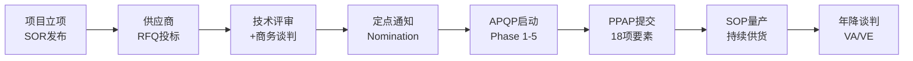
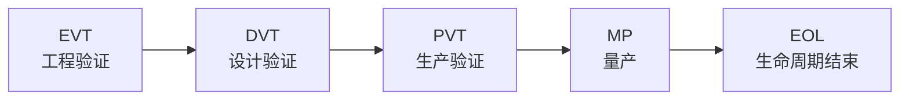

---
created: 2026-07-15
updated: 2026-07-15
tags: [Self, 供应链]
status: draft
---
> [!summary] 商采与间采流程研究 — 多行业适配分析
> - **核心**：跨汽车、消费电子、互联网、医药四大行业，系统对比直接采购（商采）与间接采购（间采）的流程、关键物料、注意事项与最佳实践。
> - **要点**：💡 核心发现
> - **要点**：一、概念定义
> - **要点**：1.1 商采（直接采购 / Direct Procurement）
> - **要点**：1.2 间采（间接采购 / Indirect Procurement）

# 商采与间采流程研究 — 多行业适配分析

> 跨汽车、消费电子、互联网、医药四大行业，系统对比直接采购（商采）与间接采购（间采）的流程、关键物料、注意事项与最佳实践。

---

## 💡 核心发现

> [!tip]- 一句话总结
> - **商采**是"质量 × 供应安全 × 成本"的三角博弈，流程重、周期长、标准化程度高
> - **间采**是"效率 × 合规 × 成本"的平衡游戏，品类杂、流程轻、管理难度在于散
> - 行业差异的本质：**法规约束力 × 产品复杂度 × 供应链深度**决定了采购模式
> - 趋势：间采正在被"商采化管理"，从"能买到就行"升级为品类战略管理

---

## 一、概念定义

### 1.1 商采（直接采购 / Direct Procurement）

| 维度 | 说明 |
|------|------|
| **定义** | 采购直接用于产品制造的原材料、零部件、半成品，最终进入成品 BOM |
| **影响** | 直接影响 **COGS（销货成本）**、产品质量、交付能力 |
| **驱动** | 生产计划 / MRP / BOM 展开 |
| **典型金额** | 占企业总支出 **60-80%** |

### 1.2 间采（间接采购 / Indirect Procurement）

| 维度 | 说明 |
|------|------|
| **定义** | 采购支持企业运营但不进入成品的物资与服务 |
| **影响** | 影响 **OPEX（运营成本）**、运营效率、员工体验 |
| **驱动** | 需求部门申请 / 预算驱动 |
| **典型金额** | 占企业总支出 **20-40%** |

### 1.3 边界划分的灰色地带

| 物料 | 归属 | 说明 |
|------|------|------|
| 生产用模具 | 商采 or 间采？ | 部分企业归商采（专用模具），部分归间采（通用工装） |
| 包装材料 | 商采 or 间采？ | 产品包装 → 商采；物流包装 → 间采 |
| 测试设备 | 商采 or 间采？ | 产线在线检测 → 商采；实验室设备 → 间采 |
| IT 系统/云服务 | 间采 | 但互联网公司的云服务可能是"商采"（直接支撑产品） |

> ⚠️ **实操建议**：边界划分无统一标准，关键是企业内部统一口径、与财务 COGS/OPEX 分类对齐。

---

## 二、通用流程对比

### 2.1 全流程对比

| 阶段 | 商采流程 | 间采流程 |
|------|----------|----------|
| **1. 需求发起** | BOM 展开 → MRP 自动生成采购计划 | 需求部门提交采购申请（PR） |
| **2. 供应商寻源** | 战略寻源：RFQ/RFP → 商务+技术+质量三方评审 | 电商目录 / 三方比价 / 框架协议 |
| **3. 供应商准入** | 现场审核 → 体系认证 → 样件开发 → PPAP 批准 | 资质审查 → 信用评估（相对简化） |
| **4. 商务谈判** | 年度/多年合同，含成本模型、年降条款、产能预留 | 框架协议 / 单次采购，注重价格和账期 |
| **5. 下单执行** | PO → JIT/JIS 交付 → VMI 看板拉动 | PO / 采购卡（P-Card）/ 电子目录直购 |
| **6. 验收** | IQC 来料检验 + SPC 过程监控 | 使用部门确认 + 发票校验 |
| **7. 供应商绩效** | QCD 月度考核 → 季度评审 → 年度大会 | 年度满意度评估（简单打分） |
| **8. 持续改进** | VA/VE 降本 → 联合改善 → 技术路线共研 | 集中度优化 → 流程自动化 |

### 2.2 关键差异矩阵

| 维度 | 商采 | 间采 |
|------|------|------|
| **供应商数量** | 少而精（战略级 < 50 家） | 多而散（可达数千家） |
| **合同周期** | 长（1-5 年，含 LTA） | 短（单次 ~ 1 年框架协议） |
| **质量要求** | 极高（IATF 16949 / IPC / GMP） | 一般（ISO 9001 或无体系要求） |
| **技术门槛** | 高（需联合开发能力） | 低至中（标准化产品/服务） |
| **数字化程度** | 高（SRM + EDI + MES 集成） | 中（e-Procurement / 电商目录） |
| **审批链** | 长（技术 + 质量 + 商务 + 财务） | 短至中（金额分级审批） |
| **降本方式** | VA/VE、年降、国产替代、集中采购 | 集中采购、品类整合、流程自动化 |
| **风险管理** | 供应链韧性、双源/多源、安全库存 | 合规风险、预算超支、 maverick spend |

---

## 三、分行业深度分析

### 3.1 🚗 汽车行业

#### 商采流程（最复杂）

| 阶段 | 关键活动 | 周期 |
|------|----------|------|
| **寻源定点** | SOR → RFQ → 技术+商务+质量三方评审 → 定点 | 3-6 个月 |
| **APQP Phase 1** | 项目计划、初始BOM、质量目标 | 1-2 个月 |
| **APQP Phase 2** | DFMEA、设计评审、样件试制 | 2-4 个月 |
| **APQP Phase 3** | PFMEA、控制计划、工艺路线、工装开发 | 3-6 个月 |
| **APQP Phase 4** | PPAP 提交（18 项要素）、试生产、过程能力 Cpk ≥ 1.67 | 2-3 个月 |
| **APQP Phase 5** | 量产爬坡、持续改进 | 持续 |
| **总周期** | 从寻源到量产 | **12-24 个月** |

**汽车商采关键物料**：

| 分类 | 物料 | 关键供应商 | 特殊要求 |
|------|------|-----------|----------|
| 动力系统 | 发动机/电机、变速箱/电控、电池包 | 博世、CATL、比亚迪弗迪 | IATF 16949、功能安全 |
| 底盘系统 | 悬架、制动、转向 | 大陆、采埃孚、博世 | NVH、耐久性测试 |
| 车身系统 | 冲压件、铝合金型材、密封件 | 海斯坦普、诺贝丽斯 | 材料认证、焊接工艺 |
| 电子电气 | 线束、连接器、ECU、芯片 | 安波福、TE、英飞凌 | AEC-Q 系列认证 |
| 内外饰 | 仪表板、座椅、保险杠 | 安道拓、延锋 | 外观件色差管控（ΔE < 1） |
| 新能源三电 | 电池、电机、电控 | CATL、汇川技术 | 功能安全 ASIL-D |

**间采品类矩阵**：

| 品类 | 典型内容 | 管理方式 |
|------|----------|----------|
| **MRO** | 备件、工具、润滑油、安全防护 | 电商平台 + 框架协议 |
| **设备工装** | 生产设备、检测仪器、模具 | 专项采购（商采化管理） |
| **物流服务** | 入厂物流、仓储、整车运输 | 3PL 招标，KPI 驱动 |
| **IT 与数字化** | ERP/MES/SRM 许可、硬件、云服务 | 企业级协议 + 年度预算 |
| **专业服务** | 咨询、认证、检测、法律 | SOW + 里程碑付款 |
| **行政后勤** | 办公用品、保洁、安保、餐饮 | 集中采购 + 目录化 |

---

### 3.2 📱 消费电子行业

#### 商采流程（NPI 驱动）

| 阶段 | 采购活动 | 关注重点 |
|------|----------|----------|
| **EVT（工程验证）** | 样品采购，小批量验证，多源比对 | 技术可行性、性能达标 |
| **DVT（设计验证）** | 锁定供应商，开模，可靠性测试 | DFM 可制造性、良率 |
| **PVT（生产验证）** | 产能爬坡、工艺固化、良率达标 | 交付稳定性、质量一致性 |
| **MP（量产）** | 批量供货、成本优化、二供导入 | 成本控制、供应安全 |

**消费电子关键物料**：

| 分类 | 物料 | 关键供应商 | 注意事项 |
|------|------|-----------|----------|
| **芯片** | SoC、基带、电源管理、存储 | 高通、联发科、三星、美光 | 提前 12 个月锁定产能（wafer lead time） |
| **显示** | OLED/LCD 面板、驱动 IC | 三星显示、京东方、维信诺 | 面板定制开发，切换成本极高 |
| **电池** | 锂聚合物电池 | ATL（新能源）、三星 SDI | 安全认证（UL/CE），供应链追溯 |
| **结构件** | 中框、后盖、卡托 | 富士康、蓝思科技 | CNC/压铸工艺，阳极氧化色差管控 |
| **光学** | 摄像头模组、镜头 | 舜宇光学、大立光 | 良率爬坡周期长，产能预留 |
| **连接器** | Type-C、FPC、BTB 连接器 | 立讯精密、安费诺 | 高频插拔寿命、信号完整性 |

**消费电子间采特点**：

| 特点 | 说明 |
|------|------|
| **云服务占比高** | AWS/GCP/阿里云是大额间采，部分公司云成本 > 间采总额 30% |
| **广告投放** | 品牌营销费用高，需 ROI 评估体系 |
| **样品/测试设备** | 实验室设备、测试治具，金额大但频次低 |

---

### 3.3 🌐 互联网行业

#### 商采特征（轻资产 + 重间采）

互联网行业商采占比极低，核心是 **间采管理**。

| 维度 | 特征 |
|------|------|
| **商采** | 几乎无传统意义的商采；硬件公司（如字节 Pico、小米）有少量硬件商采 |
| **间采主导** | 云服务、带宽/CDN、广告投放、内容采购、人力外包 |
| **决策模式** | 业务驱动（非 BOM 驱动），采购更多是"商务支持"角色 |
| **审批流** | 扁平化，金额分级（小额可自主决策） |

**互联网核心间采品类**：

| 品类 | 内容 | 年化金额量级 | 管理策略 |
|------|------|:------------:|----------|
| **云服务** | 计算/存储/网络/CDN | 亿级 | Reserved Instance + 竞价实例混用，FinOps |
| **广告投放** | SEM、信息流、品牌广告 | 十亿级 | ROI 驱动，程序化采购 |
| **内容采购** | 版权、IP、音乐、视频 | 亿级 | 独家/非独家协议，分成模式 |
| **IT 基础设施** | 服务器、交换机、IDC 托管 | 亿级 | 集中采购 + 白牌定制 |
| **人力外包** | 外包开发、客服、审核 | 十亿级 | MSP 管理 + SLA 考核 |
| **专业服务** | 法律、审计、咨询 | 千万级 | SOW + 竞标 |
| **行政后勤** | 办公租赁、物业、餐饮、差旅 | 千万-亿级 | 集采 + 目录化 |

**互联网间采独特挑战**：

| 挑战 | 说明 |
|------|------|
| **Shadow IT** | 业务部门绕过采购自行购买 SaaS，导致重复采购和安全风险 |
| **用量波动大** | 大促期间带宽/计算资源弹性需求，需按量计费+预留混合 |
| **供应商话语权强** | 头部云厂商（AWS/阿里云）议价空间有限，需以量换价 |
| **合同标准化低** | 各类 SaaS 合同条款差异大，法务审核成本高 |

---

### 3.4 💊 医药行业

#### 商采流程（合规驱动）

| 阶段 | 关键活动 | 法规约束 |
|------|----------|----------|
| **供应商审计** | GMP 审计 → 现场检查 → 资质认定 | 《药品管理法》、FDA 21 CFR |
| **物料验证** | 三批工艺验证 → 稳定性考察 → 注册关联 | 药典标准（CP/USP/EP） |
| **采购执行** | 受控发放 → 批号追溯 → 温湿度管控 | GMP 附录：物料管理 |
| **放行使用** | QA 审批 → 检验放行 → 使用记录 | 全流程可追溯 |

**医药关键物料**：

| 分类 | 物料 | 关键供应商 | 特殊要求 |
|------|------|-----------|----------|
| **原料药（API）** | 化学合成药、生物制品原液 | 药明康德、合全药业、龙沙 | DMF 文件、杂质谱研究 |
| **辅料** | 填充剂、崩解剂、润滑剂 | IFF、巴斯夫、山河药辅 | 药典标准符合性 |
| **包装材料** | 铝塑泡罩、玻璃瓶、胶塞 | 肖特、SGD Pharma | 相容性研究、迁移实验 |
| **生物制品关键** | 培养基、色谱填料、一次性耗材 | Cytiva、默克、赛多利斯 | 批间一致性、供应链追溯 |

**医药间采特点**：

| 品类 | 说明 | 管理要点 |
|------|------|----------|
| **CRO/CMO** | 临床试验外包、委托生产 | 金额极大（可达研发预算 50%+），供应商评估是核心 |
| **冷链物流** | 2-8°C、-20°C、-80°C 温控运输 | 验证报告（IQ/OQ/PQ）、温度记录仪 |
| **验证服务** | 设备验证、清洁验证、计算机化系统验证 | 供应商资质、验证文件合规性 |
| **实验室耗材** | 移液管、离心管、试剂 | 批号追溯、COA 随货 |

---

### 3.5 四行业对比全景

| 维度 | 🚗 汽车 | 📱 消费电子 | 🌐 互联网 | 💊 医药 |
|------|---------|------------|-----------|---------|
| **商采复杂度** | ⭐⭐⭐⭐⭐ | ⭐⭐⭐⭐ | ⭐ | ⭐⭐⭐⭐ |
| **间采复杂度** | ⭐⭐⭐ | ⭐⭐⭐ | ⭐⭐⭐⭐⭐ | ⭐⭐⭐ |
| **商采占比** | 70-80% | 60-75% | < 10% | 40-60% |
| **间采占比** | 20-30% | 25-40% | > 90% | 40-60% |
| **法规约束力** | 高（IATF、VDA） | 中（RoHS、REACH） | 低 | 极高（GMP、FDA） |
| **采购周期** | 12-24 个月 | 6-12 个月 | 1-4 周 | 6-18 个月 |
| **供应商关系** | 战略伙伴 | 项目合作 | 交易型 | 合规伙伴 |
| **核心挑战** | 质量 × 供应安全 | 速度 × 成本 | 效率 × 透明度 | 合规 × 可追溯 |

---

## 四、跨行业最佳实践

### 4.1 商采最佳实践

| # | 实践 | 说明 |
|---|------|------|
| 1 | **品类策略差异化** | 用 Kraljic 矩阵分类，战略/杠杆/瓶颈/常规四象限分别制定策略 |
| 2 | **供应商分级管理** | A/B/C 三级，A 级战略供应商配专属 SDE/SQE，C 级自动化管理 |
| 3 | **成本模型透明化** | 应该成本（Should Cost）模型，拆解材料+人工+制造费用+利润 |
| 4 | **双源/多源策略** | 关键品类至少 2 家供应商，单一供应商份额不超过 60% |
| 5 | **联合技术开发** | 与战略供应商共建技术路线图，提前锁定下一代技术 |
| 6 | **年度降本机制** | 年降 3-5%（汽车行业惯例），通过 VA/VE 实现价值降本 |
| 7 | **供应风险预警** | 建立供应商财务健康监控、地缘政治风险评估、产能预警系统 |

### 4.2 间采最佳实践

| # | 实践 | 说明 |
|---|------|------|
| 1 | **品类管理专业化** | 间采品类经理制度，按 IT、MRO、物流、专业服务等设品类负责人 |
| 2 | **需求聚合** | 跨 BU/跨区域集中采购，利用量价杠杆（尤其 IT、差旅） |
| 3 | **目录化采购** | 80% 常规间采接入电子目录，员工自助下单，审批自动路由 |
| 4 | **支出可视化** | Spend Analytics 平台，100% 支出可见，识别 maverick spend |
| 5 | **框架协议覆盖率** | 间采框架协议覆盖率目标 > 80%，减少零散采购 |
| 6 | **SaaS 治理** | 统一 SaaS 采购入口，定期审计 license 使用率，清理 shelfware |
| 7 | **总拥有成本（TCO）** | 不只看采购价，含维护费、培训费、切换成本、退出成本 |

### 4.3 通用数字化能力

| 能力 | 商采 | 间采 |
|------|------|------|
| **SRM（供应商关系管理）** | ✅ 必须（贯穿全生命周期） | ✅ 简化版（准入+绩效） |
| **EDI（电子数据交换）** | ✅ JIT/JIS 交付必备 | ❌ 通常不需要 |
| **e-Sourcing（电子寻源）** | ✅ RFQ/Auction | ✅ 三方比价 |
| **P2P（采购到付款）** | ✅ ERP 集成 | ✅ e-Procurement 平台 |
| **Spend Analytics** | ✅ BOM 成本分析 | ✅ 支出分类分析 |
| **合同管理（CLM）** | ✅ 多年合同管理 | ✅ 框架协议管理 |
| **供应商门户** | ✅ 图纸/规格/变更管理 | ⚬ 可选 |

---

## 五、出海场景下的特殊考量

### 5.1 商采出海适配

| 维度 | 适配要点 |
|------|----------|
| **本地化采购** | CKD 模式下，线束/铝合金/轮胎等体积大、物流成本高的物料优先本地采购 |
| **供应商准入** | 目标国供应商需重新审计（VDA 6.3 / IATF 16949），不能直接复用国内 AVL |
| **关税优化** | 散件 HS 编码归类影响税率，需提前与海关确认 |
| **绿色采购** | EU CBAM、电池法对铝材/钢材/电池碳足迹有硬性要求 |
| **多币种定价** | 原材料定价需考虑汇率波动，建议自然对冲或金融对冲 |

### 5.2 间采出海适配

| 维度 | 适配要点 |
|------|----------|
| **当地合规** | 各国劳动法、税法、环保法差异大，需本地法务支持 |
| **行政后勤** | 办公租赁/物业/餐饮/安保 100% 本地采购 |
| **IT 基础设施** | 数据本地化（GDPR），云服务选择需考虑当地合规 |
| **物流服务** | 本地 3PL 招标，建立当地配送网络 |
| **专业服务** | 当地律所/会计所/认证机构（TÜV、SGS）合作 |
| **MRO 备件** | 海外工厂 MRO 本地化率目标 > 90%，减少跨境物流 |

### 5.3 小米汽车出海采购优先级

| 优先级 | 采购事项 | 时间窗口 |
|:------:|----------|----------|
| 🔴 P0 | 电池供应商欧洲工厂协议（CATL/弗迪欧洲） | 出海前 18 个月 |
| 🔴 P0 | 底盘件/车身件本地供应商寻源与审核 | 出海前 12 个月 |
| 🟡 P1 | 芯片/传感器安全库存 + 长期协议 | 出海前 12 个月 |
| 🟡 P1 | MRO/行政物资本地供应商框架建立 | 工厂建设期 |
| 🟢 P2 | IT 系统海外部署（ERP/SRM 多语言多币种） | 工厂投产前 6 个月 |
| 🟢 P2 | 物流服务商招标（入厂 + 出厂） | 工厂投产前 3 个月 |

---

## 六、关键体系与标准速查

| 标准 | 适用行业 | 范围 |
|------|----------|------|
| **IATF 16949** | 汽车 | 汽车行业质量管理体系（供应商必备） |
| **VDA 6.3** | 汽车（德系） | 过程审核标准（大众/宝马/奔驰要求） |
| **AIAG 五大工具** | 汽车（美系） | APQP / PPAP / FMEA / SPC / MSA |
| **AEC-Q 系列** | 汽车电子 | 车规芯片可靠性认证（AEC-Q100/Q200） |
| **IPC 标准** | 消费电子 | 电子组装与焊接标准 |
| **GMP / FDA** | 医药 | 药品生产质量管理规范 |
| **ISO 9001** | 通用 | 质量管理体系基础标准 |
| **RoHS / REACH** | 电子/汽车 | 欧盟有害物质限制 |
| **ISO 14001** | 通用 | 环境管理体系 |
| **CSDDD** | 出海通用 | 欧盟供应链尽职调查指令 |

---

## 七、趋势与展望

| 趋势 | 影响商采 | 影响间采 |
|------|:--------:|:--------:|
| **AI 驱动采购** | 智能寻源、预测性补货、供应商风险 AI 评估 | 自动审批路由、智能目录推荐、Chatbot 采购 |
| **ESG 嵌入采购** | 碳足迹核算成准入门槛 | 绿色办公、低碳差旅政策 |
| **近岸化/本地化** | 出海本地供应链构建 | 海外工厂行政后勤本地化 |
| **间采商采化** | — | 间采引入品类战略、供应商分级、绩效考核 |
| **采购即服务（PaaS）** | 共享采购中心、集团集采 | Coupa/SAP Ariba 等 SaaS 平台普及 |
| **供应链韧性** | 双源/多源、安全库存、战略储备 | 关键 SaaS 备份、数据本地化 |

---

## 🔗 相关文档

- [[00_Self/04_供应链/05_出海与国际贸易/02_Kraljic矩阵分析|Kraljic 矩阵分析]] — 品类分类与采购策略
- [[00_Self/04_供应链/05_出海与国际贸易/01_出海模式总览|小米汽车出海模式分析]] — CKD/DKD/SKD 模式与案例
- [[00_Self/04_供应链/05_出海与国际贸易/09_ESG与合规调研|ESG 与合规调研报告]] — 合规要求详解

---

## 📚 参考资料

- Kraljic, P. (1983). "Purchasing Must Become Supply Management". *Harvard Business Review*
- AIAG. APQP Manual (3rd Edition) / PPAP Manual (4th Edition)
- IATF 16949:2016 — 汽车行业质量管理体系标准
- Deloitte. Global Chief Procurement Officer Survey 2025
- The Hackett Group. Procurement Key Issues 2025
- Gartner. Procurement & Sourcing Predictions 2025-2026
- McKinsey. "The New Procurement: How Leading Companies Use AI"
- [盖世汽车 — 供应链专题](https://www.gasgoo.com)
