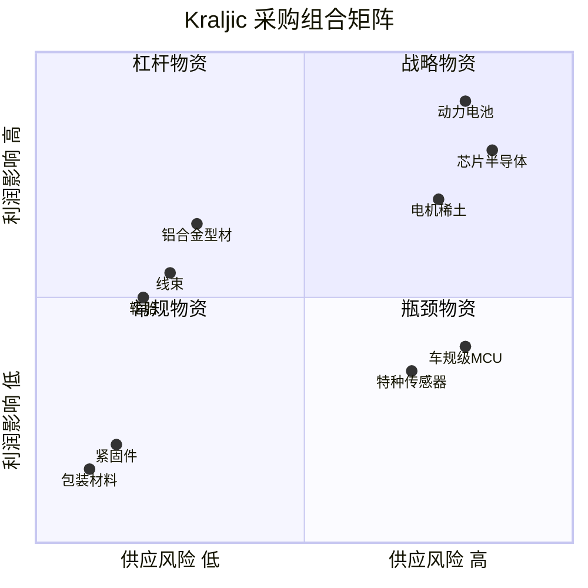
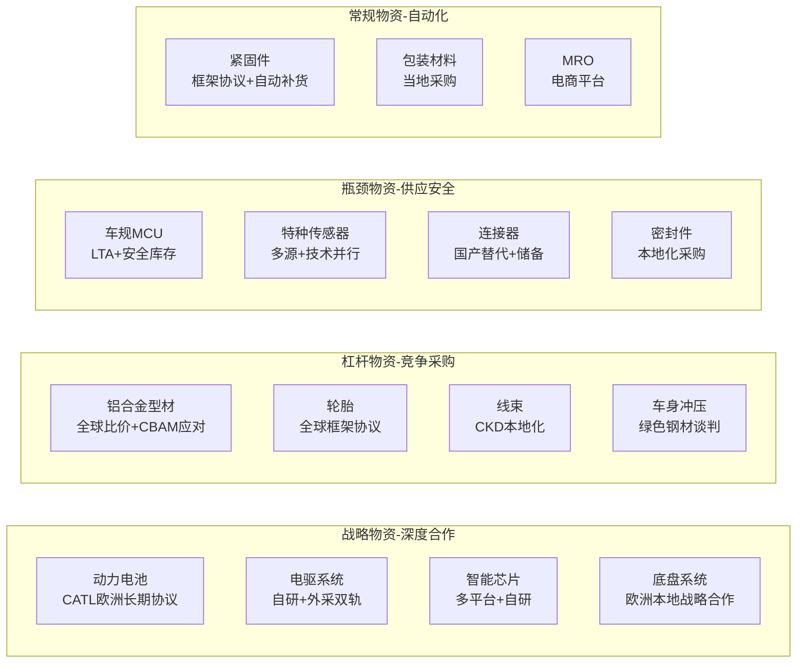

---
created: 2026-07-15
updated: 2026-07-15
tags: [Self, 供应链, 合规]
status: draft
---
> [!summary] 小米汽车出海 — Kraljic 矩阵分析
> - **核心**：基于 Kraljic 采购组合矩阵，对小米汽车出海供应链进行品类分类与采购策略分析。
> - **要点**：术语速查
> - **要点**：一、Kraljic 矩阵框架
> - **要点**：矩阵定义
> - **要点**：二、小米汽车供应链 Kraljic 分类

# 小米汽车出海 — Kraljic 矩阵分析

> 基于 Kraljic 采购组合矩阵，对小米汽车出海供应链进行品类分类与采购策略分析。

---

## 术语速查

| 缩写 | 英文全称 | 中文 | 含义 |
|------|---------|------|------|
| **CBU** | Completely Built Up | 整车出口/进口 | 整车组装好直接运输销售 |
| **CKD** | Completely Knocked Down | 全散件出口 | 完全拆散为零件级，运到当地工厂组装 |
| **DKD** | Done Knocked Down | 半成品出口 | 大总成已预装，介于 SKD 和 CBU 之间 |

---

## 一、Kraljic 矩阵框架

### 矩阵定义

| 象限 | 供应风险 | 利润影响 | 采购策略 |
|------|:--------:|:--------:|----------|
| 🔴 **战略物资** | 高 | 高 | 战略合作伙伴关系，长期协议，联合开发 |
| 🟢 **杠杆物资** | 低 | 高 | 利用采购量优势，竞争性谈判，集中采购 |
| 🟡 **瓶颈物资** | 高 | 低 | 保障供应安全，开发替代方案，安全库存 |
| ⚪ **常规物资** | 低 | 低 | 简化流程，自动化采购，框架协议 |

---

## 二、小米汽车供应链 Kraljic 分类

### 2.1 🔴 战略物资（高供应风险 × 高利润影响）

> **策略：战略合作伙伴关系**

| 品类              | 供应风险来源                   | 利润影响                | 出海特殊考量                | 建议策略                    |
| --------------- | ------------------------ | ------------------- | --------------------- | ----------------------- |
| **动力电池**        | CATL/比亚迪双寡头，锂/钴/镍资源集中    | 占BOM 30-40%，决定续航和安全 | 欧盟电池法碳足迹要求，美国IRA本土化要求 | 与CATL签订欧洲工厂长期协议，同步开发二供  |
| **电驱系统（电机+电控）** | 稀土永磁材料受地缘政治影响，SiC芯片紧缺    | 核心性能件，影响动力和能效       | 稀土供应链集中在中国，出海需多元化     | 自研+外采双轨，布局无稀土电机技术       |
| **智能驾驶芯片**      | 英伟达/高通/Mobileye寡头，算力军备竞赛 | 决定智能化竞争力            | 美国出口管制风险              | 多平台策略（英伟达+地平线），自研芯片长期布局 |
| **底盘系统**        | 博世/大陆/采埃孚Tier1主导         | 影响驾驶品质和安全           | 海外本地化供应能力             | 欧洲底盘件本地采购，建立战略合作关系      |

**出海战略行动**：
- 🔑 在欧洲建立电池供应链联盟（CATL欧洲工厂 + 本地回收企业）
- 🔑 电驱系统二供开发（除自研外，与日本/欧洲电机企业合作）
- 🔑 智能驾驶平台双源供应，降低单一供应商依赖

### 2.2 🟢 杠杆物资（低供应风险 × 高利润影响）

> **策略：利用采购量优势**

| 品类 | 供应风险来源 | 利润影响 | 出海特殊考量 | 建议策略 |
|------|------------|----------|-------------|----------|
| **铝合金型材/铸件** | 供应商多，市场竞争充分 | 车身轻量化核心材料，用量大 | 欧洲铝价差异，CBAM对铝制品影响 | 集中采购+全球比价，CKD模式下当地采购 |
| **轮胎** | 米其林/普利司通/国产替代丰富 | 直接影响续航和NVH | 各国认证标准差异 | 全球框架协议，当地品牌快速认证 |
| **线束** | 供应商分散，安波福/矢崎/国产替代 | 用量大，影响装配效率 | CKD模式下的物流成本 | 当地建线束厂或找本地供应商 |
| **车身冲压件** | 钢材价格波动，供应商众多 | 占车身成本较大比例 | 钢材CBAM碳关税影响 | 本地化采购，绿色钢材溢价谈判 |
| **座椅系统** | 安道拓/李尔/国产替代 | 占内饰成本主要部分 | 用户体验关键件 | 核心件自控+本地化组装 |

**出海战略行动**：
- 💰 建立全球采购中心，统一谈判杠杆
- 💰 铝合金/钢材等大宗商品套期保值
- 💰 CKD模式下优先选择当地供应商，降低物流成本

### 2.3 🟡 瓶颈物资（高供应风险 × 低利润影响）

> **策略：保障供应安全**

| 品类 | 供应风险来源 | 利润影响 | 出海特殊考量 | 建议策略 |
|------|------------|----------|-------------|----------|
| **车规级MCU** | 瑞萨/恩智浦/英飞凌寡头，产能周期长 | 单价低但缺一不可 | 汽车芯片缺货周期性风险 | 安全库存+长期协议+国产替代验证 |
| **特种传感器（激光雷达/毫米波）** | 技术壁垒高，供应商有限 | 单价不高但功能关键 | 欧洲对传感器精度要求高 | 多源供应+技术路线并行 |
| **连接器/继电器** | TE/安费诺主导高端市场 | 单价低，但数量大 | 车规认证周期长 | 国产替代（瑞可达等）+安全库存 |
| **密封件/橡胶件** | NOK/Freudenberg主导 | 单价低但影响防水防尘 | 各国材料标准差异 | 本地化采购，建立备选供应商 |
| **车规级被动元件** | 村田/三星电机/TDK | 单价极低但用量巨大 | 日本产能集中 | 多源采购+战略储备 |

**出海战略行动**：
- 🛡️ 建立瓶颈物资安全库存机制（3-6个月用量）
- 🛡️ 加速国产替代验证，降低进口依赖
- 🛡️ 与芯片原厂签订长期供应协议（LTA）

### 2.4 ⚪ 常规物资（低供应风险 × 低利润影响）

> **策略：简化流程，自动化采购**

| 品类 | 供应风险来源 | 利润影响 | 出海特殊考量 | 建议策略 |
|------|------------|----------|-------------|----------|
| **标准紧固件** | 供应商极多，标准化程度高 | 单价极低 | 当地采购更经济 | 框架协议+自动补货 |
| **包装材料** | 纸箱/泡沫/缠绕膜等 | 成本占比低 | CKD散件包装方案特殊 | 当地采购，减少跨境物流 |
| **MRO（维修运营物资）** | 工业品超市/电商 | 非生产性支出 | 海外工厂运维需求 | 电商平台+框架协议 |
| **办公用品/行政物资** | 标准化商品 | 极低 | 各国本地化 | 当地采购 |
| **基础化工品（清洗剂/脱模剂）** | 供应商多 | 低 | 环保法规差异 | 绿色替代+本地采购 |

**出海战略行动**：
- ⚙️ 全球ERP系统统一，采购流程自动化
- ⚙️ 常规物资100%框架协议覆盖
- ⚙️ 海外工厂常规物资本地化率目标 > 90%

---

## 三、出海模式下的 Kraljic 动态调整

### 3.1 CBU → CKD → DKD 模式演变对品类分类的影响

| 品类 | CBU（整车出口） | CKD（散件组装） | DKD（深度本地化） |
|------|----------------|----------------|------------------|
| **动力电池** | 🔴 战略 | 🔴 战略 | 🔴 战略（但本地化后风险降低） |
| **铝合金/钢材** | 🟢 杠杆 | 🟢 → ⚪（当地采购后变常规） | ⚪ 常规 |
| **线束** | 🟢 杠杆 | 🟡 瓶颈（需当地建线） | 🟢 杠杆 |
| **标准紧固件** | ⚪ 常规 | ⚪ 常规 | ⚪ 常规 |
| **芯片** | 🟡 瓶颈 | 🟡 瓶颈 | 🟡 瓶颈 |

**核心洞察**：随着本地化程度加深，部分物资从"瓶颈"降为"常规"，但战略物资的地位不变。

### 3.2 各目标市场的品类策略差异

| 市场 | 战略物资重点 | 杠杆物资重点 | 瓶颈物资重点 |
|------|-------------|-------------|-------------|
| **欧洲** | 电池本地化、碳足迹合规 | 铝材/钢材CBAM应对 | 车规芯片安全库存 |
| **东南亚** | 电池供应链（印尼镍矿） | 轮胎/线束本地化 | 传感器/连接器进口 |
| **美国** | 电池本土化（IRA要求） | 车身件本地采购 | FEOC合规审查 |

---

## 四、采购策略全景图

---

## 五、风险预警与应对

### 5.1 供应风险热力图

| 风险因素 | 影响品类 | 风险等级 | 应对措施 |
|----------|----------|:--------:|----------|
| **地缘政治（稀土/芯片）** | 电机、芯片 | 🔴 高 | 多源供应+国产替代+战略储备 |
| **CBAM碳关税** | 铝材、钢材、电池 | 🔴 高 | 碳数据采集+绿色供应链 |
| **欧盟电池法** | 动力电池 | 🔴 高 | 碳足迹核算+电池护照 |
| **锂/钴/镍价格波动** | 电池 | 🟡 中 | 长期协议+期货对冲 |
| **芯片产能周期** | MCU/SoC | 🟡 中 | LTA+安全库存+多源 |
| **物流中断（红海/巴拿马）** | CBU整车出口 | 🟡 中 | CKD本地化+多路线 |
| **汇率波动** | 全品类 | 🟡 中 | 自然对冲+金融工具 |

### 5.2 供应商集中度风险

| 品类 | CR3（前3供应商份额） | 风险 | 目标 |
|------|:-------------------:|:----:|------|
| 动力电池 | > 80% | 🔴 | 2027年前CR3 < 70% |
| 智能驾驶芯片 | > 90% | 🔴 | 三平台策略 |
| 车规MCU | > 75% | 🟡 | 国产替代导入 |
| 铝合金型材 | < 40% | 🟢 | 维持多元化 |
| 轮胎 | < 50% | 🟢 | 维持多元化 |

---

## 六、与EP系统的关联

| Kraljic策略 | 对EP系统的需求 |
|-------------|----------------|
| **战略物资管理** | 供应商战略合作模块、联合开发进度跟踪、长期协议管理 |
| **杠杆采购** | 全球比价引擎、集中采购审批流、框架协议管理 |
| **瓶颈物资保障** | 安全库存预警、供应风险监控、替代供应商评估 |
| **常规物资自动化** | 自动补货、电子目录采购、审批流程简化 |
| **碳数据管理** | 供应商碳排放数据采集、CBAM申报数据生成 |
| **全球采购协同** | 多币种、多语言、多法域的统一采购平台 |

---

## 七、参考资料

- Kraljic, P. (1983). "Purchasing Must Become Supply Management". Harvard Business Review.
- [McKinsey - Automotive Supply Chain Resilience](https://www.mckinsey.com/industries/automotive-and-assembly)
- [罗兰贝格 - 中国车企出海供应链白皮书](https://www.rolandberger.com)
- [[电池联盟与供应商联盟分析]]
- [[小米汽车出海模式分析]]
- [[ESG与合规调研]]
- [[Self/04_供应链/01_方法论与框架/13_商采与间采流程|商采与间采流程研究]]
- [[Self/04_供应链/04_行业与商业/大宗原材料价格波动与汽车行业]] — 大宗原材料价格传导机制与采购谈判策略
