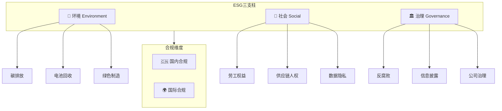
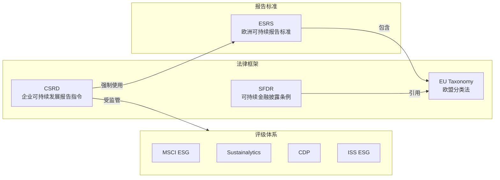

---
created: 2026-07-15
updated: 2026-07-15
tags: [Self, 供应链, 合规]
status: draft
---
> [!summary] 小米汽车出海 — ESG 与合规调研报告
> - **核心**：分国内和国外两个维度，覆盖环境（E）、社会（S）、治理（G）三大领域及关键合规要求。
> - **要点**：一、调研框架
> - **要点**：二、国内 ESG 与合规要求
> - **要点**：2.1 环境（E）— 国内
> - **要点**：2.2 社会（S）— 国内

# 小米汽车出海 — ESG 与合规调研报告

> 分国内和国外两个维度，覆盖环境（E）、社会（S）、治理（G）三大领域及关键合规要求。

---

## 一、调研框架

---

## 二、国内 ESG 与合规要求

### 2.1 环境（E）— 国内

| 法规/政策 | 核心要求 | 对车企影响 | 生效时间 |
|-----------|----------|------------|----------|
| **双碳目标** | 2030碳达峰 / 2060碳中和 | 全生命周期碳足迹管理 | 持续推进 |
| **《企业环境信息依法披露管理办法》** | 重点排放企业强制披露环境信息 | 年度环境报告 | 2022年起 |
| **工信部碳足迹核算标准** | 新能源汽车碳足迹核算方法 | 产品碳标签、供应链碳追溯 | 2024-2025逐步推进 |
| **《汽车产品生产者责任延伸行动计划》** | 推动回收利用和绿色制造 | 电池回收、材料循环利用 | 2023年起 |
| **新能源汽车动力蓄电池回收利用管理暂行办法** | 建立回收体系，梯次利用 | 电池溯源管理平台接入 | 2018年起 |

**关键差距**：
- ❌ 缺乏统一的全生命周期碳排放数据体系
- ❌ 上游原材料碳足迹追溯能力不足
- ⚠️ 电池回收体系仍在建设中

### 2.2 社会（S）— 国内

| 法规/政策 | 核心要求 | 对车企影响 |
|-----------|----------|------------|
| **《劳动法》《劳动合同法》** | 劳工权益保护 | 供应商劳工合规审查 |
| **《个人信息保护法》** | 个人信息处理规范 | 车辆数据采集、座舱数据管理 |
| **《数据安全法》** | 数据分级分类管理 | 数据出境安全评估 |
| **《汽车数据安全管理若干规定（试行）》** | 地理信息、人脸数据、座舱数据特殊管理 | 车内摄像头/传感器数据合规 |
| **《网络安全法》** | 网络安全等级保护 | 车联网安全合规 |

**关键风险点**：
- 🔴 **数据出境**：车辆运行数据、用户行为数据跨境传输需通过安全评估
- 🔴 **地理信息**：高精地图数据涉及国家安全，限制严格
- ⚠️ **座舱数据**：车内摄像头、麦克风数据属于敏感个人信息

### 2.3 治理（G）— 国内

| 法规/政策 | 核心要求 | 对车企影响 |
|-----------|----------|------------|
| **证监会ESG信息披露指引** | 三大交易所2024年起逐步强制ESG披露 | 上市公司ESG报告 |
| **《反不正当竞争法》** | 商业贿赂、不正当竞争 | 海外经销商合规管理 |
| **《出口管制法》** | 两用物项出口管制 | 技术出口合规 |
| **反垄断法** | 经营者集中申报 | 海外并购、合资审查 |

---

## 三、国际 ESG 与合规要求

### 3.1 环境（E）— 国际

#### 欧盟

| 法规 | 核心要求 | 生效时间 | 影响等级 |
|------|----------|----------|----------|
| **碳边境调节机制（CBAM）** | 进口产品碳排放申报，2026年起正式征收碳关税 | 2023过渡期 → 2026正式 | 🔴 高 |
| **欧盟新电池法** | 碳足迹声明、电池护照、回收材料比例、尽职调查 | 2024分阶段实施 | 🔴 高 |
| **CSRD / ESRS** | 在欧盟运营大型企业强制ESG披露 | 2024起逐步生效 | 🟡 中 |
| **Euro 7 排放标准** | 更严格的尾气排放和刹车/轮胎颗粒物限制 | 2025起 | 🟡 中 |
| **ELV指令（报废车辆）** | 车辆回收利用率要求 | 修订中 | 🟡 中 |

#### 东南亚

| 国家/地区 | 关键政策 | 说明 |
|-----------|----------|------|
| **泰国** | EV 3.0/3.5 政策 | 本地化生产要求（国产化率40%+），补贴与关税优惠挂钩 |
| **印尼** | 矿产下游化政策 | 要求在本地建电池产业链，镍矿出口限制 |
| **马来西亚** | 国家汽车政策 | 进口关税、本地组装优惠 |

#### 其他市场

| 市场 | 关键政策 |
|------|----------|
| **美国** | IRA（通胀削减法案）— 电池组件北美制造要求，FEOC排除条款 |
| **巴西** | 新能源汽车进口关税逐步恢复，鼓励本地化 |
| **中东** | 相对宽松，但沙特/UAE开始关注ESG |

### 3.2 社会（S）— 国际

| 法规/标准 | 核心要求 | 适用市场 |
|-----------|----------|----------|
| **GDPR（通用数据保护条例）** | 个人数据处理、数据跨境传输 | 欧盟 |
| **欧盟《数据法案》** | 车辆生成数据的访问权和可移植性 | 欧盟 |
| **欧盟《网络弹性法案》（CRA）** | 智能网联汽车网络安全 | 欧盟 |
| **UN R155/R156** | 车辆网络安全和软件更新管理 | 联合国法规（多国采纳） |
| **欧盟供应链尽职调查指令（CSDDD）** | 供应链人权和环境尽职调查 | 欧盟 |
| **美国UFLPA** | 禁止强迫劳动产品进口 | 美国 |
| **ILO核心劳工公约** | 结社自由、集体谈判、禁止强迫劳动 | 国际通用 |

**关键风险点**：
- 🔴 **数据跨境**：GDPR 罚款最高全球营收4%，车辆数据合规是重中之重
- 🔴 **供应链人权**：钴、锂等矿产的童工/强迫劳动风险（刚果钴矿、南美锂矿）
- 🔴 **网络安全**：智能网联汽车面临 UN R155 合规压力
- ⚠️ **CSDDD**：2027年起要求大型企业对供应链进行人权和环境尽职调查

### 3.3 治理（G）— 国际

| 法规/标准 | 核心要求 | 适用市场 |
|-----------|----------|----------|
| **ISSB/IFRS S1&S2** | 全球统一可持续披露准则 | 国际（多国采纳中） |
| **GRI标准** | 全球报告倡议组织ESG披露框架 | 国际通用 |
| **TCFD** | 气候相关财务信息披露 | 国际通用 |
| **欧盟反补贴调查** | 中国电动车补贴认定 | 欧盟 |
| **FCPA / UK Bribery Act** | 反腐败、反商业贿赂 | 美国/英国 |
| **OECD尽职调查指南** | 矿产供应链尽职调查 | 国际通用 |

---

## 四、合规风险热力图

| 风险领域 | 国内风险 | 欧盟风险 | 东南亚风险 | 美国风险 |
|----------|:--------:|:--------:|:----------:|:--------:|
| 碳排放/CBAM | 🟡 中 | 🔴 高 | 🟢 低 | 🟡 中 |
| 电池法规 | 🟡 中 | 🔴 高 | 🟡 中 | 🟡 中 |
| 数据安全/隐私 | 🔴 高 | 🔴 高 | 🟡 中 | 🟡 中 |
| 供应链人权 | 🟢 低 | 🔴 高 | 🟡 中 | 🔴 高 |
| 网络安全 | 🟡 中 | 🔴 高 | 🟡 中 | 🟡 中 |
| ESG披露 | 🟡 中 | 🔴 高 | 🟢 低 | 🟡 中 |
| 反腐败 | 🟡 中 | 🟡 中 | 🟡 中 | 🔴 高 |
| 反补贴/关税 | 🟢 低 | 🔴 高 | 🟡 中 | 🔴 高 |
| 本地化率要求 | 🟢 低 | 🟡 中 | 🔴 高 | 🔴 高 |

---

## 五、欧盟 ESG 报告标准体系详解

> 💡 小米若要在欧盟市场合规运营，必须理解并对接三大支柱标准：**CSRD/ESRS**（披露规则）、**EU Taxonomy**（分类标准）、**SFDR**（金融披露）。

### 5.1 三大标准关系图

### 5.2 CSRD / ESRS 完整解读

**CSRD（Corporate Sustainability Reporting Directive）** 于 2023 年 1 月生效，取代原 NFRD，是欧盟 ESG 披露的核心法规。

#### 分阶段实施时间表

| 阶段 | 适用财年 | 报告发布时间 | 适用对象 | 小米关联 |
|------|----------|-------------|---------|----------|
| **Phase 1** | FY 2024 | 2025 年 | 原 NFRD 适用企业（>500 员工的上市大企业） | ❌ 不直接适用 |
| **Phase 2** | FY 2025 | 2026 年 | 其他欧盟大型企业（>250 员工 / >€40M 营收 / >€20M 总资产） | ⚠️ 欧洲子公司可能触发 |
| **Phase 3** | FY 2026 | 2027 年 | 欧盟上市中小企业 | ❌ |
| **Phase 4** | FY 2028 | 2029 年 | **在欧盟有重大业务的非欧盟企业**（净营收 >€1.5 亿，且欧盟子公司/分支满足条件） | 🔴 **小米可能直接适用** |

> ⚠️ **2025 年 2 月"Omnibus 简化包"**：欧盟委员会提议提高门槛（<1,000 员工可能豁免）、减少强制数据点、推迟 Phase 3/4 时间线。最终方案待定，但**方向不变，只是节奏放缓**。

#### ESRS（European Sustainability Reporting Standards）核心架构

ESRS 由 EFRAG 制定，采用**双重重要性（Double Materiality）**原则：

| 重要性维度 | 定义 | 示例 |
|-----------|------|------|
| **影响重要性（Impact Materiality）** | 企业对环境/社会的实际或潜在影响 | 小米工厂碳排放、电池供应链童工风险 |
| **财务重要性（Financial Materiality）** | 可持续议题对企业财务状况的影响 | CBAM 碳关税增加成本、电池法罚款风险 |

**只有两个方向都被评估为"不重要"的议题才能不披露。**

#### ESRS 通用标准 + 专题标准

| 标准编号 | 名称 | 类型 | 核心披露内容 |
|---------|------|------|-------------|
| **ESRS 1** | 一般要求 | 通用 | 报告原则、重要性评估方法 |
| **ESRS 2** | 一般披露 | 通用 | 治理、战略、影响/风险/机遇管理、指标与目标 |
| **E1** | 气候变化 | 环境 | GHG 排放（Scope 1/2/3）、转型计划、能源消耗 |
| **E2** | 污染 | 环境 | 空气/水/土壤污染物、微塑料、有害物质 |
| **E3** | 水与海洋资源 | 环境 | 水资源使用、排放 |
| **E4** | 生物多样性与生态系统 | 环境 | 对生态系统影响、供应链依赖 |
| **E5** | 资源利用与循环经济 | 环境 | 资源流入/流出、废弃物、产品可回收性 |
| **S1** | 自身劳动力 | 社会 | 工作条件、健康安全、多元化 |
| **S2** | 价值链工人 | 社会 | 供应商劳工实践（全球汽车供应链关键） |
| **S3** | 受影响社区 | 社会 | 社区影响 |
| **S4** | 消费者与终端用户 | 社会 | 产品安全、数据隐私、负责任营销 |
| **G1** | 商业行为 | 治理 | 反腐败、政治参与、供应商付款实践 |

### 5.3 ESRS 专题标准 × 汽车行业映射

| ESRS 标准 | 汽车行业关键指标 | 小米汽车具体影响 | 数据难度 |
|-----------|-----------------|-----------------|---------|
| **E1 气候** | Scope 1（工厂排放） Scope 2（外购电力） **Scope 3（供应链排放，占比 >80%）** | 电池生产碳排放（高能耗） 上游矿产开采排放 物流运输排放 | 🔴 高 |
| **E2 污染** | 制造过程有害物质排放 刹车片/轮胎微塑料 电池电解液泄漏风险 | 涂装车间 VOC 排放 电池生产废液处理 | 🟡 中 |
| **E5 循环经济** | 车辆可回收率（>95%） 再生材料使用比例 电池梯次利用 | 电池回收体系建设 再生铝/钢使用比例 | 🟡 中 |
| **S1 自身劳动力** | 工伤率、员工流失率 多元化指标（性别、国籍） 培训时数 | 工厂员工管理 研发团队多元化 | 🟢 低 |
| **S2 价值链工人** | 供应商劳工审计覆盖率 冲突矿产（钴、锂、锡） 强迫劳动风险 | 刚果钴矿童工风险 南美锂矿社区影响 中国供应商劳工条件 | 🔴 高 |
| **S4 消费者** | 产品安全召回率 数据隐私事件 自动驾驶安全 | 车辆网络安全 座舱数据合规 OTA 更新安全 | 🟡 中 |
| **G1 商业行为** | 反腐败培训覆盖率 供应商付款周期 举报机制 | 海外经销商合规 政府采购合规 | 🟢 低 |

### 5.4 EU Taxonomy（欧盟分类法）

EU Taxonomy 定义了**六大环境目标**下的"可持续经济活动"，决定哪些业务收入可被标记为"绿色"：

| 环境目标 | 汽车行业相关活动 | 技术筛选标准 |
|---------|-----------------|-------------|
| 1. 气候变化减缓 | 零排放车辆制造 充电基础设施 | 纯电/氢燃料车辆符合 需满足生命周期排放阈值 |
| 2. 气候变化适应 | 工厂气候韧性改造 | 气候风险评估 + 适应措施 |
| 3. 水与海洋资源保护 | 废水处理、节水改造 | 排放达标 + 水回用率 |
| 4. 循环经济 | 车辆拆解回收 再生材料使用 | 可回收率 >95% 再生材料比例 |
| 5. 污染防治 | 有害物质替代 | REACH 合规 + 替代方案 |
| 6. 生物多样性 | 供应链生态影响管理 | 生物多样性影响评估 |

> 🔴 **对小米的意义**：如果小米汽车在欧盟融资（绿色债券、可持续贷款），EU Taxonomy 合规性直接影响融资成本和投资者吸引力。

### 5.5 SFDR（可持续金融披露条例）

SFDR 主要约束金融机构，但**间接影响小米**（通过投资者要求和供应链传导）：

| SFDR 条款 | 要求 | 对小米的影响 |
|-----------|------|-------------|
| **Article 6** | 基本 ESG 风险披露 | 所有被投资企业需提供基础 ESG 数据 |
| **Article 8** | "促进环境/社会特征"的金融产品 | 投资者要求小米提供 ESG 指标数据 |
| **Article 9** | "可持续投资目标"的金融产品 | 对小米 ESG 表现有更高要求 |

> 💡 实际影响：持有小米股票的欧洲基金（如 Article 8/9 基金）会要求小米定期提供 ESG 数据，否则可能被排除出投资组合。

---

## 六、头部企业 ESG 报告深度解读

> 📋 以下为 12 家成熟企业的 ESG 报告深度解读，每份为独立子文件，含 E/S/G 三维度数据、callout 提炼和对小米的借鉴意义。

### 6.1 车企 ESG 报告

| 企业 | MSCI 评级 | 报告框架 | 核心亮点 | 深度解读 |
|------|-----------|---------|---------|---------|
| **大众集团** | AA | ESRS + GRI + TCFD | Scope 3 供应链碳管理、电池护照先行者 | [[01_ESG报告/ESG报告_大众集团]] |
| **宝马集团** | AA | ESRS + GRI + TCFD + CDP | 循环经济（再生材料 30%+）、CSDDD 先行准备 | [[01_ESG报告/ESG报告_宝马集团]] |
| **梅赛德斯-奔驰** | AA | ESRS + GRI + TCFD | Ambition 2039 碳中和、矿产供应链区块链溯源 | [[01_ESG报告/ESG报告_奔驰集团]] |
| **Stellantis** | A | ESRS + GRI + TCFD | BETTER WORLDS 循环经济工厂、再制造利润中心 | [[01_ESG报告/ESG报告_Stellantis]] |
| **特斯拉** | BBB | 自有框架 + CDP | 纯电碳减排量化方法论、电池回收闭环（⚠️ 治理拉低评级） | [[01_ESG报告/ESG报告_特斯拉]] |
| **比亚迪** | A | GRI + 港交所 | 全产业链垂直整合碳管理、BBB→A 两年跃升 | [[01_ESG报告/ESG报告_比亚迪]] |
| **蔚来** | A | GRI + 港交所 | 用户社区治理创新、BaaS 电池全生命周期管理 | [[01_ESG报告/ESG报告_蔚来]] |

### 6.2 科技/消费电子企业 ESG 报告（跨行业参考）

| 企业 | MSCI 评级 | 报告框架 | 核心亮点 | 深度解读 |
|------|-----------|---------|---------|---------|
| **苹果** | AA | GRI + CDP + TCFD | 供应链 100% RE、每产品碳足迹报告、供应商 ESG 评分卡 | [[01_ESG报告/ESG报告_苹果]] |
| **三星电子** | A | GRI + TCFD + SASB | RE100 成员、精炼厂级冲突矿产溯源 | [[01_ESG报告/ESG报告_三星]] |
| **华为** | A | GRI + 港交所 | 供应商 ESG 数据平台（AI 预警）、使能减排量化 | [[01_ESG报告/ESG报告_华为]] |
| **联想集团** | AA | GRI + TCFD + ISSB + EU Taxonomy | 中国 CSRD 对标先行者、闭环回收、供应链碳管理平台 | [[01_ESG报告/ESG报告_联想]] |

### 6.3 小米基准线

| 企业 | MSCI 评级 | 报告框架 | 核心差距 | 详情 |
|------|-----------|---------|---------|------|
| **小米集团** | BBB | GRI + 港交所 | 无碳中和目标、Scope 3 缺失、无 ESG 委员会 | [[01_ESG报告/ESG报告_小米集团]] |

### 6.4 报告框架对标分析

| 报告框架 | 使用企业占比 | 核心价值 | 小米优先级 |
|---------|------------|---------|-----------|
| **GRI Standards** | 95%+ | 全球最通用，利益相关方认可度最高 | 🔴 必须 |
| **ESRS** | 欧盟企业 100% | 欧盟合规要求，双重重要性 | 🔴 必须（出海欧盟） |
| **TCFD** | 85%+ | 气候风险财务披露，投资者关注 | 🔴 必须 |
| **CDP** | 75%+ | 碳排放数据平台，机构投资者追踪 | 🟡 强烈推荐 |
| **ISSB (IFRS S1/S2)** | 快速增长中 | 全球统一标准，与 ESRS 互操作 | 🟡 推荐 |
| **EU Taxonomy** | 欧盟企业必选 | 绿色收入标签，影响融资成本 | 🟡 推荐 |
| **港交所 ESG 指引** | 港股企业 100% | 小米现有合规基础 | ✅ 已覆盖 |

### 6.5 横向对比分析

> 🔬 完整的 E/S/G 三维度跨企业对比、差异提炼和行动建议：

**→ [[01_ESG报告/01_ESG报告横向对比分析]]**

---

## 七、对标：头部车企 ESG 实践

| 车企 | ESG评级 | 关键实践 | 小米可借鉴 |
|------|---------|----------|------------|
| **比亚迪** | MSCI A | 全产业链碳管理、电池回收体系 | 垂直整合的碳数据管理 |
| **蔚来** | MSCI A | 用户社区治理、换电模式减碳 | 用户运营+ESG结合 |
| **吉利** | MSCI BBB | 沃尔沃ESG体系导入 | 并购带来的ESG能力提升 |
| **特斯拉** | MSCI BBB | 影响力报告、供应链审计 | 透明度和数据驱动 |
| **大众** | MSCI AA | 全价值链脱碳路线图 | 系统化的碳管理 |

---

## 八、小米汽车出海合规建议

### 8.1 优先级排序

| 优先级 | 合规事项 | 时间窗口 | 建议动作 |
|--------|----------|----------|----------|
| 🔴 P0 | 欧盟电池法合规 | 2024-2025 | 建立碳足迹核算能力，接入电池护照 |
| 🔴 P0 | 数据出境合规 | 立即 | 完成数据出境安全评估，建立数据本地化方案 |
| 🔴 P0 | UN R155/R156 网络安全 | 2025起 | 建立车辆网络安全管理体系 |
| 🟡 P1 | CBAM 碳关税应对 | 2026前 | 供应链碳数据采集，碳排放核算 |
| 🟡 P1 | CSDDD 供应链尽职调查 | 2027前 | 建立供应商ESG评估体系 |
| 🟡 P1 | ESG报告体系 | 2025-2026 | 对标ISSB/GRI，发布首份ESG报告 |
| 🟢 P2 | 各市场本地化合规 | 持续 | 建立各目标市场合规清单 |

### 8.2 组织建议

| 能力建设 | 说明 |
|----------|------|
| **ESG委员会** | 董事会层面设立ESG委员会，统筹ESG战略 |
| **合规团队** | 在欧洲设立本地合规团队，覆盖GDPR/电池法/CSDDD |
| **碳管理体系** | 建立全生命周期碳足迹核算系统（LCA） |
| **供应链ESG平台** | 建设供应商ESG数据采集和评估平台 |
| **数据本地化** | 欧洲数据中心部署，满足GDPR和数据主权要求 |

---

## 九、与EP系统的关联

| 合规要求 | 对EP系统的需求 |
|----------|----------------|
| **碳足迹核算** | 供应商碳排放数据采集模块、碳足迹计算引擎 |
| **电池护照** | 电池材料溯源、碳足迹声明自动生成 |
| **供应商ESG评估** | 供应商ESG问卷、评分、风险预警 |
| **供应链尽职调查** | 矿产来源追溯、冲突矿产筛查 |
| **数据合规** | 数据分级分类、跨境传输审批流程 |
| **ESG报告** | ESG数据自动采集、报告生成 |

---

## 十、参考资料

- [欧盟委员会 CBAM](https://taxation-customs.ec.europa.eu/carbon-border-adjustment-mechanism_en)
- [欧盟新电池法](https://environment.ec.europa.eu/topics/waste-and-recycling/batteries-and-accumulators_en)
- [CSRD 指令](https://finance.ec.europa.eu/capital-markets-union-and-financial-markets/company-reporting-and-auditing/company-reporting/corporate-sustainability-reporting_en)
- [ESRS 标准全文（EFRAG）](https://www.efrag.org/Activities/199383810498/European-Sustainability-Reporting-Standards)
- [EU Taxonomy 分类法](https://finance.ec.europa.eu/sustainable-finance/tools-and-standards/eu-taxonomy-sustainable-activities_en)
- [SFDR 可持续金融披露条例](https://finance.ec.europa.eu/sustainable-finance/disclosures/sustainable-finance-disclosure-regulation_en)
- [ISSB 准则](https://www.ifrs.org/groups/international-sustainability-standards-board/)
- [GRI 标准](https://www.globalreporting.org/standards/)
- [UN R155 网络安全](https://unece.org/transport/documents/2021/03/standards/un-regulation-no-155-cyber-security-and-cyber)
- [CSDDD 供应链尽职调查指令](https://commission.europa.eu/business-economy-euro/doing-business-eu/corporate-sustainability-due-diligence_en)

#### 头部企业 ESG 报告（深度解读子文件）

- [[01_ESG报告/01_ESG报告横向对比分析]] — 12 家企业 E/S/G 三维度横向对比
- [[01_ESG报告/ESG报告_大众集团]] — 欧盟合规标杆，Scope 3 碳管理
- [[01_ESG报告/ESG报告_宝马集团]] — 循环经济最佳实践
- [[01_ESG报告/ESG报告_比亚迪]] — 中国车企 ESG 标杆（⭐ 最相似对标）
- [[01_ESG报告/ESG报告_苹果]] — 供应链碳管理跨行业参考
- [[01_ESG报告/ESG报告_联想]] — 中国企业 CSRD 对标先行者（⭐ 最佳蓝本）
- [[01_ESG报告/ESG报告_小米集团]] — 小米 ESG 基准线与差距分析

- [[小米汽车出海模式分析]]
- [[06_项目与汇报/03_蔚来与小米汽车供应链韧性对比研究|蔚来与小米汽车供应链韧性对比研究]]
- [[Self/04_供应链/01_方法论与框架/13_商采与间采流程|商采与间采流程研究]]

---

## 十一、深度落地方案

> 💡 本报告为 ESG 与合规全景调研，以下为各专题的深度落地方案：

| 专题              | 方案笔记                              | 说明                                                         |
| --------------- | --------------------------------- | ---------------------------------------------------------- |
| 🔋 碳足迹追踪 & 电池护照 | [[碳足迹追踪与电池护照方案]]                  | EU 电池法 (2023/1542) 完整落地方案：LCA 方法论、电池护照数据模型、系统建设、行业对标、实施路线图 |
| 🎮 交互式 Demo     | [电池护照 Demo](assets/电池护照demo.html) | 模拟电池护照界面：碳足迹仪表盘、材料溯源地图、健康状态监测、QR 验证                        |
