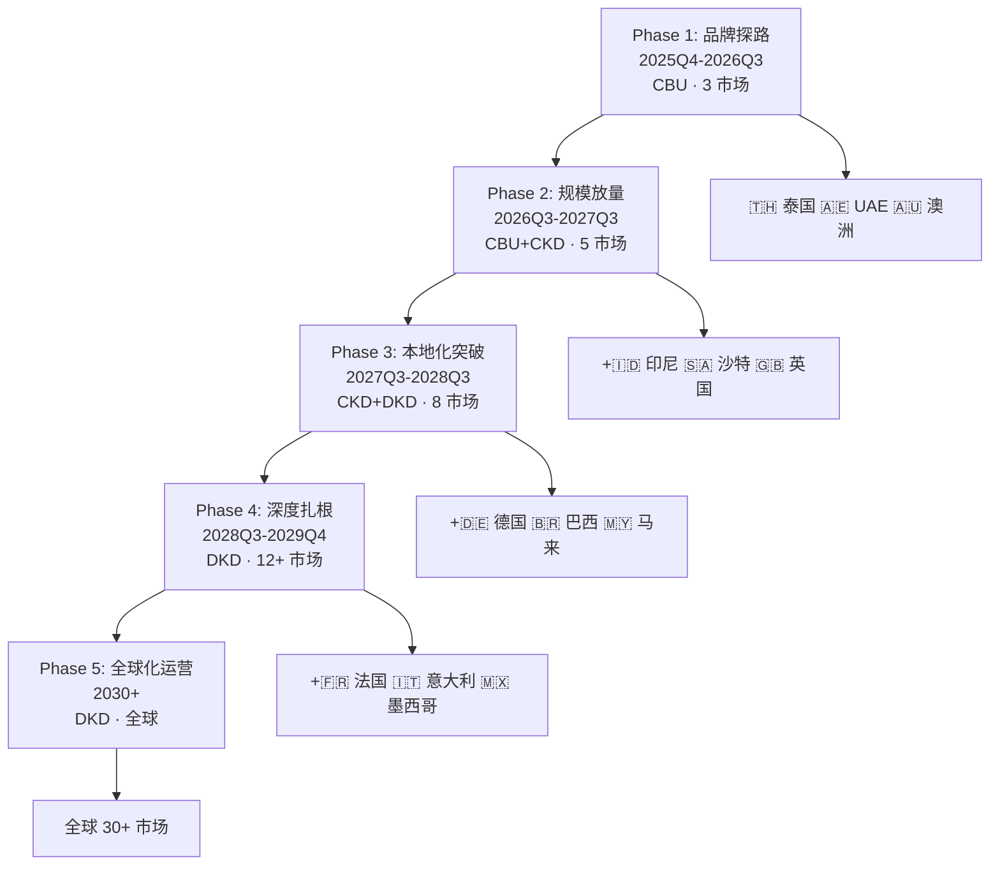
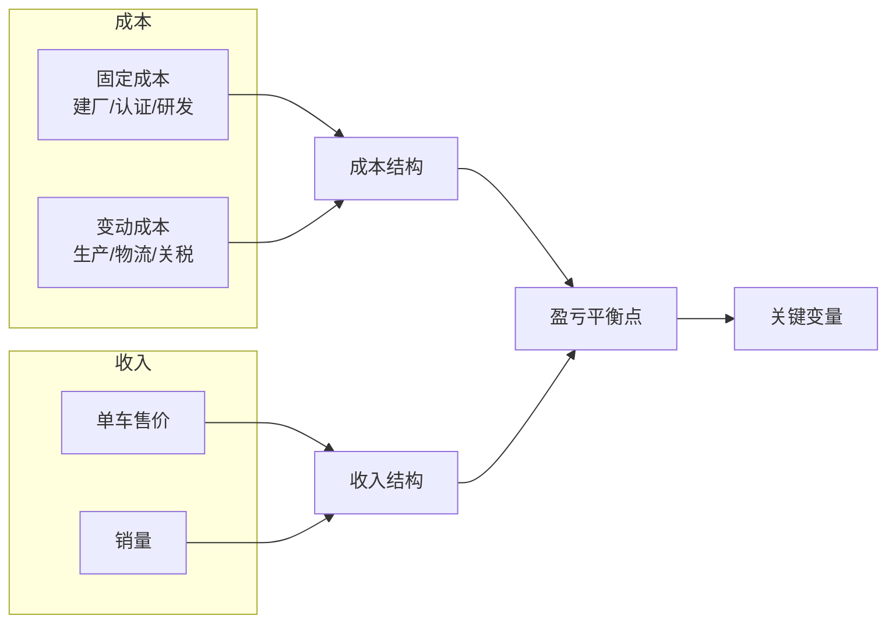

---
created: 2026-07-15
updated: 2026-07-15
tags: [Self, 供应链, 合规]
status: draft
---
> [!summary] 小米汽车出海模式分析
> - **核心**：基于 DKD/CKD/SKD 三种组装模式，深度对标 BYD、上汽/MG、Stellantis+零跑、小鹏等案例，分析中国汽车出海模式、挑战与小米出海路径建议。
> - **要点**：术语速查
> - **要点**：一、四种组装模式对比
> - **要点**：二、行业案例深度调研
> - **要点**：2.1 麦格纳（Magna）— 代工制造模式

# 小米汽车出海模式分析

> 基于 DKD/CKD/SKD 三种组装模式，深度对标 BYD、上汽/MG、Stellantis+零跑、小鹏等案例，分析中国汽车出海模式、挑战与小米出海路径建议。

---

## 术语速查

| 缩写 | 英文全称 | 中文 | 含义 |
|------|---------|------|------|
| **CBU** | Completely Built Up | 整车出口/进口 | 整车组装好直接运输销售 |
| **CKD** | Completely Knocked Down | 全散件出口 | 完全拆散为零件级，运到当地工厂组装 |
| **SKD** | Semi Knocked Down | 半散件出口 | 部分总成已预装，到当地做简单拼装 |
| **DKD** | Done Knocked Down | 半成品出口 | 大总成已预装，介于 SKD 和 CBU 之间 |

---

## 一、四种组装模式对比

| 维度 | CBU (Completely Built Up) | CKD (Completely Knocked Down) | DKD (Done Knocked Down) | SKD (Semi Knocked Down) |
|------|------|------|------|------|
| **拆散程度** | 不拆，整车运输 | 完全拆散，零件级 | 半散件，大总成已预装 | 半成品，关键总成已装配 |
| **本地工作量** | 无（仅 PDI 检测） | 焊接+涂装+总装全部工序 | 仅总装+调试 | 简单组装+调试 |
| **技术门槛** | 最低 | 高，需建完整产线 | 较低，组装能力即可 | 最低 |
| **投资规模** | 最小（无工厂） | 大 | 中 | 小 |
| **关税** | 整车关税（通常最高） | 散件税率通常低于整车 | 介于整车和CKD之间 | 关税优惠适中 |
| **本地化程度** | 无 | 深 | 中 | 浅 |
| **适用阶段** | 初期试水/品牌探路 | 中长期深度本地化 | 中期布局 | 初期试水 |

**简单理解**（从粗到细）：
- **CBU** = 整车直接运（不拆）
- **SKD** = 拆到总成级（座椅、仪表板已装好）
- **DKD** = 介于两者之间（模块级拆散）
- **CKD** = 拆到螺丝钉（所有零件散装发运）

---

## 二、行业案例深度调研

### 2.1 麦格纳（Magna）— 代工制造模式

麦格纳的核心是 **"制造即服务"**，旗下 Magna Steyr（奥地利格拉茨工厂）是全球最大汽车代工商。

| 案例 | 模式 | 说明 |
|------|------|------|
| 奔驰G级 | 整车代工 | 1979年至今，全生命周期在格拉茨生产 |
| 宝马Z4 / 丰田Supra | 共线代工 | 同一平台两品牌共线生产 |
| 捷豹I-Pace | 整车代工 | 纯电车型，全流程代工 |
| 中国车企合作 | CKD/DKD探索 | 帮助中国车企在欧洲落地组装，规避反补贴关税 |

**对小米的价值**：如果出海欧洲，Magna 是潜在的 CKD/DKD 落地方案合作伙伴，可借助其成熟的制造能力和欧洲工厂网络。

---

### 2.2 比亚迪（BYD）— 全产业链出海标杆

#### 核心数据

| 指标 | 2023 | 2024 | 趋势 |
|------|------|------|------|
| 海外销量 | 242,766 辆 | 417,204 辆 | +72% YoY |
| 总 NEV 销量 | 3,024,417 辆 | 4,272,145 辆 | +41% YoY |
| 海外占比 | ~8% | ~9.8% | 稳步提升 |
| 覆盖国家 | 70+ | 90+ | 快速扩张 |

> 2025 年 4 月，BYD 在欧洲 EV 月销量超越 Tesla，标志性里程碑。

#### 区域出海模式

| 区域 | 出口模式 | 在售车型 | 关键动作 |
|------|---------|---------|---------|
| **欧洲** | CBU → CKD（匈牙利/土耳其在建） | Atto 3、Seal、Dolphin、Seal U | EU 加征 17.4% 反补贴税（中国车企最低）；2025.8 泰国工厂向欧洲出口 Dolphin |
| **东南亚** | 泰国本地生产（2024.7 投产） | Atto 3、Dolphin、Seal、M6 | 泰国 Rayong 工厂 15 万辆/年，至 2026.7 累计交付 13 万+ |
| **印尼** | 工厂在建 | Dolphin 等 | Subang 工厂投资 $13 亿，15 万辆/年，2026 初投产 |
| **拉美** | 巴西工厂在建（原 Ford 工厂） | Dolphin、Yuan Plus、Song Plus DM-i | Camaçari 投资 $6 亿，规划 30 万辆/年；因劳工问题一度停工 |
| **中东/非洲** | CBU + 区域经销商 | Atto 3、Dolphin、Seal | UAE 与 Al-Futtaim 合作；南非建 300 公共充电桩 |
| **中亚** | 合资本地生产 | Song Plus DM-i | 乌兹别克斯坦与 UzAuto 合资，Jizzakh 工厂 2024.6 投产 |
| **澳洲** | CBU → 直接运营 | Atto 3、Dolphin、Seal、Sealion 6 | 2025.7 接管 EVDirect 直接运营 |

#### 海外工厂全景

| 工厂 | 状态 | 产能 | 投资 | 备注 |
|------|------|------|------|------|
| 🇹🇭 泰国 Rayong | ✅ 已投产（2024.7） | 15 万辆/年 | - | 首个海外全资工厂，雇佣 10,000 人 |
| 🇭🇺 匈牙利 Szeged | 🔨 在建 | 10 万辆+ | - | 首个欧洲乘用车工厂，目标 2026 投产 |
| 🇹🇷 土耳其 | 📋 规划 | 15 万辆 | $10 亿 | 2024.7 签约，利用 EU 关税同盟优势 |
| 🇮🇩 印尼 Subang | 🔨 在建 | 15 万辆 | $13 亿 | 计划 18,000 员工，2026 初投产 |
| 🇧🇷 巴西 Camaçari | ⚠️ 停工 | 30 万辆（规划） | $6 亿 | 原 Ford 工厂，因劳工问题暂停 |
| 🇺🇿 乌兹别克斯坦 Jizzakh | ✅ 已投产（2024.6） | - | - | 与 UzAuto 合资 |
| 🇵🇰 巴基斯坦 Port Qasim | 📋 规划 | - | - | 与 Mega Motors 合资，2026H1 目标 |
| 🇲🇾 马来西亚 Tanjong Malim | ⏸️ 暂停 | 5 万辆 | 13 亿令吉 | 因 80% 出口率等条件谈判暂停 |

#### BYD 出海模式特征

1. **"建厂绕关税"**：匈牙利、土耳其、泰国（向欧洲转口）三条路径同步推进
2. **渐进式路径**：CBU 出口 → CKD/SKD 组装 → 全本体化生产
3. **东南亚是战略支点**：泰国是样板工程，印尼是下一个重心
4. **高端化是利润引擎**：欧洲单车利润 €14,300 vs 中国 €1,300，溢价 92-112%
5. **分销策略**：先经销商合作快速铺开 → 市场成熟后转向直接运营

---

### 2.3 上汽集团（SAIC / MG）— 最大中国车企出海样本

#### 核心数据

| 指标 | 数据 |
|------|------|
| 2023 年出口量 | ~121 万辆（中国最大车企出口商） |
| MG 全球销量 | ~84 万辆（88% 来自海外） |
| MG 欧洲交付 | 231,818 辆（2023） |
| EU 关税 | 35.3-37.6%（中国车企最高） |

> 2024 年，欧洲每出口 10 辆中国造汽车，7 辆是 MG。

#### 区域出海模式

| 区域 | 出口模式 | 关键市场 | 说明 |
|------|---------|---------|------|
| **欧洲** | CBU 为主（上海/南京/宁德工厂） | 英国 81K、法国 33K、意大利 30K、西班牙 29K、德国 21K | MG4 EV 是主力车型；正在探索欧洲本地生产 |
| **东南亚** | 泰国本地组装（SAIC-CP 合资） | 泰国 29K | 春武里工厂 10 万辆/年，出口越南和印尼 |
| **印度** | 合资本地生产 | 49K | JSW MG Motor India（SAIC 49%、JSW 35%），Halol 工厂 |
| **澳洲** | CBU 直营 | 58K | 2013 年起工厂直营，品牌第 7 |
| **拉美** | CBU → 巴西建厂 | 墨西哥 60K | Horizonte 工厂 2026.10 投产 |
| **中东** | CBU + 区域经销商 | 多国 | 与 Abdul Latif Jameel 等合作 |
| **巴基斯坦** | CKD 组装 | - | MG JW Automobile Pakistan，2020 起 |

#### 海外工厂

| 工厂 | 合资方 | 产能 | 状态 |
|------|--------|------|------|
| 🇹🇭 春武里 SAIC-CP | CP 集团（SAIC 51%） | 10 万辆/年 | ✅ 运营中 |
| 🇮🇩 SGMW 印尼 | SGMW 联合体 | - | ✅ 运营中（2024.2 起 EV 组装） |
| 🇮🇳 MG Motor India | JSW Group（SAIC 49%） | - | ✅ 运营中 |
| 🇵🇰 MG JW Pakistan | Javed Afridi | - | ✅ CKD 运营中 |
| 🇧🇷 PACE 巴西 | - | - | 📋 2026.10 投产 |

#### EU 反补贴调查应对

| 事件 | 详情 |
|------|------|
| **关税率** | 35.3-37.6%（最高档，因"配合不足"被判定） |
| **SAIC 立场** | 公开谴责"不公平市场歧视"；拒绝提供电池化学配方（超出调查范围） |
| **应对策略** | ① 法律申诉 ② 吸收部分关税维持价格竞争力 ③ 探索欧洲本地生产（西班牙/匈牙利） ④ 从泰国/印尼转口 |
| **根本挑战** | 总关税 ~45-48%（反补贴 + 原有 10%），MG 的价格优势被严重侵蚀 |

---

### 2.4 Stellantis + 零跑汽车 — "渠道即服务"合资模式

#### 合资架构

| 要素 | 详情 |
|------|------|
| **合资公司** | Leapmotor International（荷兰阿姆斯特丹） |
| **股比** | Stellantis 51% / 零跑 49% |
| **Stellantis 入股** | €15 亿收购零跑 20% 股权（2023.10） |
| **核心逻辑** | 零跑中国自运营 + Leapmotor International 专责全球分销与生产 |
| **目标** | 2026 年进入 50+ 市场，2030 年年销 50 万辆 |

#### 产品与定价

| 车型 | 定位 | 欧洲起售价 | 生产基地 |
|------|------|-----------|---------|
| T03 | A 级微型 EV | ~€18,900 | 波兰 Tychy（已停产）→ 马来西亚 |
| C10 | 中型纯电 SUV | - | 马来西亚 Gurun（CKD） |
| B10 | 紧凑型 SUV | - | 西班牙 Zaragoza（2026 量产）+ Opel 换标 |
| B05 | 紧凑型车 | - | 西班牙 Zaragoza |

#### 全球 CKD/SKD 生产网络

| 工厂 | 车型 | 状态 | 备注 |
|------|------|------|------|
| 🇵🇱 波兰 Tychy | T03 | 2024.6 投产 → 2025.3 停产 | 因波兰支持 EU 关税，B10 转产西班牙 |
| 🇪🇸 西班牙 Zaragoza | B10 / B05 / Opel 换标 SUV | 2026 量产 | 核心欧洲生产基地 |
| 🇲🇾 马来西亚 Gurun | C10 | ✅ 已投产 | 东南亚 CKD 组装基地 |

#### 模式特征

- ✅ **渠道复用**：直接利用 Stellantis 12,000+ 全球经销商网点
- ✅ **品牌嫁接**：B10 以 Opel 品牌销售，降低消费者认知门槛
- ✅ **关税规避**：欧洲本地 CKD 组装，规避最高 35.3% 关税
- ✅ **配套整合**：CATL 与 Stellantis 在 Zaragoza 合资 €41 亿建 50 GWh LFP 电池厂
- ⚠️ **代价**：让渡控制权（51% 控股）+ 利润分成 + 技术外溢风险

#### 与 Stellantis 在中国的困境形成镜像

Stellantis 在中国合资（东风 DPCA）从 2014 年销量峰值 73.4 万辆暴跌至 2024 年仅 56,448 辆（-92%），2022 年退出广汽 Jeep 合资。**"技术流向逆转"**：曾经的"市场换技术"已变为西方 OEM 主动引进中国 EV 技术。

---

### 2.5 小鹏汽车 — CBU → CKD 升级路径

| 阶段 | 市场 | 模式 | 说明 |
|------|------|------|------|
| 2020-2022 | 挪威 | CBU整车出口 | 首批出海，直接运整车 |
| 2023-2024 | 欧洲多国 | CBU + 本地分销 | 与Stellantis合作，借助其渠道铺开 |
| 2024+ | 泰国/印尼 | CKD本地组装 | 探索东南亚本地化，享受关税优惠 |
| 2025+ | 欧洲 | CKD/DKD规划中 | 应对欧盟反补贴关税（最高38.1%） |

**关键动作**：2023年引入 Stellantis 战略投资（持股~5%），借助其全球工厂网络为 CKD/DKD 落地提供基础设施。

---

### 2.6 全球传统 OEM × 中国 EV 品牌合作全景

| 传统 OEM | 中国伙伴 | 合作形式 | 时间 | 要点 |
|---------|---------|---------|------|------|
| **Stellantis** | 零跑汽车 | 51/49 合资 + €15 亿入股 20% | 2023.10 | 全球分销 + CKD 生产 |
| **大众** | 小鹏汽车 | $7 亿入股 ~4.9% | 2023.07 | 联合开发 2 款中型 EV（中国，预计 2026） |
| **丰田** | 比亚迪 | BYD Toyota EV Technology 合资 | 2019 | 联合开发 bZ3，使用刀片电池 |
| **奥迪** | 上汽集团 | 平台合作 | 2024 | 使用上汽 EV 平台加速电动化 |
| **宝马** | 长城汽车 | Spotlight Automotive 合资 | 2019 | 中国生产 MINI EV |
| **Stellantis** | 东风汽车 | 50/50 合资 + 2026 新协议 | 1992 | 东风 EV 通过合资在法国生产 |
| **Stellantis** | CATL | 50/50 电池合资 | 2024.12 | Zaragoza €41 亿 LFP 电池厂 |
| **雷诺** | 吉利汽车 | 动力总成合资 | 2023 | 混动/燃油发动机合作 |
| **福特** | 宁德时代 | 技术授权 | 2023 | 密歇根 LFP 电池工厂 |

#### 合作模式分类

| 模式 | 代表案例 | 适用场景 |
|------|---------|---------|
| **全球分销合资** | Stellantis + 零跑 | 有产品力但缺海外渠道 |
| **技术引进** | 大众 + 小鹏、奥迪 + 上汽 | 外方 EV 转型慢，需借力 |
| **联合开发** | 丰田 + 比亚迪 | 双方各有技术优势 |
| **供应链合作** | CATL + Stellantis/Ford | 电池全球领先 |
| **品牌换标** | 零跑 → Opel | 降低消费者认知门槛 |

---

## 三、出海面临的挑战与应对方案

### 3.1 贸易壁垒与关税

| 市场 | 关税政策 | 税率 | 受影响企业 | 应对方案 |
|------|---------|------|-----------|---------|
| **欧盟** | 反补贴税（2024.10 生效，5 年期） | BYD 17.4%、吉利 19.3%、上汽 35.3-37.6%、Tesla 7.8%、其他 20.7-21.3%（均 + 原有 10%） | 所有中国 EV 出口商 | CKD 本地组装、建厂（匈牙利/土耳其/西班牙）、从第三国转口 |
| **美国** | 100% 关税（2024） | 100% | 实质封锁中国 EV 乘用车 | BYD 已主动放弃；小米短期不应考虑 |
| **加拿大** | 跟随美国 | 100% | 同上 | 同上 |
| **土耳其** | 40% 附加关税 | 40% | 中国 EV | BYD 签约建厂（利用 EU 关税同盟） |
| **巴西** | EV 关税逐步提升 | 2024 起 10% → 2026 18% → 2027 25% → 2028 35% | 中国 EV | 本地建厂（BYD、上汽均已布局） |
| **马来西亚** | 有条件准入 | 要求 80% 出口率 + 40% 本地化率 + 最低售价 | BYD | BYD 暂停，政策谈判中 |
| **印度** | 高关税 + 投资限制 | 进口关税 70-100%；外资需合资 | 所有外国车企 | 合资本地生产（MG+JSW、BYD+UzAuto） |

### 3.2 法规与合规挑战

| 领域 | 挑战 | 详情 | 应对方案 |
|------|------|------|---------|
| **EU 整车型式认证 WVTA** | 整车必须通过欧洲认证才能销售 | 流程复杂、周期长、成本高 | 提前 18-24 个月启动认证；与认证机构（TÜV、SGS）合作 |
| **EU 电池法规 (2023/1542)** | 碳足迹声明、回收含量、供应链尽职调查、电池护照（2026-2027） | 影响电池供应商和整车厂 | CATL 已在欧洲建电池护照体系；整车厂需提前建立数据采集链 |
| **网络安全 UNECE WP.29** | 车辆网络安全管理系统（CSMS）强制要求 | 2024 年起对所有新车型强制 | 建立 CSMS 体系；OTA 安全审计 |
| **数据隐私 GDPR** | 车辆采集的个人数据须合规 | 影响智能座舱、自动驾驶数据 | 欧洲数据本地化存储；匿名化处理 |
| **碳边境调节机制 CBAM** | 高碳产品进口需购买碳证书 | 2026 年全面实施 | 降低生产碳排放；使用绿电 |
| **ESG 供应链尽职调查** | CSDDD 要求企业审查供应链人权和环境风险 | 影响电池原材料（钴、锂）溯源 | 建立供应链追溯体系；使用经认证的矿源 |
| **Euro NCAP** | 安全评级影响市场认知 | 必须获得高评级才有竞争力 | 提前进行碰撞测试优化 |

### 3.3 供应链与运营挑战

| 挑战 | 详细说明 | 行业最佳实践 |
|------|---------|-------------|
| **本地化率要求** | 泰国 40%+、印尼 40%+、EU 本地化加分 | BYD 泰国雇佣 10,000 人；建立当地供应链 |
| **物流成本** | 散件包装 vs 整车运输成本差异大 | SAIC 自有安吉物流船队；BYD 签订长期航运合同 |
| **质量管控** | 远程质量标准传递，本地工人技能参差 | 培训体系 + 远程质检 + 本地质量经理 |
| **关税分类优化** | CKD 散件 HS 编码归类影响税率 | 提前与海关确认分类；模块化设计优化散件方案 |
| **售后网络** | 零配件供应、维修能力、保修体系 | 先建立核心城市售后站，逐步扩展 |
| **充电基础设施** | 各国充电标准不同（CCS2、CHAdeMO、GB/T） | 适配当地标准；与充电网络合作（BYD 南非建 300 桩） |

### 3.4 品牌与市场挑战

| 挑战 | 详细说明 | 成功案例/方案 |
|------|---------|-------------|
| **品牌认知低** | 中国车企在成熟市场知名度远低于传统 OEM | MG 借英国百年品牌历史；BYD 赞助 Euro 2024 |
| **中国品牌偏见** | "中国威胁"叙事影响消费者信心 | 本地化生产 + 本地化团队 + 本地设计中心 |
| **产品本地化** | UI/UX、导航、语音助手、驾驶习惯差异 | 本地化软件团队；接入 Google/Apple 生态 |
| **二手车残值不确定** | 新品牌二手车残值低影响租赁定价 | 提供保值回购承诺；与残值管理公司合作 |
| **竞争格局** | 各区域面临本土品牌 + 其他中国车企竞争 | 差异化定位；避免纯价格战 |
| **地缘政治风险** | 波兰因支持 EU 关税被零跑转移生产 | 多国布局分散风险；不过度依赖单一市场 |

### 3.5 金融与税务

| 挑战 | 说明 | 应对方案 |
|------|------|---------|
| **多币种管理** | 海外运营涉及多币种结算和汇率风险 | 多币种账户 + 对冲工具 |
| **转移定价** | CBU/CKD 模式下母子公司定价须合规 | 独立转让定价文档；与四大合作 |
| **资金出境** | 中国外汇管制影响海外投资节奏 | 提前规划资金路径；利用香港/新加坡中转 |
| **税务架构** | 合资公司 vs 全资子公司税务差异大 | 根据目标市场选择最优架构 |

---

## 四、小米汽车渐进式出海方案

### 4.0 设计原则

| 原则 | 说明 |
|------|------|
| **风险递进** | 先低门槛市场验证，再高门槛市场突破 |
| **投资递进** | 先轻资产 CBU，再中资产 CKD，最后重资产 DKD |
| **能力递进** | 先积累出口经验，再建组装能力，最后建全价值链 |
| **关税递进** | 先选低关税市场，再攻高关税市场 |
| **车型递进** | 先旗舰树品牌，再走量车型放规模 |

---

### 4.1 五阶段渐进路线图总览



---

### 4.2 车型 × 市场 × 模式矩阵

> 核心逻辑：不同车型因**体量、定位、关税敏感度**不同，适合不同的出海模式和节奏。

| 车型 | 定位 | 全球策略 | 出海模式演进 |
|------|------|---------|-------------|
| **SU7 Ultra** | 性能图腾 | 始终 CBU | 限量、高价、树品牌，不值得建产线 |
| **SU7 标准/Pro** | 走量主力 | CBU → CKD → DKD | 体量最大，关税优化收益最高 |
| **SU7 Max** | 旗舰走量 | CBU → CKD | 高价值，800V 平台是差异化武器 |
| **YU7（SUV，预计2026）** | 第二增长曲线 | CKD → DKD 直接启动 | SUV 天然适合海外，CKD 从第一天开始 |
| **未来车型（轿车/紧凑型）** | 2027+ | 跟随市场成熟度 | 视已有工厂能力决定 |

---

### 4.3 Phase 1: 品牌探路（2025Q4 - 2026Q3）

> **核心目标**：用最小投资验证"小米汽车"品牌在海外能否站住脚，收集一手市场数据。

#### 市场选择

| 市场 | 选择理由 | 关税 | EV 渗透率 | 小米品牌基础 |
|------|---------|------|----------|-------------|
| 🇦🇪 **UAE** | 关税仅 5%，高消费力，小米手机知名度高 | 5% GCC | ~3-5% | 强（手机/生态链） |
| 🇹🇭 **泰国** | 东南亚 EV 中心，BYD/长城已建厂验证可行性 | 0%（至2025） | 快速增长 | 中（手机） |
| 🇦🇺 **澳洲** | 关税低，FBT 减免利好，竞争相对温和 | 5% | 增长中 | 强（手机/生态链） |

#### 车型与模式

| 车型 | 市场 | 模式 | 预期销量/年 | 说明 |
|------|------|------|-----------|------|
| **SU7 Ultra** | UAE、澳洲 | **CBU** | 500-1,000 | 限量旗舰树品牌，$7-10 万定价 |
| **SU7 Max** | UAE、泰国、澳洲 | **CBU** | 3,000-5,000 | 旗舰走量，验证需求 |
| **SU7 标准版** | 泰国 | **CBU** | 2,000-3,000 | 试水价格敏感市场 |

#### 为什么这样设计？

| 决策 | 理由 |
|------|------|
| **全部 CBU** | Phase 1 投资为零（无工厂建设），仅需物流渠道+经销商+认证 |
| **先 UAE 再东南亚** | UAE 关税最低（5%），利润最高，风险最小；积累经验后再攻东南亚 |
| **SU7 Ultra 打头阵** | 用性能标杆制造话题（纽北 6:46 记录），吸引媒体关注，不追求销量 |
| **暂不进欧洲** | EU 关税 30-46%，Phase 1 品牌认知不足时进入会亏钱 |
| **暂不做 CKD** | 销量太小，CKD 建线投资回收期太长 |

#### 关键动作

| 时间 | 动作 |
|------|------|
| 2025 Q4 | UAE/澳洲经销商签约；泰国分销商签约；启动各国认证 |
| 2026 Q1 | SU7 Ultra 首发 UAE（限量发布会），澳洲上市 |
| 2026 Q2 | 泰国上市 SU7 Max/标准版；收集首批用户反馈 |
| 2026 Q3 | 评估 Phase 1 数据，确定 Phase 2 泰国 CKD 可行性 |

---

### 4.4 Phase 2: 规模放量（2026Q3 - 2027Q3）

> **核心目标**：在东南亚建立第一个 CKD 组装基地，CBU+CKD 双线并行，同时试探欧洲市场。

#### 市场扩展

| 新增市场 | 选择理由 | 关税 | 策略 |
|---------|---------|------|------|
| 🇮🇩 **印尼** | 东南亚最大市场，镍资源，政府推动 EV | 0-10% | 从泰国辐射 |
| 🇸🇦 **沙特** | Vision 2030 推动 EV，GCC 统一关税 | 5% GCC | CBU 从 UAE 辐射 |
| 🇬🇧 **英国** | 脱欧后独立关税政策，无 EU 反补贴税叠加 | 10% | CBU 试水欧洲 |

#### 车型与模式

| 车型 | 市场 | 模式 | 预期销量/年 | 说明 |
|------|------|------|-----------|------|
| **YU7 (SUV)** | 泰国 | **CKD**（新建组装线） | 10,000-15,000 | SUV 是东南亚主力品类，直接 CKD |
| **SU7 标准/Pro** | 泰国 | **CKD**（与 YU7 共线） | 5,000-8,000 | 共享泰国 CKD 产线 |
| **SU7 Max** | UAE、澳洲、沙特 | **CBU**（继续） | 5,000-8,000 | 关税低的市场继续 CBU |
| **SU7 标准/Pro** | UAE、沙特 | **CBU** | 3,000-5,000 | 中东走量 |
| **YU7** | 英国 | **CBU** | 2,000-3,000 | 探路欧洲，验证英国需求 |
| **SU7 Ultra** | 全球（已有市场） | **CBU** | 1,000-2,000 | 继续限量 |

#### 为什么泰国先做 CKD？

| 因素 | 分析 |
|------|------|
| **关税** | 泰国 EV CKD 补贴最高 15 万 THB/台，免 40% 消费税 |
| **先例** | BYD Rayong（15万/年）、长城泰国工厂已验证可行性 |
| **供应链** | 泰国是东南亚汽车供应链最成熟的国家（丰田/本田几十年培育） |
| **辐射能力** | 泰国 CKD 可辐射印尼、马来西亚、越南、菲律宾 |
| **本地化率** | 泰国要求 40%+ 本地化率，座椅/轮胎/玻璃/线束可本地采购 |
| **投资规模** | $30-50M（约 2-3 亿人民币），小米可承受 |

#### 为什么 YU7 先于 SU7 做 CKD？

| 因素 | 分析 |
|------|------|
| **SUV 天然适合** | 东南亚 SUV/皮卡占 60%+ 市场，轿车份额小 |
| **YU7 是增量** | 新车型从第一天就规划 CKD BOM，无需事后改造 |
| **SU7 需要验证** | 轿车在东南亚需求有限，先用 CBU 验证再决定是否 CKD |
| **共线设计** | YU7 和 SU7 基于同平台，CKD 产线可共用 |

#### 为什么英国先于 EU 进入？

| 因素 | 分析 |
|------|------|
| **关税差异** | 英国无 EU 反补贴税叠加，总关税仅 10%（vs EU 30-46%） |
| **品牌友好** | 英国消费者对中国品牌接受度相对较高（MG 在英国畅销） |
| **右舵市场** | 英国是右舵，可同步覆盖澳洲、新西兰、南非 |
| **跳板作用** | 英国市场成功可增强进入 EU 时的谈判筹码 |

#### 泰国 CKD 投资规划

| 项目 | 金额 | 说明 |
|------|------|------|
| 组装线建设 | $15-20M | 焊装+涂装+总装（中等自动化） |
| 工装夹具 | $8-12M | YU7+SU7 专用 |
| 厂房改造/租赁 | $5-8M | 利用现有工业区厂房 |
| 人员培训 | $2-3M | 派驻团队+本地培训 |
| 首批物料 | $5-8M | CKD 散件首批库存 |
| **合计** | **$35-50M** | 约 2.5-3.5 亿人民币 |

---

### 4.5 Phase 3: 本地化突破（2027Q3 - 2028Q3）

> **核心目标**：泰国 CKD 升级为 DKD，进入欧洲（德国），巴西建厂启动。

#### 市场扩展

| 新增市场 | 选择理由 | 关税 | 策略 |
|---------|---------|------|------|
| 🇩🇪 **德国** | 欧洲最大 EV 市场，品牌制高点 | EU 关税 | CKD（匈牙利/合作工厂） |
| 🇧🇷 **巴西** | 拉美最大市场，关税逐步提升至 35% | 10→18→25% | 建 CKD 工厂 |
| 🇲🇾 **马来西亚** | 关税低，可从泰国辐射 | 0% | CBU（泰国出口） |

#### 车型与模式

| 车型 | 市场 | 模式 | 说明 |
|------|------|------|------|
| **YU7** | 泰国 | **DKD**（升级） | 座椅/线束/玻璃/轮胎本地采购 → 本地化率 50-60% |
| **SU7 标准/Pro** | 泰国 | **CKD → DKD**（逐步升级） | 跟随 YU7 升级节奏 |
| **YU7** | 德国 | **CKD**（匈牙利代工或 BYD 合作） | 规避 EU 反补贴关税 |
| **SU7 Max** | 德国 | **CKD** | 与 YU7 共享欧洲 CKD 基地 |
| **YU7** | 巴西 | **CKD**（新建工厂） | 抢在关税 35% 封顶前建厂 |
| **SU7 Ultra** | 德国 | **CBU**（继续） | 限量款，关税敏感度低 |
| **全部在售** | 马来西亚 | **CBU**（从泰国出口） | 利用泰国产能辐射 |

#### 为什么此时升级 DKD？

| 阶段 | 本地化率 | 本地采购件 | 收益 |
|------|---------|-----------|------|
| CKD（Phase 2） | ~30-35% | 轮胎、玻璃、12V 蓄电池 | 基础关税优化 |
| **DKD（Phase 3）** | **~50-60%** | +座椅、低压线束、隔音材料、部分内饰 | 满足泰国 40%+ 要求；成本进一步降低 |
| DKD+（远期） | ~70%+ | +钢板冲压件、部分电子件 | 接近全本体化 |

> 💡 **升级逻辑**：CKD 运行 12 个月后，团队已积累本地供应链经验，此时增加本地采购件数量是最自然的能力递进。

#### 欧洲 CKD 路径选择

| 方案 | 优势 | 风险 | 建议 |
|------|------|------|------|
| **匈牙利自建工厂** | 完全控制，长期成本最优 | 投资大（$100M+），周期长 | 适合 2029+ 长期 |
| **Magna 代工** | 成熟经验，快速启动 | 利润分成，产能受限 | **Phase 3 首选** |
| **利用 BYD/吉利富余产能** | 互利共赢 | 竞争对手合作复杂 | 备选 |
| **第三国转口（泰国→EU）** | 短期见效 | 政策风险大（EU 可能封堵） | 仅作过渡 |

> 📌 **建议**：Phase 3 先与 Magna 签 CKD 代工协议（利用其格拉茨或欧洲其他工厂），同步评估匈牙利/波兰自建可行性。Magna 代工投资约 $20-30M，12-18 个月可投产。

---

### 4.6 Phase 4: 深度扎根（2028Q3 - 2029Q4）

> **核心目标**：欧洲建自有工厂，东南亚实现 70%+ 本地化，进入拉美市场。

#### 市场与模式

| 市场 | 模式 | 新增内容 |
|------|------|---------|
| 泰国 | **DKD+** | 本地化率提升至 70%+，成为东南亚出口枢纽 |
| 欧洲 | **自有 CKD 工厂**（匈牙利/波兰） | 替代 Magna 代工，产能 5-10 万辆/年 |
| 巴西 | **CKD → DKD** | 本地化率提升，辐射 MERCOSUR（南方共同市场） |
| 新增：🇫🇷 法国、🇮🇹 意大利、🇲🇽 墨西哥 | **CBU/CKD**（从已有基地辐射） | 用已有产能覆盖更多市场 |

#### 车型矩阵（成熟期）

| 车型 | 泰国 | 欧洲 | 巴西 | 中东 | 澳洲 |
|------|------|------|------|------|------|
| YU7 | DKD+ | CKD（自有工厂） | DKD | CBU | CBU |
| SU7 标准/Pro | DKD | CKD | CKD | CBU | CBU |
| SU7 Max | DKD | CKD | - | CBU | CBU |
| SU7 Ultra | CBU | CBU | - | CBU | CBU |
| 新车型 | 视规划 | 视规划 | - | - | - |

---

### 4.7 Phase 5: 全球化运营（2030+）

> **愿景**：30+ 市场，泰国/欧洲自有工厂，巴西合资工厂，中东/澳洲 CBU 覆盖。

| 区域 | 枢纽工厂 | 覆盖市场 | 目标产能 |
|------|---------|---------|---------|
| 东南亚 | 🇹🇭 泰国（DKD+） | 泰国、印尼、马来、越南、菲律宾 | 10-15 万辆/年 |
| 欧洲 | 🇭🇺 匈牙利（DKD） | 德、法、英、意、西、北欧 | 5-10 万辆/年 |
| 拉美 | 🇧🇷 巴西（DKD） | 巴西、墨西哥、阿根廷、智利 | 5-8 万辆/年 |
| 中东/非洲 | 🇦🇪 UAE（CBU 转运中心） | GCC、北非、东非 | 2-3 万辆/年 |
| 澳新 | 🇦🇺 澳洲（CBU） | 澳大利亚、新西兰 | 1-2 万辆/年 |

---

### 4.8 全局时间线一览

| 时间 | 阶段 | 模式 | 新增市场 | 关键里程碑 | 投资级别 |
|------|------|------|---------|-----------|---------|
| **2025Q4** | Phase 1 启动 | CBU | UAE、澳洲 | 首批 SU7 Ultra 发运 | 低（$5-10M） |
| **2026Q1** | Phase 1 | CBU | +泰国 | 泰国上市 | 低 |
| **2026Q3** | Phase 2 启动 | CBU+CKD | +印尼、沙特 | 泰国 CKD 工厂签约 | 中（$35-50M） |
| **2026Q4** | Phase 2 | CKD | 英国 | 英国 CBU 上市 | 低 |
| **2027Q1** | Phase 2 | CKD | 泰国 | 泰国 CKD 投产（YU7） | - |
| **2027Q3** | Phase 3 启动 | CKD+DKD | +德国 | 泰国升级 DKD；Magna 代工签约 | 中高（$50-80M） |
| **2027Q4** | Phase 3 | CKD | +巴西 | 巴西工厂签约 | 高（$30-50M） |
| **2028Q1** | Phase 3 | CKD | +马来 | 泰国辐射马来西亚 | 低 |
| **2028Q3** | Phase 4 启动 | DKD | +法国、意大利 | 欧洲自有工厂规划确认 | 高（$80-120M） |
| **2029** | Phase 4 | DKD | +墨西哥 | 欧洲工厂投产；巴西升级 DKD | 高 |
| **2030+** | Phase 5 | DKD 全球 | 30+ 市场 | 全球化运营体系成熟 | 持续投入 |

---

### 4.9 为什么这样设计？—— 关键决策逻辑

#### Q1: 为什么 Phase 1 全部 CBU，不直接 CKD？

> **类比 BYD**：BYD 2020 年进挪威也是 CBU，直到 2024 年泰国工厂才投产 CKD。

| 原因 | 说明 |
|------|------|
| 销量不足 | Phase 1 预期年销 5,000-10,000 台，CKD 产线盈亏平衡点约 15,000-20,000 台 |
| 市场未验证 | 不知道哪些配置受欢迎，CBU 可灵活调配 |
| 团队未就绪 | 海外供应链管理、质量管控能力需要时间建设 |
| 轻资产验证 | $5-10M 投入即可覆盖 3 个市场，失败代价低 |

#### Q2: 为什么泰国是第一个 CKD 基地，不是印尼或巴西？

| 对比 | 泰国 🇹🇭 | 印尼 🇮🇩 | 巴西 🇧🇷 |
|------|----------|----------|----------|
| 汽车供应链成熟度 | ⭐⭐⭐⭐⭐ | ⭐⭐⭐ | ⭐⭐⭐ |
| EV 政策友好度 | ⭐⭐⭐⭐⭐ | ⭐⭐⭐⭐ | ⭐⭐⭐ |
| BYD/长城先例 | ✅ 已验证 | 🔨 在建 | ⚠️ 劳工风险 |
| 辐射范围 | ASEAN 5 国 | 仅印尼 | MERCOSUR |
| 投资风险 | 低 | 中 | 中高 |
| **结论** | **首选** | Phase 2-3 | Phase 3-4 |

#### Q3: 为什么 SUV 先于轿车做 CKD？

| 原因 | 说明 |
|------|------|
| 市场偏好 | 东南亚 SUV/皮卡占比 60%+；欧洲 SUV 增长最快 |
| 新平台优势 | YU7 从设计阶段就规划 CKD BOM，无需事后改造 |
| 价格带适合 | SUV 定价天然高于轿车，CKD 投资回报率更高 |
| 品牌定位 | SUV 更容易建立"高端科技"品牌认知 |

#### Q4: 为什么英国先于 EU 进入？

| 原因 | 说明 |
|------|------|
| 关税 | 英国 10% vs EU 30-46%（反补贴叠加），差距巨大 |
| 品牌环境 | MG 在英国畅销证明中国品牌可被接受 |
| 右舵价值 | 一套认证覆盖英国+澳洲+新西兰+南非 |
| 跳板效应 | 英国成功 → 进 EU 时有数据支撑，谈判更有力 |

#### Q5: 为什么 SU7 Ultra 始终 CBU？

| 原因 | 说明 |
|------|------|
| 体量太小 | 年销 500-2,000 台，CKD 产线无法回本 |
| 高价值低关税敏感度 | 单车利润高，关税对总成本影响相对小 |
| 品牌意义 > 走量 | 纽北记录的宣传价值远大于销量本身 |
| 品质一致性 | CBU 北京工厂生产，品质最有保障 |

---

### 4.10 投资回报估算

| 阶段 | 累计投资 | 预期年销量 | 年营收估算 | 回本周期 |
|------|---------|-----------|-----------|---------|
| Phase 1（CBU） | $5-10M | 5,000-10,000 台 | $200-400M | 半年 |
| Phase 2（+CKD 泰国） | $40-60M | 20,000-30,000 台 | $800M-1.2B | 1-1.5 年 |
| Phase 3（+CKD 欧洲/巴西） | $90-140M | 40,000-60,000 台 | $1.6-2.4B | 1.5-2 年 |
| Phase 4（DKD 全面） | $170-260M | 80,000-120,000 台 | $3-5B | 2-2.5 年 |

> 📊 **关键假设**：单车均价 $30,000-40,000（CBU）/ $25,000-35,000（CKD 后降本）

### 4.11 供应链考量

| 环节 | CKD模式下的关键问题 |
|------|----------------------|
| **零件拆分方案** | 哪些零件散件发运、哪些当地采购？ |
| **物流成本** | 散件体积/重量 vs 整车对比，包装方案 |
| **质量管控** | 远程质量标准传递，本地检验能力 |
| **关税分类** | 散件HS编码归类，享受最优税率 |
| **本地化率** | 满足当地国产化率要求（如泰国40%+） |
| **电池供应链** | EU 电池法规合规；考虑与 CATL 欧洲工厂配套 |

### 4.12 欧盟关税应对方案对比

| 方案 | 优势 | 风险 | 参考案例 |
|------|------|------|---------|
| CBU 出口（继续） | 轻资产，快速铺开 | 反补贴关税 17-38%，价格竞争力下降 | MG4 EV 短期可承受但长期不可持续 |
| CKD 本地组装 | 规避关税，享受本地化政策 | 需投资产线和供应链 | BYD 匈牙利、零跑+Stellantis 西班牙 |
| 与 Magna 代工合作 | 借助成熟制造能力，降低风险 | 依赖第三方，利润分成 | 格拉茨工厂经验丰富 |
| "零跑模式"渠道合作 | 借助分销网络快速铺开 | 品牌控制力弱，利润分成 | Stellantis 51/49 合资 |
| 第三国转口 | 短期见效 | 政策风险（欧盟可能封堵） | BYD 泰国→欧洲（2025.8） |

### 4.13 小米 vs 零跑出海能力对比

| 维度 | 零跑 | 小米 | 启示 |
|------|------|------|------|
| 品牌力 | 中低端定位，品牌认知弱 | 全球消费电子品牌，认知度高 | 小米**不需要换标**，可自建品牌 |
| 技术栈 | 成本控制 + 增程技术 | 智能座舱 + 生态整合 + 自动驾驶 | 小米可打出"智能生态"差异化 |
| 资金实力 | 持续亏损（2023 亏 HK$45.7 亿） | 集团盈利，现金储备充足 | 小米可选择**更重资产**的路径 |
| 出海策略 | 依赖 Stellantis 渠道 | 可能自建 + 合作混合模式 | "自建品牌 + 合作建厂"更优 |
| 目标市场 | 50+ 国家，主打性价比 | 可聚焦高价值市场 | 先打透 3-5 个重点市场 |

---

## 五、与EP系统的关联

出海模式对EP采购系统的影响：

| 影响维度 | 具体需求 |
|----------|----------|
| **供应商管理** | 海外供应商注册、多语言支持、多币种结算 |
| **询报价** | 海外RFQ流程、关税/物流成本纳入报价 |
| **订单管理** | 跨境订单、散件BOM管理、包装方案 |
| **合同管理** | 多法域合同模板、电子签跨境合规 |
| **价格中心** | 多币种价格对比、关税影响分析 |

---

## 六、关税盈亏平衡分析

### 6.1 盈亏平衡模型框架



### 6.2 欧盟市场盈亏平衡计算（SU7 Max 为例）

**假设条件**：

| 参数 | 数值 | 说明 |
|------|------|------|
| FOB 出厂价 | $38,000 | 含内陆运输+出口单证 |
| 海运+保险 | $2,500 | 天津→汉堡 RoRo |
| 合规认证 | $2,000 | WVTA/UNECE 分摊 |
| 经销商利润 | 12% | 渠道成本 |
| 售后储备 | $1,000 | 首年保修预提 |
| **单车毛利目标** | 10% | 最低可接受利润率 |

**CBU 模式（整车进口）**：

```
到岸成本 = FOB × (1 + 关税率) + 运费 + 保险 + 合规
         = $38,000 × (1 + 40.8%) + $2,500 + $2,000
         = $53,504 + $4,500
         = $58,004

经销商拿货价 = 到岸成本 × (1 + 经销商利润)
             = $58,004 × 1.12
             = $64,964

盈亏平衡售价 = 到岸成本 × (1 + 经销商利润) × (1 + 毛利率)
              = $58,004 × 1.12 × 1.10
              = $71,461
              ≈ €66,000（按 1 EUR = 1.08 USD）
```

**CKD 模式（匈牙利组装）**：

```
散件加权关税 = 2.5%（电池2.7% + 电机2.7% + 车身3% + 底盘2.75% 平均）

到岸成本 = FOB × (1 + 2.5%) + 运费 + 保险 + 合规 + 本地组装成本
         = $38,000 × 1.025 + $2,500 + $2,000 + $3,000（组装人工+工厂分摊）
         = $39,950 + $7,500
         = $47,450

盈亏平衡售价 = $47,450 × 1.12 × 1.10
              = $58,368
              ≈ €54,000
```

### 6.3 关键结论：盈亏平衡点

| 模式 | 盈亏平衡售价 | 市场接受度 | 可行性 |
|------|-------------|-----------|--------|
| **CBU 整车进口** | €66,000 | ❌ 高于 BMW i4 (€51,370) | 🔴 **不可行** |
| **CKD 匈牙利组装** | €54,000 | ✅ 接近 Tesla Model 3 (€42,990) | 🟡 **需优化** |
| **CKD + 供应链本地化** | €48,000-50,000 | ✅ 有竞争力 | 🟢 **可行** |

### 6.4 盈亏平衡敏感性分析

**关键变量对盈亏平衡点的影响**：

| 变量 | 变化幅度 | 盈亏平衡售价变化 | 敏感度 |
|------|---------|-----------------|--------|
| **关税率** | ±5% | ±€3,300 | 🔴 高 |
| **FOB 价格** | ±$2,000 | ±€2,400 | 🔴 高 |
| **本地化率** | ±10% | ±€2,700 | 🔴 高 |
| **销量规模** | ±5,000 台/年 | ∓€1,500 | 🟡 中 |
| **物流成本** | ±$500 | ±€600 | 🟢 低 |

### 6.5 盈亏平衡条件汇总

**欧盟市场盈亏平衡的 3 个必要条件**：

| 条件 | 要求 | 当前状态 | 差距 |
|------|------|----------|------|
| ① **关税率 ≤ 25%** | CKD 模式 + 匈牙利组装 | CBU 40.8% | 🔴 需建厂 |
| ② **本地化率 ≥ 40%** | 获得"匈牙利制造"原产地证 | 0% | 🔴 需供应链重构 |
| ③ **年销量 ≥ 8,000 台** | 摊薄固定成本 | 0（未进入） | 🔴 需市场开拓 |

**盈亏平衡公式**：

```
盈亏平衡销量 = 固定成本 / (单车售价 - 单车变动成本)

固定成本（CKD 匈牙利工厂）：
  - 工厂建设：€8,000 万（分 5 年摊销 = €1,600 万/年）
  - 认证费用：€2,000 万（分 3 年摊销 = €667 万/年）
  - 研发分摊：€3,000 万/年
  - 管理费用：€2,000 万/年
  ─────────────────────────
  合计：€8,267 万/年

单车毛利（目标 10%）：
  - 售价：€54,000
  - 变动成本：€47,450
  - 毛利：€6,550

盈亏平衡销量 = €8,267 万 / €6,550 = 12,621 台/年
             ≈ 1,052 台/月
```

### 6.6 各市场盈亏平衡对比

| 市场 | CBU 模式 | CKD 模式 | CKD+本地化 |
|------|---------|---------|-----------|
| **欧盟** | ❌ €66,000（不可行） | 🟡 €54,000（需优化） | 🟢 €48,000（可行） |
| **东南亚** | ✅ $38,000（可行） | ✅ $32,000（最优） | - |
| **中东** | ✅ $42,000（可行） | - | - |

---

## 七、出海阻碍深度解析

### 7.1 表面路径 vs 实际困难

| 表面路径 | 实际困难 | 影响程度 |
|----------|----------|----------|
| "CKD 降关税" | 需要 €8,000 万建厂 + 3 年建设周期 | 🔴 高 |
| "本地化率达 40%" | 供应链重构 + 质量一致性挑战 | 🔴 高 |
| "品牌溢价 60-80%" | 消费者对中国品牌认知不足 | 🔴 高 |
| "规模效应降本" | 初期销量不足，单车成本居高不下 | 🟡 中 |

### 7.2 各家车企遇到的具体阻碍

#### **BYD — 最成功但仍有隐忧**

| 优势 | 隐忧 |
|------|------|
| ✅ 垂直整合（电池+电机+电控） | ⚠️ 欧洲反补贴税 17%（最低档） |
| ✅ 泰国/匈牙利工厂已投产 | ⚠️ 品牌溢价受限（被视为"性价比"） |
| ✅ 2025 年欧洲销量 15 万辆 | ⚠️ 售后网络仍弱于传统车企 |

**实际困难**：
- 匈牙利工厂产能爬坡慢（2026 年目标 5 万辆，实际可能只达 3 万辆）
- 本地化率 40% 难以快速实现（电池仍需进口，占成本 40%+）

#### **NIO — 高端路线的代价**

| 优势 | 困难 |
|------|------|
| ✅ 品牌定位高端（对标 BBA） | ❌ 换电站建设成本高（每站 €50 万+） |
| ✅ 用户社区运营强 | ❌ 欧洲销量仅 2,000+ 台/年（2025） |
| ✅ 技术领先（150kWh 电池） | ❌ 亏损严重（每辆车亏损 €1.5 万+） |

**实际困难**：
- 换电模式在欧洲推广慢（用户习惯充电桩，不习惯换电）
- 高定价难以支撑销量规模（ET5 在德国 €46,000 起，低于 Tesla 但销量不及）

#### **小鹏 — 技术强但品牌弱**

| 优势 | 困难 |
|------|------|
| ✅ 智驾技术领先（XNGP） | ❌ 品牌知名度低（欧洲认知度 <5%） |
| ✅ 与大众合作（技术授权） | ❌ 渠道建设慢（直营+代理混合模式） |

**实际困难**：
- 大众合作更多是"技术换市场"，小鹏实际获得的渠道资源有限
- 智驾功能在欧洲受限于法规（L3 未完全开放）

#### **零跑 — 灵活但规模受限**

| 优势 | 困难 |
|------|------|
| ✅ 与 Stellantis 合作（10 万辆目标） | ❌ 车型偏小（T03/C10，非主流市场） |
| ✅ 波兰/西班牙组装（规避关税） | ❌ 品牌认知度几乎为零 |

**实际困难**：
- Stellantis 合作是"代工+分销"模式，零跑利润空间被压缩
- 小型车市场欧洲竞争激烈（Renault 5/Peugeot e-208）

### 7.3 共性困难：为什么"路径明确"却"执行困难"？

#### **① 时间错配：建厂需要 3 年，市场窗口可能只有 2 年**

```
2025-2027：欧盟关税政策收紧（反补贴税 + 碳足迹要求）
2027-2030：电池护照强制 + 碳足迹阈值
2030+：本地化率要求可能进一步提高

⏰ 中国企业建厂周期：匈牙利工厂从签约到投产通常需要 3-4 年
💡 结论：如果 2025 年不启动建厂，2028 年投产时可能错过最佳窗口
```

#### **② 资金错配：初期亏损需要母公司持续输血**

| 阶段 | 时间 | 单车亏损 | 累计亏损（按 1 万辆计算） |
|------|------|---------|-------------------------|
| 市场进入期 | 第 1-2 年 | €5,000-10,000 | €5,000-10,000 万 |
| 规模爬坡期 | 第 3-4 年 | €2,000-5,000 | €7,000-15,000 万 |
| 盈亏平衡期 | 第 5 年+ | 0 | - |

**实际困难**：
- 中国市场竞争激烈，利润空间被压缩，能持续输血的企业有限
- 投资人对海外亏损容忍度低（尤其新势力）

#### **③ 能力错配：国内经验无法直接复制**

| 国内能力 | 海外要求 | 差距 |
|----------|----------|------|
| 直营+电商模式 | 经销商网络+本地服务 | 🔴 大 |
| 供应链集约化 | 本地化采购+认证 | 🔴 大 |
| 快速迭代 | 合规认证周期长（12-18 个月） | 🟡 中 |
| 价格战 | 品牌溢价+服务体验 | 🔴 大 |

#### **④ 认知错配：中国品牌的"刻板印象"**

| 误解 | 现实 | 影响 |
|------|------|------|
| "中国车=廉价" | SU7 Ultra 对标 Porsche Taycan | 定价受限 |
| "质量不可靠" | 中国新能源质量已超欧洲平均 | 需要时间证明 |
| "数据安全风险" | GDPR 合规成本高 | 增加运营成本 |

---

## 八、小米破局路径建议

### 8.1 短期（1-2 年）：试水+建认知

| 策略 | 动作 | 目标 |
|------|------|------|
| **中东优先** | UAE/沙特首发（关税仅 5%） | 建立海外运营能力 |
| **东南亚布局** | 泰国 CKD 工厂建设 | 规避欧盟高关税 |
| **品牌建设** | 参加日内瓦/慕尼黑车展 | 提升欧洲认知度 |

### 8.2 中期（3-5 年）：规模+盈利

| 策略 | 动作 | 目标 |
|------|------|------|
| **匈牙利工厂** | 2028 年投产，产能 5 万辆/年 | 规避反补贴税 |
| **供应链本地化** | 40% 本地化率（座椅/轮胎/玻璃） | 获得"匈牙利制造"认证 |
| **渠道深耕** | 100+ 经销商网络覆盖西欧 | 销量突破 3 万辆/年 |

### 8.3 长期（5 年+）：生态+壁垒

| 策略 | 动作 | 目标 |
|------|------|------|
| **技术壁垒** | 电池护照 + 碳足迹领先 | 合规成本优势 |
| **生态协同** | 手机+汽车+IoT 联动 | 差异化竞争力 |
| **本地研发** | 欧洲研发中心（慕尼黑） | 产品本地化 |

---

## 九、参考资料

### 公司与案例
- [Wikipedia - BYD Auto](https://en.wikipedia.org/wiki/BYD_Auto)
- [Wikipedia - SAIC Motor](https://en.wikipedia.org/wiki/SAIC_Motor)
- [Wikipedia - MG Motor](https://en.wikipedia.org/wiki/MG_Motor)
- [CnEVPost - BYD Coverage](https://cnevpost.com/byd/)
- [CnEVPost - Leapmotor International](https://cnevpost.com)
- [BYD Investor Relations](https://ir.byd.com)
- [SAIC Motor Official](https://www.saicmotor.com)

### 政策与法规
- [European Commission - EU Anti-Subsidy Investigation on Chinese EVs](https://ec.europa.eu)
- [EU Battery Regulation (2023/1542)](https://eur-lex.europa.eu)
- [UNECE WP.29 Cybersecurity](https://unece.org/transport/documents/2021/03/standards/un-regulation-no-155-cyber-security-and-cyber-security)

### 行业分析
- [盖世汽车 - 中国车企出海模式分析](https://www.gasgoo.com)
- [汽车之家 - CKD/SKD/DKD概念解析](https://www.autohome.com.cn)
- [Reuters - Automotive Coverage](https://www.reuters.com)
- [Automotive News Europe](https://www.autonews.com/europe)

### Vault 内部参考
- [[06_项目与汇报/03_蔚来与小米汽车供应链韧性对比研究|蔚来与小米汽车供应链韧性对比研究]]
- [[控股架构与税务筹划|控股架构设计与全球税务筹划]]
- [[ESG与合规调研|ESG与合规调研报告]]
- [[碳足迹与电池护照|碳足迹追踪与电池护照方案]]
- [[电池联盟与供应商联盟分析|电池联盟与供应商联盟分析]]
- [[汽车细分市场调研|汽车细分市场（A-F Segment）完整调研]]
- [[汽车整车模块分解|汽车整车模块分解与供应链全景]]
- [[固定资产投入与分摊策略|固定资产投入与分摊策略]]
- [[Kraljic矩阵分析|Kraljic矩阵分析]]
- [[SU7_CKD拆分方案|SU7 CKD 散件拆分方案（BOM 模块化分析）]]
- [[SU7竞争定价分析|SU7 海外市场竞争定价分析（四大市场定价策略）]]
- [[01_EP系统/PRD-EP系统全球化扩展|EP 系统全球化扩展 PRD]]
- [[Self/04_供应链/01_方法论与框架/13_商采与间采流程|商采与间采流程研究]]
