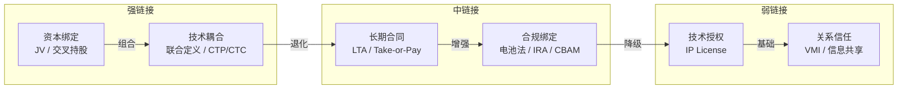

---
created: 2026-07-15
updated: 2026-07-15
tags: [Self, 供应链, 合规]
status: draft
---
> [!summary] 电池联盟与供应商联盟分析
> - **核心**：围绕 EV 出海场景，系统梳理电池联盟和供应商联盟的链接机制、典型案例，并给出小米出海策略建议。
> - **要点**：术语速查
> - **要点**：一、概念辨析
> - **要点**：二、联盟的 5 层链接机制 🔗
> - **要点**：2.1 💰 资本绑定（最强）

# 电池联盟与供应商联盟分析

> 围绕 EV 出海场景，系统梳理电池联盟和供应商联盟的链接机制、典型案例，并给出小米出海策略建议。
> 与 [[Kraljic矩阵分析]] 配合使用——Kraljic 解决"买什么"，本文解决"和谁绑定、怎么绑定"。

---

## 术语速查

| 缩写 | 英文全称 | 中文 | 含义 |
|------|---------|------|------|
| **CBU** | Completely Built Up | 整车出口/进口 | 整车组装好直接运输销售 |
| **CKD** | Completely Knocked Down | 全散件出口 | 完全拆散为零件级，运到当地工厂组装 |

---

## 一、概念辨析

| 维度 | 电池联盟 (Battery Alliance) | 供应商联盟 (Supplier Alliance) |
|------|---------------------------|-------------------------------|
| **本质** | 围绕**一个核心品类**（电池）的纵向深度绑定 | 围绕**一个OEM/平台**的横向生态组合 |
| **参与者** | 电池厂 + 车企 + 矿商 + 回收企业 | Tier 1 + Tier 2 + 软硬件供应商 + OEM |
| **绑定深度** | 极深——资本、技术、产能三重锁定 | 中等——以合同+技术标准为主 |
| **典型形态** | 合资建厂 (JV)、长期包产 (LTA)、技术授权 | 平台化开发、模块化供货、战略协议 |
| **Kraljic 分类** | 🔴 战略物资象限——高供应风险 × 高利润影响 | 跨象限——从🔴战略到⚪常规都有 |

---

## 二、联盟的 5 层链接机制 🔗

链接强度从强到弱排列：

### 2.1 💰 资本绑定（最强）

> **核心逻辑**：你中有我，我中有你，利益深度捆绑

| 方式 | 说明 | 示例 |
|------|------|------|
| **交叉持股** | OEM 持有电池厂股份，反之亦然 | 丰田持股电装 (DENSO) 24% |
| **合资建厂 (JV)** | 双方出资建电池厂，共担风险、共享产能 | GM × LG（Ultium Cells）、Stellantis × CATL（西班牙工厂） |
| **战略投资** | OEM 直接投资电池初创公司 | 大众投资 Northvolt（后破产）、奔驰投资 ACC |

**为什么有效**：产能变成了"共同资产"，退出成本极高。

### 2.2 📜 长期合同锁定（次强）

> **核心逻辑**：用商业条款锁住未来 5-10 年的供应

| 机制 | 作用 |
|------|------|
| **长期供应协议 (LTA)** | 锁定产能+价格，如车企提前 5 年包下电池厂产能 |
| **照付不议 (Take-or-Pay)** | 承诺最低采购量，否则赔偿——类似 LNG 合同 |
| **价格联动公式** | 与锂/钴/镍现货价挂钩，双方共担原材料波动 |

### 2.3 🔧 技术深度耦合（非常强）

> **核心逻辑**：技术路线选了就难换，形成路径依赖

| 耦合维度 | 示例 |
|----------|------|
| **联合定义电芯规格** | OEM 和电池厂从 R&D 阶段共同定义尺寸、化学体系（NMC / LFP / 固态） |
| **CTP/CTC 技术协同** | Cell-to-Pack / Cell-to-Chassis 需要电池厂和整车厂深度工程协作 |
| **BMS 联合开发** | 电池管理系统的软件和整车控制深度集成 |
| **技术授权** | CATL 向福特授权 LFP 技术——IP 成为纽带 |

**关键洞察**：一旦选定了某个电池厂的电芯尺寸和化学体系，更换供应商的成本极高（重新设计底盘、重新验证安全、重新过认证）。这就是为什么电池品类在 Kraljic 矩阵里始终是🔴战略物资。

### 2.4 🌐 合规与地缘政治绑定（新兴且强）

> **核心逻辑**：法规创造了"被迫联盟"

| 法规 | 要求 | 联盟效应 |
|------|------|----------|
| **欧盟电池法规** | 碳足迹申报 + 电池护照 + 回收义务 | OEM 必须和电池厂共享碳数据，倒逼深度合作 |
| **美国 IRA** | 电池组件北美制造比例逐年提高 | 迫使车企与北美电池厂 JV（GM×LG、Ford×SK） |
| **中国出口管制** | 稀土/锂加工技术出口限制 | 海外车企不得不与中国企业合资 |
| **CBAM 碳关税** | 对高碳产品征收关税 | 铝/钢/电池都受影响，供应链必须脱碳 |

**核心洞察**：这些法规本身**创造了联盟的必要性**。车企单打独斗根本无法满足合规要求。

### 2.5 🤝 关系与信任（最弱但最基础）

> **核心逻辑**：长期合作积累的信任、信息透明度和默契

| 表现 | 说明 |
|------|------|
| **联合库存管理 (VMI)** | 电池厂在整车厂旁边建仓库，实时补货 |
| **信息共享** | 需求预测、产能计划、技术路线图双向透明 |
| **人员互派** | 工程师常驻对方工厂 |
| **危机共担** | 原材料暴涨时不坐地起价；需求下滑时不砍单 |

---

## 三、典型案例 🎯

### 案例 1：丰田 × 电装 (DENSO) — 供应商联盟教科书

| 维度 | 详情 |
|------|------|
| **链接机制** | 交叉持股（丰田持电装 24%）+ 60 年合作历史 + 联合研发 |
| **覆盖范围** | 电子系统、空调、动力总成、传感器——几乎全产业链 |
| **为什么好** | ① 丰田体系（keiretsu）稳定性和信任极高 ② 电装技术反哺丰田（如混动核心部件） ③ 丰田帮电装降成本，电装帮丰田提性能 |
| **关键绑定** | 不是合同，是**组织嵌入**——电装前身为丰田的一个部门 |

> 💡 最持久的联盟不是靠合同锁的，而是靠**组织嵌入和共同进化**。

### 案例 2：GM × LG（Ultium Cells）— 电池联盟美国范本

| 维度 | 详情 |
|------|------|
| **结构** | 50/50 合资，投资超 $7B 建 3 座美国电池厂 |
| **链接机制** | 💰 JV 股权 + 🔧 联合开发 Ultium 电芯平台 + 📜 LTA 包产 |
| **技术耦合** | Ultium 电芯专门为 GM 车型设计（大软包电芯），底盘级集成 |
| **风险** | 合资意味着"一荣俱荣，一损俱损"——EV 需求不达预期，双方都亏 |
| **合规价值** | 满足 IRA 对北美制造的要求，拿满补贴 |

> 💡 JV 是目前欧美车企布局电池的主流模式。核心驱动：**合规要求 + 技术耦合 + 资本壁垒**。

### 案例 3：CATL × Stellantis（西班牙 LFP 工厂）— 中国电池出海新范式

| 维度 | 详情 |
|------|------|
| **结构** | JV 建厂，投资 €4.1B，目标 50GWh，2026 年底投产 |
| **链接机制** | 💰 JV + 🔧 CATL 授权 LFP 技术 + 🌐 满足欧盟电池法 |
| **战略意义** | CATL 不卖电芯，而是**输出技术和产能**到欧洲，降低碳足迹 |

> 💡 中国电池企业出海策略正在从"出口电芯"转向"出口产能和技术"，JV 是最合规路径。

### 案例 4：CATL 技术授权 × 福特 — 地缘政治下的"轻量级联盟"

| 维度 | 详情 |
|------|------|
| **结构** | 非 JV，而是**技术授权 + 收费**（类似特许经营） |
| **链接机制** | 🔧 技术授权费 + 🌐 规避 CFIUS/政治审查 |
| **为什么用授权而非 JV** | 美国政治环境不允许中国企业持股美国关键基础设施工厂 |
| **风险** | 绑定弱——技术授权容易被政策打断，福特后来缩减了规模 |

> 💡 当资本绑定不可能时，技术授权是退而求其次的选择，但联盟强度大打折扣。

### 案例 5：比亚迪垂直整合 — "反联盟"模式

| 维度 | 详情 |
|------|------|
| **策略** | 电池、电机、电控、芯片全部自研自产 |
| **逻辑** | 对 Kraljic 矩阵里的🔴战略物资，不联盟，直接**内化** |
| **优势** | 完全掌控供应链，成本极低（刀片电池成本比外采低 20-30%） |
| **劣势** | 巨额资本投入，技术路线锁定风险高 |

> 💡 垂直整合是联盟的极端反面。适合规模化、技术已成熟的品类（如 LFP 电池），不适合快速迭代的品类（如智驾芯片）。

---

## 四、联盟强度对比

---

## 五、对小米出海的策略建议

> 绑定深度 = f(利润影响, 技术复杂度, 合规要求)。三个越高，链接越深。

| 品类 | 推荐联盟模式 | 链接机制 | 原因 |
|------|------------|----------|------|
| **动力电池** | JV + LTA（重模式） | 💰资本 + 🔧技术 + 🌐合规 | 利润影响最高，必须深度绑定 |
| **电驱系统** | 自研核心 + Tier 1 联盟 | 🔧技术协作 + 📜长期协议 | 自研保留控制力，外采保弹性 |
| **智驾芯片** | 多平台授权（非 JV） | 📜授权 + 🔧联合定义 | 技术迭代快，不适合长期锁死 |
| **底盘系统** | 战略供应商协议 | 🤝关系 + 📜框架合同 | 成熟品类，靠信任和效率取胜 |

### 行动清单

1. **短期（出海第一阶段 CBU）**：与 CATL 签订欧洲 LTA，锁定产能和价格联动公式
2. **中期（CKD 阶段）**：评估 CATL/Stellantis 西班牙工厂是否可纳入供应链，考虑 JV 参股
3. **长期（DKD 阶段）**：自研电池技术 + 欧洲本地化生产，逐步降低对外部联盟的依赖
4. **同步推进**：建立电池回收联盟（满足欧盟电池法），与矿商签订锂/镍长协

---

## 六、参考案例索引

| 联盟 | 类型 | 链接机制 | 评价 |
|------|------|----------|------|
| 丰田 × 电装 | 供应商联盟 | 交叉持股 + 组织嵌入 | ⭐⭐⭐⭐⭐ 教科书级别 |
| GM × LG (Ultium) | 电池联盟 | JV + LTA + 技术耦合 | ⭐⭐⭐⭐ 欧美主流范式 |
| CATL × Stellantis | 电池联盟 | JV + 技术授权 + 合规 | ⭐⭐⭐⭐ 中国出海新范式 |
| CATL × 福特 | 电池联盟 | 技术授权（轻量级） | ⭐⭐⭐ 受地缘政治限制 |
| 比亚迪垂直整合 | 反联盟 | 全产业链内化 | ⭐⭐⭐⭐ 极端但有效 |
| 大众 × Northvolt | 电池联盟 | 战略投资 | ⭐⭐ 失败案例（Northvolt 破产） |
| 福特 × SK On (BlueOval) | 电池联盟 | JV | ⭐⭐⭐ 规模大但受需求波动影响 |

---

## 七、参考资料

- [McKinsey - The future of the European automotive supply chain](https://www.mckinsey.com)
- [CATL and Stellantis to Build LFP Battery Plant in Spain (Oct 2024)](https://www.catl.com/en/news/)
- [Ford Scales Back CATL-Linked Michigan Battery Plant](https://www.reuters.com)
- [European Battery Regulation Overview](https://environment.ec.europa.eu/topics/waste-and-recycling/batteries-and-accumulators_en)
- [U.S. Inflation Reduction Act - Clean Vehicle Credit Requirements](https://www.irs.gov/credits-deductions/clean-vehicle-credit)
- [[Kraljic矩阵分析]]
