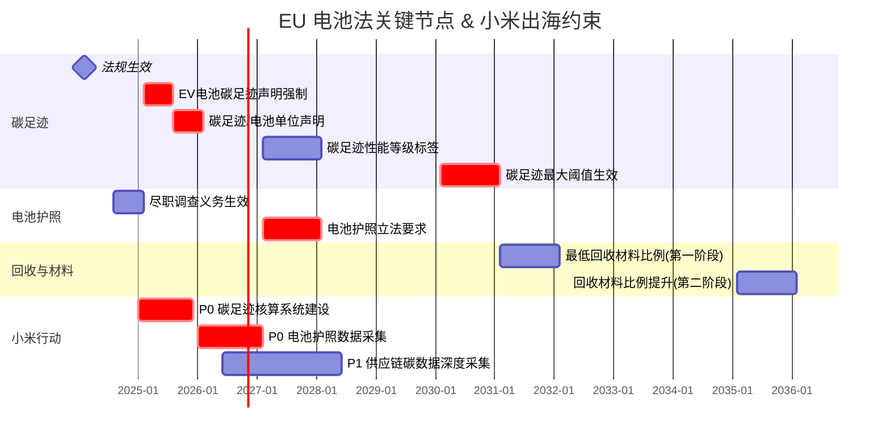
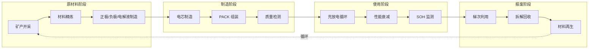
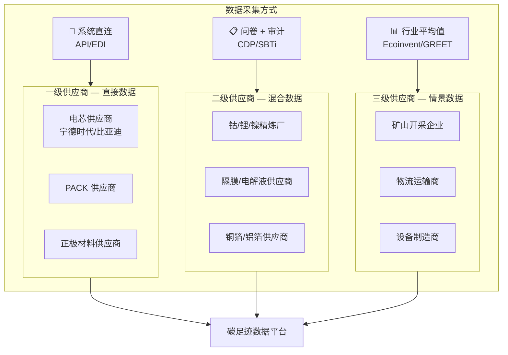
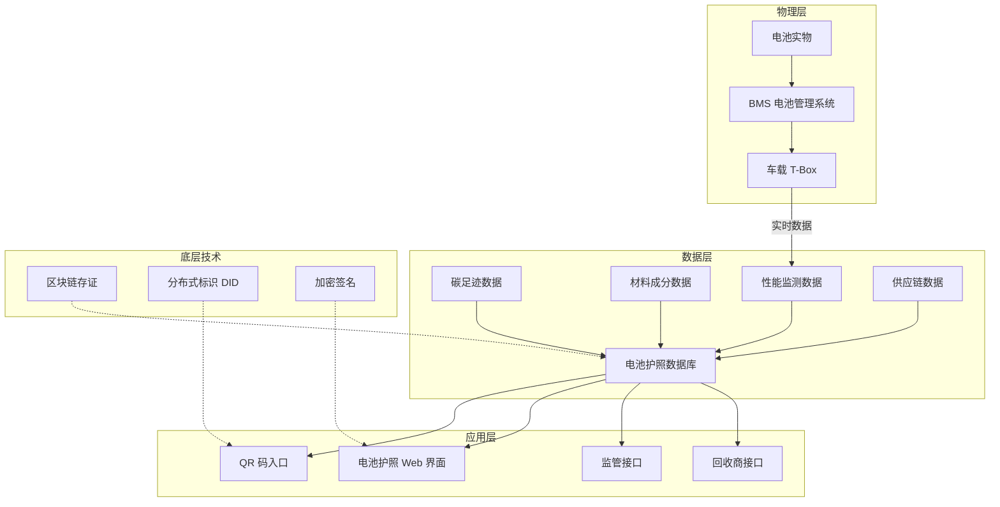
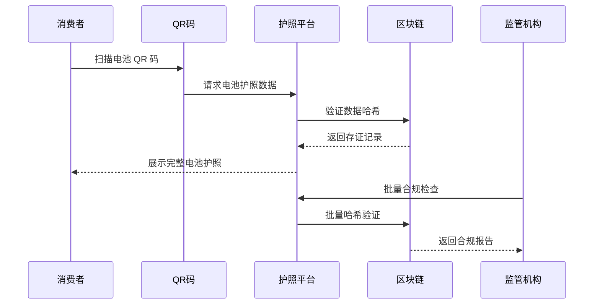
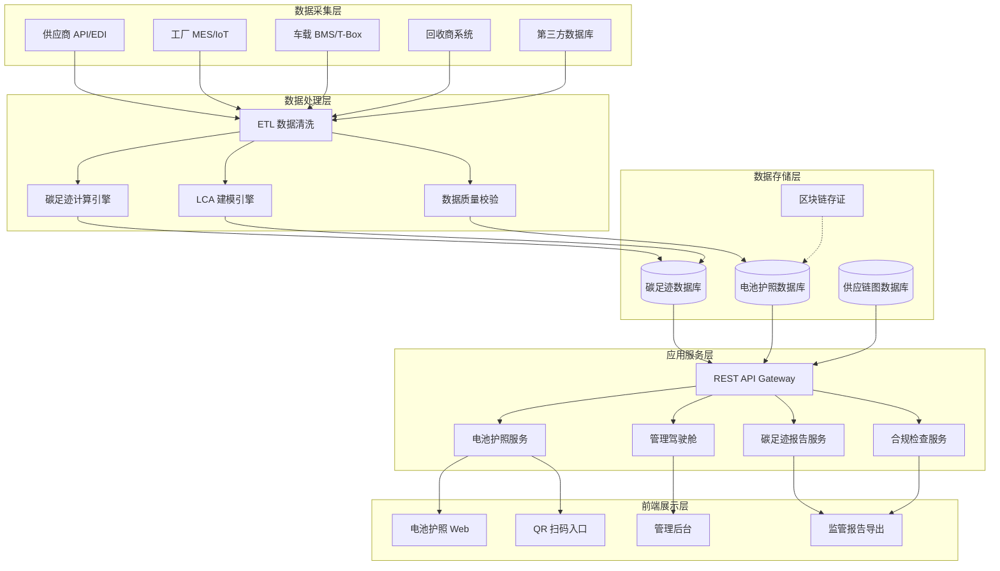
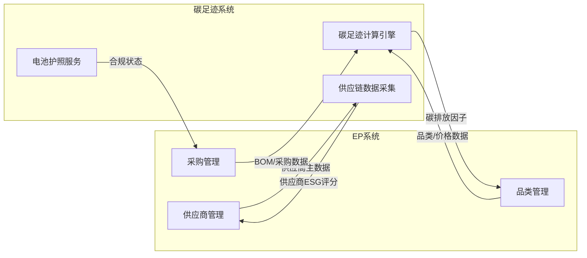
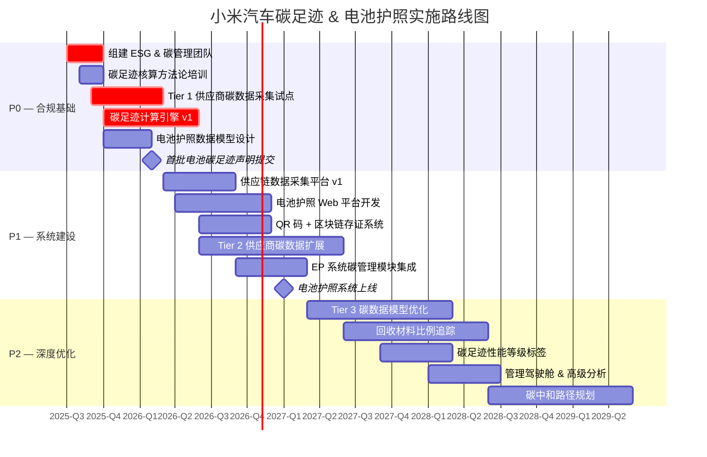

---
created: 2026-07-15
updated: 2026-07-15
tags: [Self, 供应链, 合规]
status: draft
---
> [!summary] 碳足迹追踪与电池护照方案 — 小米汽车出海落地方案
> - **核心**：配合 [[ESG与合规调研]] 的深度落地方案，聚焦 EU 电池法规 (2023/1542) 的碳足迹声明和电池护照两大硬约束。
> - **要点**：一、EU 电池法时间线与小米约束
> - **要点**：1.1 法规全景
> - **要点**：1.2 各阶段详细要求
> - **要点**：1.3 不合规后果

# 碳足迹追踪与电池护照方案 — 小米汽车出海落地方案

> 配合 [[ESG与合规调研]] 的深度落地方案，聚焦 EU 电池法规 (2023/1542) 的碳足迹声明和电池护照两大硬约束。

---

## 一、EU 电池法时间线与小米约束

### 1.1 法规全景

EU 电池法规 (Regulation 2023/1542) 于 **2024 年 2 月 18 日**正式生效，替代原 2006/66/EC 指令，是全球首个覆盖电池全生命周期的法规。

### 1.2 各阶段详细要求

| 阶段 | 时间 | 法规要求 | 对小米出海的约束 |
|------|------|----------|-----------------|
| **Phase 1** | 2025.02 | EV 电池碳足迹声明 | 每款出口 EU 的电池必须提交碳足迹声明，否则无法上市 |
| **Phase 2** | 2025.08 | 碳足迹/电池单位声明 | 需精确到每块电池的碳排放数据 |
| **Phase 3** | 2027.02 | **电池护照强制** + 碳足迹标签 | 所有 EV 电池必须配备数字护照，含全生命周期数据 |
| **Phase 4** | 2030.02 | 碳足迹最大阈值 | 超标电池将被禁止在 EU 市场销售 |
| **Phase 5** | 2031.02 | 最低回收材料比例 | 钴 16%、铅 85%、锂 6%、镍 6% |
| **Phase 6** | 2035.02 | 回收材料比例提升 | 钴 26%、锂 12%、镍 15% |

### 1.3 不合规后果

| 后果 | 说明 |
|------|------|
| 🔴 市场准入拒绝 | 不符合碳足迹声明的电池**禁止在 EU 销售** |
| 🔴 产品召回 | 监管机构可要求召回不合规产品 |
| 🔴 罚款 | 各成员国执行，罚款金额因国而异 |
| 🟡 声誉风险 | 不合规信息公开，影响品牌信任 |
| 🟡 供应链中断 | 需紧急调整供应链，导致交付延迟 |

---

## 二、碳足迹追踪方案

### 2.1 LCA 方法论框架

碳足迹核算基于 **生命周期评价 (LCA)** 方法论，遵循以下标准：

| 标准 | 适用范围 | 说明 |
|------|----------|------|
| **ISO 14040/14044** | LCA 通用框架 | 目标与范围定义、清单分析、影响评价、结果解释 |
| **ISO 14067** | 产品碳足迹 | 产品层面碳排放量化方法 |
| **GHG Protocol** | 企业碳核算 | Scope 1/2/3 分类，供应链碳排放核算 |
| **EU PEF** | 产品环境足迹 | EU 官方 LCA 方法学，电池法碳足迹核算的基础 |
| **GBA Battery Passport** | 电池碳足迹 | 全球电池联盟的碳足迹计算规范 |

### 2.2 PCF 数据模型

产品碳足迹 (PCF) 数据模型覆盖电池全生命周期：

**PCF 数据字段定义**：

| 数据类别 | 字段 | 单位 | 数据来源 | 采集频率 |
|----------|------|------|----------|----------|
| **原材料** | 矿产开采碳排放 | kg CO₂e/kg | 供应商 LCA 报告 | 年度 |
| | 材料精炼碳排放 | kg CO₂e/kg | 供应商 LCA 报告 | 年度 |
| | 运输碳排放 | kg CO₂e/t·km | 物流商碳排放因子 | 季度 |
| **制造** | 电力消耗 | kWh/unit | 工厂能源管理系统 | 实时 |
| | 直接排放 | kg CO₂e/unit | 工厂排放监测 | 月度 |
| | 辅助材料 | kg CO₂e/unit | BOM 数据 | 批次 |
| **使用** | 充电效率 | % | BMS 数据 | 实时 |
| | 循环寿命 | 次 | BMS 数据 | 实时 |
| **报废** | 回收率 | % | 回收商报告 | 批次 |
| | 再生材料比例 | % | 回收商报告 | 批次 |

### 2.3 供应链三级数据采集方案

**三级数据采集策略**：

| 层级 | 供应商类型 | 数据精度 | 采集方式 | 成本 | 覆盖率目标 |
|------|-----------|----------|----------|------|-----------|
| **Tier 1** | 电芯、PACK、正极材料 | 实测数据 | API/EDI 系统直连 | 高 | 100% |
| **Tier 2** | 精炼厂、隔膜、电解液 | 混合数据 | 问卷 + 第三方审计 | 中 | 80% |
| **Tier 3** | 矿山、物流、设备 | 情景数据 | 行业数据库 | 低 | 100%（估算） |

**关键数据源**：

| 数据库 | 类型 | 覆盖范围 | 使用场景 |
|--------|------|----------|----------|
| **Ecoinvent** | 商业 LCI | 全行业 | Tier 3 缺失数据补充 |
| **GREET** | 免费 LCI | 能源/交通 | 北美供应链验证 |
| **GaBi** | 商业 LCI | 制造业 | 精细化工序碳足迹 |
| **CLCD** | 中国 LCI | 中国产业 | 国内供应链数据 |
| **CDP** | 问卷平台 | 全球企业 | Tier 2 数据收集 |

---

## 三、电池护照方案

### 3.1 EU 电池护照数据模型

EU 电池护照基于 **CIRPASS** (Circular & Resource-efficient Infrastructure for Sustainability & digital PAssport System) 标准，数据通过 **QR 码** 载体访问。

**电池护照必含数据项**：

| 类别 | 数据项 | 说明 | 更新频率 |
|------|--------|------|----------|
| 🔋 **电池身份** | 电池唯一标识符 | UUID + 制造商编码 | 出厂固定 |
| | 制造商信息 | 名称、地址、联系方式 | 出厂固定 |
| | 电池型号/化学体系 | NMC/LFP/NCA 等 | 出厂固定 |
| | 制造日期/地点 | 工厂、产线信息 | 出厂固定 |
| | 额定容量/电压 | 设计参数 | 出厂固定 |
| 🌿 **碳足迹** | 全生命周期碳排放 | kg CO₂e/kWh | 年度更新 |
| | 各阶段碳排放明细 | 原材料/制造/运输/回收 | 年度更新 |
| | 碳足迹性能等级 | A/B/C/D/E 等级标签 | 2027 起 |
| 📦 **材料成分** | 关键矿物含量 | Co/Li/Ni/Graphite 重量比 | 出厂固定 |
| | 再生材料比例 | 回收钴/锂/镍占比 | 出厂固定 |
| | 冲突矿产声明 | OECD 尽职调查 | 年度更新 |
| ♻️ **供应链** | 矿产来源国 | 各矿物产地信息 | 年度更新 |
| | 供应链尽职调查 | OECD DD 审计报告 | 年度更新 |
| | 供应商 ESG 评级 | 第三方 ESG 评估 | 年度更新 |
| 📊 **性能数据** | 额定/实际容量 | 初始 vs 当前 SOH | 实时更新 |
| | 循环次数 | 充放电循环计数 | 实时更新 |
| | 温度历史 | 充放电温度记录 | 实时更新 |
| | 设计寿命 | 预期使用寿命 | 出厂固定 |
| 🔄 **报废处理** | 可回收性评级 | 材料回收难度评估 | 出厂固定 |
| | 拆解指南 | 结构化拆解说明 | 出厂固定 |
| | 梯次利用建议 | 二次使用场景建议 | 动态更新 |

### 3.2 数字孪生架构

### 3.3 QR 码 + 区块链方案

**QR 码设计**：

| 组件 | 方案 | 说明 |
|------|------|------|
| QR 格式 | GS1 Digital Link | 符合国际标准，支持 URL 嵌入 |
| 数据容量 | 4,296 字符（QR v40） | 足够嵌入唯一标识 + 签名哈希 |
| 链接格式 | `https://bpassport.mi.com/{battery_id}` | 指向小米电池护照 Web 应用 |
| 安全机制 | 数字签名 + 时间戳 | 防篡改，可验证数据完整性 |

**区块链存证方案**：

| 维度 | 推荐方案 | 说明 |
|------|----------|------|
| 链类型 | **许可链 (Hyperledger Fabric)** | 隐私保护，适合 B2B 场景 |
| 备选 | **Polygon/Ethereum L2** | 公链存证，增加透明度 |
| 存证内容 | 数据哈希 + 时间戳 + 操作者 ID | 原始数据不上链，仅存哈希 |
| 节点参与 | 电池厂 + 车厂 + 回收商 + 监管机构 | 多方共识，防止单点篡改 |
| 数据交互 | **Catena-X** 数据空间 | 汽车行业标准数据交换平台 |

**合规验证流程**：

---

## 四、系统建设方案

### 4.1 整体架构

### 4.2 模块拆解

| 模块 | 核心功能 | 技术选型 | 优先级 |
|------|----------|----------|--------|
| **碳足迹计算引擎** | LCA 建模、碳排放因子管理、PCF 计算 | Python + Brightway2 + pandas | P0 |
| **电池护照服务** | 护照数据组装、QR 生成、Web 展示 | React + Node.js + GS1 SDK | P0 |
| **供应链数据采集** | 供应商 API 对接、问卷管理、数据清洗 | FastAPI + Apache Airflow | P0 |
| **区块链存证** | 数据哈希上链、存证验证、多方签名 | Hyperledger Fabric / Polygon | P1 |
| **合规检查引擎** | 法规阈值检查、合规报告生成、预警 | Python + 规则引擎 | P1 |
| **管理驾驶舱** | 数据可视化、KPI 监控、异常告警 | React + ECharts + Grafana | P1 |
| **数据质量校验** | 数据完整性/一致性检查、异常值检测 | Great Expectations | P1 |
| **监管报告导出** | 标准化报告模板、批量导出 | Jinja2 + PDFKit | P2 |

### 4.3 与 EP 系统集成方案

**集成接口设计**：

| 接口 | 方向 | 数据 | 协议 | 频率 |
|------|------|------|------|------|
| 供应商主数据同步 | EP → 碳足迹系统 | 供应商 ID、名称、地址、联系方式 | REST API | 实时 |
| BOM 数据同步 | EP → 碳足迹系统 | 物料清单、用量、供应商分配 | REST API | 批次级 |
| 碳排放因子回写 | 碳足迹系统 → EP | 物料碳排放因子 | REST API | 月度 |
| ESG 评分回写 | 碳足迹系统 → EP | 供应商 ESG 综合评分 | REST API | 季度 |
| 合规状态推送 | 碳足迹系统 → EP | 电池合规状态、风险预警 | Webhook | 实时 |

### 4.4 技术选型总览

| 层级 | 技术 | 选型理由 |
|------|------|----------|
| **前端** | React + TypeScript | 组件化，生态成熟 |
| **后端** | Python (FastAPI) + Node.js | Python 做数据计算，Node.js 做 API 服务 |
| **数据库** | PostgreSQL + Neo4j + Redis | 关系型 + 图数据库（供应链溯源） + 缓存 |
| **数据处理** | Apache Airflow + pandas | ETL 调度、数据清洗 |
| **LCA 引擎** | Brightway2 (开源) | Python 原生 LCA 库，支持 Ecoinvent |
| **区块链** | Hyperledger Fabric | 许可链，隐私保护，企业级 |
| **存储** | MinIO (S3 兼容) | 文档/报告存储 |
| **监控** | Prometheus + Grafana | 系统监控 + 业务指标 |
| **部署** | Kubernetes | 容器化部署，弹性伸缩 |

---

## 五、行业案例对标

### 5.1 宁德时代 (CATL)

| 维度 | 实践 | 参考价值 |
|------|------|----------|
| 碳足迹 | 发布产品碳足迹白皮书，建立全生命周期碳排放数据库 | ⭐⭐⭐ 碳足迹数据模型可直接参考 |
| 电池护照 | 参与 GBA Battery Passport 试点，已生成首批电池护照 | ⭐⭐⭐ 数据字段定义最成熟 |
| 区块链 | 与 Circulor 合作建立钴溯源区块链 | ⭐⭐ 矿产溯源方案可借鉴 |
| 认证 | 获得 TÜV 碳足迹认证 | ⭐⭐ 第三方认证路径 |

### 5.2 宝马 (BMW)

| 维度 | 实践 | 参考价值 |
|------|------|----------|
| 数据平台 | 参与 Catena-X 数据空间建设，推动汽车行业数据互操作 | ⭐⭐⭐ 数据交换标准最前沿 |
| 电池护照 | 是 EU 电池护照最早试点企业之一，已完成原型验证 | ⭐⭐⭐ 实施路径最清晰 |
| 碳管理 | 供应链碳排放 Scope 3 追踪覆盖 Tier 1-3 | ⭐⭐⭐ 三级数据采集方案可参考 |
| 回收 | 与 Northvolt 合作闭环电池回收体系 | ⭐⭐ 回收商业模式 |

### 5.3 大众集团 (VW Group)

| 维度 | 实践 | 参考价值 |
|------|------|----------|
| 碳中和 | PowerCo 电池工厂 100% 可再生能源供电 | ⭐⭐ 制造端碳减排路径 |
| 材料溯源 | 建立钴、锂采购溯源平台，覆盖到矿山层级 | ⭐⭐⭐ 深度溯源方案 |
| 标准参与 | 参与 CIRPASS 标准制定，推动 DPP 互操作 | ⭐⭐ 标准理解最深 |
| 合规 | 提前 2 年开始电池护照系统建设 | ⭐⭐ 时间规划参考 |

### 5.4 全球电池联盟 (GBA)

| 维度 | 实践 | 参考价值 |
|------|------|----------|
| 标准 | 发布 Battery Passport 标准框架，定义 7 大数据维度 | ⭐⭐⭐ 数据模型标准参考 |
| 评分 | 建立电池生命周期 ESG 评分体系 | ⭐⭐ 评分方法论 |
| 试点 | 与特斯拉、CATL、三星 SDI 等开展试点 | ⭐⭐ 行业最佳实践 |
| 技术 | 推荐分布式标识 (DID) + 可验证凭证 (VC) | ⭐⭐ 身份验证方案 |

### 5.5 小米差距分析

| 能力维度 | 行业标杆 | 小米现状 | 差距 |
|----------|----------|----------|------|
| 碳足迹数据采集 | CATL — Tier 3 全覆盖 | Tier 1 部分覆盖 | 🔴 大 |
| LCA 建模 | BMW — 完整 LCA 模型 | 无 LCA 能力 | 🔴 大 |
| 电池护照 | VW — 系统已建 | 无系统 | 🔴 大 |
| 区块链溯源 | CATL+Circulor — 已落地 | 无相关实践 | 🟡 中 |
| 供应商碳数据 | BMW — CDP 覆盖 80% | 未启动 | 🔴 大 |
| 第三方认证 | CATL — TÜV 认证 | 无认证 | 🟡 中 |

---

## 六、小米落地路线图

### 6.1 分阶段实施计划

### 6.2 各阶段详细计划

#### P0 — 合规基础（2025.07 — 2026.06）

| 任务 | 负责团队 | 产出物 | 时间 |
|------|----------|--------|------|
| 组建 ESG & 碳管理团队 | HR + ESG 委员会 | 团队到位 | Q3 2025 |
| 碳足迹核算培训 | 外部顾问 + 内部培训 | 培训材料、考核认证 | Q3 2025 |
| Tier 1 供应商碳数据采集试点 | 碳管理团队 + 采购 | 5 家核心供应商数据 | Q4 2025 |
| 碳足迹计算引擎 v1 | 研发团队 | 可运行的 PCF 计算系统 | Q4 2025 |
| 电池护照数据模型设计 | 产品 + 研发 | 数据模型文档 + 原型 | Q4 2025 |
| 首批碳足迹声明 | 碳管理团队 | 合规声明文件 | Q1 2026 |

#### P1 — 系统建设（2026.03 — 2027.06）

| 任务 | 负责团队 | 产出物 | 时间 |
|------|----------|--------|------|
| 供应链数据采集平台 | 研发 + 采购 | 可运行的采集系统 | Q3 2026 |
| 电池护照 Web 平台 | 研发 + 产品 | 电池护照前端 + API | Q4 2026 |
| 区块链存证系统 | 研发 + 外部合作 | 区块链网络 + 存证接口 | Q4 2026 |
| Tier 2 供应商扩展 | 碳管理团队 | 80% Tier 2 覆盖 | Q2 2027 |
| EP 系统集成 | 研发团队 | 碳管理模块上线 | Q1 2027 |

#### P2 — 深度优化（2027.03 — 2028.12）

| 任务 | 负责团队 | 产出物 | 时间 |
|------|----------|--------|------|
| Tier 3 碳数据模型优化 | 数据团队 | 行业平均值精度提升 | Q1 2028 |
| 回收材料追踪 | 研发 + 回收商 | 回收材料比例监控系统 | Q2 2028 |
| 碳中和路径规划 | ESG 委员会 | 碳中和路线图 | Q4 2028 |

### 6.3 团队配置

| 角色 | 人数 | 职责 | 阶段 |
|------|------|------|------|
| ESG 总监 | 1 | 统筹 ESG 战略，对接董事会 | P0 起 |
| 碳管理专家 | 2 | LCA 建模、碳足迹核算、法规解读 | P0 起 |
| 数据工程师 | 3 | 数据采集平台、ETL、数据库 | P0 起 |
| 全栈开发 | 3 | 电池护照 Web、API、前端 | P1 起 |
| 区块链工程师 | 1 | 区块链存证系统 | P1 起 |
| 供应链分析师 | 2 | 供应商碳数据收集、审计协调 | P0 起 |
| 产品经理 | 1 | 电池护照产品设计、用户体验 | P1 起 |
| QA/合规 | 1 | 合规验证、第三方认证协调 | P1 起 |
| **合计** | **14** | | |

### 6.4 预算估算

| 项目 | 一次性投入 | 年度运营 | 说明 |
|------|-----------|----------|------|
| **团队人力** | - | ¥1,200 万 | 14 人团队，含社保 |
| **云基础设施** | ¥50 万 | ¥120 万 | K8s 集群 + 数据库 + 存储 |
| **LCA 数据库** | ¥80 万 | ¥30 万 | Ecoinvent + GaBi 许可 |
| **区块链节点** | ¥30 万 | ¥15 万 | Hyperledger Fabric 部署运维 |
| **第三方认证** | ¥60 万 | ¥30 万 | TÜV/SGS 碳足迹认证 |
| **外部咨询** | ¥200 万 | ¥50 万 | LCA 顾问 + 法规咨询 |
| **供应商培训** | ¥30 万 | ¥20 万 | 供应商碳数据培训 |
| **合计** | **¥450 万** | **¥1,465 万/年** | |

> 💡 总投入约 **¥2,000 万/年**（含人力），约占小米汽车出海营收的 **0.1-0.3%**，属于合规必要投入。

---

## 七、注意事项与风险

### 7.1 数据质量风险

| 风险 | 影响 | 应对措施 |
|------|------|----------|
| 供应商数据不完整 | 碳足迹声明不准确，面临监管质疑 | 分阶段推进，先 Tier 1 再扩展；缺失数据用行业均值标注 |
| 数据造假 | 法规处罚 + 品牌损害 | 引入第三方审计；区块链存证防篡改 |
| 数据时效性 | 过时数据导致声明失效 | 建立数据更新 SOP，自动化采集替代人工填报 |
| 数据格式不统一 | 跨供应商数据无法整合 | 制定统一数据模板；使用 IRDI/ECLASS 标准编码 |

### 7.2 供应商配合风险

| 风险 | 影响 | 应对措施 |
|------|------|----------|
| 供应商拒绝提供数据 | 无法完成碳足迹核算 | 在采购合同中加入数据提供条款；优先级供应商重点攻关 |
| 供应商数据能力不足 | 提供数据质量差 | 提供数据模板和培训；帮助 Tier 1 建立碳管理能力 |
| 供应商更替频繁 | 数据连续性断裂 | 建立供应商碳数据交接 SOP |
| 竞争性数据敏感 | 供应商担心商业秘密泄露 | 数据脱敏 + 区间值 + 合同保密条款 |

### 7.3 认证流程风险

| 风险 | 影响 | 应对措施 |
|------|------|----------|
| 认证周期长 | 错过法规生效时间 | 提前 12 个月启动认证；与 TÜV/SGS 建立长期合作 |
| 认证标准变更 | 已完成工作需要返工 | 持续跟踪 EU 委员会 delegated acts；加入行业工作组 |
| 多国认证差异 | 不同市场需要不同认证 | 以 EU 为基准，扩展其他市场认证 |

### 7.4 成本影响

| 成本项 | 影响 | 应对策略 |
|--------|------|----------|
| 碳排放成本 | 2026 起 CBAM 碳关税 | 提前降低产品碳强度，减少碳关税支出 |
| 系统建设成本 | 一次性投入大 | 分阶段建设，P0 先保障合规，P1/P2 逐步优化 |
| 运营成本 | 持续人力和技术投入 | 自动化降低人工成本；与供应商分摊数据采集成本 |
| 认证成本 | 每款电池需单独认证 | 建立标准化认证流程，降低边际成本 |
| **碳关税估算** | 按 €80/tCO₂ 计算 | 每辆车约 €200-500，年出口 10 万辆约 €2,000-5,000 万 |

### 7.5 关键成功因素

| 因素 | 说明 |
|------|------|
| 🎯 **高层支持** | ESG 合规需董事会层面推动，碳管理团队需足够授权 |
| 🎯 **早期启动** | 2027 电池护照生效，实际建设窗口仅 18 个月 |
| 🎯 **供应商协同** | 碳足迹数据 80% 来自供应链，供应商配合是核心 |
| 🎯 **标准化先行** | 数据模型、接口标准、编码体系需提前统一 |
| 🎯 **第三方背书** | TÜV/SGS 认证增加合规可信度 |

---

## 八、参考资料

### 法规文件

- [EU Battery Regulation 2023/1542](https://eur-lex.europa.eu/eli/reg/2023/1542/oj)
- [EU Battery Passport — CIRPASS Blueprint](https://cirpass.net/)
- [Global Battery Alliance — Battery Passport](https://globalbattery.org/battery-passport/)
- [ISO 14067 — Product Carbon Footprint](https://www.iso.org/standard/71206.html)
- [GHG Protocol — Product Standard](https://ghgprotocol.org/product-standard)

### 行业标准

- [Catena-X Data Space](https://catena-x.net/)
- [GS1 Digital Link](https://www.gs1.org/standards/gs1-digital-link)
- [Ecoinvent Database](https://ecoinvent.org/)
- [W3C Verifiable Credentials](https://www.w3.org/TR/vc-data-model/)

### 企业实践

- [CATL Sustainability Report](https://www.catl.com/en/sustainability/)
- [BMW Group — Battery Passport](https://www.bmwgroup.com/en/sustainability.html)
- [Volkswagen — Battery Strategy](https://www.volkswagen-group.com/en/strategy-14684)
- [Circulor — Battery Traceability](https://circulor.com/)

### 相关笔记

- [[ESG与合规调研]] — ESG 与合规全景调研
- [[小米汽车出海模式分析]] — 出海模式分析（含 EU 电池法概述）
- [[06_项目与汇报/03_蔚来与小米汽车供应链韧性对比研究|蔚来与小米汽车供应链韧性对比研究]] — 竞品对标
