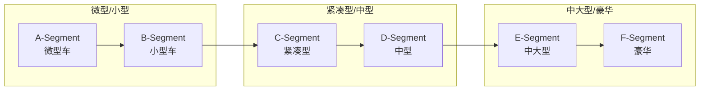

> [!summary] 汽车细分市场（Segment）完整调研
> - **核心**：欧洲汽车细分市场分类体系详解：A-F Segment 定义、尺寸标准、典型车型、电动车竞品，以及小米 SU7 的市场定位分析。
> - **要点**：一、分类体系概述
> - **要点**：1.1 欧洲分类标准
> - **要点**：1.2 分类总览
> - **要点**：1.3 中国对应分类

# 汽车细分市场（Segment）完整调研

> 欧洲汽车细分市场分类体系详解：A-F Segment 定义、尺寸标准、典型车型、电动车竞品，以及小米 SU7 的市场定位分析。

---

## 一、分类体系概述

### 1.1 欧洲分类标准

**来源**：欧洲委员会（European Commission）GAR 体系，被 ACEA（欧洲汽车工业协会）和 JATO Dynamics 广泛采用。

**分类维度**：

| 维度 | 权重 | 说明 |
|------|------|------|
| **车身长度** | ⭐⭐⭐⭐⭐ | 主要分类依据 |
| **轴距** | ⭐⭐⭐⭐ | 影响后排空间 |
| **车身宽度** | ⭐⭐⭐ | 影响横向空间 |
| **价格区间** | ⭐⭐⭐ | 市场定位参考 |
| **定位/用途** | ⭐⭐ | 家庭/商务/运动等 |

### 1.2 分类总览



### 1.3 中国对应分类

| 欧洲分类 | 中国分类 | 长度范围 | 价格区间（人民币） |
|----------|----------|----------|------------------|
| A-Segment | 微型车 | < 3,600mm | 3-8 万 |
| B-Segment | 小型车 | 3,600-4,000mm | 7-15 万 |
| C-Segment | 紧凑型车 | 4,000-4,600mm | 10-25 万 |
| D-Segment | 中型车 | 4,600-4,900mm | 18-35 万 |
| E-Segment | 中大型车 | 4,900-5,100mm | 30-60 万 |
| F-Segment | 大型车 | > 5,100mm | 60 万+ |

---

## 二、A-Segment（微型车）

### 2.1 定义与特征

| 项目 | 说明 |
|------|------|
| **英文名称** | Mini / City Car / Micro Car |
| **中文名称** | 微型车 / 城市车 |
| **典型长度** | 3,200-3,900mm |
| **典型轴距** | 2,000-2,400mm |
| **典型宽度** | 1,500-1,650mm |
| **座位数** | 2-4 座 |
| **价格区间** | €10,000-25,000 |
| **典型用途** | 城市通勤、第二辆车、年轻人首辆车 |

**核心特征**：
- ✅ 极小车身，城市灵活穿梭
- ✅ 低能耗/低油耗
- ✅ 停车方便
- ❌ 空间有限，不适合长途
- ❌ 安全配置相对较少

### 2.2 典型车型

#### **燃油车**

| 车型 | 品牌 | 长度(mm) | 价格(€) | 特点 |
|------|------|----------|---------|------|
| **Fiat 500** | 🇮🇹 菲亚特 | 3,571 | 16,000+ | 意式经典设计，时尚 icon |
| **Smart ForTwo** | 🇩🇪 奔驰/吉利 | 2,695 | 18,000+ | 极致小巧，2 座设计 |
| **Toyota Aygo X** | 🇯🇵 丰田 | 3,700 | 15,000+ | 跨界风格，可靠性高 |
| **Hyundai i10** | 🇰🇷 现代 | 3,670 | 12,000+ | 高性价比，配置丰富 |
| **Kia Picanto** | 🇰🇷 起亚 | 3,595 | 11,000+ | 与 i10 同平台，设计年轻 |
| **Renault Twingo** | 🇫🇷 雷诺 | 3,595 | 14,000+ | 后置后驱，灵活操控 |
| **VW Up!** | 🇩🇪 大众 | 3,600 | 14,000+ | 品质感强，e-Up! 有电动版 |

#### **电动车**

| 车型 | 品牌 | 续航(km) | 价格(€) | 特点 |
|------|------|----------|---------|------|
| **Fiat 500e** | 🇮🇹 菲亚特 | 320 | 25,000+ | 设计经典，意大利制造 |
| **Smart EQ ForTwo** | 🇩🇪 吉利/奔驰 | 130 | 22,000+ | 城市代步，已逐步退市 |
| **Dacia Spring** | 🇷🇴 达契亚 | 230 | 17,000+ | **欧洲最便宜电动车** |
| **Citroën ë-C3** | 🇫🇷 雪铁龙 | 320 | 23,000+ | 2024 年上市，性价比高 |
| **Hyundai Inster** | 🇰🇷 现代 | 355 | 23,000+ | 2024 年新车，空间优化 |
| **MINI Cooper SE** | 🇩🇪 宝马 | 250 | 30,000+ | 经典设计，运动操控 |

#### **中国市场车型**

| 车型 | 品牌 | 续航(km) | 价格(万) | 特点 |
|------|------|----------|----------|------|
| **五菱宏光 MINI EV** | 🇨🇳 五菱 | 120-170 | 3-5 | 销量冠军，极致性价比 |
| **长安 Lumin** | 🇨🇳 长安 | 155-301 | 4-6 | 设计时尚，空间优化 |
| **奇瑞 QQ 冰淇淋** | 🇨🇳 奇瑞 | 120-170 | 3-5 | 与宏光 MINI 竞争 |
| **比亚迪海鸥** | 🇨🇳 比亚迪 | 305-405 | 7-9 | 高品质微型电动车 |

### 2.3 A-Segment 图片索引

> 💡 **图片获取方式**：访问以下链接获取官方图片

| 车型 | 官方图片链接 |
|------|-------------|
| Fiat 500e | [fiat.com/500e](https://www.fiat.com/500e) |
| Dacia Spring | [dacia.com/spring](https://www.dacia.com/vehicles/spring.html) |
| Citroën ë-C3 | [citroen.com/e-c3](https://www.citroen.com/models/e-c3.html) |
| MINI Cooper SE | [mini.com/cooper-se](https://www.mini.com/cooper-se) |
| 五菱宏光 MINI EV | [wuling.com/miniev](https://www.wuling.com) |
| 比亚迪海鸥 | [byd.com/seagull](https://www.byd.com) |

---

## 三、B-Segment（小型车）

### 3.1 定义与特征

| 项目 | 说明 |
|------|------|
| **英文名称** | Supermini / Small Car / Subcompact |
| **中文名称** | 小型车 / 次紧凑型 |
| **典型长度** | 3,900-4,200mm |
| **典型轴距** | 2,400-2,600mm |
| **典型宽度** | 1,650-1,750mm |
| **座位数** | 4-5 座 |
| **价格区间** | €15,000-30,000 |
| **典型用途** | 家庭第一辆车、年轻人、城市通勤 |

**核心特征**：
- ✅ 空间比 A-Segment 实用，可坐 4-5 人
- ✅ 后备箱可满足日常需求
- ✅ 油耗/电耗经济
- ✅ 价格适中，性价比高
- ❌ 后排空间仍有限
- ❌ 高速稳定性一般

### 3.2 典型车型

#### **燃油车（欧洲畅销）**

| 车型 | 品牌 | 长度(mm) | 价格(€) | 特点 |
|------|------|----------|---------|------|
| **VW Polo** | 🇩🇪 大众 | 4,074 | 22,000+ | 品质感标杆，底盘扎实 |
| **Renault Clio** | 🇫🇷 雷诺 | 4,050 | 18,000+ | 欧洲销量王，设计时尚 |
| **Peugeot 208** | 🇫🇷 标致 | 4,055 | 20,000+ | 2020 欧洲年度车，i-Cockpit |
| **Opel Corsa** | 🇩🇪 欧宝 | 4,060 | 19,000+ | 与 208 同平台，性价比高 |
| **Toyota Yaris** | 🇯🇵 丰田 | 3,940 | 20,000+ | 混动技术强，可靠性高 |
| **Ford Fiesta** | 🇺🇸 福特 | 4,040 | 19,000+ | 操控出色（已停产） |
| **Seat Ibiza** | 🇪🇸 西雅特 | 4,059 | 18,000+ | 年轻运动，大众平台 |
| **Skoda Fabia** | 🇨🇿 斯柯达 | 4,108 | 17,000+ | 空间最大，实用主义 |

#### **电动车**

| 车型 | 品牌 | 续航(km) | 价格(€) | 特点 |
|------|------|----------|---------|------|
| **Peugeot e-208** | 🇫🇷 标致 | 400 | 30,000+ | 设计最佳，驾驶质感好 |
| **Opel Corsa-e** | 🇩🇪 欧宝 | 400 | 29,000+ | 与 e-208 同平台 |
| **Renault ZOE** | 🇫🇷 雷诺 | 395 | 28,000+ | 欧洲最畅销电动车之一（已退市） |
| **Renault 5 E-Tech** | 🇫🇷 雷诺 | 400 | 25,000+ | 2024 年上市，复古设计 |
| **MINI Aceman** | 🇩🇪 宝马 | 310 | 35,000+ | 跨界风格，MINI 家族 |
| **BYD Dolphin** | 🇨🇳 比亚迪 | 427 | 29,000+ | 刀片电池，空间大 |
| **MG4 EV** | 🇨🇳 上汽 | 450 | 29,000+ | 性价比之王，操控好 |

#### **中国市场车型**

| 车型 | 品牌 | 续航(km) | 价格(万) | 特点 |
|------|------|----------|----------|------|
| **比亚迪海豚** | 🇨🇳 比亚迪 | 301-401 | 10-13 | 海洋美学，销量冠军 |
| **大众 ID.3** | 🇩🇪 大众 | 450 | 12-16 | 欧洲血统，底盘优秀 |
| **埃安 AION Y** | 🇨🇳 广汽 | 410-610 | 10-15 | 空间越级，性价比高 |
| **哪吒 U** | 🇨🇳 哪吒 | 400-610 | 12-17 | 配置丰富，智能化高 |
| **零跑 T03** | 🇨🇳 零跑 | 403 | 7-9 | 高性价比微型电动车 |

### 3.3 B-Segment 图片索引

| 车型 | 官方图片链接 |
|------|-------------|
| VW Polo | [volkswagen.com/polo](https://www.volkswagen.com/polo) |
| Peugeot e-208 | [peugeot.com/e-208](https://www.peugeot.com/e-208.html) |
| Renault 5 E-Tech | [renault.com/r5](https://www.renault.com/electric-vehicles/r5-e-tech-electric.html) |
| BYD Dolphin | [byd.com/dolphin](https://www.byd.com) |
| MG4 EV | [mg.co.uk/mg4](https://www.mg.co.uk/mg4-ev) |

---

## 四、C-Segment（紧凑型车）

### 4.1 定义与特征

| 项目 | 说明 |
|------|------|
| **英文名称** | Small Family Car / Compact Car |
| **中文名称** | 紧凑型车 / 小型家用车 |
| **典型长度** | 4,200-4,600mm |
| **典型轴距** | 2,600-2,750mm |
| **典型宽度** | 1,750-1,850mm |
| **座位数** | 5 座 |
| **价格区间** | €20,000-40,000 |
| **典型用途** | 家庭主力车、商务入门、年轻人升级 |

**核心特征**：
- ✅ 空间实用，后排可坐 3 成人
- ✅ 后备箱满足家庭需求
- ✅ 配置丰富，安全性能好
- ✅ 油耗/电耗与空间平衡
- ❌ 无法满足 7 座需求
- ❌ 豪华感不如 D-Segment

### 4.2 典型车型

#### **燃油车（欧洲标杆）**

| 车型 | 品牌 | 长度(mm) | 价格(€) | 特点 |
|------|------|----------|---------|------|
| **VW Golf** | 🇩🇪 大众 | 4,284 | 30,000+ | **欧洲标杆**，综合素质最强 |
| **Toyota Corolla** | 🇯🇵 丰田 | 4,630 | 28,000+ | 全球销量冠军，混动强 |
| **Ford Focus** | 🇺🇸 福特 | 4,378 | 25,000+ | 操控出色（已退市） |
| **Opel Astra** | 🇩🇪 欧宝 | 4,374 | 27,000+ | 设计突破，质感提升 |
| **Mercedes A-Class** | 🇩🇪 奔驰 | 4,419 | 33,000+ | 豪华入门，MBUX 系统 |
| **BMW 1 Series** | 🇩🇪 宝马 | 4,319 | 35,000+ | 后驱操控，运动基因 |
| **Audi A3** | 🇩🇪 奥迪 | 4,343 | 33,000+ | 科技感强，内饰精致 |
| **Mazda 3** | 🇯🇵 马自达 | 4,460 | 27,000+ | 设计美学，驾驶乐趣 |

#### **电动车**

| 车型 | 品牌 | 续航(km) | 价格(€) | 特点 |
|------|------|----------|---------|------|
| **VW ID.3** | 🇩🇪 大众 | 420-550 | 35,000+ | 纯电平台，空间大 |
| **Tesla Model 3** | 🇺🇸 特斯拉 | 510-620 | 40,000+ | **电动车标杆**，智能化 |
| **Hyundai Ioniq 5** | 🇰🇷 现代 | 385-507 | 42,000+ | 复古设计，800V 快充 |
| **Kia EV6** | 🇰🇷 起亚 | 394-528 | 42,000+ | 与 Ioniq 5 同平台 |
| **BYD Seal** | 🇨🇳 比亚迪 | 570 | 45,000+ | 刀片电池，CTB 技术 |
| **NIO ET5** | 🇨🇳 蔚来 | 560 | 46,000+ | 换电服务，高端定位 |
| **XPeng P7** | 🇨🇳 小鹏 | 706 | 44,000+ | 智驾技术领先 |
| **MG4 EV** | 🇨🇳 上汽 | 450 | 29,000+ | 性价比之王 |

#### **中国市场车型**

| 车型 | 品牌 | 续航(km) | 价格(万) | 特点 |
|------|------|----------|----------|------|
| **比亚迪秦 PLUS** | 🇨🇳 比亚迪 | 120-1300(DMi) | 10-15 | 销量冠军，DM-i 超混 |
| **特斯拉 Model 3** | 🇺🇸 特斯拉 | 567-713 | 23-33 | 智能化标杆 |
| **大众 ID.3** | 🇩🇪 大众 | 450 | 12-16 | 欧洲血统，降价后性价比高 |
| **埃安 AION S** | 🇨🇳 广汽 | 460-610 | 13-17 | 网约车之王，空间大 |
| **哪吒 S** | 🇨🇳 哪吒 | 715 | 15-25 | 配置越级，性价比高 |

### 4.3 C-Segment 图片索引

| 车型 | 官方图片链接 |
|------|-------------|
| VW Golf | [volkswagen.com/golf](https://www.volkswagen.com/golf) |
| Tesla Model 3 | [tesla.com/model3](https://www.tesla.com/model3) |
| Hyundai Ioniq 5 | [hyundai.com/ioniq5](https://www.hyundai.com/ioniq5) |
| BYD Seal | [byd.com/seal](https://www.byd.com) |
| NIO ET5 | [nio.com/et5](https://www.nio.com/et5) |

---

## 五、D-Segment（中型车）— **小米 SU7 所在市场**

### 5.1 定义与特征

| 项目 | 说明 |
|------|------|
| **英文名称** | Large Family Car / Mid-Size Car |
| **中文名称** | 中型车 |
| **典型长度** | 4,600-4,900mm |
| **典型轴距** | 2,750-2,900mm |
| **典型宽度** | 1,800-1,900mm |
| **座位数** | 5 座 |
| **价格区间** | €30,000-60,000 |
| **典型用途** | 商务用车、家庭主力、中产阶级 |

**核心特征**：
- ✅ 空间宽敞，后排舒适
- ✅ 配置豪华，科技感强
- ✅ 动力充沛，驾驶质感好
- ✅ 品牌溢价，身份象征
- ❌ 价格较高
- ❌ 城市停车不如 C-Segment 灵活

### 5.2 典型车型

#### **燃油车（传统三强）**

| 车型 | 品牌 | 长度(mm) | 价格(€) | 特点 |
|------|------|----------|---------|------|
| **BMW 3 Series** | 🇩🇪 宝马 | 4,709 | 45,000+ | **运动标杆**，后驱操控 |
| **Mercedes C-Class** | 🇩🇪 奔驰 | 4,751 | 46,000+ | 豪华舒适，S 级下放 |
| **Audi A4** | 🇩🇪 奥迪 | 4,762 | 43,000+ | 科技内饰，Quattro 四驱 |
| **VW Passat** | 🇩🇪 大众 | 4,773 | 38,000+ | 商务首选，空间大 |
| **Toyota Camry** | 🇯🇵 丰田 | 4,885 | 35,000+ | 可靠性标杆，混动省油 |
| **Mazda 6** | 🇯🇵 马自达 | 4,865 | 32,000+ | 设计美学，驾驶乐趣 |
| **Volvo S60** | 🇸🇪 沃尔沃 | 4,761 | 40,000+ | 安全标杆，北欧设计 |

#### **电动车（小米 SU7 竞品）**

| 车型 | 品牌 | 续航(km) | 价格(€) | 特点 |
|------|------|----------|---------|------|
| **Tesla Model 3** | 🇺🇸 特斯拉 | 510-620 | 40,000+ | **电动车标杆**，销量王 |
| **BMW i4** | 🇩🇪 宝马 | 493-590 | 51,000+ | 3 系电动版，操控好 |
| **Mercedes EQE** | 🇩🇪 奔驰 | 545-654 | 65,000+ | 豪华电动，E 级定位 |
| **Audi Q4 e-tron** | 🇩🇪 奥迪 | 341-520 | 42,000+ | 跨界风格，科技感强 |
| **Polestar 2** | 🇸🇪 极星 | 440-635 | 45,000+ | 北欧设计，性能版强 |
| **NIO ET5** | 🇨🇳 蔚来 | 560 | 46,000+ | 换电服务，高端定位 |
| **XPeng P7** | 🇨🇳 小鹏 | 706 | 44,000+ | 智驾领先，设计科幻 |
| **Xiaomi SU7** | 🇨🇳 小米 | 668-800 | 28,000+ | 生态整合，性价比 |
| **BYD Seal** | 🇨🇳 比亚迪 | 570 | 45,000+ | 刀片电池，CTB 技术 |

#### **中国市场车型**

| 车型 | 品牌 | 续航(km) | 价格(万) | 特点 |
|------|------|----------|----------|------|
| **小米 SU7** | 🇨🇳 小米 | 668-800 | 22-53 | 生态整合，性能标杆 |
| **特斯拉 Model 3** | 🇺🇸 特斯拉 | 567-713 | 23-33 | 智能化，超充网络 |
| **比亚迪海豹** | 🇨🇳 比亚迪 | 550-700 | 17-25 | 刀片电池，性价比高 |
| **极氪 007** | 🇨🇳 极氪 | 616-870 | 21-30 | 800V 快充，操控好 |
| **小鹏 P7** | 🇨🇳 小鹏 | 610-706 | 21-34 | 智驾领先，设计科幻 |
| **蔚来 ET5** | 🇨🇳 蔚来 | 560-710 | 30-39 | 换电服务，高端定位 |
| **智界 S7** | 🇨🇳 华为 | 550-855 | 25-35 | 华为智驾，鸿蒙座舱 |
| **宝马 3 系** | 🇩🇪 宝马 | - | 29-40 | 豪华标杆，操控好 |
| **奔驰 C 级** | 🇩🇪 奔驰 | - | 33-42 | 豪华舒适，品牌溢价 |

### 5.3 D-Segment 电动车对比（小米 SU7 竞品矩阵）

| 维度 | SU7 | Model 3 | i4 | ET5 | P7 | Seal |
|------|-----|---------|-----|-----|-----|------|
| **起售价(€)** | 28,000 | 40,000 | 51,000 | 46,000 | 44,000 | 45,000 |
| **续航(km)** | 668-800 | 510-620 | 493-590 | 560 | 706 | 570 |
| **0-100km/h** | 2.78s | 3.3s | 3.9s | 4.0s | 6.7s | 3.8s |
| **智驾等级** | L2+ | L2+ | L2 | L2 | L2+ | L2 |
| **800V 快充** | ✅ | ❌ | ❌ | ❌ | ❌ | ✅ |
| **生态整合** | ⭐⭐⭐⭐⭐ | ⭐⭐⭐ | ⭐⭐ | ⭐⭐⭐ | ⭐⭐⭐ | ⭐⭐ |
| **品牌溢价** | ⭐⭐⭐ | ⭐⭐⭐⭐⭐ | ⭐⭐⭐⭐⭐ | ⭐⭐⭐ | ⭐⭐⭐ | ⭐⭐⭐ |

### 5.4 D-Segment 图片索引

| 车型 | 官方图片链接 |
|------|-------------|
| BMW 3 Series | [bmw.com/3series](https://www.bmw.com/3series) |
| Tesla Model 3 | [tesla.com/model3](https://www.tesla.com/model3) |
| BMW i4 | [bmw.com/i4](https://www.bmw.com/i4) |
| NIO ET5 | [nio.com/et5](https://www.nio.com/et5) |
| Xiaomi SU7 | [xiaomi.com/su7](https://www.xiaomi.com) |
| BYD Seal | [byd.com/seal](https://www.byd.com) |

---

## 六、E-Segment（中大型车）

### 6.1 定义与特征

| 项目 | 说明 |
|------|------|
| **英文名称** | Executive Car / Upper Mid-Size |
| **中文名称** | 中大型车 / 行政级 |
| **典型长度** | 4,900-5,100mm |
| **典型轴距** | 2,900-3,100mm |
| **典型宽度** | 1,850-1,950mm |
| **座位数** | 5 座 |
| **价格区间** | €50,000-90,000 |
| **典型用途** | 商务接待、高管用车、豪华家庭 |

**核心特征**：
- ✅ 后排空间宽敞，可翘二郎腿
- ✅ 配置奢华，用料高级
- ✅ 隔音出色，行驶质感好
- ✅ 品牌价值高，身份象征
- ❌ 价格昂贵
- ❌ 车身较大，城市不灵活

### 6.2 典型车型

#### **燃油车（行政三强）**

| 车型 | 品牌 | 长度(mm) | 价格(€) | 特点 |
|------|------|----------|---------|------|
| **BMW 5 Series** | 🇩🇪 宝马 | 5,060 | 60,000+ | **行政标杆**，科技豪华 |
| **Mercedes E-Class** | 🇩🇪 奔驰 | 4,949 | 62,000+ | 豪华舒适，S 级下放 |
| **Audi A6** | 🇩🇪 奥迪 | 4,939 | 58,000+ | 科技内饰，Quattro |
| **Volvo S90** | 🇸🇪 沃尔沃 | 4,963 | 55,000+ | 安全标杆，北欧豪华 |
| **Jaguar XF** | 🇬🇧 捷豹 | 4,954 | 55,000+ | 英伦运动，设计优雅 |

#### **电动车**

| 车型 | 品牌 | 续航(km) | 价格(€) | 特点 |
|------|------|----------|---------|------|
| **BMW i5** | 🇩🇪 宝马 | 500-580 | 70,000+ | 5 系电动版，豪华电动 |
| **Mercedes EQE** | 🇩🇪 奔驰 | 545-654 | 65,000+ | 纯电平台，超低风阻 |
| **Audi A6 e-tron** | 🇩🇪 奥迪 | 600-700 | 70,000+ | 2024 年上市，PPE 平台 |
| **Polestar 2 LR** | 🇸🇪 极星 | 635 | 50,000+ | 性价比高，北欧设计 |
| **NIO ET7** | 🇨🇳 蔚来 | 530-1000 | 60,000+ | 换电+150kWh 电池 |

#### **中国市场车型**

| 车型 | 品牌 | 续航(km) | 价格(万) | 特点 |
|------|------|----------|----------|------|
| **宝马 5 系** | 🇩🇪 宝马 | - | 43-56 | 豪华标杆，操控好 |
| **奔驰 E 级** | 🇩🇪 奔驰 | - | 44-56 | 豪华舒适，品牌溢价 |
| **蔚来 ET7** | 🇨🇳 蔚来 | 530-1000 | 43-54 | 换电服务，智驾强 |
| **极氪 001** | 🇨🇳 极氪 | 546-1032 | 30-40 | 猎装轿跑，性价比高 |
| **智己 L7** | 🇨🇳 智己 | 615-1000 | 33-58 | 后轮转向，操控好 |

### 6.3 E-Segment 图片索引

| 车型 | 官方图片链接 |
|------|-------------|
| BMW 5 Series | [bmw.com/5series](https://www.bmw.com/5series) |
| Mercedes E-Class | [mercedes-benz.com/eclass](https://www.mercedes-benz.com/e-class) |
| BMW i5 | [bmw.com/i5](https://www.bmw.com/i5) |
| Mercedes EQE | [mercedes-benz.com/eqe](https://www.mercedes-benz.com/eqe) |
| NIO ET7 | [nio.com/et7](https://www.nio.com/et7) |

---

## 七、F-Segment（豪华车）

### 7.1 定义与特征

| 项目 | 说明 |
|------|------|
| **英文名称** | Luxury Car / Full-Size / Flagship |
| **中文名称** | 豪华车 / 旗舰级 |
| **典型长度** | > 5,100mm |
| **典型轴距** | > 3,100mm |
| **典型宽度** | > 1,900mm |
| **座位数** | 4-5 座（后排独立座椅可选） |
| **价格区间** | €80,000-200,000+ |
| **典型用途** | 总裁座驾、国宾车、顶级商务 |

**核心特征**：
- ✅ 后排如头等舱，独立座椅+按摩+腿托
- ✅ 用料顶级（真皮/实木/金属）
- ✅ 隔音极致，静如图书馆
- ✅ 动力澎湃，V6/V8/电动
- ✅ 品牌价值最高，身份终极象征
- ❌ 价格极高
- ❌ 车身庞大，需要专职司机

### 7.2 典型车型

#### **燃油车（旗舰三强）**

| 车型 | 品牌 | 长度(mm) | 价格(€) | 特点 |
|------|------|----------|---------|------|
| **BMW 7 Series** | 🇩🇪 宝马 | 5,391 | 110,000+ | **科技旗舰**，后排娱乐 |
| **Mercedes S-Class** | 🇩🇪 奔驰 | 5,289 | 120,000+ | **豪华标杆**，陆地头等舱 |
| **Audi A8** | 🇩🇪 奥迪 | 5,320 | 100,000+ | 科技内饰，全铝车身 |
| **Lexus LS** | 🇯🇵 雷克萨斯 | 5,235 | 90,000+ | 可靠性，东方美学 |
| **Porsche Panamera** | 🇩🇪 保时捷 | 5,049 | 100,000+ | 运动豪华，保时捷基因 |

#### **电动车**

| 车型 | 品牌 | 续航(km) | 价格(€) | 特点 |
|------|------|----------|---------|------|
| **BMW i7** | 🇩🇪 宝马 | 590-625 | 140,000+ | 7 系电动版，后排大屏 |
| **Mercedes EQS** | 🇩🇪 奔驰 | 600-780 | 120,000+ | **电动 S 级**，超低风阻 |
| **Audi A8 e-tron** | 🇩🇪 奥迪 | 500+ | 120,000+ | 未来旗舰（概念阶段） |
| **Porsche Taycan** | 🇩🇪 保时捷 | 390-510 | 90,000+ | 运动电动，保时捷灵魂 |
| **NIO ET9** | 🇨🇳 蔚来 | 900+ | 120,000+ | 2025 年上市，旗舰级 |
| **Xiaomi SU7 Ultra** | 🇨🇳 小米 | 630 | 73,000+ | **性能标杆**，纽北 6:46 |

#### **中国市场车型**

| 车型 | 品牌 | 续航(km) | 价格(万) | 特点 |
|------|------|----------|----------|------|
| **宝马 7 系** | 🇩🇪 宝马 | - | 82-261 | 科技旗舰，后排娱乐 |
| **奔驰 S 级** | 🇩🇪 奔驰 | - | 94-184 | 豪华标杆，陆地头等舱 |
| **保时捷 Taycan** | 🇩🇪 保时捷 | 390-510 | 89-183 | 运动电动，保时捷灵魂 |
| **蔚来 ET9** | 🇨🇳 蔚来 | 900+ | 80 | 旗舰级，2025 年上市 |
| **小米 SU7 Ultra** | 🇨🇳 小米 | 630 | 53 | 性能标杆，纽北 6:46 |
| **极氪 001 FR** | 🇨🇳 极氪 | 555 | 77 | 四电机，性能怪兽 |

### 7.3 F-Segment 图片索引

| 车型 | 官方图片链接 |
|------|-------------|
| BMW 7 Series | [bmw.com/7series](https://www.bmw.com/7series) |
| Mercedes S-Class | [mercedes-benz.com/sclass](https://www.mercedes-benz.com/s-class) |
| Porsche Taycan | [porsche.com/taycan](https://www.porsche.com/taycan) |
| Mercedes EQS | [mercedes-benz.com/eqs](https://www.mercedes-benz.com/eqs) |
| NIO ET9 | [nio.com/et9](https://www.nio.com/et9) |

---

## 八、SUV 细分市场（J-Segment）

### 8.1 SUV 分类标准

| 细分 | 对应轿车 | 长度(mm) | 典型车型 |
|------|----------|----------|----------|
| **B-SUV** | B-Segment | 4,000-4,300 | Peugeot 2008, VW T-Cross |
| **C-SUV** | C-Segment | 4,300-4,600 | VW Tiguan, Toyota RAV4 |
| **D-SUV** | D-Segment | 4,600-4,900 | BMW X3, Mercedes GLC |
| **E-SUV** | E-Segment | 4,900-5,100 | BMW X5, Mercedes GLE |
| **F-SUV** | F-Segment | > 5,100 | BMW X7, Mercedes GLS |

### 8.2 电动 SUV 典型车型

| 细分 | 车型 | 续航(km) | 价格(€) | 特点 |
|------|------|----------|---------|------|
| **B-SUV** | Peugeot e-2008 | 310 | 32,000+ | 设计时尚，城市 SUV |
| | MG ZS EV | 440 | 29,000+ | 性价比之王 |
| **C-SUV** | VW ID.4 | 350-520 | 38,000+ | 大众电动 SUV 标杆 |
| | Tesla Model Y | 455-533 | 45,000+ | **全球最畅销电动车** |
| | Hyundai Ioniq 5 | 385-507 | 42,000+ | 800V 快充，复古设计 |
| | BYD Atto 3 | 420 | 35,000+ | 刀片电池，性价比高 |
| **D-SUV** | BMW iX3 | 460 | 65,000+ | X3 电动版，操控好 |
| | Mercedes EQC | 400 | 70,000+ | 豪华电动 SUV |
| | NIO ES6 | 465-610 | 50,000+ | 换电服务，高端定位 |
| **E-SUV** | BMW iX | 380-630 | 85,000+ | 旗舰电动 SUV |
| | Mercedes EQS SUV | 500-600 | 120,000+ | 电动 GLS，豪华极致 |
| | NIO ES8 | 465-605 | 60,000+ | 7 座旗舰，换电服务 |

---

## 九、小米 SU7 市场定位分析

### 9.1 SU7 所在细分市场

| 维度 | SU7 定位 | 竞争对手 |
|------|----------|----------|
| **细分市场** | D-Segment（中型轿车） | Model 3, BMW i4, NIO ET5 |
| **车身尺寸** | 4,997mm × 1,963mm × 1,440mm | 接近 E-Segment 尺寸 |
| **轴距** | 3,000mm | 超越同级，接近 E-Segment |
| **价格区间** | €28,000-73,000（海外） | 低于 BBA，高于 BYD |
| **定位策略** | **Value Premium（价值型豪华）** | 高配低价，差异化竞争 |

### 9.2 SU7 vs 竞品尺寸对比

| 车型 | 长度(mm) | 轴距(mm) | 定位 |
|------|----------|----------|------|
| **小米 SU7** | 4,997 | 3,000 | D+ Segment（越级） |
| Tesla Model 3 | 4,720 | 2,875 | D-Segment |
| BMW i4 | 4,783 | 2,856 | D-Segment |
| NIO ET5 | 4,790 | 2,888 | D-Segment |
| BYD Seal | 4,800 | 2,920 | D-Segment |
| **BMW 5 Series** | 5,060 | 2,995 | E-Segment |
| **Mercedes EQE** | 4,946 | 3,120 | E-Segment |

> 💡 **SU7 的越级策略**：以 D-Segment 的价格，提供 E-Segment 的空间和配置。

### 9.3 SU7 各版本定位

| 版本 | 续航(km) | 0-100km/h | 价格(€) | 定位 |
|------|----------|-----------|---------|------|
| **SU7 标准版** | 668 | 5.28s | 28,000 | 入门走量，对标 Model 3 |
| **SU7 Pro** | 830 | 5.28s | 32,000 | 长续航，家用首选 |
| **SU7 Max** | 800 | 2.78s | 38,000 | 双电机旗舰，对标 BMW i4 |
| **SU7 Ultra** | 630 | 1.98s | 73,000 | **性能标杆**，纽北 6:46 |

---

## 十、总结

### 10.1 各细分市场核心特征

| 细分 | 长度 | 价格(€) | 核心用户 | 电动车渗透率 |
|------|------|---------|----------|-------------|
| **A** | < 3.9m | 10k-25k | 城市通勤、年轻人 | ⭐⭐⭐ 高（Dacia Spring） |
| **B** | 3.9-4.2m | 15k-30k | 家庭第一辆车 | ⭐⭐⭐ 高（e-208, Dolphin） |
| **C** | 4.2-4.6m | 20k-40k | 家庭主力、年轻人升级 | ⭐⭐⭐⭐ 很高（Model 3, MG4） |
| **D** | 4.6-4.9m | 30k-60k | 商务、中产家庭 | ⭐⭐⭐⭐ 很高（SU7, i4, ET5） |
| **E** | 4.9-5.1m | 50k-90k | 商务接待、高管 | ⭐⭐⭐ 高（i5, EQE） |
| **F** | > 5.1m | 80k-200k+ | 总裁、顶级商务 | ⭐⭐ 中（i7, EQS, Taycan） |

### 10.2 小米 SU7 竞争格局

```
SU7 竞争层级：

第一层（直接竞品）：
  Tesla Model 3 / BMW i4 / NIO ET5 / BYD Seal / XPeng P7

第二层（向上对标）：
  BMW 5 Series / Mercedes E-Class / NIO ET7

第三层（向下覆盖）：
  VW ID.3 / MG4 EV / BYD Dolphin
```

### 10.3 出海市场建议

| 市场 | 主力车型 | 定位策略 |
|------|----------|----------|
| 🇪🇺 欧洲 | SU7 Max | D-Segment 电动轿车，对标 Model 3/i4 |
| 🇹🇭 泰国 | SU7 标准版 | 价格优势，抢占 BYD 份额 |
| 🇦🇪 UAE | SU7 Max/Ultra | 高端定位，品牌溢价 |
| 🇦🇺 澳洲 | SU7 Pro | 继航优先，对标 Model 3 LR |

---

## 参考资料

### 行业标准
- [ACEA - European Automobile Manufacturers' Association](https://www.acea.auto)
- [JATO Dynamics - Global Automotive Data](https://www.jato.com)
- [European Commission - GAR Classification](https://ec.europa.eu)

### 车型数据
- [EV Database - Electric Vehicle Specifications](https://ev-database.org)
- [InsideEVs - Electric Vehicle News](https://insideevs.com)
- [CleanTechnica - EV Sales Data](https://cleantechnica.com)

### 相关笔记
- [[出海模式总览|出海模式总览]]
- [[SU7竞争定价分析|SU7 竞争定价分析]]
- [[控股架构与税务筹划|控股架构与税务筹划]]
