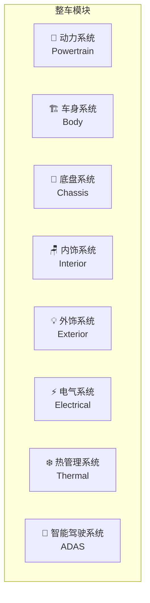

> [!summary] 汽车整车模块分解与供应链全景
> - **核心**：一辆汽车由多少个零件组成？各大模块如何划分？主要供应商是谁？本文用通俗语言+爆炸图，带你全面理解汽车结构与供应链。
> - **要点**：一、汽车有多少个零件？
> - **要点**：1.1 零件数量对比
> - **要点**：1.2 BOM 层级结构
> - **要点**：二、整车模块划分（8 大模块）

# 汽车整车模块分解与供应链全景

> 一辆汽车由多少个零件组成？各大模块如何划分？主要供应商是谁？本文用通俗语言+爆炸图，带你全面理解汽车结构与供应链。

---

## 一、汽车有多少个零件？

### 1.1 零件数量对比

| 车型类型 | 零件数量 | 说明 |
|----------|----------|------|
| **传统燃油车** | 30,000+ | 发动机、变速箱复杂 |
| **纯电动车** | 10,000-15,000 | 取消发动机、简化传动 |
| **智能手机** | 1,500-2,000 | 对比参考 |
| **笔记本电脑** | 2,000-3,000 | 对比参考 |

> 💡 **关键洞察**：电动车零件数量比燃油车减少 **50-60%**，这是电动车成本下降和制造简化的核心原因。

### 1.2 BOM 层级结构

```
整车（Vehicle Level）
├── 系统级（System Level）— 8-12 个系统
│   ├── 总成级（Assembly Level）— 50-100 个总成
│   │   ├── 零部件级（Component Level）— 500-1,000 个零部件
│   │   │   └── 零件级（Part Level）— 10,000-30,000 个零件
```

---

## 二、整车模块划分（8 大模块）



### 2.1 各模块成本占比（电动车 vs 燃油车）

| 模块 | 电动车成本占比 | 燃油车成本占比 | 变化 |
|------|--------------|--------------|------|
| **动力系统** | 40-50% | 25-35% | ⬆️ +15%（电池主导） |
| **车身系统** | 15-20% | 15-20% | ➡️ 持平 |
| **底盘系统** | 10-15% | 12-18% | ⬇️ -3% |
| **内饰系统** | 8-12% | 10-15% | ⬇️ -3% |
| **外饰系统** | 3-5% | 3-5% | ➡️ 持平 |
| **电气系统** | 8-12% | 8-12% | ➡️ 持平 |
| **热管理系统** | 5-8% | 3-5% | ⬆️ +3%（电池热管理） |
| **智能驾驶系统** | 3-8% | 1-3% | ⬆️ +5% |

---

## 三、模块详解与爆炸图

### 3.1 🔋 动力系统（Powertrain）

**燃油车 vs 电动车对比**：

| 组件 | 燃油车 | 电动车 | 说明 |
|------|--------|--------|------|
| **动力源** | 内燃机（ICE） | 电池包 + 电机 | 核心差异 |
| **传动** | 变速箱（6-10AT/DCT） | 单速减速器 | 电动车简化 |
| **能量存储** | 油箱（50-80L） | 电池包（50-100kWh） | 形态完全不同 |
| **排放** | 排气系统、三元催化 | 无 | 电动车零排放 |
| **启动** | 启动电机、发电机 | 电机直接启动 | 一体化 |

#### **电动车动力系统爆炸图**

```
┌─────────────────────────────────────────────────────────────────┐
│                    电动车动力系统爆炸图                            │
├─────────────────────────────────────────────────────────────────┤
│                                                                 │
│                          ┌─────────────┐                        │
│                          │   电池包     │                        │
│                          │ Battery Pack│                        │
│                          └──────┬──────┘                        │
│                                 │                               │
│                    ┌────────────┼────────────┐                  │
│                    ▼            ▼            ▼                  │
│            ┌──────────┐  ┌──────────┐  ┌──────────┐            │
│            │ 电芯模组  │  │  BMS     │  │ 热管理   │            │
│            │ Cell Module│ │ Battery  │  │ Thermal  │            │
│            │          │  │ Management│  │ Management│            │
│            └──────────┘  └──────────┘  └──────────┘            │
│                                                                 │
│                          ┌─────────────┐                        │
│                          │  电机       │                        │
│                          │ Motor      │                        │
│                          └──────┬──────┘                        │
│                                 │                               │
│                    ┌────────────┼────────────┐                  │
│                    ▼            ▼            ▼                  │
│            ┌──────────┐  ┌──────────┐  ┌──────────┐            │
│            │ 定子      │  │ 转子     │  │ 减速器   │            │
│            │ Stator   │  │ Rotor    │  │ Reducer  │            │
│            └──────────┘  └──────────┘  └──────────┘            │
│                                                                 │
│                          ┌─────────────┐                        │
│                          │ 电控系统    │                        │
│                          │ Power      │                        │
│                          │ Electronics│                        │
│                          └──────┬──────┘                        │
│                                 │                               │
│                    ┌────────────┼────────────┐                  │
│                    ▼            ▼            ▼                  │
│            ┌──────────┐  ┌──────────┐  ┌──────────┐            │
│            │ 逆变器    │  │ DC-DC    │  │ OBC      │            │
│            │ Inverter │  │ Converter│  │ 充电机   │            │
│            └──────────┘  └──────────┘  └──────────┘            │
│                                                                 │
└─────────────────────────────────────────────────────────────────┘
```

#### **动力系统主要供应商**

| 组件 | Tier 1 供应商 | Tier 2 供应商 | 市场份额 |
|------|--------------|--------------|----------|
| **电池电芯** | 宁德时代(CATL)、LG新能源、比亚迪、松下、三星SDI | 当升科技、容百科技、天赐材料 | CATL 35%+ |
| **电池模组/PACK** | 宁德时代、比亚迪、国轩高科 | 华鼎国联、欣旺达 | CATL 35%+ |
| **BMS** | 宁德时代(自研)、比亚迪(自研)、博世、大陆 | TI、ADI、NXP | OEM 自研趋势 |
| **驱动电机** | 博世、日电产(Nidec)、采埃孚(ZF)、汇川技术 | 方正电机、卧龙电驱 | Nidec 15%+ |
| **电机控制器** | 英飞凌(Infineon)、ST、安森美(Onsemi) | 比亚迪(自研)、汇川 | Infineon 25%+ |
| **IGBT/SiC** | 英飞凌、ST、Wolfspeed | 比亚迪半导体、斯达半导 | Infineon 30%+ |
| **减速器** | 采埃孚(ZF)、麦格纳(Magna)、吉利(自研) | 精进电动、巨一自动化 | ZF 20%+ |

---

### 3.2 🏗️ 车身系统（Body）

**车身结构爆炸图**：

```
┌─────────────────────────────────────────────────────────────────┐
│                       车身系统爆炸图                              │
├─────────────────────────────────────────────────────────────────┤
│                                                                 │
│    ┌─────────────────────────────────────────────────────┐     │
│    │                   白车身 (BIW)                        │     │
│    │            Body in White                             │     │
│    └─────────────────────────────────────────────────────┘     │
│                              │                                  │
│         ┌────────────────────┼────────────────────┐            │
│         ▼                    ▼                    ▼            │
│  ┌─────────────┐    ┌─────────────┐    ┌─────────────┐        │
│  │ 车身骨架    │    │ 车门总成    │    │ 覆盖件      │        │
│  │ Body Frame │    │ Door Assy  │    │ Panels     │        │
│  └─────────────┘    └─────────────┘    └─────────────┘        │
│         │                    │                    │            │
│    ┌────┴────┐          ┌────┴────┐          ┌────┴────┐      │
│    ▼         ▼          ▼         ▼          ▼         ▼      │
│ ┌─────┐ ┌─────┐   ┌─────┐ ┌─────┐   ┌─────┐ ┌─────┐        │
│ │前纵梁│ │A柱  │   │车门板│ │车窗  │   │引擎盖│ │翼子板│        │
│ │Front│ │A-Pi │   │Door │ │Wind │   │Hood │ │Fend │        │
│ │Rail │ │llar │   │Panel│ │ow   │   │     │ │er   │        │
│ └─────┘ └─────┘   └─────┘ └─────┘   └─────┘ └─────┘        │
│                                                                 │
│  ┌─────────────────────────────────────────────────────┐     │
│  │                   车身材料                           │     │
│  ├─────────────────────────────────────────────────────┤     │
│  │ • 高强度钢（60-70%）                                │     │
│  │ • 铝合金（10-20%）— 特斯拉、蔚来大量使用            │     │
│  │ • 碳纤维（<5%）— 高端车型                           │     │
│  │ • 塑料/复合材料（10-15%）— 保险杠、翼子板           │     │
│  └─────────────────────────────────────────────────────┘     │
│                                                                 │
└─────────────────────────────────────────────────────────────────┘
```

#### **车身系统主要供应商**

| 组件 | 主要供应商 | 说明 |
|------|-----------|------|
| **白车身冲压件** | 海斯坦普(Gestamp)、麦格纳(Magna)、凌云股份 | 高强度钢冲压 |
| **铝合金车身** | 诺贝丽斯(Novelis)、忠旺集团、南山铝业 | 特斯拉/蔚来供应商 |
| **车门系统** | 海拉(Hella)、博泽(Brose)、麦格纳 | 车门模块总成 |
| **车窗玻璃** | 福耀玻璃、旭硝子(AGC)、圣戈班(Saint-Gobain) | 福耀全球第一 |
| **密封条** | 库博标准(Cooper Standard)、丰田合成、海达股份 | 密封隔音 |
| **车身电子** | 博世、大陆、安波福(Aptiv) | 车身控制模块 |

---

### 3.3 🛞 底盘系统（Chassis）

**底盘系统爆炸图**：

```
┌─────────────────────────────────────────────────────────────────┐
│                       底盘系统爆炸图                              │
├─────────────────────────────────────────────────────────────────┤
│                                                                 │
│                         ┌─────────────┐                        │
│                         │  转向系统   │                        │
│                         │  Steering   │                        │
│                         └──────┬──────┘                        │
│                                │                               │
│                   ┌────────────┼────────────┐                  │
│                   ▼            ▼            ▼                  │
│           ┌──────────┐  ┌──────────┐  ┌──────────┐            │
│           │ 转向机    │  │ 转向柱   │  │ 方向盘   │            │
│           │ Steering │  │ Column   │  │ Wheel   │            │
│           │ Gear     │  │          │  │          │            │
│           └──────────┘  └──────────┘  └──────────┘            │
│                                                                 │
│                         ┌─────────────┐                        │
│                         │  悬架系统   │                        │
│                         │ Suspension  │                        │
│                         └──────┬──────┘                        │
│                                │                               │
│              ┌─────────────────┼─────────────────┐             │
│              ▼                 ▼                 ▼             │
│      ┌──────────────┐  ┌──────────────┐  ┌──────────────┐     │
│      │ 前悬架       │  │ 后悬架       │  │ 减震器       │     │
│      │ Front       │  │ Rear        │  │ Damper      │     │
│      │ Suspension  │  │ Suspension  │  │ (Shock)     │     │
│      └──────────────┘  └──────────────┘  └──────────────┘     │
│              │                 │                 │             │
│         ┌────┴────┐       ┌────┴────┐       ┌────┴────┐       │
│         ▼         ▼       ▼         ▼       ▼         ▼       │
│     ┌──────┐ ┌──────┐ ┌──────┐ ┌──────┐ ┌──────┐ ┌──────┐   │
│     │麦弗逊│ │双叉臂│ │多连杆│ │扭力梁│ │液压  │ │空气  │   │
│     │McPher│ │Double│ │Multi│ │Torsi │ │Hydra│ │Air   │   │
│     │son   │ │Wishbo│ │Link │ │on    │ │ulic │ │      │   │
│     └──────┘ └──────┘ └──────┘ └──────┘ └──────┘ └──────┘   │
│                                                                 │
│                         ┌─────────────┐                        │
│                         │  制动系统   │                        │
│                         │  Braking    │                        │
│                         └──────┬──────┘                        │
│                                │                               │
│                   ┌────────────┼────────────┐                  │
│                   ▼            ▼            ▼                  │
│           ┌──────────┐  ┌──────────┐  ┌──────────┐            │
│           │ 制动卡钳  │  │ 制动盘   │  │ ESP/ABS  │            │
│           │ Brake    │  │ Disc     │  │ System   │            │
│           │ Caliper  │  │          │  │          │            │
│           └──────────┘  └──────────┘  └──────────┘            │
│                                                                 │
│                         ┌─────────────┐                        │
│                         │  轮胎轮毂   │                        │
│                         │  Wheels     │                        │
│                         └──────┬──────┘                        │
│                                │                               │
│                   ┌────────────┼────────────┐                  │
│                   ▼            ▼            ▼                  │
│           ┌──────────┐  ┌──────────┐  ┌──────────┐            │
│           │ 轮胎      │  │ 轮毂     │  │ 轴承     │            │
│           │ Tire     │  │ Rim      │  │ Bearing  │            │
│           └──────────┘  └──────────┘  └──────────┘            │
│                                                                 │
└─────────────────────────────────────────────────────────────────┘
```

#### **底盘系统主要供应商**

| 组件 | 主要供应商 | 说明 |
|------|-----------|------|
| **转向系统** | 博世(Bosch)、采埃孚(ZF)、蒂森克虏伯(ThyssenKrupp) | EPS 电动助力转向 |
| **悬架系统** | 采埃孚(ZF)、天纳克(Tennaco)、大陆(Continental) | 空气悬架高端 |
| **空气悬架** | 大陆(Continental)、威巴克(Vibracoustic)、孔辉科技 | 蔚来/理想供应商 |
| **制动系统** | 大陆(Continental)、博世(Bosch)、布雷博(Brembo) | ESP/ABS |
| **制动卡钳** | 布雷博(Brembo)、博世(Bosch)、大陆(Continental) | 高性能制动 |
| **轮胎** | 米其林(Michelin)、普利司通(Bridgestone)、大陆(Continental) | 三大巨头 |
| **轮毂** | 中信戴卡、万丰奥威、立中集团 | 铝合金轮毂 |

---

### 3.4 🪑 内饰系统（Interior）

**内饰系统爆炸图**：

```
┌─────────────────────────────────────────────────────────────────┐
│                       内饰系统爆炸图                              │
├─────────────────────────────────────────────────────────────────┤
│                                                                 │
│                         ┌─────────────┐                        │
│                         │  座舱总成   │                        │
│                         │  Cockpit    │                        │
│                         └──────┬──────┘                        │
│                                │                               │
│         ┌──────────────────────┼──────────────────────┐        │
│         ▼                      ▼                      ▼        │
│  ┌─────────────┐    ┌─────────────┐    ┌─────────────┐        │
│  │ 仪表板总成  │    │ 座椅总成    │    │ 门内饰板    │        │
│  │ Instrument │    │ Seat Assy  │    │ Door Trim  │        │
│  │ Panel      │    │            │    │            │        │
│  └─────────────┘    └─────────────┘    └─────────────┘        │
│         │                  │                  │                │
│    ┌────┴────┐        ┌────┴────┐        ┌────┴────┐          │
│    ▼         ▼        ▼         ▼        ▼         ▼          │
│ ┌─────┐ ┌─────┐  ┌─────┐ ┌─────┐  ┌─────┐ ┌─────┐          │
│ │中控屏│ │仪表 │  │座椅骨架│ │座椅面│  │门板  │ │扶手  │          │
│ │Center│ │Instr│  │Seat │ │Seat │  │Door │ │Arm  │          │
│ │Displ │ │ment │  │Frame│ │Cover│  │Panel│ │rest │          │
│ └─────┘ └─────┘  └─────┘ └─────┘  └─────┘ └─────┘          │
│                                                                 │
│                         ┌─────────────┐                        │
│                         │  方向盘总成  │                        │
│                         │  Steering   │                        │
│                         │  Wheel      │                        │
│                         └──────┬──────┘                        │
│                                │                               │
│                   ┌────────────┼────────────┐                  │
│                   ▼            ▼            ▼                  │
│           ┌──────────┐  ┌──────────┐  ┌──────────┐            │
│           │ 方向盘    │  │ 安全气囊  │  │ 多功能按键│            │
│           │ Wheel    │  │ Airbag   │  │ Buttons  │            │
│           └──────────┘  └──────────┘  └──────────┘            │
│                                                                 │
│  ┌─────────────────────────────────────────────────────┐     │
│  │                   内饰材料                           │     │
│  ├─────────────────────────────────────────────────────┤     │
│  │ • 真皮/仿皮 — 座椅、方向盘                          │     │
│  │ • 塑料/软触材质 — 仪表板、门板                       │     │
│  │ • 织物/Alcantara — 运动座椅                         │     │
│  │ • 金属/木纹饰条 — 装饰面板                           │     │
│  │ • 玻璃 — 中控屏、仪表罩                              │     │
│  └─────────────────────────────────────────────────────┘     │
│                                                                 │
└─────────────────────────────────────────────────────────────────┘
```

#### **内饰系统主要供应商**

| 组件 | 主要供应商 | 说明 |
|------|-----------|------|
| **座椅总成** | 安道拓(Adient)、李尔(Lear)、佛吉亚(Faurecia)、延锋安道拓 | 全球四大座椅供应商 |
| **座椅骨架** | 安道拓、李尔、华域汽车 | 钢/铝合金骨架 |
| **座椅电机** | 博泽(Brose)、电装(Denso)、德昌电机 | 电动调节 |
| **仪表板** | 佛吉亚(Faurecia)、安道拓、延锋 | 注塑+包覆 |
| **中控屏** | 京东方(BOE)、天马微电子、LG Display、三星显示 | 面板供应商 |
| **仪表盘** | 大陆(Continental)、博世(Bosch)、电装(Denso) | 液晶仪表 |
| **安全气囊** | 奥托立夫(Autoliv)、采埃孚(ZF)、均胜电子 | 全球两大巨头 |
| **方向盘** | 均胜电子、丰田合成、高田(Takata) | 集成安全气囊 |
| **音响系统** | 哈曼(Harman)、BOSE、丹拿(Dynaudio)、柏林之声 | 高端音响 |
| **线束** | 安波福(Aptiv)、矢崎(Yazaki)、住友电气、莱尼(Leoni) | 全球四大 |

---

### 3.5 💡 外饰系统（Exterior）

**外饰系统爆炸图**：

```
┌─────────────────────────────────────────────────────────────────┐
│                       外饰系统爆炸图                              │
├─────────────────────────────────────────────────────────────────┤
│                                                                 │
│                         ┌─────────────┐                        │
│                         │  前脸总成   │                        │
│                         │  Front End  │                        │
│                         └──────┬──────┘                        │
│                                │                               │
│         ┌──────────────────────┼──────────────────────┐        │
│         ▼                      ▼                      ▼        │
│  ┌─────────────┐    ┌─────────────┐    ┌─────────────┐        │
│  │ 前保险杠    │    │ 前大灯      │    │ 格栅        │        │
│  │ Front      │    │ Headlamp   │    │ Grille     │        │
│  │ Bumper     │    │            │    │            │        │
│  └─────────────┘    └─────────────┘    └─────────────┘        │
│         │                  │                  │                │
│    ┌────┴────┐        ┌────┴────┐        ┌────┴────┐          │
│    ▼         ▼        ▼         ▼        ▼         ▼          │
│ ┌─────┐ ┌─────┐  ┌─────┐ ┌─────┐  ┌─────┐ ┌─────┐          │
│ │保险杠│ │导流板│  │LED灯│ │日行灯│  │主动格│ │品牌标│          │
│ │Bar  │ │Air  │  │LED  │ │DRL  │  │Active│ │Logo │          │
│ │     │ │Dam  │  │     │ │     │  │Grill│ │     │          │
│ └─────┘ └─────┘  └─────┘ └─────┘  └─────┘ └─────┘          │
│                                                                 │
│                         ┌─────────────┐                        │
│                         │  尾部总成   │                        │
│                         │  Rear End   │                        │
│                         └──────┬──────┘                        │
│                                │                               │
│         ┌──────────────────────┼──────────────────────┐        │
│         ▼                      ▼                      ▼        │
│  ┌─────────────┐    ┌─────────────┐    ┌─────────────┐        │
│  │ 后保险杠    │    │ 尾灯        │    │ 后备箱盖    │        │
│  │ Rear       │    │ Taillamp   │    │ Trunk Lid  │        │
│  │ Bumper     │    │            │    │            │        │
│  └─────────────┘    └─────────────┘    └─────────────┘        │
│                                                                 │
│                         ┌─────────────┐                        │
│                         │  其他外饰   │                        │
│                         └──────┬──────┘                        │
│                                │                               │
│         ┌──────────────────────┼──────────────────────┐        │
│         ▼                      ▼                      ▼        │
│  ┌─────────────┐    ┌─────────────┐    ┌─────────────┐        │
│  │ 后视镜      │    │ 雨刮系统    │    │ 车标/徽章   │        │
│  │ Mirror     │    │ Wiper      │    │ Badge      │        │
│  └─────────────┘    └─────────────┘    └─────────────┘        │
│                                                                 │
└─────────────────────────────────────────────────────────────────┘
```

#### **外饰系统主要供应商**

| 组件 | 主要供应商 | 说明 |
|------|-----------|------|
| **前大灯** | 海拉(Hella)、小糸(Koito)、法雷奥(Valeo)、马瑞利(Marelli) | LED/激光大灯 |
| **尾灯** | 海拉(Hella)、小糸(Koito)、法雷奥(Valeo) | LED 贯穿式尾灯 |
| **保险杠** | 模塑科技、延锋彼欧、佛吉亚(Faurecia) | 塑料注塑 |
| **后视镜** | 麦格纳(Magna)、市光工业(Ichikoh)、镜泰(Gentex) | 电动折叠+加热 |
| **雨刮** | 法雷奥(Valeo)、博世(Bosch)、电装(Denso) | 无骨雨刮 |
| **车标/徽章** | 各 OEM 自制 | 品牌标识 |

---

### 3.6 ⚡ 电气系统（Electrical）

**电气系统架构图**：

```
┌─────────────────────────────────────────────────────────────────┐
│                       电气系统架构图                              │
├─────────────────────────────────────────────────────────────────┤
│                                                                 │
│    ┌─────────────────────────────────────────────────────┐     │
│    │                  电源系统                             │     │
│    │         Power Supply System                         │     │
│    └───────────────────────┬─────────────────────────────┘     │
│                            │                                   │
│         ┌──────────────────┼──────────────────┐                │
│         ▼                  ▼                  ▼                │
│  ┌─────────────┐    ┌─────────────┐    ┌─────────────┐        │
│  │ 高压电池    │    │ 低压电池    │    │ DC-DC       │        │
│  │ HV Battery │    │ LV Battery │    │ Converter  │        │
│  │ (400V/800V)│    │ (12V)      │    │            │        │
│  └─────────────┘    └─────────────┘    └─────────────┘        │
│                                                                 │
│    ┌─────────────────────────────────────────────────────┐     │
│    │                  线束系统                             │     │
│    │         Wiring Harness                              │     │
│    └───────────────────────┬─────────────────────────────┘     │
│                            │                                   │
│         ┌──────────────────┼──────────────────┐                │
│         ▼                  ▼                  ▼                │
│  ┌─────────────┐    ┌─────────────┐    ┌─────────────┐        │
│  │ 高压线束    │    │ 低压线束    │  │ 信号线束    │        │
│  │ HV Harness │    │ LV Harness │    │ Signal     │        │
│  │            │    │            │    │ Harness    │        │
│  └─────────────┘    └─────────────┘    └─────────────┘        │
│                                                                 │
│    ┌─────────────────────────────────────────────────────┐     │
│    │                  控制器系统                           │     │
│    │         ECU / Domain Controller                     │     │
│    └───────────────────────┬─────────────────────────────┘     │
│                            │                                   │
│    ┌───────────┬───────────┼───────────┬───────────┐           │
│    ▼           ▼           ▼           ▼           ▼           │
│ ┌──────┐  ┌──────┐  ┌──────┐  ┌──────┐  ┌──────┐            │
│ │VCU   │  │BMS   │  │MCU   │  │ADAS  │  │座舱  │            │
│ │整车  │  │电池  │  │电机  │  │域控  │  │域控  │            │
│ │控制  │  │管理  │  │控制  │  │      │  │      │            │
│ └──────┘  └──────┘  └──────┘  └──────┘  └──────┘            │
│                                                                 │
│    ┌─────────────────────────────────────────────────────┐     │
│    │                  传感器系统                           │     │
│    │         Sensors                                    │     │
│    └───────────────────────┬─────────────────────────────┘     │
│                            │                                   │
│    ┌───────────┬───────────┼───────────┬───────────┐           │
│    ▼           ▼           ▼           ▼           ▼           │
│ ┌──────┐  ┌──────┐  ┌──────┐  ┌──────┐  ┌──────┐            │
│ │摄像头│  │雷达  │  │超声波│  │IMU   │  │温度  │            │
│ │Camera│  │Radar │  │USS   │  │      │  │Temp  │            │
│ └──────┘  └──────┘  └──────┘  └──────┘  └──────┘            │
│                                                                 │
└─────────────────────────────────────────────────────────────────┘
```

#### **电气系统主要供应商**

| 组件 | 主要供应商 | 说明 |
|------|-----------|------|
| **高压线束** | 安波福(Aptiv)、莱尼(Leoni)、住友电气 | 400V/800V 高压 |
| **低压线束** | 矢崎(Yazaki)、安波福(Aptiv)、住友电气 | 全球四大 |
| **连接器** | 泰科(TE Connectivity)、安波福(Aptiv)、莫仕(Molex) | 高压/低压连接器 |
| **域控制器** | 博世(Bosch)、大陆(Continental)、德赛西威、华为 | 座舱/智驾域控 |
| **VCU 整车控制** | 博世、大陆、联电(United Electronics) | 整车控制器 |
| **低压电池** | 骆驼蓄电池、瓦尔塔(Varta)、风帆 | 12V 铅酸/锂电 |
| **保险丝盒** | Littelfuse、博世、安波福 | 过流保护 |

---

### 3.7 ❄️ 热管理系统（Thermal Management）

**热管理系统架构图**：

```
┌─────────────────────────────────────────────────────────────────┐
│                    电动车热管理系统架构图                          │
├─────────────────────────────────────────────────────────────────┤
│                                                                 │
│    ┌─────────────────────────────────────────────────────┐     │
│    │                  热管理集成模块                       │     │
│    │         Thermal Management Module                   │     │
│    └───────────────────────┬─────────────────────────────┘     │
│                            │                                   │
│    ┌───────────────────────┼───────────────────────┐           │
│    ▼                       ▼                       ▼           │
│ ┌─────────────┐    ┌─────────────┐    ┌─────────────┐        │
│ │ 电池热管理  │    │ 电驱热管理  │    │ 座舱热管理  │        │
│ │ Battery    │    │ E-Drive    │    │ Cabin     │        │
│ │ Thermal    │    │ Thermal    │    │ Thermal   │        │
│ └─────────────┘    └─────────────┘    └─────────────┘        │
│         │                  │                  │                │
│         ▼                  ▼                  ▼                │
│  ┌─────────────┐    ┌─────────────┐    ┌─────────────┐        │
│  │ 冷却板      │    │ 散热器      │    │ 热泵空调    │        │
│  │ Cold Plate │    │ Radiator   │    │ Heat Pump │        │
│  └─────────────┘    └─────────────┘    └─────────────┘        │
│                                                                 │
│  ┌─────────────────────────────────────────────────────┐     │
│  │                  关键组件                             │     │
│  ├─────────────────────────────────────────────────────┤     │
│  │ • 冷却液（乙二醇+水）                                │     │
│  │ • 电子水泵 — 博世、盖茨(Gates)                       │     │
│  │ • 电子膨胀阀 — 三花智控、盾安环境                     │     │
│  │ • 冷凝器/蒸发器 — 翰昂、法雷奥                       │     │
│  │ • 热泵系统 — 法雷奥、翰昂、特斯拉自研                 │     │
│  └─────────────────────────────────────────────────────┘     │
│                                                                 │
└─────────────────────────────────────────────────────────────────┘
```

#### **热管理系统主要供应商**

| 组件 | 主要供应商 | 说明 |
|------|-----------|------|
| **热泵空调** | 法雷奥(Valeo)、翰昂(Hanon Systems)、电装(Denso) | 特斯拉自研 |
| **电子水泵** | 博世(Bosch)、盖茨(Gates)、飞龙股份 | 电池冷却 |
| **电子膨胀阀** | 三花智控、盾安环境、Egelhof | 热管理核心部件 |
| **冷凝器** | 翰昂(Hanon)、法雷奥、银轮股份 | 空调系统 |
| **电池冷却板** | 翰昂(Hanon)、三花智控、拓普集团 | 液冷板 |
| **散热器** | 翰昂(Hanon)、马勒(MAHLE)、银轮股份 | 电驱散热 |

---

### 3.8 🤖 智能驾驶系统（ADAS）

**智能驾驶系统架构图**：

```
┌─────────────────────────────────────────────────────────────────┐
│                    智能驾驶系统架构图                              │
├─────────────────────────────────────────────────────────────────┤
│                                                                 │
│    ┌─────────────────────────────────────────────────────┐     │
│    │                  感知层                               │     │
│    │         Perception                                  │     │
│    └───────────────────────┬─────────────────────────────┘     │
│                            │                                   │
│    ┌───────────┬───────────┼───────────┬───────────┐           │
│    ▼           ▼           ▼           ▼           ▼           │
│ ┌──────┐  ┌──────┐  ┌──────┐  ┌──────┐  ┌──────┐            │
│ │摄像头│  │毫米波│  │激光  │  │超声波│  │高精  │            │
│ │Camera│  │雷达  │  │雷达  │  │雷达  │  │地图  │            │
│ │      │  │mmWave│  │LiDAR│  │USS   │  │HD Map│            │
│ └──────┘  └──────┘  └──────┘  └──────┘  └──────┘            │
│                                                                 │
│    ┌─────────────────────────────────────────────────────┐     │
│    │                  决策层                               │     │
│    │         Decision Making                             │     │
│    └───────────────────────┬─────────────────────────────┘     │
│                            │                                   │
│         ┌──────────────────┼──────────────────┐                │
│         ▼                  ▼                  ▼                │
│  ┌─────────────┐    ┌─────────────┐    ┌─────────────┐        │
│  │ 域控制器    │    │ 算法芯片    │    │ 软件平台    │        │
│  │ ADAS DC    │    │ SoC        │    │ Software   │        │
│  └─────────────┘    └─────────────┘    └─────────────┘        │
│                                                                 │
│    ┌─────────────────────────────────────────────────────┐     │
│    │                  执行层                               │     │
│    │         Execution                                   │     │
│    └───────────────────────┬─────────────────────────────┘     │
│                            │                                   │
│         ┌──────────────────┼──────────────────┐                │
│         ▼                  ▼                  ▼                │
│  ┌─────────────┐    ┌─────────────┐    ┌─────────────┐        │
│  │ 线控转向    │    │ 线控制动    │    │ 线控油门    │        │
│  │ Steer by   │    │ Brake by   │    │ Throttle   │        │
│  │ Wire       │    │ Wire       │    │ by Wire    │        │
│  └─────────────┘    └─────────────┘    └─────────────┘        │
│                                                                 │
└─────────────────────────────────────────────────────────────────┘
```

#### **智能驾驶系统主要供应商**

| 组件 | 主要供应商 | 说明 |
|------|-----------|------|
| **摄像头** | Mobileye、博世(Bosch)、大陆(Continental)、舜宇光学 | 前视+环视 |
| **毫米波雷达** | 博世(Bosch)、大陆(Continental)、采埃孚(ZF) | 77GHz 4D 雷达 |
| **激光雷达(LiDAR)** | 禾赛科技、速腾聚创、图达通、Luminar、Velodyne | 中国厂商领先 |
| **超声波雷达** | 博世、法雷奥(Valeo)、尼赛拉 | 泊车辅助 |
| **ADAS 域控** | Mobileye、英伟达(NVIDIA)、地平线、华为 | 高算力平台 |
| **智驾芯片** | 英伟达(NVIDIA)、Mobileye、高通(Qualcomm)、地平线 | Orin/Xavier |
| **高精地图** | 百度、四维图新、TomTom、Here | 中国/欧美分开 |
| **线控转向** | 博世(Bosch)、采埃孚(ZF)、蒂森克虏伯 | L3+ 必须 |
| **线控制动** | 博世(Bosch)、大陆(Continental)、博世华域 | EPB+ESC |

---

## 四、新能源 vs 燃油车模块差异

### 4.1 核心差异对比

| 维度 | 燃油车 | 电动车 | 变化 |
|------|--------|--------|------|
| **动力源** | 内燃机（2,000+ 零件） | 电机（200 零件） | ⬇️ -90% |
| **传动系统** | 变速箱（8-10AT） | 单速减速器 | ⬇️ -80% |
| **能量存储** | 油箱 | 电池包 | ⬆️ 复杂度增加 |
| **排放系统** | 排气管+三元催化 | 无 | ⬇️ -100% |
| **热管理** | 发动机冷却 | 电池+电机+座舱热管理 | ⬆️ 复杂度增加 |
| **电气架构** | 12V | 400V/800V 高压 | ⬆️ 复杂度增加 |
| **智能驾驶** | L1-L2 | L2-L4 | ⬆️ 复杂度增加 |

### 4.2 供应商格局变化

| 模块 | 燃油车时代霸主 | 电动车时代新玩家 | 变化趋势 |
|------|--------------|-----------------|----------|
| **动力系统** | 博世、大陆、采埃孚 | CATL、比亚迪、宁德时代 | 🔴 中国厂商崛起 |
| **电驱系统** | 博世、日电产 | 汇川技术、精进电动 | 🟡 格局重塑 |
| **电池** | 无 | CATL、LG、比亚迪 | 🟢 全新赛道 |
| **智驾芯片** | Mobileye、TI | 英伟达、高通、地平线 | 🔴 算力军备竞赛 |
| **激光雷达** | 无 | 禾赛、速腾、图达通 | 🟢 中国领先 |
| **热管理** | 翰昂、法雷奥 | 三花智控、拓普集团 | 🟡 中国渗透 |

---

## 五、小米 SU7 供应商分析

### 5.1 SU7 核心供应商

| 模块       | 供应商            | 是否自研   | 说明              |
| -------- | -------------- | ------ | --------------- |
| **电池**   | 宁德时代(CATL)、比亚迪 | ❌ 外采   | 麒麟电池+刀片电池       |
| **电机**   | 汇川技术           | ✅ 联合开发 | HyperEngine V8s |
| **电控**   | 比亚迪半导体         | ❌ 外采   | IGBT 模块         |
| **智驾芯片** | 英伟达(NVIDIA)    | ❌ 外采   | Orin-X          |
| **激光雷达** | 禾赛科技           | ❌ 外采   | AT128           |
| **域控制器** | 德赛西威           | ❌ 外采   | 座舱+智驾域控         |
| **线束**   | 安波福(Aptiv)     | ❌ 外采   | 高压+低压线束         |
| **座椅**   | 安道拓(Adient)    | ❌ 外采   | 前后排座椅           |
| **热管理**  | 三花智控、拓普集团      | ❌ 外采   | 热泵+冷却板          |
| **制动**   | 博世(Bosch)      | ❌ 外采   | IPB+ESP         |
| **转向**   | 博世(Bosch)      | ❌ 外采   | EPS             |
| **悬架**   | 采埃孚(ZF)        | ❌ 外采   | CDC 减震器         |

### 5.2 小米自研 vs 外采策略

| 自研方向 | 外采方向 | 策略逻辑 |
|----------|----------|----------|
| ✅ 智能座舱 | ❌ 电池/电机 | 核心体验自研 |
| ✅ 智驾算法 | ❌ 传统零部件 | 差异化竞争力 |
| ✅ 电驱系统 | ❌ 底盘系统 | 供应链安全 |
| ✅ 整车架构 | ❌ 内外饰 | 快速迭代能力 |

---

## 六、总结

### 6.1 整车模块全景

| 模块 | 零件数 | 成本占比 | 主要玩家 |
|------|--------|----------|----------|
| **动力系统** | 500-1,000 | 40-50% | CATL、博世、汇川 |
| **车身系统** | 1,000-2,000 | 15-20% | 海斯坦普、福耀 |
| **底盘系统** | 800-1,500 | 10-15% | 博世、大陆、采埃孚 |
| **内饰系统** | 2,000-3,000 | 8-12% | 安道拓、延锋 |
| **外饰系统** | 500-800 | 3-5% | 海拉、法雷奥 |
| **电气系统** | 1,500-2,500 | 8-12% | 安波福、矢崎 |
| **热管理系统** | 300-500 | 5-8% | 翰昂、三花智控 |
| **智能驾驶系统** | 200-500 | 3-8% | 英伟达、Mobileye、华为 |

### 6.2 供应商层级

```
供应链层级：

Tier 3：原材料供应商（钢、铝、塑料、芯片晶圆）
   ↓
Tier 2：零部件供应商（电芯、传感器、轴承、密封件）
   ↓
Tier 1：系统集成商（博世、大陆、采埃孚、CATL）
   ↓
OEM：整车厂（小米、特斯拉、比亚迪、宝马）
   ↓
经销商/消费者
```

### 6.3 电动车供应链趋势

| 趋势 | 说明 | 影响 |
|------|------|------|
| **电池为王** | 电池占成本 40%+ | 电池厂商话语权增强 |
| **中国崛起** | CATL、比亚迪、汇川、三花 | 中国供应商全球份额提升 |
| **软硬分离** | 软件定义汽车 | 芯片+算法公司崛起 |
| **垂直整合** | 特斯拉/比亚迪自研 | 传统 Tier 1 被挤压 |
| **域控融合** | 分散 ECU → 域控制器 | 传统 Tier 1 转型 |

---

## 参考资料

### 行业数据
- [S&P Global - Automotive Components](https://www.spglobal.com)
- [JATO Dynamics - Vehicle Components](https://www.jato.com)
- [MarkLines - Automotive Supplier Database](https://www.marklines.com)

### 供应商官网
- [博世 Bosch](https://www.bosch.com)
- [大陆 Continental](https://www.continental.com)
- [采埃孚 ZF](https://www.zf.com)
- [宁德时代 CATL](https://www.catl.com)
- [安道拓 Adient](https://www.adient.com)
- [安波福 Aptiv](https://www.aptiv.com)

### 相关笔记
- [[出海模式总览|出海模式总览]]
- [[SU7_CKD拆分方案|SU7 CKD 散件拆分方案]]
- [[汽车细分市场调研|汽车细分市场调研]]
