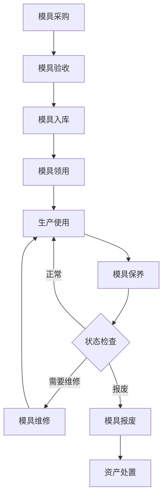

> [!summary] 固定资产投入与分摊策略
> - **核心**：汽车出海建厂的前期工程投入量级、分摊成本计算、供应商支付条款、模具管理、CAPEX/OPEX 配比等核心问题深度解析。
> - **要点**：一、前期工程投入量级
> - **要点**：1.1 汽车工厂建设总投入
> - **要点**：1.2 前期工程投入明细（以全工序工厂为例）
> - **要点**：1.3 模具投入详解

# 固定资产投入与分摊策略

> 汽车出海建厂的前期工程投入量级、分摊成本计算、供应商支付条款、模具管理、CAPEX/OPEX 配比等核心问题深度解析。

---

## 一、前期工程投入量级

### 1.1 汽车工厂建设总投入

| 工厂类型 | 投资规模 | 建设周期 | 产能规模 | 案例 |
|----------|----------|----------|----------|------|
| **CKD 组装厂** | $20-50M | 12-18 个月 | 5-10 万辆/年 | 零跑波兰工厂 |
| **全工序工厂** | $100-200M | 24-36 个月 | 10-20 万辆/年 | BYD 匈牙利工厂 |
| **超级工厂** | $500M-1B | 36-48 个月 | 30-50 万辆/年 | 特斯拉上海工厂 |

### 1.2 前期工程投入明细（以全工序工厂为例）

| 投入类别 | 金额范围 | 占比 | 说明 |
|----------|----------|------|------|
| **土地+厂房** | $30-50M | 25-30% | 土地购置+厂房建设 |
| **生产线设备** | $40-60M | 35-40% | 冲压/焊装/涂装/总装 |
| **模具工装** | $20-40M | 20-25% | 冲压模具+检具+夹具 |
| **研发+认证** | $10-20M | 10-15% | 产品本地化+法规认证 |
| **IT+信息化** | $5-10M | 5-8% | MES/ERP/WMS 系统 |
| **前期运营** | $5-10M | 5-8% | 人员培训+试生产 |
| **合计** | **$110-190M** | 100% | - |

### 1.3 模具投入详解

#### **冲压模具（占比最大）**

| 零部件 | 模具数量 | 单套成本 | 总成本 | 说明 |
|--------|----------|----------|--------|------|
| **侧围** | 8-12 套 | $1.5-2.5M | $12-30M | 最贵，左右各 4-6 序 |
| **车门** | 16-24 套 | $0.8-1.5M | $12-36M | 4 门×4-6 序 |
| **引擎盖** | 4-6 套 | $0.5-1.0M | $2-6M | 外板+内板 |
| **翼子板** | 8-12 套 | $0.3-0.6M | $2.4-7.2M | 左右各 4-6 序 |
| **车顶** | 4-6 套 | $0.4-0.8M | $1.6-4.8M | - |
| **地板** | 6-10 套 | $0.6-1.2M | $3.6-12M | 前/中/后地板 |
| **其他** | 20-30 套 | $0.2-0.5M | $4-15M | 加强件/支架等 |
| **合计** | **66-100 套** | - | **$37-111M** | 整车冲压模具 |

#### **其他模具**

| 类型 | 金额范围 | 说明 |
|------|----------|------|
| **注塑模具**（保险杠/内饰） | $5-15M | 外饰+内饰塑料件 |
| **压铸模具**（一体化压铸） | $8-15M | 特斯拉/小米后地板 |
| **铸造模具**（发动机/电机壳体） | $3-8M | 铝合金铸造 |
| **锻造模具**（底盘件） | $2-5M | 控制臂/转向节 |
| **检具/夹具** | $3-8M | 质量检测+焊接夹具 |
| **合计** | **$21-51M** | 非冲压模具 |

#### **模具总投入汇总**

| 类型 | 金额范围 | 占比 |
|------|----------|------|
| 冲压模具 | $37-111M | 60-70% |
| 注塑模具 | $5-15M | 10-15% |
| 压铸模具 | $8-15M | 10-15% |
| 其他模具 | $8-18M | 10-15% |
| **合计** | **$58-159M** | 100% |

> 💡 **关键数据**：一套完整的汽车模具投入约 **$60-160M**，是前期工程投入中最大的单项之一。

### 1.4 研发投入

| 项目 | 金额范围 | 说明 |
|------|----------|------|
| **产品本地化** | $3-8M | 适应当地法规/气候/用户习惯 |
| **法规认证** | $5-10M | WVTA/UNECE/碰撞测试 |
| **工艺开发** | $2-5M | 生产线调试+工艺优化 |
| **软件适配** | $1-3M | 车机语言/地图/服务 |
| **合计** | **$11-26M** | - |

---

## 二、分摊成本计算

### 2.1 分摊逻辑

**核心公式**：

```
单车分摊成本 = 固定资产总投入 / 预计总产量

示例：
模具总投入：$100M
预计生命周期产量：50 万辆
单车分摊成本：$100M / 500,000 = $200/车
```

### 2.2 不同产能规模的分摊对比

| 场景 | 模具投入 | 年产量 | 生命周期 | 总产量 | 单车分摊 |
|------|----------|--------|----------|--------|----------|
| **保守** | $100M | 2 万辆 | 5 年 | 10 万辆 | **$1,000** |
| **中性** | $100M | 5 万辆 | 7 年 | 35 万辆 | **$286** |
| **乐观** | $100M | 10 万辆 | 10 年 | 100 万辆 | **$100** |

> ⚠️ **关键风险**：如果销量不达预期，单车分摊成本会急剧上升。

### 2.3 分摊策略对比

| 策略 | 适用场景 | 优点 | 缺点 |
|------|----------|------|------|
| **直线法** | 产量稳定 | 简单，成本可预测 | 不反映实际使用 |
| **产量法** | 产量波动大 | 成本与产量匹配 | 低产量年份成本高 |
| **加速折旧** | 技术迭代快 | 前期抵税多 | 前期利润压力大 |
| **递延分摊** | 初期销量低 | 降低初期成本 | 后期成本上升 |

#### **产量法计算示例**

```
模具投入：$100M
预计总产量：50 万辆

第 1 年：产量 2 万辆
  分摊成本 = $100M × (2/50) = $4M
  单车分摊 = $4M / 20,000 = $200/车

第 2 年：产量 5 万辆
  分摊成本 = $100M × (5/50) = $10M
  单车分摊 = $10M / 50,000 = $200/车

第 3 年：产量 10 万辆
  分摊成本 = $100M × (10/50) = $20M
  单车分摊 = $20M / 100,000 = $200/车
```

### 2.4 小米 SU7 出海分摊测算

| 项目 | 金额 | 年产量 | 生命周期 | 单车分摊 |
|------|------|--------|----------|----------|
| **匈牙利工厂** | $150M | 5 万辆 | 10 年 | $300 |
| **模具（SU7）** | $80M | 5 万辆 | 7 年 | $229 |
| **研发+认证** | $15M | 5 万辆 | 5 年 | $60 |
| **IT 系统** | $8M | 5 万辆 | 10 年 | $16 |
| **合计** | **$253M** | - | - | **$605/车** |

---

## 三、供应商分摊策略

### 3.1 模具所有权模式

| 模式 | 所有权 | 谁付钱 | 谁分摊 | 适用场景 |
|------|--------|--------|--------|----------|
| **OEM 自购** | OEM | OEM | OEM 计入产品成本 | 核心零部件/高价值 |
| **供应商自购** | 供应商 | 供应商 | 供应商计入零件单价 | 通用件/低价值 |
| **OEM 垫付+分摊** | OEM | OEM 先付 | 按产量向供应商收取 | 高价值/独家供应 |
| **联合投资** | 共有 | 双方分摊 | 按协议分摊 | 战略合作/风险共担 |

### 3.2 供应商分摊条款模板

#### **模式 A：OEM 全额承担**

```
合同条款：
- 模具所有权：OEM 所有
- 付款方式：模具验收后 30 天内 100% 支付
- 分摊方式：OEM 自行分摊到产品成本
- 模具寿命：保证 50 万冲次或 10 年
- 维护责任：供应商负责日常维护，费用含在零件单价中

适用：
✅ 核心零部件（电池包、电机壳体）
✅ 高价值模具（单套 > $500K）
✅ OEM 需要控制模具资产
```

#### **模式 B：供应商全额承担**

```
合同条款：
- 模具所有权：供应商所有
- 付款方式：供应商自行投资
- 分摊方式：供应商将分摊成本计入零件单价
- 单价调整：前 N 万辆单价包含分摊，之后降价 X%
- 模具寿命：保证 50 万冲次或 10 年

示例：
零件单价（含分摊）：$50/件（前 20 万辆）
零件单价（分摊完成）：$40/件（20 万辆之后）

适用：
✅ 通用零部件（螺栓、密封件）
✅ 低价值模具（单套 < $100K）
✅ 多客户供应（供应商可分摊到多家 OEM）
```

#### **模式 C：OEM 垫付 + 产量分摊**

```
合同条款：
- 模具所有权：OEM 所有
- 付款方式：OEM 先支付 100%
- 分摊方式：按实际产量向供应商收取分摊费
- 分摊单价：$X/件（模具总价 / 预计总产量）
- 结算周期：季度结算
- 最低保证：供应商承诺最低年采购量

计算示例：
模具投入：$10M
预计总产量：100 万件
分摊单价：$10M / 1,000,000 = $10/件

适用：
✅ 高价值零部件（座椅骨架、仪表板）
✅ 独家供应（供应商绑定）
✅ OEM 需要控制成本
```

#### **模式 D：联合投资**

```
合同条款：
- 模具所有权：双方共有（按出资比例）
- 付款方式：双方按比例支付（如 50:50）
- 分摊方式：双方各自分摊自己的部分
- 决策权：重大维修/改造需双方同意
- 退出机制：一方退出时，另一方有优先购买权

适用：
✅ 战略合作伙伴
✅ 高风险/高投入项目
✅ 技术联合开发
```

### 3.3 供应商分摊策略对比

| 维度 | OEM 全额 | 供应商全额 | OEM 垫付+分摊 | 联合投资 |
|------|----------|-----------|--------------|----------|
| **OEM 初期现金流出** | 🔴 高 | 🟢 零 | 🔴 高 | 🟡 中 |
| **OEM 长期成本** | 🟡 中 | 🔴 高（含在单价） | 🟡 中 | 🟢 低 |
| **供应商现金流压力** | 🟢 无 | 🔴 高 | 🟢 无 | 🟡 中 |
| **模具控制权** | 🟢 完全 | 🔴 无 | 🟢 完全 | 🟡 共有 |
| **成本透明度** | 🟢 高 | 🔴 低 | 🟢 高 | 🟡 中 |
| **适用场景** | 核心件 | 通用件 | 高价值件 | 战略合作 |

---

## 四、支付条款详解

### 4.1 常见支付条款

| 条款 | 付款时间 | 比例 | 说明 |
|------|----------|------|------|
| **T/T 预付** | 合同签订后 | 30-50% | 定金，启动生产 |
| **T/T 见提单** | 发货后 | 30-40% | 凭提单副本付款 |
| **T/T 验收后** | 验收合格后 | 20-30% | 质量确认后付款 |
| **信用证 L/C** | 见单即付 | 100% | 银行担保，风险低 |
| **D/P 托收** | 见单付款 | 100% | 风险中等 |
| **O/A 赊销** | 30-90 天 | 100% | 信用好才给 |

### 4.2 模具支付条款对比

| 条款 | OEM 现金流 | 供应商现金流 | 风险 | 适用场景 |
|------|-----------|-------------|------|----------|
| **100% 预付** | 🔴 差 | 🟢 好 | 🔴 高（OEM 风险大） | 小额/信任供应商 |
| **30-30-40** | 🟡 中 | 🟡 中 | 🟡 中 | 常见模式 |
| **50-30-20** | 🟡 中 | 🟡 中 | 🟡 中 | 大额模具 |
| **100% 验收后** | 🟢 好 | 🔴 差 | 🟢 低（OEM 风险小） | 强势 OEM |
| **分期付款（12期）** | 🟢 好 | 🟡 中 | 🟢 低 | 大额/现金流紧张 |

#### **30-30-40 条款详解**

```
合同签订：支付 30%（$30M）
  ↓
模具设计完成：支付 30%（$30M）
  ↓
模具验收合格：支付 40%（$40M）

优点：
✅ OEM 风险可控（每阶段验收后付款）
✅ 供应商现金流合理（有启动资金）
✅ 质量把控（验收后才付尾款）

缺点：
⚠️ OEM 需要较大前期资金
⚠️ 如果模具不合格，追回已付款困难
```

### 4.3 零件支付条款对比

| 条款 | 付款时间 | 说明 | 适用场景 |
|------|----------|------|----------|
| **Net 30** | 收货后 30 天 | 最常见 | 常规供应商 |
| **Net 60** | 收货后 60 天 | OEM 占用资金 | 强势 OEM |
| **Net 90** | 收货后 90 天 | 长账期 | 特斯拉等强势 OEM |
| **2/10 Net 30** | 10 天内付 98%，否则 30 天全付 | 现金折扣 | 鼓励早付款 |
| **COD** | 货到付款 | 无账期 | 新供应商/信用差 |
| **VMI** | 使用后付款 | 供应商管理库存 | JIT 供应 |

#### **2/10 Net 30 详解**

```
发票金额：$100,000

选项 A：10 天内付款
  支付：$100,000 × 98% = $98,000
  节省：$2,000（2%）

选项 B：30 天付款
  支付：$100,000
  节省：$0

年化收益计算：
2% / 20 天 × 365 天 = 36.5% 年化收益
→ 如果资金成本 < 36.5%，应该选择早付款
```

### 4.4 不同市场的支付习惯

| 市场 | 常见条款 | 账期 | 说明 |
|------|----------|------|------|
| 🇨🇳 中国 | 月结 30-60 天 | 30-60 天 | 行业惯例 |
| 🇩🇪 德国 | Net 30 | 30 天 | 严格准时 |
| 🇯🇵 日本 | 月结 60-90 天 | 60-90 天 | 账期较长 |
| 🇺🇸 美国 | Net 30-45 | 30-45 天 | 灵活 |
| 🇭🇺 匈牙利 | Net 30-60 | 30-60 天 | EU 标准 |

---

## 五、模具管理

> [!tip]- 模具资产管理系统模型已独立
> 模具管理的完整系统设计（数据模型、状态机、8 大功能模块、预测性维护、KPI 体系）已独立为：[[模具资产管理系统模型|模具资产管理系统模型]]

### 5.1 模具分类

| 分类维度 | 类型 | 说明 |
|----------|------|------|
| **按工艺** | 冲压模、注塑模、压铸模、锻造模、铸造模 | 不同成型工艺 |
| **按归属** | 厂内模具、厂外模具、供应商模具 | 存放位置 |
| **按价值** | A 类（>$1M）、B 类（$100K-1M）、C 类（<$100K） | 价值分级 |
| **按重要性** | 关键模具、一般模具、辅助模具 | 生产影响度 |

### 5.2 厂内模具管理

#### **管理流程**



#### **厂内模具台账**

| 字段 | 说明 | 示例 |
|------|------|------|
| **模具编号** | 唯一标识 | XM-SU7-DL-001 |
| **模具名称** | 描述性名称 | SU7 左侧围外板冲压模 |
| **模具类型** | 工艺分类 | 冲压模 |
| **供应商** | 制造商 | 海斯坦普 |
| **采购日期** | 入厂日期 | 2026-03-15 |
| **采购成本** | 原值 | $2,500,000 |
| **累计产量** | 冲次/件数 | 125,000 冲次 |
| **设计寿命** | 预计总寿命 | 500,000 冲次 |
| **当前状态** | 使用状态 | 在用 |
| **存放位置** | 库位 | 冲压车间 A 区 |
| **责任人** | 管理人 | 张三 |
| **下次保养** | 保养计划 | 2026-08-15 |

#### **厂内模具管理系统功能**

| 模块 | 功能 | 说明 |
|------|------|------|
| **台账管理** | 模具档案、资产信息 | 全生命周期记录 |
| **库存管理** | 库位管理、出入库 | 实时位置追踪 |
| **保养管理** | 保养计划、保养记录 | 预防性维护 |
| **维修管理** | 故障报修、维修记录 | 故障追溯 |
| **寿命管理** | 冲次计数、寿命预警 | 预测性维护 |
| **成本管理** | 折旧、维修成本 | 成本核算 |
| **报表分析** | 利用率、故障率、成本分析 | 决策支持 |

### 5.3 厂外模具管理

#### **厂外模具场景**

| 场景 | 说明 | 管理要点 |
|------|------|----------|
| **供应商处模具** | 模具存放在供应商工厂 | 定期审核、产权保护 |
| **委外加工模具** | OEM 模具借给供应商使用 | 借用协议、定期盘点 |
| **共用模具** | 多家 OEM 共用同一供应商模具 | 产权清晰、使用优先级 |

#### **厂外模具管理要点**

| 要点 | 具体措施 | 频率 |
|------|----------|------|
| **产权确认** | 合同明确模具所有权、刻印标识 | 合同签订时 |
| **定期盘点** | 现场核查模具数量、状态 | 季度/半年 |
| **保养审核** | 审核供应商保养记录 | 月度 |
| **寿命监控** | 要求供应商报告冲次数据 | 月度 |
| **维修审核** | 大修需 OEM 审批 | 按需 |
| **退出回收** | 合同终止时收回模具 | 合同结束 |

#### **厂外模具管理风险**

| 风险 | 说明 | 应对措施 |
|------|------|----------|
| **产权纠纷** | 供应商声称模具为其所有 | 合同明确+刻印+拍照存档 |
| **保养不当** | 供应商不重视保养 | 定期审核+罚款条款 |
| **私自使用** | 供应商用 OEM 模具生产其他客户产品 | 合同限制+定期审核 |
| **损坏丢失** | 模具损坏或丢失 | 保险+赔偿条款 |
| **退出困难** | 合同终止时供应商拒绝归还 | 合同明确退出条款 |

### 5.4 模具管理系统推荐

| 系统类型 | 产品 | 功能 | 适用规模 |
|----------|------|------|----------|
| **专业模具管理** | ToolManager、MoldManager | 模具全生命周期管理 | 中大型企业 |
| **ERP 模块** | SAP PM、Oracle EAM | 资产管理+维护管理 | 大型企业 |
| **MES 集成** | 西门子 Opcenter、达索 DELMIA | 生产+模具一体化 | 智能工厂 |
| **轻量化工具** | Excel/飞书多维表格 | 基础台账管理 | 小型企业/初期 |

---

## 六、CAPEX 与 OPEX 概览

> [!tip]- 详细内容已独立
> CAPEX/OPEX 的完整分析已独立为专题文件：[[06_财务与结算/03_CAPEX与OPEX详解|CAPEX 与 OPEX 详解]]
> 包含：折旧方法与税务、财务报表影响、投资决策框架（NPV/IRR）、行业对标、10 年财务测算模型

### 核心数据速览

| 维度 | 数据 |
|------|------|
| **全工序工厂 CAPEX** | $193-429M |
| **5 万辆/年 OPEX** | $371-740M（不含折旧） |
| **CAPEX/OPEX 配比** | 建厂期 1.5-2.0 → 成熟期 0.3-0.5 |
| **小米匈牙利测算** | CAPEX $250M / OPEX $400M / CAPEX/OPEX = 0.63 |

---

## 七、关键结论

### 7.1 投入量级

| 项目 | 金额范围 | 说明 |
|------|----------|------|
| **全工序工厂** | $150-400M | 含土地/厂房/设备/模具 |
| **模具总投入** | $60-160M | 冲压+注塑+压铸 |
| **研发+认证** | $15-30M | 本地化+法规认证 |
| **单车分摊（5 万辆/年）** | $500-800 | 含所有前期投入 |

### 7.2 分摊策略

| 策略 | 适用场景 | 建议 |
|------|----------|------|
| **产量法** | 产量波动大 | ✅ 推荐，成本与产量匹配 |
| **直线法** | 产量稳定 | ✅ 简单，可预测 |
| **加速折旧** | 技术迭代快 | ⚠️ 前期利润压力大 |

### 7.3 供应商支付

| 条款 | OEM 现金流 | 风险 | 建议 |
|------|-----------|------|------|
| **30-30-40** | 🟡 中 | 🟡 中 | ✅ 常规模具 |
| **50-30-20** | 🟡 中 | 🟡 中 | ✅ 大额模具 |
| **100% 验收后** | 🟢 好 | 🟢 低 | ✅ 强势 OEM |
| **Net 60-90** | 🟢 好 | 🟢 低 | ✅ 零件采购 |

### 7.4 CAPEX/OPEX 配比

| 阶段 | 理想配比 | 说明 |
|------|----------|------|
| **建厂初期** | 1.5-2.0 | CAPEX 主导 |
| **稳定期** | 0.5-0.8 | 平衡 |
| **成熟期** | 0.3-0.5 | OPEX 主导 |

---

## 参考资料

### 行业数据
- [McKinsey - Automotive Manufacturing](https://www.mckinsey.com)
- [Roland Berger - Automotive Factory Investment](https://www.rolandberger.com)
- [IHS Markit - Automotive CAPEX Analysis](https://ihsmarkit.com)

### 模具管理
- [ToolManager - Mold Management System](https://www.toolmanager.com)
- [SAP PM - Plant Maintenance](https://www.sap.com)

### 相关笔记
- [[出海模式总览|出海模式总览]]
- [[SU7_CKD拆分方案|SU7 CKD 散件拆分方案]]
- [[汽车整车模块分解|汽车整车模块分解]]
- [[06_财务与结算/03_CAPEX与OPEX详解|CAPEX 与 OPEX 详解]] — CAPEX/OPEX 专题（折旧、税务、投资决策、10 年测算）
- [[模具资产管理系统模型|模具资产管理系统模型]] — 模具全生命周期管理系统设计（数据模型、状态机、预测性维护）
