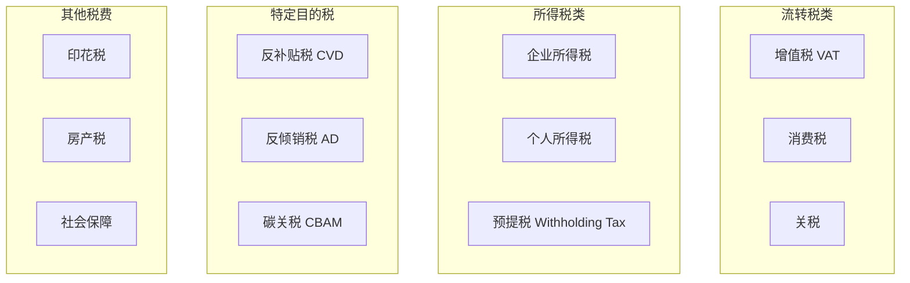
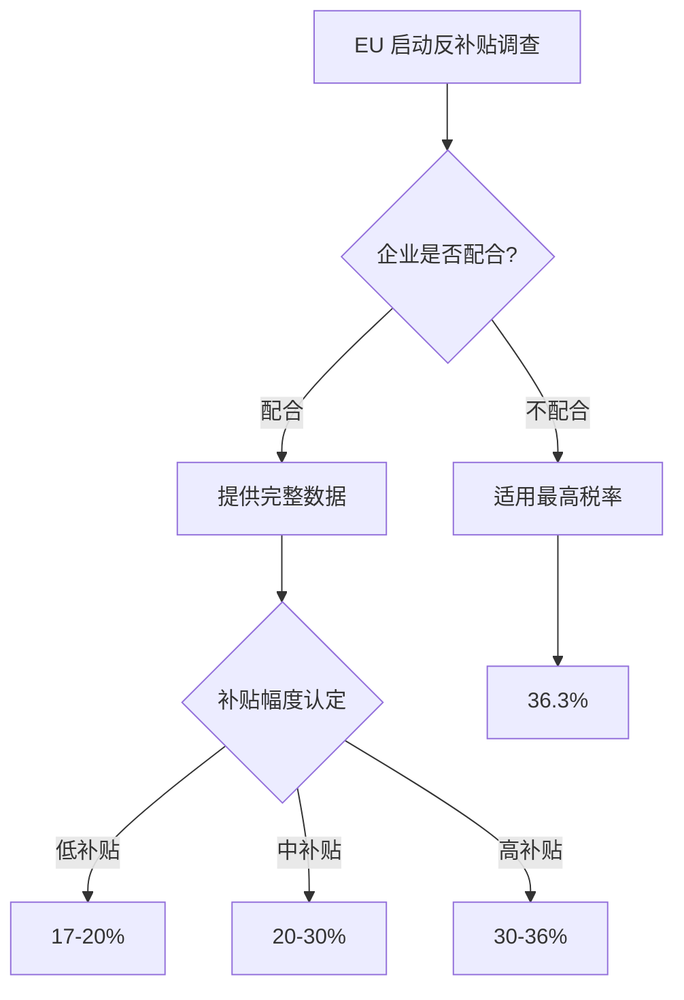
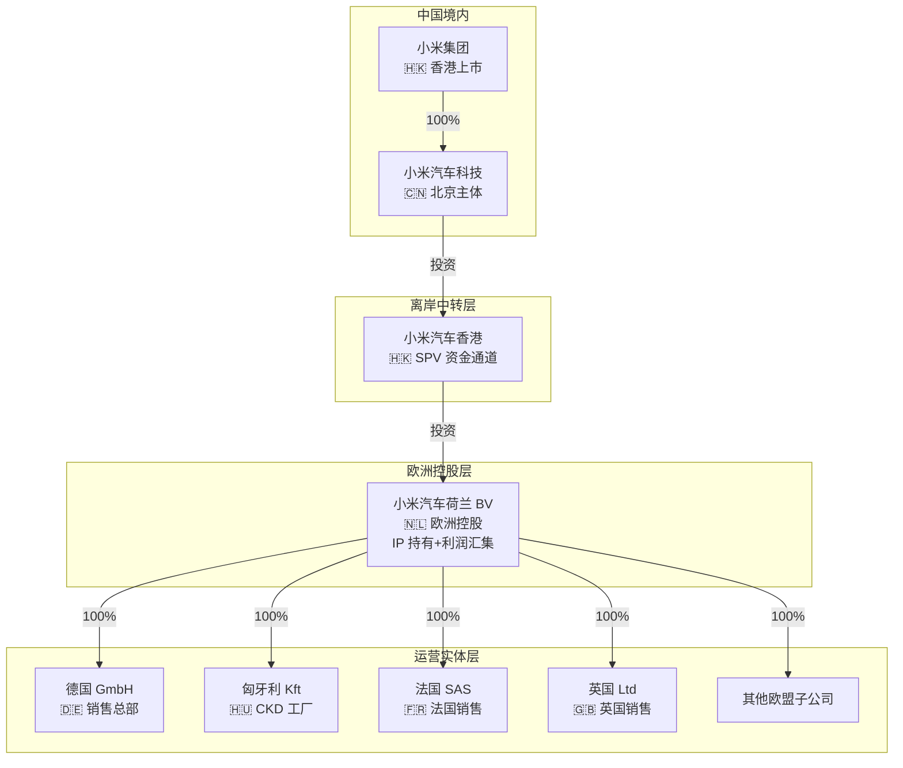

> [!summary] 控股架构设计与全球税务筹划
> - **核心**：深度解析出海控股架构设计、各法律实体区别、全球税务体系对比，以及小米欧洲架构优化方案。
> - **要点**：术语速查
> - **要点**：出口模式
> - **要点**：区域与国际组织
> - **要点**：贸易协定

# 控股架构设计与全球税务筹划

> 深度解析出海控股架构设计、各法律实体区别、全球税务体系对比，以及小米欧洲架构优化方案。

---

## 术语速查

### 出口模式

| 缩写 | 英文全称 | 中文 | 含义 |
|------|---------|------|------|
| **CBU** | Completely Built Up | 整车出口 | 整车组装好直接运输销售 |
| **CKD** | Completely Knocked Down | 全散件出口 | 完全拆散为零件级，运到当地工厂组装 |
| **SKD** | Semi Knocked Down | 半散件出口 | 半成品，关键总成已装配 |

### 区域与国际组织

| 缩写 | 英文全称 | 中文 | 说明 |
|------|---------|------|------|
| **EU** | European Union | 欧盟 | 27 个成员国，统一市场，内部零关税 |
| **GCC** | Gulf Cooperation Council | 海湾合作委员会 | 沙特/UAE/卡塔尔等 6 国，统一关税 5% |
| **ASEAN** | Association of Southeast Asian Nations | 东南亚国家联盟 | 泰国/印尼等 10 国，区域贸易优惠 |
| **BOI** | Board of Investment | 泰国投资促进委员会 | 泰国政府机构，提供税收优惠吸引外资 |

### 贸易协定

| 缩写 | 英文全称 | 中文 | 说明 |
|------|---------|------|------|
| **FTA** | Free Trade Agreement | 自由贸易协定 | 两国/地区间降低关税的协议 |
| **RCEP** | Regional Comprehensive Economic Partnership | 区域全面经济伙伴关系 | 中国/日韩/东盟等 15 国，全球最大自贸协定 |
| **ITA** | Information Technology Agreement | 信息技术协定 | WTO 成员国间 IT 产品零关税 |

---

## 一、公司架构核心概念

### 1.1 两个维度的理解

| 维度       | 说明        | 示例                  |
| -------- | --------- | ------------------- |
| **功能维度** | 这家公司"做什么" | 控股公司、运营公司、SPV（特殊目的载体） |
| **法律形式** | 这家公司"是什么" | BV、GmbH、Ltd、SAS、Kft |

> 💡 **关键点**：功能和法律形式是两个独立维度，可以自由组合。
> 例如：一家荷兰 BV 可以是"控股公司"，也可以是"运营公司"。

### 1.2 法律形式缩写速查表

| 缩写 | 全称 | 中文 | 国家 | 一句话说明 |
|------|------|------|------|-----------|
| **SPV** | Special Purpose Vehicle | 特殊目的载体 | 通用 | 为特定目的设立的"壳公司"，通常无实际经营 |
| **BV** | Besloten Vennootschap | 私人有限责任公司 | 🇳🇱 荷兰 | 无最低注册资本，**Innovation Box 税率仅 9%**，控股首选 |
| **GmbH** | Gesellschaft mit beschränkter Haftung | 有限责任公司 | 🇩🇪 德国 | 最低注册资本 €25,000，**欧洲最大市场**，运营首选 |
| **Ltd** | Limited Company | 私人股份有限公司 | 🇬🇧 英国 | 注册快速，**英国已脱欧**，非 EU 成员国 |
| **SAS** | Société par Actions Simplifiée | 简化股份公司 | 🇫🇷 法国 | 治理灵活，无最低资本，**适合做合资** |
| **Kft** | Korlátolt Felelősségű Társaság | 有限责任公司 | 🇭🇺 匈牙利 | **企业所得税仅 9%**（EU 最低），建工厂首选 |
| **HK Limited** | Hong Kong Private Company Limited by Shares | 香港私人股份有限公司 | 🇭🇰 香港 | 外汇自由，**资金进出便利**，资金通道首选 |

> 🧠 **记忆技巧**：
> - **BV** = "Best Value"（最佳价值）→ 荷兰控股，9% 低税率
> - **GmbH** = "Germany"（德国）→ 欧洲最大市场，运营首选
> - **Kft** = "Keep money in Hungary"（把钱留在匈牙利）→ 9% 超低税率
> - **Ltd** = "Limited"（有限）→ 英国，注册最简单
> - **SAS** = "Simple And Smart"（简单灵活）→ 法国，合资首选

---

## 二、按功能分类

### 2.1 控股公司（Holding Company）

**定义**：持有其他公司股权，不直接经营业务的公司。

**核心作用**：

| 作用 | 说明 | 实操价值 |
|------|------|----------|
| **风险隔离** | 子公司独立法人，母公司仅以出资额为限承担责任 | ⭐⭐⭐⭐⭐ 保护核心资产 |
| **税务优化** | 利润汇集到低税率地区（如荷兰 BV） | ⭐⭐⭐⭐⭐ 每年节省千万级 |
| **资本运作** | 统一管理投资、并购、上市 | ⭐⭐⭐⭐ 便于资本运作 |
| **战略控制** | 通过股权控制子公司重大决策 | ⭐⭐⭐⭐⭐ 集团管控 |

**架构示例**：

```
┌─────────────────────────────────────┐
│         控股公司（Holding）           │
│  ✅ 持有子公司股权                   │
│  ✅ 资本运作（投资/并购/退出）        │
│  ✅ 利润汇集与分配                   │
│  ❌ 不直接生产/销售                  │
└─────────────────────────────────────┘
         ↓ 100% 控股        ↓ 100% 控股
    ┌──────────┐      ┌──────────┐
    │ 运营公司A │      │ 运营公司B │
    │ （德国）  │      │ （法国）  │
    └──────────┘      └──────────┘
```

### 2.2 运营公司（Operating Company）

**定义**：直接开展业务（生产、销售、服务等）的公司。

**核心特征**：

| 特征 | 说明 |
|------|------|
| ✅ 生产制造 | 工厂、生产线、工人 |
| ✅ 销售与市场 | 客户关系、渠道、营销 |
| ✅ 客户服务 | 售后、维修、投诉处理 |
| ✅ 员工雇佣 | 签订劳动合同、发工资 |
| ❌ 不持有其他公司股权 | 专注本业务 |

### 2.3 SPV（Special Purpose Vehicle，特殊目的载体）

**定义**：为特定目的设立的"壳公司"，通常无实际经营。

**典型用途**：

| 用途 | 说明 | 案例 |
|------|------|------|
| **项目融资** | 隔离项目风险，不波及母公司 | 基建项目公司 |
| **资产证券化** | 将资产打包出售给 SPV | ABS、MBS |
| **跨境投资** | 作为中间层持有海外资产 | 小米香港 SPV |
| **合资平台** | 双方共同出资设立 SPV | 合资工厂 |
| **风险隔离** | 特定业务风险与主体隔离 | 高风险业务 |

**SPV vs 控股公司对比**：

| 维度 | SPV | 控股公司 |
|------|-----|----------|
| **目的** | 特定项目/交易 | 长期持有子公司 |
| **存续期** | 通常有限（项目结束即清算） | 长期持续 |
| **经营** | 通常无实际经营 | 可能有战略管理职能 |
| **资产** | 单一资产或项目 | 多个子公司股权 |

---

## 三、按法律形式分类（欧洲主要类型）

### 3.1 荷兰 BV（Besloten Vennootschap）

| 项目 | 说明 |
|------|------|
| **全称** | Besloten Vennootschap met beperkte aansprakelijkheid |
| **中文** | 荷兰私人有限责任公司 |
| **特点** | ✅ 股东责任有限 ✅ 股权转让受限 ✅ 无最低注册资本要求 |
| **税率** | 25.8%（Innovation Box 可优化至 ~9%） |
| **适用** | 控股公司、欧洲总部、IP 持有 |
| **案例** | 蔚来 NIO B.V.、比亚迪 BYD Europe B.V.、特斯拉 Tesla International B.V. |

**为什么 BV 适合做控股？**

| 优势 | 说明 |
|------|------|
| ✅ **Innovation Box** | IP 收入税率仅 ~9%（全球最低之一） |
| ✅ **税收协定** | 与 90+ 国家签有协定，减少预提税 |
| ✅ **EU 成员国** | 一国注册通行 27 国 |
| ✅ **法律成熟** | 全球最成熟的控股公司法律体系 |
| ✅ **无最低资本** | €0.01 起即可注册 |
| ✅ **设立快速** | 1-2 周完成注册 |

### 3.2 德国 GmbH（Gesellschaft mit beschränkter Haftung）

| 项目 | 说明 |
|------|------|
| **全称** | Gesellschaft mit beschränkter Haftung |
| **中文** | 德国有限责任公司 |
| **特点** | ✅ 股东责任有限 ✅ 最低注册资本 €25,000 ✅ 管理灵活 |
| **税率** | ~29.8%（含团结附加税） |
| **适用** | 运营公司、销售公司、研发中心 |
| **案例** | 小米德国销售公司、华为德国子公司 |

**GmbH vs BV 对比**：

| 维度 | 🇳🇱 荷兰 BV | 🇩🇪 德国 GmbH |
|------|-------------|---------------|
| 最低注册资本 | **无要求**（€0.01 起） | **€25,000**（实缴 50%） |
| 设立速度 | 1-2 周 | 2-4 周 |
| 标准税率 | 25.8% | ~29.8% |
| 优惠税率 | **9%**（Innovation Box） | 无 |
| 税收协定网络 | 90+ 国家 | 80+ 国家 |
| 适合功能 | **控股、IP 持有** | **运营、销售** |

### 3.3 英国 Ltd（Limited Company）

| 项目     | 说明                                |
| ------ | --------------------------------- |
| **全称** | Private Company Limited by Shares |
| **中文** | 英国私人股份有限公司                        |
| **特点** | ✅ 股东责任有限 ✅ 注册简单快速 ✅ 信息披露少         |
| **税率** | 25%（2024 年起）                      |
| **适用** | 英国市场销售、服务中心                       |
| **案例** | 各车企英国销售公司                         |

**⚠️ 注意**：英国已脱欧，**不是 EU 成员国**，不能享受 EU 内部免关税流通。

### 3.4 法国 SAS（Société par Actions Simplifiée）

| 项目 | 说明 |
|------|------|
| **全称** | Société par Actions Simplifiée |
| **中文** | 法国简化股份公司 |
| **特点** | ✅ 治理灵活 ✅ 股东自治 ✅ 适合合资 |
| **税率** | 25.8% |
| **适用** | 法国市场、合资企业 |
| **案例** | 零跑与 Stellantis 的合资公司 |

**SAS vs SA 对比**：

| 维度 | SAS（Société par Actions Simplifiée，简化股份公司） | SA（Société Anonyme，传统股份公司） |
|------|-------------|-----------|
| 最低股东 | **1 人** | **2 人** |
| 最低资本 | **无要求** | **€37,000** |
| 治理灵活度 | **高**（章程自治） | 低（法定结构） |
| 适合场景 | 合资、初创 | 上市、大型企业 |

> 💡 **SA**（Société Anonyme）= 法国传统股份公司，适合上市和大型企业，治理结构更复杂

### 3.5 匈牙利 Kft（Korlátolt Felelősségű Társaság）

| 项目 | 说明 |
|------|------|
| **全称** | Korlátolt Felelősségű Társaság |
| **中文** | 匈牙利有限责任公司 |
| **特点** | ✅ 劳动力成本低 ✅ EU 成员国 ✅ 对中国投资友好 |
| **税率** | **9%**（欧盟最低之一！） |
| **适用** | 制造工厂、CKD 组装 |
| **案例** | BYD Szeged 工厂、宁德时代电池厂 |

**为什么匈牙利 Kft 适合建工厂？**

| 优势 | 说明 |
|------|------|
| ✅ **EU 成员国** | 产品在 EU 内部自由流通，零关税 |
| ✅ **超低税率** | 9% 企业所得税（EU 最低） |
| ✅ **劳动力成本** | 德国的 1/3 |
| ✅ **中国友好** | "向东开放"政策，中资企业多 |
| ✅ **供应链配套** | CATL、比亚迪等已布局 |

### 3.6 香港有限公司（HK Limited）

| 项目 | 说明 |
|------|------|
| **全称** | Hong Kong Private Company Limited by Shares |
| **中文** | 香港私人股份有限公司 |
| **特点** | ✅ 外汇自由 ✅ 税率低 ✅ 资金进出便利 |
| **税率** | 8.25%（首 HKD 200 万）/ 16.5% |
| **适用** | 资金通道、离岸中转 |
| **案例** | 各企业海外投资 SPV |

**为什么香港适合做资金通道？**

| 优势 | 说明 |
|------|------|
| ✅ **外汇自由** | 无外汇管制，资金自由进出 |
| ✅ **低税率** | 8.25-16.5%，离岸收入免税 |
| ✅ **中国连接** | 与大陆联系紧密，资金往来便利 |
| ✅ **法律体系** | 普通法体系，国际认可 |

---

## 四、全球税务体系深度解析

### 4.0 税务缩写速查表

| 缩写 | 全称 | 中文 | 一句话说明 |
|------|------|------|-----------|
| **VAT** | Value Added Tax | 增值税 | 对商品和服务增值部分征收的税，企业可抵扣进项税 |
| **CIT** | Corporate Income Tax | 企业所得税 | 对企业年度利润征收的税，各国税率差异大 |
| **WHT** | Withholding Tax | 预提税 | 支付方向非居民付款时代扣的税（股息/利息/授权费） |
| **CBAM** | Carbon Border Adjustment Mechanism | 碳边境调节机制 | EU 对进口商品碳排放征收的费用，2026 年起正式实施 |
| **CVD** | Countervailing Duty | 反补贴税 | 针对出口国政府补贴征收的特别关税 |
| **AD** | Anti-Dumping Duty | 反倾销税 | 针对低于成本出口征收的特别关税 |
| **IP** | Intellectual Property | 知识产权 | 专利、商标、版权等无形资产 |
| **CFC** | Controlled Foreign Company | 受控外国公司 | 中国对海外低税率子公司的反避税规则 |

### 4.1 税务体系全景图



### 4.2 增值税（VAT, Value Added Tax）

**定义**：对商品和服务在流转过程中产生的增值额征收的税。

**核心特点**：
- ✅ **多环节征收**：生产、批发、零售每个环节都征
- ✅ **进项抵扣**：企业可抵扣上游已缴增值税
- ✅ **最终消费者承担**：企业只是代收代缴

**各市场增值税对比**：

| 市场 | 标准税率 | 低税率 | 适用范围 | 特殊说明 |
|------|----------|--------|----------|----------|
| 🇨🇳 中国 | 13% | 9%/6% | 商品销售、进口 | 出口可退税 |
| 🇩🇪 德国 | 19% | 7% | 商品和服务 | EU 标准 |
| 🇫🇷 法国 | 20% | 5.5%/10% | 商品和服务 | 食品、书籍低税率 |
| 🇬🇧 英国 | 20% | 5%/0% | 商品和服务 | 部分商品零税率 |
| 🇮🇹 意大利 | 22% | 4%/10% | 商品和服务 | 食品、旅游低税率 |
| 🇪🇸 西班牙 | 21% | 4%/10% | 商品和服务 | 食品、医疗低税率 |
| 🇳🇱 荷兰 | 21% | 9% | 商品和服务 | 食品、书籍低税率 |
| 🇭🇺 匈牙利 | 27% | 5%/18% | 商品和服务 | **EU 最高 VAT！** |
| 🇵🇱 波兰 | 23% | 5%/8% | 商品和服务 | 食品低税率 |
| 🇹🇭 泰国 | 10%（实际 7%） | - | 商品和服务 | EV 部分免税 |
| 🇮🇩 印尼 | 11% | - | 商品和服务 | 2025 年升至 12% |
| 🇦🇪 UAE | 5% | 0% | 商品和服务 | 部分行业免税 |
| 🇸🇦 沙特 | 15% | - | 商品和服务 | 2020 年从 5% 升至 15% |
| 🇺🇸 美国 | 无联邦 VAT | - | - | 各州销售税 0-10% |
| 🇧🇷 巴西 | ~17-25% | - | 商品和服务 | 各州不同，极复杂 |

**增值税计算示例（德国销售 SU7）**：

```
SU7 Max 终端售价（不含税）：€50,000
德国 VAT 19%：€50,000 × 19% = €9,500
消费者支付总价：€50,000 + €9,500 = €59,500

小米德国 GmbH：
- 销项税额（向消费者收取）：€9,500
- 进项税额（采购、运营抵扣）：€6,000
- 应缴增值税：€9,500 - €6,000 = €3,500
```

**VAT 优化策略**：

| 策略 | 说明 | 适用场景 |
|------|------|----------|
| **进口 VAT 递延** | 进口时暂不缴纳 VAT，销售后统一结算 | 改善现金流 |
| **进项税充分抵扣** | 确保所有采购取得合规发票 | 降低实际税负 |
| **VAT 集团注册** | 集团内部交易免征 VAT | 集团架构优化 |
| **出口退税** | 出口商品 VAT 全额退还 | 中国出口 |

### 4.3 关税（Customs Duty）

**定义**：进出口商品经过一国关境时，由海关征收的税。

**关税分类**：

| 类型 | 说明 | 适用场景 |
|------|------|----------|
| **从价税** | 按商品价值百分比征收 | 最常见，如 10% |
| **从量税** | 按商品数量/重量征收 | 酒类、烟草 |
| **混合税** | 从价+从量结合 | 部分农产品 |
| **滑准税** | 税率随价格变动 | 棉花等 |

**欧盟汽车关税结构**：

| 关税类型 | 税率 | 说明 | 法律依据 |
|----------|------|------|----------|
| **标准关税** | 10% | 所有进口汽车适用 | EU Common External Tariff |
| **反补贴税（CVD）** | 17.4-36.3% | 针对中国 EV 补贴 | EU 反补贴调查 |
| **反倾销税（AD）** | 0%（目前） | 如认定倾销可加征 | EU 反倾销条例 |
| **合计** | **27.4-46.3%** | 中国 EV 实际关税 | - |

**各市场关税对比**：

| 市场 | 整车关税（CBU） | 散件关税（CKD） | 反补贴税 | 合计（中国 EV） |
|------|----------------|----------------|----------|----------------|
| 🇪🇺 欧盟 | 10% | 2-3% | 17.4-36.3% | **27.4-46.3%** |
| 🇬🇧 英国 | 10% | 2-3% | 0%（暂未征收） | **10%** |
| 🇺🇸 美国 | 2.5% | 0-2.5% | 100% | **102.5%** |
| 🇨🇦 加拿大 | 6.1% | 0-3% | 100%（拟征） | **106.1%** |
| 🇹🇭 泰国 | 0%（EV 优惠） | 0% | 0% | **0%** |
| 🇮🇩 印尼 | 0-10% | 0% | 0% | **0-10%** |
| 🇦🇪 UAE | 5% | 0-5% | 0% | **5%** |
| 🇸🇦 沙特 | 5% | 0-5% | 0% | **5%** |
| 🇦🇺 澳大利亚 | 5% | 0-5% | 0% | **5%** |
| 🇧🇷 巴西 | 35%（逐年递增） | 2-6% | 0% | **35%** |
| 🇮🇳 印度 | 70-100% | 15%（承诺投资后） | 0% | **70-100%** |

### 4.4 反补贴税（Countervailing Duty, CVD）

**定义**：进口国为抵消出口国政府对出口商品的补贴而征收的特别关税。

**欧盟对中国 EV 反补贴调查结果**：

| 制造商 | 反补贴税率 | 标准关税 | 合计税率 | 说明 |
|--------|-----------|----------|----------|------|
| **比亚迪** | 17.0% | 10% | **27.0%** | 配合调查，最低税率 |
| **吉利（含极氪）** | 19.9% | 10% | **29.9%** | 配合调查 |
| **上汽（含 MG）** | 36.3% | 10% | **46.3%** | 未充分配合，最高税率 |
| **其他配合企业** | 20.8% | 10% | **30.8%** | 小米预估落在此档 |
| **未配合企业** | 36.3% | 10% | **46.3%** | 最坏情况 |
| **特斯拉（上海）** | 7.8% | 10% | **17.8%** | 单独申请，最低 |

**反补贴税判定逻辑**：



**小米的策略建议**：

| 策略 | 效果 | 风险 |
|------|------|------|
| ✅ **积极配合调查** | 争取 20.8% 或更低 | 需披露敏感数据 |
| ✅ **单独申请** | 可能获得类似特斯拉的低税率 | 流程复杂，耗时长 |
| ⚠️ **价格承诺** | 与 EU 协商最低出口价 | 可能限制定价灵活性 |
| ❌ **不配合** | 适用 36.3% 最高税率 | 完全不可接受 |

### 4.5 反倾销税（Anti-Dumping Duty, AD）

**定义**：进口国为抵消出口国以低于正常价值的价格出口商品而征收的特别关税。

**反倾销 vs 反补贴对比**：

| 维度 | 反补贴税（CVD） | 反倾销税（AD） |
|------|----------------|----------------|
| **针对** | 政府补贴 | 低于成本/正常价值销售 |
| **认定标准** | 存在专项补贴 | 出口价格 < 正常价值 |
| **损害认定** | 需要证明产业损害 | 需要证明产业损害 |
| **税率确定** | 补贴幅度 | 倾销幅度 |
| **目前状态** | ✅ 已对中国 EV 征收 | ⚠️ 尚未征收（可能启动） |

**⚠️ 风险提示**：EU 可能在反补贴税基础上，额外启动反倾销调查，届时关税可能进一步上升。

### 4.6 企业所得税（Corporate Income Tax, CIT）

**定义**：对企业年度利润征收的税。

**全球企业所得税税率对比**：

| 地区 | 国家/地区 | 标准税率 | 优惠税率 | 说明 |
|------|----------|----------|----------|------|
| **欧洲** | 🇳🇱 荷兰 | 25.8% | **9%**（Innovation Box） | 控股首选 |
| | 🇩🇪 德国 | ~29.8% | - | 含团结附加税 |
| | 🇫🇷 法国 | 25.8% | - | 2022 年降至 25% |
| | 🇬🇧 英国 | 25% | - | 2024 年起 |
| | 🇭🇺 匈牙利 | **9%** | - | EU 最低 |
| | 🇮🇪 爱尔兰 | **12.5%** | **6.25%**（知识盒） | 科技公司首选 |
| | 🇵🇱 波兰 | 19% | 9%（小企业） | 人口大国 |
| | 🇪🇸 西班牙 | 25% | 15%（新创） | 南欧市场 |
| | 🇮🇹 意大利 | 27.8% | - | 税率较高 |
| **亚太** | 🇨🇳 中国 | 25% | 15%（高新）/ 5%（小微） | 国内主体 |
| | 🇭🇰 香港 | 16.5% | **8.25%**（首 HKD 200 万） | 资金通道 |
| | 🇸🇬 新加坡 | 17% | **13.5%**（首 SGD 20 万） | 东南亚总部 |
| | 🇹🇭 泰国 | 20% | BOI 优惠（8 年免税） | EV 工厂 |
| | 🇮🇩 印尼 | 22% | 20%（上市公司） | 资源国 |
| **中东** | 🇦🇪 UAE | **9%** | 0%（自由区） | 中东总部 |
| | 🇸🇦 沙特 | 20% | - | GCC 最大市场 |
| **美洲** | 🇺🇸 美国 | 21% | 州税 0-12% | 联邦+州 |
| | 🇧🇷 巴西 | 34% | - | 全球最高之一 |

**企业所得税计算示例**：

```
小米德国 GmbH 年度利润：€1,000 万

无优化方案：
  应纳税额 = €1,000 万 × 29.8% = €298 万

有优化方案（IP 授权费 €400 万）：
  应税利润 = €1,000 万 - €400 万 = €600 万
  应纳税额 = €600 万 × 29.8% = €178.8 万

  荷兰 BV 收到 IP 授权费 €400 万
  Innovation Box 税率 9%
  应纳税额 = €400 万 × 9% = €36 万

  总税负 = €178.8 万 + €36 万 = €214.8 万
  节省 = €298 万 - €214.8 万 = €83.2 万（节省 28%）
```

### 4.7 预提税（Withholding Tax, WHT）

**定义**：支付方向非居民收款人支付款项时，代扣代缴的税款。

**常见预提税类型**：

| 类型 | 说明 | 典型税率 |
|------|------|----------|
| **股息预提税** | 分配利润时征收 | 10-25% |
| **利息预提税** | 支付利息时征收 | 10-20% |
| **特许权使用费预提税** | 支付 IP 授权费时征收 | 10-20% |
| **服务费预提税** | 支付服务费时征收 | 0-20% |

**无税收协定 vs 有税收协定对比**：

| 路径 | 股息预提税 | 利息预提税 | 特许权使用费预提税 |
|------|-----------|-----------|-------------------|
| 🇩🇪 德国 → 🇨🇳 中国（无协定） | 25% | 25% | 25% |
| 🇩🇪 德国 → 🇨🇳 中国（中德协定） | 10% | 10% | 6% |
| 🇩🇪 德国 → 🇳🇱 荷兰（EU 指令） | **0%** | 0% | 0% |
| 🇳🇱 荷兰 → 🇭🇰 香港（荷港协定） | **0%** | 0% | 0% |
| 🇭🇰 香港 → 🇨🇳 中国（大陆香港协定） | **0%** | 0% | 7% |

**优化路径**：

```
无优化路径：
🇩🇪 德国子公司 → 🇨🇳 中国母公司
  股息预提税：25%

优化路径：
🇩🇪 德国子公司 → 🇳🇱 荷兰 BV → 🇭🇰 香港 SPV → 🇨🇳 中国母公司
  股息预提税：0%（EU 母子公司指令）
              0%（荷港税收协定）
              0%（港陆税收安排）
  合计：0%
```

**⚠️ 合规要求**：
- 必须有"合理商业理由"，不能仅为避税
- 必须满足"受益所有人"（Beneficial Owner）条件
- 不能被认定为"导管公司"（Conduit Company）

### 4.8 碳边境调节机制（CBAM, Carbon Border Adjustment Mechanism）

**定义**：欧盟对进口商品的碳排放征收的费用，防止"碳泄漏"。

**实施时间线**：

| 阶段 | 时间 | 要求 |
|------|------|------|
| **过渡期** | 2023.10 - 2025.12 | 仅报告，不征费 |
| **正式实施** | 2026.01 起 | 开始征收碳关税 |
| **全面实施** | 2034 年 | 取消免费配额，全额征收 |

**覆盖行业**：

| 行业 | 包含产品 | 对汽车行业影响 |
|------|----------|---------------|
| 钢铁 | 钢材、钢管 | 🔴 车身、底盘用钢 |
| 铝 | 铝锭、铝材 | 🔴 车身铝材、电池壳 |
| 水泥 | 水泥、熟料 | 🟢 低影响 |
| 化肥 | 氮肥、磷肥 | 🟢 低影响 |
| 电力 | 进口电力 | 🟡 间接影响 |
| **氢** | 绿氢、蓝氢 | 🟢 未来可能影响 |

**CBAM 对汽车行业的影响**：

```
CBAM 计算公式：
CBAM 成本 = (出口国碳强度 - EU 碳强度) × 进口数量 × EU 碳价

示例：
中国钢铁碳强度：2.0 tCO₂/t 钢
EU 钢铁碳强度：1.5 tCO₂/t 钢
每辆 SU7 用钢：800 kg
EU 碳价：€80/tCO₂

每辆车 CBAM 成本 = (2.0 - 1.5) × 0.8t × €80 = €32
10 万辆/年 × €32 = €320 万/年
```

**⚠️ 风险提示**：
- 2026 年起 CBAM 正式征收，可能增加 €300-500/车 成本
- 铝材碳排放更高，CBAM 影响可能更大
- 降低碳足迹是长期最优解

### 4.9 消费税（Excise Tax）

**定义**：对特定消费品（烟酒、燃油、奢侈品等）征收的税。

**汽车相关消费税**：

| 市场 | 消费税类型 | 税率 | 说明 |
|------|-----------|------|------|
| 🇨🇳 中国 | 消费税 | 1-40% | 按排量，纯电免征 |
| 🇹🇭 泰国 | 消费税 | 0-50% | EV 免征最高 40% |
| 🇮🇩 印尼 | 奢侈品税 | 10-120% | EV 免征 |
| 🇸🇬 新加坡 | ARF | 100-220% | 电动车优惠 45% |
| 🇳🇴 挪威 | - | 0% | EV 免增值税+注册税 |
| 🇩🇪 德国 | - | 0% | 无汽车消费税 |
| 🇳🇱 荷兰 | BPM | 按 CO₂ | EV 免 BPM |
| 🇮🇹 意大利 | IPT | 按功率/kW | EV 减免 75% |

**各市场 EV 税收优惠对比**：

| 市场 | 增值税优惠 | 消费税优惠 | 注册税优惠 | 购车补贴 | 综合优惠力度 |
|------|-----------|-----------|-----------|----------|-------------|
| 🇳🇴 挪威 | 免 VAT | 免 | 免 | 无 | ⭐⭐⭐⭐⭐ |
| 🇩🇪 德国 | 无 | 无 | 无 | €4,500（已取消） | ⭐⭐ |
| 🇫🇷 法国 | 无 | 免 | 免 | €5,000-7,000 | ⭐⭐⭐⭐ |
| 🇮🇹 意大利 | 无 | 减免 75% | 免 | €3,000-5,000 | ⭐⭐⭐ |
| 🇪🇸 西班牙 | 无 | 免 | 免 | €4,500-7,000 | ⭐⭐⭐ |
| 🇬🇧 英国 | 无 | 免 | 免 | 无 | ⭐⭐ |
| 🇹🇭 泰国 | 免 40% | 免 40% | 免 | 补贴 15 万 THB | ⭐⭐⭐⭐⭐ |
| 🇮🇩 印尼 | 免奢侈品税 | 免 | 免 | 无 | ⭐⭐⭐⭐ |
| 🇦🇪 UAE | 无 | 无 | 无 | 无 | ⭐ |
| 🇸🇦 沙特 | 无 | 无 | 无 | 无 | ⭐ |

---

## 五、小米出海架构设计

### 5.1 推荐控股架构



### 5.2 各层级功能与税务角色

| 层级 | 实体 | 法律形式 | 注册地 | 核心功能 | 税务角色 |
|------|------|----------|--------|----------|----------|
| **母公司** | 小米集团 | HK Limited | 🇭🇰 香港 | 上市融资 | 全球资本运作 |
| **国内运营** | 小米汽车科技 | 有限公司 | 🇨🇳 北京 | 研发、生产 | 利润中心 |
| **资金通道** | 小米汽车香港 | HK Limited | 🇭🇰 香港 | 资金出境 | 外汇自由、低税率 |
| **欧洲控股** | 小米汽车荷兰 BV | BV | 🇳🇱 荷兰 | IP 持有、利润汇集 | Innovation Box 9% |
| **销售总部** | 小米汽车德国 GmbH | GmbH | 🇩🇪 德国 | 销售、品牌 | 29.8%（可优化） |
| **CKD 工厂** | 小米汽车匈牙利 Kft | Kft | 🇭🇺 匈牙利 | 制造、组装 | **9%**（EU 最低） |
| **法国销售** | 小米汽车法国 SAS | SAS | 🇫🇷 法国 | 法国市场 | 25.8% |
| **英国销售** | 小米汽车英国 Ltd | Ltd | 🇬🇧 英国 | 英国市场 | 25% |

### 5.3 税务优化架构详解

#### **① 利润汇集机制**

```
各国子公司利润 → IP 授权费 → 荷兰 BV

德国 GmbH 利润 €1,000 万
  → 支付 IP 授权费 €350 万给荷兰 BV
  → 应税利润 €650 万
  → 缴税 €650 万 × 29.8% = €193.7 万

法国 SAS 利润 €800 万
  → 支付 IP 授权费 €280 万给荷兰 BV
  → 应税利润 €520 万
  → 缴税 €520 万 × 25.8% = €134.2 万

荷兰 BV 收到 IP 授权费 €630 万
  → Innovation Box 税率 9%
  → 缴税 €630 万 × 9% = €56.7 万

总税负 = €193.7 万 + €134.2 万 + €56.7 万 = €384.6 万
vs 无优化：€1,000 万 × 29.8% + €800 万 × 25.8% = €504.4 万
节省 = €504.4 万 - €384.6 万 = €119.8 万（节省 23.7%）
```

#### **② 股息回流机制**

```
匈牙利 Kft 股息 → 荷兰 BV → 香港 SPV → 中国母公司

匈牙利 Kft 分配股息 €500 万
  → EU 母子公司指令：0% 预提税
  → 荷兰 BV 收到 €500 万

荷兰 BV 分配股息 €500 万
  → 荷港税收协定：0% 预提税
  → 香港 SPV 收到 €500 万

香港 SPV 分配股息 €500 万
  → 港陆税收安排：0% 预提税
  → 中国母公司收到 €500 万

合计预提税：0%（vs 无架构 25%）
节省 = €500 万 × 25% = €125 万
```

#### **③ 匈牙利工厂税务优势**

```
匈牙利 Kft 工厂利润 €2,000 万

匈牙利企业所得税：9%
应纳税额 = €2,000 万 × 9% = €180 万

vs 德国工厂：€2,000 万 × 29.8% = €596 万
节省 = €596 万 - €180 万 = €416 万（节省 69.8%）
```

### 5.4 综合税务节省测算

**假设**：小米欧洲年销量 10 万辆，单车利润 €6,000，总利润 €6 亿

| 优化手段 | 节省金额 | 说明 |
|----------|----------|------|
| **Innovation Box** | €3,830 万 | IP 授权费 9% 税率 |
| **匈牙利低税率** | €4,160 万 | 工厂利润 9% vs 29.8% |
| **股息预提税优化** | €1,250 万 | 香港中转 0% 预提税 |
| **合计** | **€9,240 万/年** | - |

> 💡 **每年节省 €9,240 万**，10 年累计节省 **€9.24 亿**

---

## 六、各市场综合税负对比

### 6.1 SU7 Max 各市场税费全景

| 市场 | FOB | 关税 | 反补贴税 | VAT | 消费税 | 其他 | 终端价 | 税占% |
|------|-----|------|----------|-----|--------|------|--------|-------|
| 🇩🇪 德国 | €33,500 | 10% | 30.8% | 19% | 0% | 认证 | €59,900 | **40.4%** |
| 🇬🇧 英国 | €33,500 | 10% | 0% | 20% | 0% | - | £49,900 | **23.1%** |
| 🇫🇷 法国 | €33,500 | 10% | 30.8% | 20% | 0% | - | €60,500 | **41.0%** |
| 🇮🇹 意大利 | €33,500 | 10% | 30.8% | 22% | 0% | IPT | €61,500 | **42.1%** |
| 🇪🇸 西班牙 | €33,500 | 10% | 30.8% | 21% | 0% | - | €60,800 | **41.2%** |
| 🇳🇴 挪威 | €33,500 | 0% | 0% | 0% | 0% | - | €48,000 | **30.2%** |
| 🇹🇭 泰国 | €33,500 | 0% | 0% | 7% | 0% | 补贴 | ฿1,699,000 | **7.0%** |
| 🇮🇩 印尼 | €33,500 | 0-10% | 0% | 11% | 0% | - | IDR 600jt | **18.0%** |
| 🇦🇪 UAE | €33,500 | 5% | 0% | 5% | 0% | - | AED 179,000 | **10.1%** |
| 🇸🇦 沙特 | €33,500 | 5% | 0% | 15% | 0% | - | SAR 185,000 | **21.5%** |
| 🇦🇺 澳洲 | €33,500 | 5% | 0% | 10% | 0% | - | AUD 69,990 | **14.0%** |
| 🇧🇷 巴西 | €33,500 | 35% | 0% | ~25% | 0% | IPI | R$380,000 | **40.7%** |
| 🇮🇳 印度 | €33,500 | 70-100% | 0% | 28% | 22% | - | ₹80,00,000 | **65%+** |

### 6.2 税负轻重排名

| 排名 | 市场 | 综合税负 | 主要构成 | 出海优先级 |
|------|------|----------|----------|-----------|
| 1 | 🇳🇴 挪威 | 30.2% | 无关税+免 VAT | ⭐⭐⭐⭐（小市场） |
| 2 | 🇹🇭 泰国 | 7.0% | 免关税+补贴 | ⭐⭐⭐⭐⭐ |
| 3 | 🇦🇪 UAE | 10.1% | 低关税+低 VAT | ⭐⭐⭐⭐⭐ |
| 4 | 🇦🇺 澳洲 | 14.0% | 低关税+标准 VAT | ⭐⭐⭐⭐ |
| 5 | 🇮🇩 印尼 | 18.0% | 低关税+标准 VAT | ⭐⭐⭐⭐ |
| 6 | 🇬🇧 英国 | 23.1% | 标准关税+无反补贴 | ⭐⭐⭐⭐ |
| 7 | 🇸🇦 沙特 | 21.5% | 低关税+标准 VAT | ⭐⭐⭐ |
| 8 | 🇩🇪 德国 | 40.4% | 高关税+高 VAT | ⭐⭐⭐（品牌价值） |
| 9 | 🇫🇷 法国 | 41.0% | 高关税+高 VAT | ⭐⭐⭐ |
| 10 | 🇧🇷 巴西 | 40.7% | 高关税+高 VAT | ⭐⭐ |
| 11 | 🇮🇳 印度 | 65%+ | 超高关税+高 GST | ⭐（极难） |

---

## 七、合规风险与注意事项

### 7.0 合规术语速查表

| 术语 | 英文 | 一句话解释 | 小米需要注意 |
|------|------|-----------|-------------|
| **Innovation Box** | Innovation Box / Patent Box | 荷兰对知识产权（IP）收入的超低税率（~9%） | 荷兰 BV 持有专利/软件，收入享受 9% 低税率 |
| **受益所有人** | Beneficial Owner | 实际享有收益的人，不是名义持有人 | 不能是"空壳"，必须有实质经营才能享受协定优惠 |
| **导管公司** | Conduit Company | 仅为资金中转设立的"空壳"公司 | ❌ 如果被认定为导管，不能享受税收协定优惠 |
| **经济实质** | Economic Substance | 公司在当地必须有足够的实质经营（员工/办公室/决策） | 荷兰 BV 需要有真实员工和办公场所，不能只是"信箱公司" |
| **转让定价** | Transfer Pricing | 母子公司之间的交易定价必须合理 | IP 授权费必须有市场参考，不能随意定价转移利润 |
| **独立交易原则** | Arm's Length Principle | 关联交易定价应与独立第三方交易价格一致 | 定价过高/过低都会被税务机关调整 |
| **Master File** | Master File | 集团全球转让定价政策文档（母公司的"总纲"） | 收入 > €7.5 亿的集团必须准备 |
| **Local File** | Local File | 各国子公司关联交易文档（子公司的"明细"） | 每个子公司都要准备，记录关联交易细节 |
| **国别报告** | CbCR (Country-by-Country Report) | 披露全球各国收入、利润、税负分布的"成绩单" | 年度提交，让税务机关看到全球利润分配是否合理 |
| **GAAR** | General Anti-Avoidance Rule | 一般反避税规则（税务机关的"尚方宝剑"） | 税务机关可否定没有商业目的的避税安排 |
| **CFC** | Controlled Foreign Company | 受控外国公司（中国的"海外追税"规则） | 中国可对海外低税率子公司征收中国税 |

### 7.1 反避税风险

| 风险 | 说明 | 应对措施 |
|------|------|----------|
| **受控外国公司（CFC）规则** | 中国对海外低税率子公司征税 | 合理规划利润分配，确保有"合理商业理由" |
| **经济实质要求** | 荷兰要求 BV 有足够"经济实质" | 在荷兰配置员工、办公场所、核心决策职能 |
| **反导管规则** | 被认定为"导管公司"则不能享受协定优惠 | 确保有实质经营，不是"空壳" |
| **一般反避税规则（GAAR）** | 税务机关可否定避税安排 | 所有架构必须有合理商业目的 |

### 7.2 转让定价合规

| 要求 | 说明 | 频率 |
|------|------|------|
| **Master File** | 集团全球转让定价政策文档 | 年度更新 |
| **Local File** | 各国子公司关联交易文档 | 年度更新 |
| **国别报告（CbCR）** | 披露全球收入、利润、税负分布 | 年度（收入 > €7.5 亿） |
| **同期资料** | 关联交易定价依据、可比分析 | 随时备查 |

### 7.3 合规时间表

| 事项 | 时间要求 | 负责部门 |
|------|----------|----------|
| 转让定价文档准备 | 交易发生前 | 财务+税务顾问 |
| CbCR 报告 | 财年结束后 12 个月 | 集团财务 |
| 增值税申报 | 月度/季度 | 各国财务 |
| 企业所得税申报 | 年度 | 各国财务 |
| 预提税申报 | 付款时 | 财务 |

---

## 八、关键结论

### 8.1 法律形式选型指南

| 需求 | 推荐法律形式 | 理由 |
|------|-------------|------|
| **欧洲控股** | 🇳🇱 荷兰 BV | 税务优化、税收协定、EU 准入 |
| **资金通道** | 🇭🇰 香港有限公司 | 外汇自由、资金进出便利 |
| **销售运营** | 🇩🇪 德国 GmbH / 🇫🇷 法国 SAS | 本地化运营、市场覆盖 |
| **制造工厂** | 🇭🇺 匈牙利 Kft | 9% 超低税率、EU 内零关税 |
| **合资企业** | 🇫🇷 法国 SAS / 🇳🇱 荷兰 BV | 治理灵活、适合合资 |

### 8.2 税务优化优先级

| 优先级 | 优化手段 | 节省潜力 | 实施难度 |
|--------|----------|----------|----------|
| 🔴 P0 | 匈牙利建厂（9% 税率） | €4,160 万/年 | 高（需建厂） |
| 🔴 P0 | 荷兰 BV Innovation Box | €3,830 万/年 | 中（需架构搭建） |
| 🟡 P1 | 股息预提税优化 | €1,250 万/年 | 低 |
| 🟡 P1 | 进口 VAT 递延 | 改善现金流 | 低 |
| 🟢 P2 | 利息扣除优化 | €200-500 万/年 | 中（需合规） |

### 8.3 综合节省测算

| 维度 | 金额 | 时间跨度 |
|------|------|----------|
| **年度税务节省** | €9,240 万 | 每年 |
| **10 年累计节省** | €9.24 亿 | 长期 |
| **每辆车税务优化** | €924 | 单车 |
| **占单车利润比例** | 15.4% | 显著 |

---

## 九、参考资料

### 法规与政策
- [EU VAT Directive](https://ec.europa.eu/taxation_customs/vat_en)
- [EU Anti-Subsidy Regulation](https://ec.europa.eu/trade/policy/defence-and-trade/instruments/)
- [EU CBAM Regulation](https://ec.europa.eu/taxation_customs/carbon-border-adjustment-mechanism_en)
- [荷兰税务局 Innovation Box](https://www.belastingdienst.nl)
- [匈牙利投资促进局 HIPA](https://hipa.hu)

### 行业案例
- [NIO Netherlands B.V.](https://www.nio.com)
- [BYD Europe B.V.](https://www.byd.com/eu)
- [Tesla International B.V.](https://www.tesla.com)

### 相关笔记
- [[出海模式总览|出海模式总览]]
- [[欧洲市场进入策略|欧洲市场进入策略]]
- [[SU7竞争定价分析|SU7 竞争定价分析]]
- [[关税政策与进出口规则|关税政策与进出口规则]]
- [[ESG与合规调研|ESG 与合规调研]]
- [[碳足迹与电池护照|碳足迹与电池护照]]
