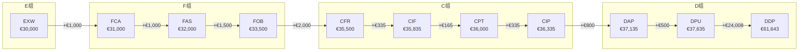
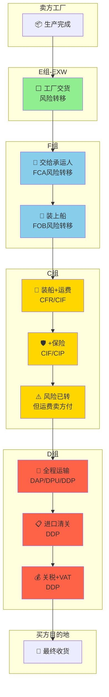

---
created: 2026-07-16
updated: 2026-07-15
tags: [Self, 供应链, 合规]
status: draft
---
> [!summary] 国际贸易术语 Incoterms 2020 完全指南
> - **核心**：11 个贸易术语的通俗解读、汽车行业实战案例、速记口诀与避坑指南。
> - **要点**：术语速查
> - **要点**：一、30 秒搞懂 Incoterms
> - **要点**：Incoterms 解决什么问题？
> - **要点**：二、用寄快递秒懂四组术语

# 国际贸易术语 Incoterms 2020 完全指南

> 11 个贸易术语的通俗解读、汽车行业实战案例、速记口诀与避坑指南。
>
> 🔗 **关联**：[[08_ByteDance/05_供应链流程/06_📖贸易条款|字节跳动贸易条款实践]] 提供了表格速查，本文在此基础上扩展为完整的实战指南。

---

## 术语速查

| 缩写 | 英文全称 | 中文 | 含义 |
|------|---------|------|------|
| **CBU** | Completely Built Up | 整车出口/进口 | 整车组装好直接运输销售 |
| **CKD** | Completely Knocked Down | 全散件出口 | 完全拆散为零件级，运到当地工厂组装 |

---

## 一、30 秒搞懂 Incoterms

### Incoterms 解决什么问题？

> 🎬 **故事**：小米要把 SU7 电池包从北京运到泰国春武里工厂。途经太平洋时，一场台风导致一个集装箱落海。
>
> **问题来了**：这个电池包的损失算谁的？小米（卖方）还是泰国工厂（买方）？运费谁出？保险谁买？
>
> **Incoterms 就是回答这些问题的"国际通用规则"。**

Incoterms（International Commercial Terms）由国际商会（ICC）发布，2020 版共 **11 个术语**，定义了国际贸易中：

| 维度 | 含义 |
|------|------|
| **风险转移点** | 货物的灭失/损坏风险从卖方转移到买方的节点 |
| **费用划分** | 运费、保险、关税等由谁承担 |
| **交货义务** | 卖方需要做到什么程度才算"交货完成" |

> ⚠️ **Incoterms 不管的事**：货物所有权转移、付款条件、违约责任——这些由合同本身约定。

---

## 二、用寄快递秒懂四组术语

用中国日常寄件体验来类比 Incoterms 四组，30 秒建立直觉：

| 类比 | 日常场景 | 对应术语 | 核心逻辑 |
|------|---------|---------|---------|
| 🏪 **自提** | 网购选"到店自取"，店家打包好放柜台，你自己来拿、自己扛回去 | EXW | 卖方只管打包，剩下全是买方的事 |
| 🏃 **跑腿/闪送** | 叫个闪送把东西送到菜鸟驿站/快递柜，交给快递员就完事 | FCA/FAS/FOB | 卖方送到"中间人"手里，后续运输买方管 |
| 📦 **顺丰标快** | 寄顺丰到付，运费你先垫，但快递摔坏了找买家赔——风险在寄出时就转了 | CFR/CIF/CPT/CIP | 卖方付运费，但货出了门就不担风险了 |
| 🎁 **京东尊享/专递** | 京东自营次日达，包邮、包保险、包上门、包售后——你只管拆箱 | DAP/DPU/DDP | 卖方一路管到底，买方只管收货 |

### 🏪 E 组 = 自提

> 你在闲鱼买了个显示器，卖家说："东西打包好了，放我公司前台，你自己来搬。"
>
> 你得自己：开车去 → 搬上车 → 如果屏碎了算你的 → 回家自己装
>
> **EXW = 我打包，你搬走，碎了别找我**

### 🏃 F 组 = 跑腿送到快递站

> 你卖了个手机壳，叫了个跑腿小哥送到菜鸟驿站，交给快递员。
>
> 跑腿小哥交出去那一刻，手机壳就不是你的了——后面快递丢件、破损都不关你事。

| 术语 | 跑腿类比 |
|------|---------|
| FCA | 送到快递员手里（任何快递） |
| FAS | 送到顺丰站点门口（仅顺丰） |
| FOB | 快递员扫码揽收了（仅顺丰）⭐ **最常用，跟快递揽件一个意思** |

### 📦 C 组 = 寄顺丰到付（你先垫运费）

> 你卖了个限量球鞋，寄顺丰到付。运费 ¥23 你先出了，但你跟买家说：
>
> "运费我帮你付了，但路上要是被快递压扁了，你自己找顺丰理赔啊。"

| 术语 | 快递类比 |
|------|---------|
| CFR | 我付运费，保险你自己买 |
| CIF | 我付运费 + 帮你买了个基础险（丢件赔，但赔得少） |
| CPT | 我付全程运费（可能转了好几次快递），保险你自理 |
| CIP | 我付全程运费 + 给你买了全险（啥都赔）⭐ |

> **C 组的坑 = "我请客吃饭，但你吃坏肚子自己去医院"** 🤣

### 🎁 D 组 = 京东尊享 / 顺丰特安

> 你在京东买了台电视，选了"尊享配送"：
>
> 京东全程：发货 → 运输 → 买了全额保险 → 送上六楼 → 帮你拆箱验货 → 安装调试
>
> 你只管开门签收。

| 术语 | 专递类比 |
|------|---------|
| DAP | 送到你家门口，但你自己搬进屋、自己拆 |
| DPU | 送到你家 + 帮你搬进屋，但关税你交（进口件） |
| DDP | 送到你家 + 帮你搬进屋 + 关税我全包 🎉 **VIP 中的 VIP** |

> **DDP = 京东自营的极致体验——你只管掏钱，剩下我全包**

### 🧠 一句话速记卡

| 术语 | 用寄快递类比记住 |
|------|----------------|
| EXW | 🏪 自提，自己来拿 |
| FCA | 🏃 跑腿送到快递员手里就不管了 |
| FOB | 📦 顺丰揽收了就是你的了 ⭐ |
| CIF | 🚚 运费我出，基础险我买，但路上碎了算你的 |
| CIP | 🚚 运费我出 + 全险我买，但路上碎了还是算你的 |
| DAP | 🚛 送到你家门口，自己搬进去 |
| DDP | 🎁 全包！送到手里 + 帮你拆箱 ⭐⭐ |

---

## 三、11 个术语速记地图

```
卖方责任轻 ◄─────────────────────────────────────────► 卖方责任重

  EXW ─→ FCA ─→ FAS ─→ FOB ─→ CFR ─→ CIF ─→ CPT ─→ CIP ─→ DAP ─→ DPU ─→ DDP
  │       │      │      │      │      │      │      │      │      │      │
  工厂    交     船     上     成本   成本   运费   运费   目的   目的   完税
  交货    承运人  边     船     +运费  +运费  付至   +保险  地交   地卸   交货
                          +保险  付至          货     货

  ◄─── E组 ──►◄──── F组 ────►◄──── C组 ────────►◄──── D组 ────────►
   卖方最少    卖方管出口     卖方管运输但       卖方管到底
   买方最多    买方管主运     风险在起运点转      买方最少
```

### 🧠 速记口诀

| 口诀 | 术语 | 记忆锚点 |
|------|------|---------|
| **"E = Everything 买方做"** | EXW | Ex = 出去（工厂门口交货，啥都不管） |
| **"F = Freight 买方付"** | FCA/FAS/FOB | Free = 免费？不，是"免除卖方后续责任" |
| **"C = Cost 卖方付，Risk 不跟"** | CFR/CIF/CPT/CIP | C 开头 = 卖方付运费，但风险在起运点就转了 |
| **"D = Delivered 卖方管到底"** | DAP/DPU/DDP | D = Door to Door，卖方送到家门口 |
| **"FOB = Free On Board"** | FOB | 最经典：上了船就是你的了 |
| **"CIF = Cost + Insurance + Freight"** | CIF | 三个英文单词 = 三样卖方出 |
| **"DDP = Delivered Duty Paid"** | DDP | Duty Paid = 关税已付，卖方全包 |

---

## 四、逐个拆解：11 个术语 + 汽车实战案例

### 3.1 E 组：EXW（Ex Works 工厂交货）

| 维度 | 内容 |
|------|------|
| **一句话** | 卖方把货放在自家门口，剩下全是买方的事 |
| **风险转移** | 卖方工厂/仓库 |
| **卖方出** | 包装（有时都不包） |
| **买方出** | 装货、出口清关、运输、保险、进口清关、关税、内陆运输 |
| **适用运输** | 任何 |

> 🚗 **汽车案例**：
>
> 宝马的 Tier-2 刹车片供应商在德国斯图加特。宝马说"EXW 斯图加特"。供应商把刹车片放在仓库月台，宝马自己安排卡车来拉、报关、发海运、买保险、清关、送到美国斯帕坦堡工厂。
>
> **为什么用 EXW**？宝马有自己的全球物流体系（BLG Logistics），控制力强、成本透明。

> ⚠️ **小米注意**：EXW 对买方要求极高。小米初期出海**不建议用 EXW**，除非对方是 Stellantis 级别的大经销商。

---

### 3.2 F 组

#### FCA（Free Carrier 交至承运人）

| 维度 | 内容 |
|------|------|
| **一句话** | 卖方把货送到买方指定的承运人手里（可以是卡车、船公司、仓库） |
| **风险转移** | 货交承运人时 |
| **卖方出** | 出口清关 + 送到承运人的费用 |
| **买方出** | 主运费 + 保险 + 进口清关 + 关税 |
| **适用运输** | 任何（陆运、海运、空运、铁路、多式联运） |

> 🚗 **汽车案例**：
>
> 小米在天津港把 CKD 电池包装进集装箱，交给 Maersk 船公司。货一交到 Maersk 手里，风险就转给泰国工厂了。
>
> **FCA 是 CKD 出口的最佳起步条款**——卖方管到承运人，清晰简单。

#### FAS（Free Alongside Ship 船边交货）

| 维度 | 内容 |
|------|------|
| **一句话** | 卖方把货送到码头船边，还没装上船 |
| **风险转移** | 货物到达船边时 |
| **卖方出** | 出口清关 + 运到码头船边 |
| **买方出** | 装船 + 海运 + 保险 + 进口清关 + 关税 |
| **适用运输** | 仅海运/内河 |

> 🚗 **汽车案例**：
>
> 巴西钢铁厂把汽车用钢板卷送到桑托斯港码头边上。德国冲压厂安排自己的船来装。钢板一到船边，风险就转了。
>
> 💡 **FAS 很少用于汽车整车/零件**——不如 FOB 灵活。

#### FOB（Free On Board 船上交货）⭐

| 维度 | 内容 |
|------|------|
| **一句话** | 卖方把货装上船，过了船舷就是买方的了 |
| **风险转移** | 货物装上船时 |
| **卖方出** | 出口清关 + 装船费用 |
| **买方出** | 海运 + 保险 + 进口清关 + 关税 + 内陆运输 |
| **适用运输** | 仅海运/内河 |

> 🚗 **汽车案例**：
>
> 小米把 500 台 SU7 Max 用滚装船（RoRo）装上船，从上海出发去迪拜。车一上船，风险转移给 UAE 经销商 Al-Futtaim。小米负责报出口关，Al-Futtaim 负责海运费、保险、UAE 清关和 5% 关税。
>
> **FOB 是中国车企出口最常用的条款**——风险清晰，成本可控，买方可以自己选船公司和谈运费。

> 🧠 **速记**：**FOB = Free On Board = 上了船我不管**

---

### 3.3 C 组

#### CFR（Cost and Freight 成本加运费）

| 维度 | 内容 |
|------|------|
| **一句话** | 卖方付运费到目的港，但风险在装船时就转了 |
| **风险转移** | 装船时（注意！不是到港时） |
| **卖方出** | 出口清关 + 海运运费 |
| **买方出** | 保险 + 进口清关 + 关税 + 内陆运输 |
| **适用运输** | 仅海运/内河 |

> 🚗 **汽车案例**：
>
> 日本变速箱供应商从横滨发 CVT 总成到巴西桑托斯港，CFR Santos。供应商付了 $3,000 海运费。但船在太平洋遇到风暴，变速箱受损。因为风险在横滨装船时就转了，损失由巴西买方承担。
>
> **教训**：CFR 下买方必须自己买保险！否则出事自认倒霉。

#### CIF（Cost, Insurance and Freight 成本、保险加运费）⭐⭐

| 维度 | 内容 |
|------|------|
| **一句话** | 卖方付运费+基本保险到目的港，风险在装船时转 |
| **风险转移** | 装船时 |
| **卖方出** | 出口清关 + 海运运费 + **最低保险**（C 条款，110% 货值） |
| **买方出** | 进口清关 + 关税 + 内陆运输（保险已由卖方买） |
| **适用运输** | 仅海运/内河 |

> 🚗 **汽车案例**：
>
> 丰田从名古屋发 CKD 散件到泰国 Gateway 工厂，CIF Bangkok。丰田付了海运费和最低保险。散件到了曼谷港，泰国工厂负责清关和内陆卡车运输。
>
> **CIF vs CFR 区别**：就差一个保险。CIF 卖方必须买最低保险（ICC C 条款），但实际价值高的货物，买方通常追加保险。

> 🧠 **速记**：**CIF = Cost + Insurance + Freight = 三样我都出，但船沉了不赖我**（风险在装船时已转）

#### CPT（Carriage Paid To 运费付至）

| 维度 | 内容 |
|------|------|
| **一句话** | 卖方付运费到目的地（不限于港口），但风险在交第一承运人时就转了 |
| **风险转移** | 交第一承运人时（起运点） |
| **卖方出** | 出口清关 + 全程主运费 |
| **买方出** | 保险 + 进口清关 + 关税 |
| **适用运输** | 任何 |

> 🚗 **汽车案例**：
>
> 小米从北京用卡车把 CKD 散件运到天津港，海运到汉堡港，再用卡车运到匈牙利布达佩斯工厂。CPT Budapest。小米付全程运费（卡车+海运+卡车），但风险在天津交给船公司时就转了。
>
> **CPT = CFR 的升级版**——适用于多式联运（公路+海运+铁路），不限于海运。

#### CIP（Carriage and Insurance Paid To 运费及保险付至）⭐

| 维度 | 内容 |
|------|------|
| **一句话** | CPT + 保险。卖方付运费和保险到目的地 |
| **风险转移** | 交第一承运人时 |
| **卖方出** | 出口清关 + 全程主运费 + **最高保险**（ICC A 条款，110% 货值） |
| **买方出** | 进口清关 + 关税 |
| **适用运输** | 任何 |

> 🚗 **汽车案例**：
>
> 小米从上海用集装箱发 SU7 电池包到匈牙利工厂，CIP Budapest。小米不仅付全程运费，还买了全险（ICC A 条款，覆盖一切风险）。这是高价值货物的最佳选择。
>
> **CIP vs CIF 的关键区别**：
>
> | | CIF | CIP |
> |---|---|---|
> | 保险要求 | 最低（ICC C 条款） | 最高（ICC A 条款） |
> | 适用运输 | 仅海运 | 任何 |
> | 风险转移 | 装船时 | 交第一承运人时 |

> 🧠 **速记**：**CIP = CIF 的"多式联运版 + 全险版"**

---

### 3.4 D 组

#### DAP（Delivered at Place 目的地交货）

| 维度 | 内容 |
|------|------|
| **一句话** | 卖方把货送到买方指定地点（如工厂门口），但不卸货、不清关 |
| **风险转移** | 到达目的地时（未卸货） |
| **卖方出** | 全程运输（出口清关 + 运费 + 保险） |
| **买方出** | 进口清关 + 关税 + 卸货费 |
| **适用运输** | 任何 |

> 🚗 **汽车案例**：
>
> 安吉物流（SAIC 自有物流）把 MG4 EV 整车用滚装船运到英国南安普顿港，再用卡车运到 MG 经销商停车场。DAP Southampton Dealer Lot。安吉负责全程运输，但英国进口清关和关税由 MG 英国公司负责。
>
> **DAP 是整车物流的常用条款**——卖方管"送到门口"，买方管"进了门以后的事"。

#### DPU（Delivered at Place Unloaded 目的地卸货交货）

| 维度 | 内容 |
|------|------|
| **一句话** | 卖方把货送到并**卸货**，但不清关 |
| **风险转移** | 卸货后 |
| **卖方出** | 全程运输 + 卸货费 |
| **买方出** | 进口清关 + 关税 |
| **适用运输** | 任何 |

> 🚗 **汽车案例**：
>
> 韩国电池厂把电池模块送到 Tata Motors 在印度浦那的仓库，并负责用叉车卸下来。DPU Pune Warehouse。电池厂承担全程运输和卸货，Tata 负责印度清关和关税。
>
> **DPU = DAP + 卸货**。2020 版新增，替代了之前的 DAT。

#### DDP（Delivered Duty Paid 完税交货）⭐⭐

| 维度 | 内容 |
|------|------|
| **一句话** | 卖方全包！送到买方手里，关税都帮你交了 |
| **风险转移** | 到达目的地时 |
| **卖方出** | **一切**：运输、保险、出口清关、进口清关、关税、增值税 |
| **买方出** | 只管收货 |
| **适用运输** | 任何 |

> 🚗 **汽车案例**：
>
> 宝马从德国不来梅港运 X5 到美国经销商，DDP Spartanburg Dealer。宝马付海运费、保险、美国 2.5% 关税、清关费、内陆卡车运输、甚至代缴了州销售税。经销商只管收车摆到展厅。
>
> **DDP = 卖方的"VIP 全包服务"**。高端品牌的整车出口常用此模式——保证终端价格稳定，不给经销商加价空间。

> ⚠️ **小米注意**：DDP 对卖方风险最大——你必须了解目的国的所有税费规则。如果税费比预期高，亏的是你。

---

## 五、11 个术语全景对比表

### 4.1 费用划分表

| 费用项 | EXW | FCA | FAS | FOB | CFR | CIF | CPT | CIP | DAP | DPU | DDP |
|--------|:---:|:---:|:---:|:---:|:---:|:---:|:---:|:---:|:---:|:---:|:---:|
| 包装 | 卖方 | 卖方 | 卖方 | 卖方 | 卖方 | 卖方 | 卖方 | 卖方 | 卖方 | 卖方 | 卖方 |
| 装货（起运地） | **买方** | 卖方 | 卖方 | 卖方 | 卖方 | 卖方 | 卖方 | 卖方 | 卖方 | 卖方 | 卖方 |
| 出口清关 | **买方** | 卖方 | 卖方 | 卖方 | 卖方 | 卖方 | 卖方 | 卖方 | 卖方 | 卖方 | 卖方 |
| 主运费 | **买方** | **买方** | **买方** | **买方** | 卖方 | 卖方 | 卖方 | 卖方 | 卖方 | 卖方 | 卖方 |
| 保险 | **买方** | **买方** | **买方** | **买方** | **买方** | 卖方 | **买方** | 卖方 | 卖方 | 卖方 | 卖方 |
| 进口清关 | **买方** | **买方** | **买方** | **买方** | **买方** | **买方** | **买方** | **买方** | **买方** | **买方** | 卖方 |
| 关税/增值税 | **买方** | **买方** | **买方** | **买方** | **买方** | **买方** | **买方** | **买方** | **买方** | **买方** | 卖方 |
| 卸货（目的地） | **买方** | **买方** | **买方** | **买方** | **买方** | **买方** | **买方** | **买方** | **买方** | 卖方 | 卖方 |

### 4.2 风险转移点对比

```
                    风险转移点位置
    
EXW    ──→  卖方工厂门口
FCA    ──→  交给承运人时（起运地）
FAS    ──→  码头船边
FOB    ──→  装上船时
CFR    ──→  装上船时  ← 运费付了但风险没跟着走
CIF    ──→  装上船时  ← 运费+保险都付了，风险还是在起运点
CPT    ──→  交第一承运人时
CIP    ──→  交第一承运人时
DAP    ──→  到达目的地（未卸货）
DPU    ──→  卸货后
DDP    ──→  到达目的地（清关后）

🔑 核心规律：C 组的"坑" — 卖方付了运费/保险，但风险在起运点就转了！
```

---

## 六、如何选择？—— 决策树

```
你的货物怎么运？
    │
    ├─→ 🚢 海运（整车/大宗散件）
    │     │
    │     ├─→ 你愿意管运费？ → CFR / CIF
    │     │     └─→ 也要管保险？ → CIF（最低险）
    │     │     └─→ 不管保险？ → CFR
    │     │
    │     ├─→ 你只想管到码头？ → FOB ⭐（最常用）
    │     │
    │     └─→ 你连码头都不想管？ → FAS（少用）
    │
    ├─→ 🚛 多式联运（公路+海运+铁路）
    │     │
    │     ├─→ 你管运费？ → CPT / CIP
    │     │     └─→ 也要全险？ → CIP
    │     │     └─→ 不管保险？ → CPT
    │     │
    │     ├─→ 你管到承运人？ → FCA ⭐（CKD 最佳起步）
    │     │
    │     └─→ 你管到家门口？ → DAP / DPU / DDP
    │           └─→ 不卸货？ → DAP
    │           └─→ 要卸货？ → DPU
    │           └─→ 关税也帮交？ → DDP（VIP 全包）
    │
    └─→ 🏭 买家自己来拉
          └─→ EXW（你什么都不管）
```

---

## 七、小米汽车出海的 Incoterms 建议

### 6.1 按场景推荐

| 场景 | 推荐术语 | 理由 |
|------|---------|------|
| **SU7 CBU 出口中东** | **FOB** 上海/天津 | 小米管到装船，经销商管后续，风险清晰 |
| **CKD 散件发泰国** | **FCA** 天津港 | 小米管到承运人，泰国工厂选船和保险 |
| **电池包等高价值件** | **CIP** 目的港 | 全程运费+全险，保护核心资产 |
| **对大经销商/战略伙伴** | **DAP** 目的港口 | 送到港口，经销商清关，体验好 |
| **对 Stellantis 级合作伙伴** | **DDP** 工厂 | 全包服务，体现合作诚意 |
| **EXW** | **不推荐初期使用** | 小米需要掌控品质到交付节点 |

### 6.2 阶段演进

| 阶段 | CBU 模式 | CKD 模式 | 说明 |
|------|---------|---------|------|
| **Phase 1** | FOB | - | 轻资产，风险最小 |
| **Phase 2** | FOB | FCA | CKD 散件用 FCA，清晰简单 |
| **Phase 3** | CIF/CIP | CIP | 逐步承担更多物流，掌控品质 |
| **Phase 4** | DAP | CIP/DAP | 品牌成熟后提升服务体验 |
| **Phase 5** | DDP | DAP/DDP | 全球化运营，端到端管控 |

### 6.3 Incoterms 与 Landed Cost 的关系

| 术语 | 到岸成本计算起点 | 小米需额外承担 |
|------|-----------------|---------------|
| EXW | 出厂价 | 装货+出口+运输+保险+进口+关税+内陆 |
| FOB | 离岸价 | 海运+保险+进口+关税+内陆 |
| CIF | 到岸价（含运费+最低保险） | 进口+关税+内陆 |
| CIP | 到岸价（含运费+全险） | 进口+关税+内陆 |
| DAP | 送到价（不含进口） | 进口+关税 |
| DDP | 完税价（全含） | 无（但卖方已包含在报价中） |

> 💡 **Landed Cost 公式**：
> ```
> Landed Cost = 贸易术语下的价格
>             + 未包含的运输费用
>             + 未包含的保险费用
>             + 进口关税（CIF × 关税率）
>             + 进口增值税（(CIF + 关税) × VAT 率）
>             + 港口杂费
>             + 清关费
>             + 内陆运输费
> ```

---

## 八、避坑指南

### 8.1 最常见的 5 个错误

| # | 错误 | 后果 | 正确做法 |
|---|------|------|---------|
| 1 | **CIF 下买方以为风险跟到港** | 货在海上损坏，买方不知自己要承担 | 记住：C 组风险都在起运点转！ |
| 2 | **FOB 下卖方帮买了保险** | 保险纠纷（谁是受益人？） | FOB 买方自己买保险 |
| 3 | **DDP 不了解目的国税费** | 卖方报价低估了关税，实际亏钱 | DDP 前做完整的税费调研 |
| 4 | **CKD 用错 HS 编码** | 散件被当成整车征关税 | 每个模块单独确认 HS 编码 |
| 5 | **忽略 Incoterms 与合同的一致性** | Incoterms 说 FOB，合同写了 DDP | 确保合同条款与 Incoterms 一致 |

### 8.2 C 组术语的"坑"

> ⚠️ **C 组是新手最容易踩坑的地方！**

| 术语 | 表面理解 | 实际含义 | 常见误区 |
|------|---------|---------|---------|
| CIF | "我付了运费+保险" | 但风险在装船时就转了 | ❌ 以为到港才算交货 |
| CIP | "我付了全程运费+全险" | 但风险在起运时就转了 | ❌ 以为全程卖方担风险 |
| CFR | "我付了运费" | 但保险要买方自己买 | ❌ 忘记买保险 |
| CPT | "我付了全程运费" | 但保险和风险都不管 | ❌ 混淆运费和风险 |

> 🧠 **记住这个比喻**：
> - **C 组 = "我请客，但摔跤了你自己爬起来"**（卖方付运费，但风险不跟）
> - **D 组 = "我全程保驾护航"**（卖方付运费+担风险+送到底）

---

## 九、各组风险规避措施

> 识别风险只是第一步，关键是怎么防。下面按组拆解：**每个风险点 → 谁承担 → 怎么规避 → 实操工具**。

### 9.1 先搞懂：ICC 保险条款 ABC

Incoterms 涉及的保险不是"有或无"的区别，而是**赔多赔少**的区别：

| 条款 | 别名 | 覆盖范围 | 适用术语 | 费率（货值%） |
|------|------|---------|---------|-------------|
| **ICC C** | 最低险 | 自然灾害、火灾、爆炸、共同海损、船舶沉没 | CIF（强制） | 0.3-0.5% |
| **ICC B** | 中间险 | ICC C + 地震、浪击落海、海水入侵 | 可选升级 | 0.5-1.0% |
| **ICC A** | 一切险 | 除明确除外的一切风险（盗窃、淡水雨淋、钩损等） | CIP（强制） | 1.0-2.0% |

> 💡 **CIF 只强制 ICC C（最低险），CIP 强制 ICC A（一切险）**——这是 CIF 和 CIP 最容易被忽略的核心差异。

### 9.2 E 组（EXW）风险规避

| 风险 | 承担方 | 后果 | 规避措施 |
|------|--------|------|---------|
| 买方无出口资质 | 买方 | 货出不了中国海关 | 合同中约定买方必须具备出口能力 |
| 装货损坏 | 买方 | 货在卖家门口就碎了 | 卖方派人在场监督装货，装完签交接确认单 |
| 买方迟迟不来提货 | 买方 | 仓储费堆积 | 合同约定提货期限 + 超期仓储费条款 |
| 货物质量争议 | 双方 | 卖方说"出门概不负责" | **出厂前做第三方检验**（SGS/BV），双方签字确认 |

> ⚠️ **EXW 卖家的最大陷阱**：虽然理论上"啥都不管"，但如果买方不熟悉中国出口流程，最终可能反过来找卖家帮忙，导致隐性成本。**建议在合同中明确：卖家可以协助报关，但费用和责任归买方。**

### 9.3 F 组（FCA/FAS/FOB）风险规避

| 风险 | 承担方 | 后果 | 规避措施 |
|------|--------|------|---------|
| FOB 装船时货物损坏 | 双方争议 | 以"过船舷"为界扯皮 | 装船前后拍照+视频，留存证据链 |
| FCA 交给承运人后丢失 | 买方 | 货在承运人手里丢了 | 买方购买 ICC A 保险（一切险） |
| 买方迟迟不派船（FOB） | 买方 | 货在码头等船，仓储费暴涨 | 合同约定派船期限 + 滞期费条款 |
| 承运人签收争议（FCA） | 双方 | "到底交没交？" | 要求承运人签发 **On-Board B/L**（已装船提单） |

> 🔧 **FOB 卖家自保三件套**：
> 1. **装船前检验报告**（SGS/CCIC）——证明货出门是好的
> 2. **清洁提单**（Clean B/L）——证明货物装船时状态完好
> 3. **装船照片+视频**——万一对方赖皮有证据

### 9.4 C 组（CFR/CIF/CPT/CIP）风险规避

> ⚠️ **C 组是风险管理最复杂的组别**——因为"谁付钱"和"谁担风险"分属两方。

#### 🔑 核心问题：C 组卖家会自己单独买保险吗？

**分两种情况：**

| 术语 | 卖方是否必须买保险 | 卖方是否**建议**额外买保险 | 说明 |
|------|------------------|--------------------------|------|
| **CFR** | ❌ 不强制 | ⚡ 建议买"卖方利益险" | 卖方付了运费但不担风险，如果买方没买保险，货物出事可能引发商业纠纷 |
| **CIF** | ✅ 强制买 ICC C | ⚡ 建议买"卖方利益险" | 最低险覆盖有限，卖方虽然风险已转，但商业关系可能受损 |
| **CPT** | ❌ 不强制 | ⚡ 建议买"卖方利益险" | 同 CFR，多式联运风险更多样 |
| **CIP** | ✅ 强制买 ICC A | ✅ 通常不需要额外 | 全险覆盖最全面，卖方基本够了 |

> 💡 **"卖方利益险"（Seller's Interest Insurance / Contingency Insurance）**：
>
> | 维度 | 说明 |
> |------|------|
> | **是什么** | 卖方在风险已转给买方后，为自己额外购买的保险 |
> | **保什么** | 买方拒收货物、买方破产、买方未投保等情况下的货物损失 |
> | **保费** | 货值的 0.1-0.3%，非常便宜 |
> | **谁买** | C 组术语下的卖方（特别是 CFR/CPT） |
>
> **实际场景**：小米用 CFR 发一批 SU7 电池包到泰国。按 Incoterms，风险在装船时转给泰方。但如果船沉了，泰方又没买保险，泰方可能拒付货款或要求小米分担损失。**卖方利益险**就是防这种"商业连带风险"。

#### C 组风险规避全景

| 风险 | 承担方 | 后果 | 规避措施 |
|------|--------|------|---------|
| **买方以为风险跟到港**（最常见） | 买方 | 货损后买方才发现要自己担 | 合同中**显眼标注**"风险在装船/交承运人时转移" |
| **CFR/CPT 下买方忘记买保险** | 买方 | 货损全赔 | 卖方在发货通知中提醒"请确认已投保" |
| **CIF 最低险不够** | 买方 | 货损只赔一部分 | 买方追加 ICC A 保险或单独投保 |
| **卖方垫付运费后买方破产** | 卖方 | 运费打水漂 | 卖方利益险 + 信用证（L/C）付款 |
| **目的港长期无人提货** | 卖方（CIF） | 滞港费、拍卖损失 | 合同约定提货期限 + 留置权条款 |

#### C 组卖家自保清单 ✅

| # | 措施 | 适用术语 | 成本 |
|---|------|---------|------|
| 1 | **买卖方利益险** | CFR/CPT | 货值 0.1-0.3% |
| 2 | **要求信用证（L/C）付款** | 全部 C 组 | 银行手续费 0.1-0.5% |
| 3 | **发货通知中标注风险转移点** | 全部 C 组 | 免费 |
| 4 | **要求买方提供保险证明** | 全部 C 组 | 免费 |
| 5 | **合同中约定买方保险义务** | 全部 C 组 | 免费 |

#### C 组买方自保清单 ✅

| # | 措施 | 适用术语 | 说明 |
|---|------|---------|------|
| 1 | **自行投保 ICC A（一切险）** | 全部 C 组 | CIF 只给了 ICC C，自己加保 ICC A |
| 2 | **投保加成 110-130%** | 全部 C 组 | 货值 + 运费 + 利润 + 关税 |
| 3 | **要求卖方提供装船照片/提单** | 全部 C 组 | 证明货物装船时状态完好 |
| 4 | **安排目的港代理跟踪到货** | 全部 C 组 | 到港后第一时间提货，避免滞港 |

### 9.5 D 组（DAP/DPU/DDP）风险规避

> D 组卖方承担最大风险，规避措施也最多。

| 风险 | 承担方 | 后果 | 规避措施 |
|------|--------|------|---------|
| **目的国关税税率超预期** | 卖方（DDP） | 报价亏钱 | 出口前做**预归类**（HS Code Binding Ruling） |
| **目的国政策突变**（如加征关税） | 卖方（DDP） | 成本暴涨 | 合同约定"关税变动超过 X% 可重新议价" |
| **汇率波动** | 卖方（DDP） | 外币收款缩水 | 远期外汇锁汇（Forward Contract） |
| **目的国清关延误** | 卖方 | 仓储费+违约金 | 委托当地专业报关行，提前准备清关文件 |
| **货物在目的国被扣** | 卖方 | 货物没收 | 提前确认产品认证（CE/FDA/CCC 等） |
| **买方拒收** | 卖方 | 货在目的国进退两难 | 预付定金（30%+）+ 合同违约条款 |

#### D 组卖家自保清单 ✅

| # | 措施 | 说明 | 成本 |
|---|------|------|------|
| 1 | **出口前做预归类** | 拿到海关 Binding Ruling，锁定 HS 编码和税率 | $200-500/次 |
| 2 | **DDP 报价加 10-15% 安全垫** | 覆盖汇率+关税+杂费波动 | - |
| 3 | **远期锁汇** | 锁定未来 3-6 个月汇率 | 银行点差 0.5-1% |
| 4 | **买全程 ICC A 保险** | D 组卖方必须买（因为风险也在卖方） | 货值 1-2% |
| 5 | **要求 30% 预付款** | 降低买方拒收风险 | 免费 |
| 6 | **委托目的国专业清关行** | 避免"不了解当地规则"的坑 | $500-2000/次 |

### 9.6 各组风险规避对比总览

| 措施 | E 组 | F 组 | C 组 | D 组 |
|------|:----:|:----:|:----:|:----:|
| **ICC A 保险（一切险）** | 买方自购 | 买方自购 | 买方追加 | 卖方必买 |
| **卖方利益险** | - | - | ⚡ 强烈建议 | - |
| **信用证（L/C）** | 可选 | 可选 | 建议 | 可选 |
| **预归类（HS Binding）** | 买方 | 买方 | 买方 | ⚡ 卖方必做 |
| **远期锁汇** | 买方 | 买方 | 买方 | ⚡ 卖方必做 |
| **第三方装船前检验** | 建议 | 建议 | 建议 | 建议 |
| **合同标注风险转移点** | 建议 | 建议 | ⚡ 必须 | 建议 |
| **预付款比例** | 30%+ | 30%+ | 30%+ | 30%+ |

### 9.7 保险费速算表

> 以小米 SU7 Max（FOB 价 €33,500）为例：

| 保险类型 | 费率 | 保费 | 覆盖范围 | 谁买 |
|---------|------|------|---------|------|
| **ICC C（最低险）** | 0.3% | €112 | 自然灾害、火灾、沉船 | CIF 卖方（强制） |
| **ICC B（中间险）** | 0.7% | €245 | ICC C + 地震、浪击落海 | 可选升级 |
| **ICC A（一切险）** | 1.5% | €541 | 除除外条款的一切风险 | CIP 卖方（强制）/ D 组卖方 |
| **卖方利益险** | 0.2% | €72 | 买方拒收/破产/未投保 | C 组卖方（建议） |
| **投保加成 110%** | 基础 ×1.1 | - | 货值 + 运费 + 利润 | 买方建议 |

> 💡 **ICC A vs ICC C 差价仅 €429/台**，但覆盖范围天差地别。高价值货物**一律建议 ICC A**。

---

## 十、各组成本差异深度分析

### 10.1 成本构成分解

以 **SU7 Max 从上海运到德国汉堡** 为例，FOB 价格 €33,500：

| 成本项 | 金额(EUR) | 说明 |
|--------|-----------|------|
| **FOB 基础价** | €33,500 | 离岸价 |
| **海运费（RoRo）** | €2,000 | 上海→汉堡 |
| **海运保险** | €335 | 货值 1% |
| **汉堡港杂费** | €500 | 码头操作费 |
| **德国进口清关** | €300 | 清关代理费 |
| **德国关税（40.8%）** | €14,621 | CIF × 40.8% |
| **德国 VAT（19%）** | €9,587 | (CIF+关税) × 19% |
| **内陆运输** | €800 | 汉堡→经销商 |
| **合计** | **€61,643** | DDP 成本 |

### 10.2 各术语价格对比

| 术语 | 价格 | 卖方承担 | 买方承担 | 差额( vs FOB) |
|------|------|----------|----------|---------------|
| **EXW** | €30,000 | 仅出厂 | 全部 | -€3,500 |
| **FCA** | €31,000 | 出厂+装货+出口 | 主运+保险+进口 | -€2,500 |
| **FAS** | €32,000 | 出口+运到船边 | 装船+海运+保险+进口 | -€1,500 |
| **FOB** | €33,500 | 出口+装船 | 海运+保险+进口 | **基准** |
| **CFR** | €35,500 | 出口+装船+海运 | 保险+进口 | +€2,000 |
| **CIF** | €35,835 | 出口+装船+海运+最低险 | 进口 | +€2,335 |
| **CPT** | €36,000 | 出口+全程运费 | 保险+进口 | +€2,500 |
| **CIP** | €36,335 | 出口+全程运费+全险 | 进口 | +€2,835 |
| **DAP** | €37,135 | 全程运输+保险 | 清关+关税 | +€3,635 |
| **DPU** | €37,635 | 全程运输+保险+卸货 | 清关+关税 | +€4,135 |
| **DDP** | €61,643 | 全部 | 仅收货 | +€28,143 |

### 10.3 各组成本差异图



### 10.4 逐级成本差异详解

| 从 → 到 | 成本差 | 包含内容 | 说明 |
|---------|--------|----------|------|
| **EXW → FCA** | +€1,000 | 装货+出口清关 | 卖方开始管出口 |
| **FCA → FAS** | +€1,000 | 运到船边 | 内陆运输 |
| **FAS → FOB** | +€1,500 | 装船费 | 装上船 |
| **FOB → CFR** | +€2,000 | 海运费 | 卖方付运费 |
| **CFR → CIF** | +€335 | 海运保险 | 最低险（ICC C） |
| **CIF → CPT** | +€165 | 多式联运差价 | 不限于海运 |
| **CPT → CIP** | +€335 | 全险 | 最高险（ICC A） |
| **CIP → DAP** | +€800 | 到门运输 | 内陆运输+风险 |
| **DAP → DPU** | +€500 | 卸货费 | 目的港卸货 |
| **DPU → DDP** | +€24,008 | 进口清关+关税+VAT | **税费巨大差异** |

> 💡 **关键发现**：**DPU → DDP 的成本跳跃最大（+€24,008）**，因为包含了关税（€14,621）和增值税（€9,587）。

### 10.5 各组成本占比分析

| 组别 | 卖方成本占比 | 买方成本占比 | 卖方风险 | 买方风险 |
|------|-------------|-------------|----------|----------|
| **E 组** | 3-5% | 95-97% | 🟢 最低 | 🔴 最高 |
| **F 组** | 10-15% | 85-90% | 🟢 低 | 🟡 中高 |
| **C 组** | 15-20% | 80-85% | 🟡 中 | 🟡 中 |
| **D 组** | 60-100% | 0-40% | 🔴 高 | 🟢 低 |

### 10.6 术语选择的成本影响

#### **场景：小米 SU7 出口 1,000 辆到德国**

| 术语 | 单车卖方成本 | 总成本(1,000 辆) | 卖方现金流压力 |
|------|-------------|-----------------|---------------|
| **EXW** | €30,000 | €30,000,000 | 🟢 最低 |
| **FOB** | €33,500 | €33,500,000 | 🟢 低 |
| **CIF** | €35,835 | €35,835,000 | 🟡 中 |
| **CIP** | €36,335 | €36,335,000 | 🟡 中 |
| **DAP** | €37,135 | €37,135,000 | 🟡 中高 |
| **DDP** | €61,643 | €61,643,000 | 🔴 最高 |

> ⚠️ **DDP vs FOB 差距**：1,000 辆车，卖方多承担 **€28,143,000**（+84%）

---

## 十一、完整流程图

### 11.1 E 组流程图（EXW）

```
┌─────────────────────────────────────────────────────────────────────────┐
│                         E 组：EXW（工厂交货）                            │
├─────────────────────────────────────────────────────────────────────────┤
│                                                                         │
│   卖方责任                                                    买方责任   │
│   ────────                                                    ────────   │
│                                                                         │
│   ┌─────────────────────────────────────────────────────────────────┐  │
│   │                      卖方工厂/仓库                               │  │
│   │  ┌─────────────────────────────────────────────────────────┐   │  │
│   │  │                                                         │   │  │
│   │  │   📦 生产完成                                            │   │  │
│   │  │      ↓                                                  │   │  │
│   │  │   📦 包装（有时不含）                                     │   │  │
│   │  │      ↓                                                  │   │  │
│   │  │   ⬜ 放置在工厂月台                                      │   │  │
│   │  │      ↓                                                  │   │  │
│   │  │   ════════════════════════════════════════════════════  │   │  │
│   │  │   ⚡ 风险转移点：工厂交货时                               │   │  │
│   │  │   ════════════════════════════════════════════════════  │   │  │
│   │  │                                                         │   │  │
│   │  └─────────────────────────────────────────────────────────┘   │  │
│   └─────────────────────────────────────────────────────────────────┘  │
│                                      │                                  │
│                                      ▼                                  │
│   ┌─────────────────────────────────────────────────────────────────┐  │
│   │                      买方负责所有后续                             │  │
│   │                                                                 │  │
│   │   🚛 装货上车 ──→ 📋 出口清关 ──→ 🚢 海运 ──→ 📋 进口清关       │  │
│   │        ↓              ↓            ↓            ↓              │  │
│   │   💰 买方付      💰 买方付     💰 买方付    💰 买方付            │  │
│   │                                                                 │  │
│   │   🛡️ 保险 ──→ 💰 关税 ──→ 🚛 内陆运输 ──→ 📍 目的地            │  │
│   │      ↓          ↓           ↓                                  │  │
│   │   💰 买方付  💰 买方付   💰 买方付                              │  │
│   │                                                                 │  │
│   └─────────────────────────────────────────────────────────────────┘  │
│                                                                         │
│   💡 适用场景：大型 OEM 有自有物流体系（如宝马、丰田）                    │
│   ⚠️ 小米注意：初期不建议使用，对买方要求极高                            │
│                                                                         │
└─────────────────────────────────────────────────────────────────────────┘
```

### 11.2 F 组流程图（FCA/FOB）

```
┌─────────────────────────────────────────────────────────────────────────┐
│                    F 组：FCA/FOB（卖方管出口）                           │
├─────────────────────────────────────────────────────────────────────────┤
│                                                                         │
│   ┌─────────────────────────────────────────────────────────────────┐  │
│   │                      卖方责任区间                                 │  │
│   │                                                                 │  │
│   │   📦 生产 ──→ 📦 包装 ──→ 🚛 装货 ──→ 📋 出口清关              │  │
│   │       ↓         ↓          ↓            ↓                      │  │
│   │   💰 卖方   💰 卖方    💰 卖方     💰 卖方                       │  │
│   │                                                                 │  │
│   │   ┌─────────────────────────────────────────────────────────┐  │  │
│   │   │  FCA：送到承运人（如天津港集装箱堆场）                    │  │  │
│   │   │  FOB：装上船（上海港滚装船）                             │  │  │
│   │   └─────────────────────────────────────────────────────────┘  │  │
│   │                                                                 │  │
│   │   ════════════════════════════════════════════════════════════  │  │
│   │   ⚡ 风险转移点                                                │  │ │
│   │      FCA：交给承运人时                                         │  │  │
│   │      FOB：货物装上船时                                         │  │  │
│   │   ════════════════════════════════════════════════════════════  │  │
│   │                                                                 │  │
│   └─────────────────────────────────────────────────────────────────┘  │
│                                      │                                  │
│                                      ▼                                  │
│   ┌─────────────────────────────────────────────────────────────────┐  │
│   │                      买方责任区间                                 │  │
│   │                                                                 │  │
│   │   🚢 主运费 ──→ 🛡️ 保险 ──→ 📋 进口清关 ──→ 💰 关税            │  │
│   │       ↓            ↓            ↓              ↓                │  │
│   │   💰 买方      💰 买方      💰 买方       💰 买方                │  │
│   │                                                                 │  │
│   │   🚛 内陆运输 ──→ 📍 目的地                                     │  │
│   │         ↓                                                      │  │
│   │     💰 买方                                                    │  │
│   │                                                                 │  │
│   └─────────────────────────────────────────────────────────────────┘  │
│                                                                         │
│   💡 适用场景：                                                         │
│      FCA：CKD 散件出口（小米→泰国 CKD 工厂）                           │
│      FOB：CBU 整车出口（小米→UAE 经销商）⭐最常用                       │
│                                                                         │
└─────────────────────────────────────────────────────────────────────────┘
```

### 11.3 C 组流程图（CIF/CIP）

```
┌─────────────────────────────────────────────────────────────────────────┐
│                    C 组：CIF/CIP（卖方付运费，风险在起运点转）            │
├─────────────────────────────────────────────────────────────────────────┤
│                                                                         │
│   ┌─────────────────────────────────────────────────────────────────┐  │
│   │                      卖方责任区间                                 │  │
│   │                                                                 │  │
│   │   📦 生产 ──→ 📦 包装 ──→ 🚛 装货 ──→ 📋 出口清关              │  │
│   │       ↓         ↓          ↓            ↓                      │  │
│   │   💰 卖方   💰 卖方    💰 卖方     💰 卖方                       │  │
│   │                                                                 │  │
│   │   🚢 主运费 ──→ 🛡️ 保险（CIF:最低/CIP:最高）                   │  │
│   │       ↓            ↓                                           │  │
│   │   💰 卖方      💰 卖方                                         │  │
│   │                                                                 │  │
│   │   ════════════════════════════════════════════════════════════  │  │
│   │   ⚡ 风险转移点（⚠️ 关键：运费付了但风险不跟！）                 │  │  │
│   │      CIF：货物装上船时                                         │  │  │
│   │      CIP：交给第一承运人时                                     │  │  │
│   │   ════════════════════════════════════════════════════════════  │  │
│   │                                                                 │  │
│   └─────────────────────────────────────────────────────────────────┘  │
│                                      │                                  │
│                                      ▼                                  │
│   ┌─────────────────────────────────────────────────────────────────┐  │
│   │                      买方责任区间                                 │  │
│   │                                                                 │  │
│   │   🚢 运输中风险（买方承担！）                                    │  │
│   │       ↓                                                        │  │
│   │   📋 进口清关 ──→ 💰 关税 ──→ 🚛 内陆运输 ──→ 📍 目的地        │  │
│   │       ↓            ↓            ↓                              │  │
│   │   💰 买方      💰 买方      💰 买方                            │  │
│   │                                                                 │  │
│   └─────────────────────────────────────────────────────────────────┘  │
│                                                                         │
│   ⚠️ C 组最大"坑"：卖方付了运费+保险，但货物在海上损坏，买方承担损失！   │
│                                                                         │
│   💡 适用场景：                                                         │
│      CIF：海运高价值货物（电池包、电机）                                │
│      CIP：多式联运高价值货物（小米→匈牙利 CKD 工厂）                   │
│                                                                         │
└─────────────────────────────────────────────────────────────────────────┘
```

### 11.4 D 组流程图（DAP/DDP）

```
┌─────────────────────────────────────────────────────────────────────────┐
│                    D 组：DAP/DDP（卖方管到底）                           │
├─────────────────────────────────────────────────────────────────────────┤
│                                                                         │
│   ┌─────────────────────────────────────────────────────────────────┐  │
│   │                      卖方责任区间（全程）                         │  │
│   │                                                                 │  │
│   │   📦 生产 ──→ 📦 包装 ──→ 🚛 装货 ──→ 📋 出口清关              │  │
│   │       ↓         ↓          ↓            ↓                      │  │
│   │   💰 卖方   💰 卖方    💰 卖方     💰 卖方                       │  │
│   │                                                                 │  │
│   │   🚢 主运费 ──→ 🛡️ 全程保险 ──→ 📋 进口清关（DDP）             │  │
│   │       ↓            ↓                ↓                          │  │
│   │   💰 卖方      💰 卖方          💰 卖方（DDP）                   │  │
│   │                                                                 │  │
│   │   💰 关税（DDP） ──→ 🚛 内陆运输 ──→ 📍 目的地                  │  │
│   │       ↓                  ↓                                      │  │
│   │   💰 卖方（DDP）     💰 卖方                                    │  │
│   │                                                                 │  │
│   │   ════════════════════════════════════════════════════════════  │  │
│   │   ⚡ 风险转移点                                                │  │  │
│   │      DAP：到达目的地（未卸货）                                  │  │  │
│   │      DPU：卸货后                                                │  │  │
│   │      DDP：到达目的地（清关后）                                  │  │  │
│   │   ════════════════════════════════════════════════════════════  │  │
│   │                                                                 │  │
│   └─────────────────────────────────────────────────────────────────┘  │
│                                      │                                  │
│                                      ▼                                  │
│   ┌─────────────────────────────────────────────────────────────────┐  │
│   │                      买方责任区间                                 │  │
│   │                                                                 │  │
│   │   DAP：进口清关 + 关税 + 增值税 + 卸货                          │  │
│   │   DPU：进口清关 + 关税 + 增值税                                 │  │
│   │   DDP：无（仅收货）✅                                            │  │
│   │                                                                 │  │
│   └─────────────────────────────────────────────────────────────────┘  │
│                                                                         │
│   💡 适用场景：                                                         │
│      DAP：品牌成熟后的整车出口（小米→欧洲经销商）                      │
│      DDP：高端品牌全包服务（宝马/奔驰→美国经销商）                     │
│                                                                         │
└─────────────────────────────────────────────────────────────────────────┘
```

### 11.5 全景对比流程图



---

## 十二、跨境电商业态 × Incoterms 实战匹配

> Incoterms 不只是"大贸"的事。跨境电商的每种生意模式，背后都藏着一条 Incoterms 链路。
> 不同模式选错术语，轻则成本失控，重则货到港口清不了关。

### 11.1 四种跨境电商模式速览

| 模式 | 代表平台 | 核心特征 | 典型货值 |
|------|---------|---------|---------|
| **平台全托管** | TikTok Shop 全托管、Temu | 卖家只管供货，平台包办物流/定价/售后 | 低客单（$5-50） |
| **平台半托管** | TikTok Shop 半托管、速卖通 | 卖家负责发货到海外仓，平台管尾程 | 中客单（$20-200） |
| **第三方平台** | Amazon FBA/FBM、小红书 | 卖家自主运营，平台提供仓储/流量 | 中高客单（$30-500） |
| **独立站** | Shopify、自建站 | 卖家全链路自控，自主选择物流商 | 灵活（$10-1000+） |

### 11.2 各模式物流链路 × Incoterms 映射

#### 📱 TikTok Shop（字节跳动）

**全托管模式**

```
卖家工厂 ──→ TikTok 国内集货仓 ──→ 出口 ──→ 海外目的国 ──→ 消费者
              │                                    │
         FCA / EXW                          DDP（平台全包）
```

| 环节 | 术语 | 谁付 | 说明 |
|------|------|------|------|
| 卖家→集货仓 | **FCA** 卖家仓 | 卖家 | 卖家把货送到 TikTok 指定仓库，交出去就不管了 |
| 集货仓→消费者 | **DDP** | TikTok | 平台统一安排出口+干线+清关+尾程+关税 |

> 💡 **全托管下卖家几乎不碰 Incoterms**——平台包办一切。卖家只需理解 FCA：送到仓就完事。

**半托管模式**

```
卖家工厂 ──→ 出口报关 ──→ 干线运输 ──→ 目的国海外仓 ──→ 消费者
              │                              │
         FOB / FCA / CIF              DDP（平台尾程）
```

| 环节 | 术语 | 谁付 | 说明 |
|------|------|------|------|
| 卖家→海外仓 | **FOB**（海运）/ **FCA**（空运/陆运） | 卖家 | 卖家负责到起运港/承运人 |
| 海外仓→消费者 | **DDP** | TikTok | 平台管清关+尾程+关税 |

> ⚠️ **半托管的关键决策**：卖家选 FOB 还是 CIF？
> - FOB：自己选船公司、谈运费 → 成本可控，适合成熟卖家
> - CIF：让货代一条龙 → 省心但溢价 10-15%，适合新手

#### 🛒 Amazon（亚马逊）

**FBA（Fulfillment by Amazon）**

```
中国卖家 ──→ 出口 ──→ 海运/空运 ──→ 美国清关 ──→ FBA 仓 ──→ 消费者
              │                                │
       FOB / CIF / DDP              Amazon 管尾程
```

| 模式 | 卖家→FBA 仓常用术语 | 风险承担 | 适用卖家 |
|------|-------------------|---------|---------|
| **FOB + 货代** | FOB 上海/深圳 | 卖家管到装船，货代管后续 | 有经验、想控成本 |
| **CIF/DDU** | CIF Long Beach | 卖方管运费，买方（卖家）管清关 | 中等经验 |
| **DDP 双清包税** | DDP FBA 仓地址 | 货代全包 | 新手、小卖家 ⭐最常见 |

> 📦 **"双清包税"就是 DDP 的跨境电商说法**：出口报关+进口清关+关税+尾程，货代一口价。
>
> Amazon FBA 卖家中 70%+ 用 DDP 双清包税，因为省心——货代负责一切，卖家只管把 SKU 发到 FBA 仓。

**FBM（Fulfillment by Merchant）**

| 模式 | 术语 | 说明 |
|------|------|------|
| 国内直发 | **DAP/DDP** | 从中国直发消费者，通常走国际快递（专线小包） |
| 海外仓代发 | **DDP** | 海外仓一件代发，卖家承担全程 |

#### 🌸 小红书跨境

小红书的跨境业务主要面向**海外品牌进中国**（与前三者方向相反）：

```
海外品牌 ──→ 出口国报关 ──→ 空运/海运 ──→ 中国保税仓 ──→ 消费者
               │                              │
          FCA / FOB                    CIF / DDP
```

| 模式 | 常用术语 | 流程 | 说明 |
|------|---------|------|------|
| **保税仓模式** | **CIF** 中国保税港 | 海外品牌发到保税仓，消费者下单后清关发货 | 最主流，品控好 |
| **海外直邮** | **DDP** 消费者地址 | 海外直接寄给消费者，走行邮税 | 灵活但物流慢 |
| **品牌直营** | **FCA** + 国内物流商 | 品牌交到指定物流商，国内物流商管后续 | 大品牌入驻用 |

> 🌸 **小红书 vs Amazon 的方向差异**：
> - Amazon：中国卖到全球 → FOB/CIF 出去
> - 小红书：全球卖到中国 → CIF/DDP 进来
> - 方向相反，但 Incoterms 逻辑完全一样

#### 🌐 独立站（Shopify / 自建站）

独立站卖家最灵活，也最需要懂 Incoterms——因为没有平台兜底，每一步都要自己决策。

**典型模式拆解**

| 模式 | 供应链 | 常用术语 | 适用 |
|------|--------|---------|------|
| **铺货型** | 1688 采 → 国际快递直发 | **DDP**（专线小包） | 低客单、轻资产起步 |
| **精品型** | 工厂定制 → 海外仓备货 | **FOB/CIF** 批量发仓 + **DDP** 尾程 | 中高客单、品牌化 |
| **DTC 品牌** | 自有工厂/深度供应链 → 全球多仓 | **CIP/DAP** 干线 + **DDP** 尾程 | 高客单、重体验 |
| **Dropshipping** | 供应商直发消费者 | **DDP**（供应商全包） | 零库存、轻运营 |

**精品型独立站的完整链路**

```
工厂 ──→ FOB/CIF ──→ 海外仓 ──→ DDP ──→ 消费者
                        │
              FBA / 第三方海外仓
```

| 环节 | 术语 | 成本占比 | 关键决策 |
|------|------|---------|---------|
| 工厂→起运港 | FOB | 5-8% | 选 FOB 自己控运费 |
| 起运港→海外仓 | CIF/CIP | 10-15% | 高货值用 CIP（全险） |
| 海外仓→消费者 | DDP | 15-20% | 尾程快递选 USPS/FedEx/UPS |

### 11.3 全景对比：四种模式的 Incoterms 选择矩阵

| 模式 | 出口报关 | 干线运输 | 目的国清关 | 尾程配送 | 关税承担 |
|------|---------|---------|-----------|---------|---------|
| **TikTok 全托管** | 平台 | 平台 | 平台 | 平台 | 平台 |
| **TikTok 卖家** | FCA/FOB | 平台/卖家 | 平台 | 平台 | 平台 |
| **Amazon FBA** | 卖家/货代 | FOB/CIF/DDP | 卖家/货代 | Amazon | 卖家/货代 |
| **Amazon FBM** | 卖家 | DDP | 卖家 | 卖家 | 卖家 |
| **小红书（保税）** | 海外品牌 | CIF | 平台/品牌 | 平台 | 消费者 |
| **小红书（直邮）** | 海外品牌 | DDP | 平台 | 平台/快递 | 消费者 |
| **独立站铺货** | 卖家 | DDP | 货代 | 快递 | 卖家 |
| **独立站精品** | 卖家 | FOB/CIP | 卖家 | DDP | 卖家 |
| **Dropshipping** | 供应商 | DDP | 供应商 | 供应商 | 供应商 |

🎯 **规律总结**：

| 平台控制力 | 卖家需懂的术语 | 复杂度 |
|-----------|---------------|--------|
| 🟢 最强（全托管） | 只需懂 FCA | ⭐ |
| 🟡 中等（FBA/半托管） | FOB + DDP 双清包税 | ⭐⭐ |
| 🔴 最弱（独立站） | 全链路：FOB/CIF/CIP/DDP | ⭐⭐⭐⭐ |

> **独立站卖家是 Incoterms 知识的最大受益者**——没有平台兜底，每个环节的术语选择都直接影响利润。

### 11.4 跨境常见"黑话"与 Incoterms 对照

| 跨境黑话 | 对应术语 | 出现场景 |
|---------|---------|---------|
| **双清包税** | DDP | 货代一口价，出口+进口清关+关税全含 |
| **双清不包税** | DDU/DAP | 清关我管，关税你出 |
| **到门** | DAP/DDP | 送到指定地址 |
| **到仓** | DAP FBA 仓 | 送到 FBA 仓库门口 |
| **海派** | DDP（海运+快递派送） | 海运到港 + 快递送到门 |
| **空派** | DDP（空运+快递派送） | 空运到港 + 快递送到门 |
| **铁路派** | DDP（中欧班列+快递） | 中欧铁路 + 当地快递 |
| **专线小包** | DDP（邮政/商业小包） | 低客单小件直发消费者 |
| **海外仓一件代发** | DDP | 消费者下单后从海外仓发 |

---

## 十三、与字节跳动实践的关联

> 🔗 基于 [[08_ByteDance/05_供应链流程/06_📖贸易条款|字节跳动贸易条款]] 和 [[08_ByteDance/05_供应链流程/08_端到端供应链流程|端到端供应链流程]]

| 维度 | 字节（服务器/芯片） | 小米汽车（整车/零件） | 差异 |
|------|-------------------|-------------------|------|
| **常用术语** | EXW、FCA、DDP | FOB、CIF、CIP | 汽车海运为主，服务器可空运 |
| **保险** | 通常买方自购 | CIF/CIP 由卖方买 | 汽车货值高，保险更重要 |
| **关税敏感度** | ITA 协定下芯片零关税 | 整车 10-100% | 汽车关税巨大差异 |
| **物流复杂度** | 标准化空运/快递 | RoRo 滚装/集装箱/CKD 散件 | 汽车物流链更长更重 |
| **Incoterms 选择** | 通常 FCA 或 DDP | 通常 FOB 或 CIF | 汽车贸易以海运术语为主 |
| **三单匹配** | PO-ASN-发票 | PO-ASN-发票 + 装箱单 + 报关单 | 汽车多一层海关单据 |

---

## 参考资料

- [ICC Incoterms 2020 Official](https://iccwbo.org/business-solutions/incoterms-rules/incoterms-2020)
- [Incoterms 2020 Wall Chart (ICC)](https://iccwbo.org)
- [[08_ByteDance/05_供应链流程/06_📖贸易条款|字节跳动贸易条款实践]]
- [[08_ByteDance/05_供应链流程/08_端到端供应链流程|端到端供应链流程]]
- [[关税政策与进出口规则|关税政策与进出口规则]]
- [[出海模式总览|小米汽车出海模式分析]]
- [[01_EP系统/PRD-EP系统全球化扩展|EP 系统全球化扩展 PRD]]
