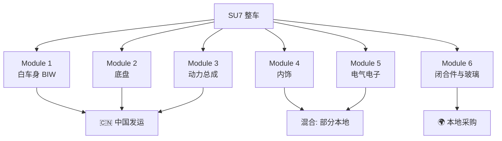

> [!summary] 小米 SU7 CKD 散件拆分方案
> - **核心**：基于 SU7 Modena 平台架构，分析 CKD 模块化拆分策略、本地化采购建议、包装物流方案及质量管控体系。
> - **要点**：术语速查
> - **要点**：一、SU7 技术架构与核心供应商
> - **要点**：1.1 平台规格
> - **要点**：1.2 核心零部件清单

# 小米 SU7 CKD 散件拆分方案

> 基于 SU7 Modena 平台架构，分析 CKD 模块化拆分策略、本地化采购建议、包装物流方案及质量管控体系。

---

## 术语速查

| 缩写 | 英文全称 | 中文 | 含义 |
|------|---------|------|------|
| **CBU** | Completely Built Up | 整车出口 | 整车组装好直接运输销售 |
| **CKD** | Completely Knocked Down | 全散件出口 | 完全拆散为零件级，运到当地工厂组装 |
| **SKD** | Semi Knocked Down | 半散件出口 | 部分总成已预装，到当地做简单拼装 |
| **DKD** | Done Knocked Down | 半成品出口 | 大总成已预装，介于 SKD 和 CBU 之间 |

---

## 一、SU7 技术架构与核心供应商

### 1.1 平台规格

| 属性 | 参数 |
|------|------|
| 平台名称 | Modena（小米超级电动平台） |
| 电压架构 | 400V（标准/Pro）/ 800V（Max） |
| 轴距 | 3,000 mm |
| 尺寸 | 4,997 × 1,963 × 1,455 mm |
| 风阻系数 | 0.195 |
| 整备质量 | ~1,980 kg（标准）/ ~2,205 kg（Max） |

### 1.2 核心零部件清单

| 系统       | 标准版/Pro           | Max                | 供应商                              |
| -------- | ----------------- | ------------------ | -------------------------------- |
| **电池包**  | 73.6 kWh LFP      | 101 kWh NMC        | 比亚迪刀片电池（标准）/ 宁德时代麒麟 CTP 3.0（Max） |
| **前电机**  | -                 | 220 kW 感应电机        | 汇川技术 / BorgWarner                |
| **后电机**  | 220 kW 永磁         | 275 kW 永磁          | 汇川技术 / 小米自研                      |
| **智驾芯片** | -                 | NVIDIA Orin-X      | NVIDIA                           |
| **座舱芯片** | 骁龙 8295           | 骁龙 8295            | Qualcomm                         |
| **制动系统** | 博世 iBooster + ESP | Brembo 卡钳 + 博世 ESP | 博世 / Brembo                      |
| **悬架**   | 传统                | CDC 自适应（ZF Sachs）  | ZF Sachs                         |
| **车身**   | 钢铝混合              | 钢铝 + 热成型钢          | 宝钢 / Novelis                     |
| **域控**   | 德赛西威              | 德赛西威               | 德赛西威                             |
| **音响**   | 标准                | Harman 高端          | Harman                           |
| **激光雷达** | -                 | 禾赛/速腾              | 禾赛科技 / 速腾聚创                      |

---

## 二、CKD 六大模块拆分方案

### 2.1 模块总览

### 2.2 Module 1: 白车身 (Body-in-White)

| 子总成 | CKD 形态 | 说明 |
|--------|---------|------|
| 地板总成 | 预焊模块 | 关键尺寸精度，海外难以保证 |
| 侧围框架（左/右） | 预冲压+预焊 | 热成型件需精密模具 |
| 顶盖 | 单件冲压 | 大但简单，可平放运输 |
| 前后碰撞结构 | 子总成 | 安全关键焊点 |
| 车门框架（4件） | 预装含铰链 | 玻璃导轨预装 |
| 引擎盖/尾箱盖 | 预冲压铝件 | 轻量、大批量 |

> 💡 **建议**：白车身以**预焊子模块**形式发运（非散件冲压件）。焊接夹具昂贵，白车身尺寸精度对 NVH 和安全至关重要。海外工厂仅需点焊连接子模块。

### 2.3 Module 2: 底盘模块

| 子总成 | CKD 形态 | 说明 |
|--------|---------|------|
| 前副车架+悬架 | 预装总成 | 直接螺栓连接白车身 |
| 后副车架+多连杆 | 预装总成 | 同上 |
| 转向机+转向柱 | 预装 | 对中精度要求高 |
| 制动系统 | 成套散装 | 卡钳扭矩规格关键 |
| 车轮+轮胎 | **本地采购** | 重、便宜、关税优势大 |
| 弹簧/减振器总成 | 预装 | ZF Sachs CDC 单元 |

> 💡 **建议**：底盘以 **2 大子总成**（前副车架模块 + 后副车架模块）加制动套件形式发运。轮胎轮辋本地采购。

### 2.4 Module 3: 动力总成模块

| 子总成 | CKD 形态 | 说明 |
|--------|---------|------|
| 电池包（73.6 / 101 kWh） | **整包发运** | 不可在海外安全拆解；核心 IP |
| 电池安装支架+螺栓 | 预装 | 安装精度要求高 |
| 前电机（四驱版） | **整机发运** | 精密动平衡转子，不可现场装配 |
| 后电机 | **整机发运** | 同上 |
| 逆变器/DC-DC 转换器 | **整机发运** | 密封电子件，无拆解收益 |
| 热管理管路（冷却液管路、泵、冷却器） | 成套散装 | 需在装配现场与电池连接 |
| 高压线束 | **整件发运** | 安全关键，出厂前已测试 |

> 💡 **建议**：所有动力总成部件以**完整密封单元**发运。电池、电机、逆变器均属高价值、IP 敏感、安全关键件——进一步拆解毫无收益。热管理管路散装发运，现场连接。

### 2.5 Module 4: 内饰模块

| 子总成 | CKD 形态 | 说明 |
|--------|---------|------|
| 仪表板总成 | 预装 | 复杂线束，HUD 安装点 |
| 前排座椅（左/右） | **本地采购** | 笨重，多数市场有本地供应商 |
| 后排座椅 | **本地采购** | 同上 |
| 中控台 | 预装 | 含电子件，预接线 |
| 门板（4件） | 预装含饰件 | 嵌套包装运输 |
| 地毯/顶衬 | 平装 | 损坏风险低 |
| 方向盘+安全气囊模块 | 预装 | 安全关键，出厂前已测试 |

> 💡 **建议**：座椅是最佳本地化候选件（体积大、标准化程度高、全球供应商充足）。仪表板和中控台从中国预装发运。

### 2.6 Module 5: 电气/电子模块

| 子总成 | CKD 形态 | 说明 |
|--------|---------|------|
| 座舱域控（骁龙 8295） | 完整密封单元 | 核心 IP，必须来自中国 |
| 智驾域控（NVIDIA Orin-X） | 完整密封单元 | 同上 |
| 激光雷达（Max） | 完整密封单元 | 同上 |
| 车身控制模块（BCM） | 完整密封单元 | 预编程 |
| 线束（主干线束） | **本地采购或半本地** | 笨重，劳动密集，本地含量加分 |
| 高压线束 | **中国发运** | 安全关键，出厂测试 |
| 12V 蓄电池 | 本地采购 | 重、低价、通用 |
| 信息娱乐屏+HUD | 预装 | 精密显示件 |
| 摄像头阵列（8-11个） | 成套散装 | 装配后需标定 |

> 💡 **建议**：线束拆分——12V/低压线束是本地化最佳候选（高劳动密集、良好本地含量加分）。高压线束和所有计算/智驾单元必须来自中国。

### 2.7 Module 6: 闭合件与玻璃模块

| 子总成 | CKD 形态 | 说明 |
|--------|---------|------|
| 前挡风玻璃 | **本地采购** | 易碎、重，本地有成熟供应商（福耀、AGC、圣戈班） |
| 后挡风玻璃 | **本地采购** | 同上 |
| 侧窗玻璃（4片） | **本地采购** | 同上 |
| 天窗总成 | 中国发运 | 专用件，含电机/导轨 |
| 后视镜总成 | 预装 | 含摄像头、电子件 |

---

## 三、CKD vs SKD 决策矩阵

### 3.1 关税优势分析

| 零部件类别 | 整车关税（典型） | CKD 散件关税（典型） | 节省幅度 | 建议 |
|-----------|-----------------|---------------------|---------|------|
| 完整车辆 | 60-100% | - | - | 使用 CKD 路径 |
| 车身板件 | 10-25% | 5-15% | 中等 | 中国发运 |
| 电池包 | 5-15% | 0-10% | 中低 | 中国发运 |
| 电机 | 5-15% | 0-10% | 中低 | 中国发运 |
| 芯片/ECU | 0-5% | 0-5% | 极小 | 中国发运 |
| 线束 | 10-20% | 5-10% | 中等 | **本地采购** |
| 轮胎 | 15-30% | 10-20% | 中高 | **本地采购** |
| 玻璃 | 10-25% | 5-15% | 中等 | **本地采购** |
| 座椅 | 15-25% | 10-15% | 中等 | **本地采购** |

### 3.2 战略分类

**必须来自中国（无替代 / 核心 IP）**：

| 零部件 | 理由 |
|--------|------|
| 电池包（CATL 麒麟 / BYD 刀片） | CTP 技术专利，安全认证 |
| 电机（汇川/小米自研） | 精密动平衡，专有设计 |
| 逆变器/DC-DC | 密封单元，专有控制算法 |
| 骁龙 8295 座舱 SoC | HyperOS 深度集成 |
| NVIDIA Orin-X 智驾域控 | 自动驾驶算法栈 |
| 激光雷达 | 中国供应商（禾赛/速腾） |
| 高压线束 | 出厂测试，安全关键 |
| 白车身 | 需 OEM 级冲压模具和焊接夹具 |

**应本地采购**：

| 零部件 | 理由 |
|--------|------|
| 轮胎 | 全球供应商（米其林、马牌、普利司通），关税高，重 |
| 玻璃 | 本地供应商遍布全球（福耀、AGC、圣戈班） |
| 12V 蓄电池 | 通用件，重，低价值 |
| 低压线束 | 劳动密集，本地含量加分 |
| 座椅（泡沫、骨架、面套） | 体积大，本地供应商充足，关税节省 |
| 隔音/NVH 材料 | 低技术，体积大，本地采购便宜 |

---

## 四、包装与物流方案

### 4.1 集装箱需求估算

| 模块组 | 估算重量 (kg) | 估算体积 (m³) | 集装箱类型 | 备注 |
|--------|--------------|--------------|-----------|------|
| 白车身子模块 | ~350-400 | 8-10 | 40ft HC | 嵌套堆叠+垫料 |
| 底盘（前后副车架） | ~250-300 | 6-8 | 40ft 标准 | 预装在货架上 |
| 动力总成（电池+电机） | ~500-600 | 8-12 | 40ft HC（危品标箱） | 电池 = 第 9 类危品，需 UN38.3 |
| 内饰 | ~150-200 | 8-10 | 40ft 标准 | 嵌套包装 |
| 电气/电子 | ~50-80 | 3-5 | 20ft 标准 | ESD 防护，建议恒温柜 |
| 闭合件（后视镜、天窗） | ~30-50 | 2-3 | 共用集装箱 | 缓冲箱 |

**单车汇总**：

| 方案 | 每车集装箱数（40ft等效） | 说明 |
|------|------------------------|------|
| 完整 CKD（全部中国发运） | 5-6 | 含座椅、玻璃、轮胎 |
| CKD + 本地化（推荐） | **3.5-4** | 座椅、玻璃、轮胎、低压线束本地采购 |
| SKD（半散件） | 2-3 | 大模块预装，零件更少 |

### 4.2 电池海运合规

| 要求 | 详情 |
|------|------|
| UN38.3 测试 | 所有锂电池运输强制要求 |
| 危品分类 | 第 9 类危险品 |
| 包装 | UN 认证木质箱，防火隔离层 |
| 文件 | MSDS、UN38.3 测试报告、危品申报单 |
| 集装箱 | 标准干货箱（电池包已密封），须符合 IMDG 规范 |
| 保险 | 海运危品专项保险 |
| 荷电状态 | 运输时 SOC 30-50% |

### 4.3 包装标准

| 零部件类型 | 包装方式 | 防护等级 |
|-----------|---------|---------|
| 白车身板件 | 钢制 A 型货架+泡棉分隔 | VCI 防锈膜+干燥剂 |
| 电池包 | UN 认证木箱，减振垫 | 防潮层，冲击指示器 |
| 电机 | 定制木箱+泡棉托架 | 防锈涂层，湿度指示卡 |
| 电子件（ECU、芯片） | ESD 袋+泡棉衬纸箱 | 建议恒温柜 |
| 底盘总成 | 钢制运输货架（可回收） | 喷涂/涂层表面保护 |
| 内饰件 | 瓦楞纸箱+泡棉 | 按 ISTA 3A 标准堆码测试 |

### 4.4 物流成本参考

| 航线 | 40ft HC 运费 | 备注 |
|------|-------------|------|
| 上海 → 东南亚 | $3,000-5,000 | RoRo 或集装箱船 |
| 上海 → 中东（迪拜） | $4,000-7,000 | |
| 上海 → 欧洲（汉堡） | $5,000-8,000 | |
| 上海 → 澳洲（悉尼） | $3,500-5,500 | |

---

## 五、行业对标：其他品牌的 CKD 做法

### 5.1 BYD

| 维度 | 详情 |
|------|------|
| 策略 | 激进 CKD + 全资工厂混合 |
| 核心工厂 | 泰国（15万/年）、匈牙利（10万+）、印尼（15万/年）、土耳其 |
| 模块方案 | 电池包+e-Platform 3.0 模块从中国发运；座椅、玻璃、轮胎、线束本地采购 |
| 本地化率目标 | 2-3 年内达 40-60% |
| 核心优势 | 全产业链垂直整合（刀片电池、电机、SiC 芯片），最大灵活度 |

### 5.2 Tesla

| 维度 | 详情 |
|------|------|
| 策略 | **不做传统 CKD**，偏好全资超级工厂 |
| 工厂 | 上海、柏林、德州、内华达 |
| 印度计划 | 探索 CKD 以获取 15% 优惠关税（投资 $20-50 亿） |
| 核心逻辑 | 品质控制至上，CKD 仅考虑极端关税市场 |

### 5.3 大众 MEB 平台

| 维度 | 详情 |
|------|------|
| 策略 | 通过合资公司本地化生产，不做独立 CKD |
| 中国 | 上汽大众/一汽大众本地生产 ID.3/ID.4/ID.6 |
| 美国 | 田纳西查塔努加工厂 |
| 核心逻辑 | 规模和全球布局足以支撑完整工厂投资 |

### 5.4 对比总结

| 品牌 | CKD 方式 | 首选进入模式 | 核心市场 |
|------|---------|------------|---------|
| **BYD** | 激进 CKD + 全资工厂 | CKD 先行，规模升级为工厂 | 东南亚、拉美、欧洲、非洲 |
| **Tesla** | 极少 CKD，偏好超级工厂 | 直接投资 | 美、中、德、（印度待定） |
| **大众** | 不做 CKD，用合资工厂 | 合资本地生产 | 通过现有布局全球化 |
| **小米（建议）** | CKD 作为工厂过渡 | 先 CKD 2-3 个试点市场 | 印尼、泰国、中东 |

---

## 六、海外 CKD 装配质量管控

### 6.1 关键质量检查点

| 阶段 | 检查点 | 方法 | 公差 |
|------|--------|------|------|
| **来料** | BOM 完整性核验 | 条码/RFID 扫描 vs 装箱单 | 100% 匹配 |
| **来料** | 电池包外观+电气 | 绝缘电阻测试（>1MΩ）、电压检查 | 按小米规格 |
| **来料** | 白车身尺寸 | CMM 或激光扫描 | 关键基准 ±0.5mm |
| **焊装** | 子模块连接（点焊） | 破坏性（剥离试验）+ 超声波 NDT | 按 AWS D8.1M |
| **焊装** | 间隙面差 | 通止规或激光 | 间隙 ±1.0mm，面差 ±0.5mm |
| **涂装** | 涂层厚度+附着力 | 测厚仪+百格法 | 80-120 微米，5B 附着力 |
| **总装** | 副车架安装扭矩 | 校准扭矩扳手+转角法 | 按小米扭矩规格（±5%） |
| **总装** | 电池安装扭矩（关键） | 校准多轴拧紧+数据记录 | 100% 数据记录 |
| **总装** | 高压线束连接 | 耐压测试+导通测试 | 按 IEC 60664 |
| **电气** | ECU 编程/刷写 | 小米 OEM 诊断工具 | 软件版本匹配 |
| **电气** | 安全气囊回路 | 电阻检查+诊断扫描 | 按 OEM 规格 |
| **终检** | 全车诊断 | OEM 扫描工具，清零所有 DTC | 零激活 DTC |
| **终检** | ADAS 标定 | 摄像头/激光雷达标定程序 | 按小米 Pilot 规格 |
| **终检** | 制动测试 | 滚筒或平板制动台 | 按当地认证（如 ECE R13） |
| **终检** | 淋雨测试 | 高压喷淋 | 零渗漏 |
| **终检** | 路试 | 5-10km 功能性驾驶 | 零 NVH/功能问题 |

### 6.2 海外工厂装备投资

| 类别 | 设备 | 估算投资 (USD) | 备注 |
|------|------|---------------|------|
| 焊装 | 点焊枪（10-20 把） | $200-500K | 伺服控制，可编程 |
| 焊装 | 白车身夹具/定位工装 | $1-3M | SU7 专用 |
| 焊装 | CMM/激光扫描站 | $300-500K | 尺寸验证 |
| 涂装 | 底漆/密封胶工位 | $2-5M | 可跨车型共用 |
| 总装 | 多轴拧紧工具 | $500K-1M | 数据记录功能 |
| 总装 | 电池吊装+安装工装 | $200-400K | 承载 600+kg，ESD 安全 |
| 总装 | 高压工具套装 | $50-100K | 按 IEC 61010 |
| 诊断 | 小米 OEM 诊断站 | $100-200K | 软件许可+硬件 |
| ADAS | 标定靶+标定间 | $200-300K | 摄像头/雷达/激光雷达 |
| 终检 | 滚筒制动试验台 | $100-200K | 支持四驱 |
| 终检 | 灯光调整站 | $50-100K | - |
| **合计** | - | **$5-15M** | 取决于自动化程度 |

### 6.3 人员培训要求

| 角色 | 培训时长 | 内容 |
|------|---------|------|
| 焊装技师 | 4-6 周 | 点焊、白车身拼接、尺寸测量 |
| 总装工人 | 3-4 周 | 扭矩规格、紧固顺序、卡扣安装 |
| 高压认证技师 | 额外 2-3 周 | 高压安全（Level 3 认证）、电池操作、应急处理 |
| 涂装操作员 | 2-3 周 | 工艺参数、质量标准 |
| 质检员 | 3-4 周 | 测量技术、缺陷识别、数据记录 |
| 诊断技师 | 4-6 周 | 小米 OBD 工具、ECU 编程、ADAS 标定、故障诊断 |
| 生产主管 | 6-8 周 | 以上全部 + 生产管理、升级流程 |

> 📌 **关键**：小米应向海外工厂派驻**常驻技术团队**（5-10 名工程师），首 12-18 个月驻场。关键人员须到**北京工厂**实地培训。所有高压技师必须通过**强制安全认证**方可操作。

---

## 七、总结与建议

| 维度 | 建议 |
|------|------|
| **目标市场（Phase 1）** | 印尼、泰国、中东（UAE/沙特） |
| **进入模式** | CKD 委托当地制造商（如印尼 INDOMOBIL 等） |
| **模块拆分** | 6 大模块；本地化后每车 ~3.5-4 个 40ft 集装箱 |
| **本地采购（Year 1）** | 轮胎、玻璃、12V 蓄电池、低压线束、座椅 |
| **本地采购（Year 2-3）** | 钢板冲压件、更多内饰件、隔音材料 |
| **必须中国发运** | 电池包、电机、逆变器、所有计算/智驾模块、白车身子模块 |
| **工厂投资** | $5-15M 装备+设施改造 |
| **质量体系** | 对标北京工厂 QC 检查点，前 18 个月派驻小米工程师 |
| **法规合规** | 电池 UN38.3 运输认证、当地整车认证（多数市场 ECE/UNECE） |

---

## 参考资料

- 小米官方技术规格
- CnEVPost - BYD/SU7 Coverage
- 盖世汽车 - 中国车企 CKD 策略
- IEA Global EV Outlook
- ASEAN 贸易数据库
- IEC/UN 运输法规
- [[出海模式总览|小米汽车出海模式分析]]
- [[SU7竞争定价分析|SU7海外市场竞争定价分析]]
