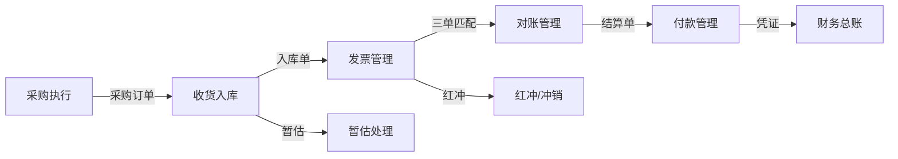

> [!summary] 01_财务日常运营全景
> - **定位**：供应链财务日常工作的完整模块清单，覆盖从采购下单到付款结算的全链路
> - **核心模块**：发票管理、对账管理、红冲/冲销、暂估处理、付款管理、月结结算、费用分摊
> - **适用对象**：供应链 PM、财务 BP、采购运营

---

## 一、全景定位

供应链财务是连接"业务动作"与"资金流动"的桥梁。从采购下单到供应商收款，中间经过的每一个财务动作，都对应着一个系统模块。

```
采购下单 → 收货入库 → 发票校验 → 对账确认 → 暂估入账 → 月结结算 → 付款执行 → 凭证归档
```

---

## 二、核心模块清单

### 2.1 发票管理

| 维度 | 说明 |
|------|------|
| 发票类型 | 增值税专用发票、普通发票、电子发票、全电发票 |
| 关键动作 | 发票录入、发票校验（三单匹配）、发票认证、发票归档 |
| 系统支持 | OCR 识别、发票查重、税率校验、进项税抵扣管理 |
| 异常处理 | 发票金额不符、税率错误、发票重复录入、供应商未开票 |

> [!tip] 全电发票趋势
> 2024年起全国推广全电发票，取消税控盘，发票数据实时同步税务系统。供应链系统需要对接税务数字账户，实现自动获取和核验。

### 2.2 对账管理

**对账的本质**：确认"我欠供应商多少钱"和"供应商认为我欠他多少钱"是否一致。

| 对账维度 | 说明 |
|----------|------|
| 对账周期 | 月度对账（最常见）、周对账（高频交易供应商）、实时对账（系统自动化） |
| 对账内容 | 采购订单金额 vs 实际收货金额 vs 发票金额 |
| 对账差异 | 数量差异、价格差异、时间差异（跨月收货/开票） |
| 对账流程 | 供应商发起 → 系统自动比对 → 差异标记 → 人工确认 → 生成结算单 |

### 2.3 红冲与冲销

**为什么需要红冲？**
- 已入账的发票金额有误，需要冲回重开
- 已结算的采购退货需要财务处理
- 跨月发现的计价错误需要纠正

| 场景 | 处理方式 | 系统影响 |
|------|----------|----------|
| 发票金额多开 | 红字发票冲回 + 蓝字发票重开 | 应付账款调整 |
| 采购退货 | 冲销原入库凭证 + 生成退货凭证 | 库存和应付同步调整 |
| 跨月价格调整 | 冲销原结算单 + 重新结算 | 影响当月损益 |
| 预付款冲销 | 预付转应付的核销处理 | 预付账款清理 |

### 2.4 暂估处理

**暂估（Accrual）的场景**：
- 月末货物已入库但发票未到，需要"暂估入账"
- 确保当期成本准确，避免利润虚增

```
月末暂估流程：
1. 扫描"已收货未开票"的采购订单
2. 按收货金额暂估入账（借：存货/成本，贷：应付账款-暂估）
3. 次月收到发票后冲回暂估，按实际金额入账
4. 差异调整当期损益
```

> [!warning] 暂估风险
> 长期暂估不清理会导致应付账款虚高、存货价值失真。建议设置暂估超期预警（如超过90天未清暂估自动告警）。

### 2.5 付款管理

| 付款方式 | 适用场景 | 系统要求 |
|----------|----------|----------|
| 银行转账 | 大额供应商付款 | 银企直连接口 |
| 商业承兑汇票 | 账期较长的核心供应商 | 票据管理系统 |
| 银行承兑汇票 | 信用等级高的供应商 | 银行授信管理 |
| 信用证（LC） | 跨境采购 | 外汇管理系统 |
| 预付款 | 定制件/长周期物料 | 预付款审批流程 |

### 2.6 费用分摊

供应链中的费用需要按规则分摊到具体成本中心或产品线：

| 费用类型 | 分摊基准 | 常见问题 |
|----------|----------|----------|
| 物流运费 | 重量/体积/货值 | 跨订单合并运输的分摊 |
| 仓储费 | 库存占用面积/货值 | 滞销品仓储成本归谁 |
| 关税 | 货值比例 | 混合报关的关税分摊 |
| 采购服务费 | 采购金额比例 | 集采 vs 分采的分摊规则 |

---

## 三、日常运营日历

```
每月工作节奏：
├── 月初 1-3日：上月暂估清理、暂估入账
├── 月初 3-5日：供应商对账确认
├── 月初 5-10日：发票收集与校验
├── 月中 10-15日：月结结算单生成
├── 月中 15-20日：付款申请审批
├── 月末 20-25日：付款执行
└── 月末 25-30日：当月暂估、凭证归档
```

---

## 四、关键指标（KPI）

| 指标 | 定义 | 健康值 |
|------|------|--------|
| 发票校验通过率 | 三单匹配一次通过的比例 | > 90% |
| 对账差异率 | 对账差异金额 / 对账总金额 | < 2% |
| 暂估清理率 | 当月清理暂估 / 期初暂估余额 | > 85% |
| 付款及时率 | 按合同约定账期准时付款的比例 | > 95% |
| 发票未达率 | 已收货未开票的金额占比 | < 10% |

---

## 五、与其他模块的关系



---

## 六、参考资料

- [[00_Self/04_供应链/07_财务与结算/02_财务与结算|财务与结算]]
- [[00_Self/04_供应链/07_财务与结算/03_月结与结算管理系统|月结与结算管理系统]]
- [[00_Self/04_供应链/07_财务与结算/04_CAPEX与OPEX详解|CAPEX与OPEX详解]]
- [[00_Self/04_供应链/07_财务与结算/05_P2P全流程与三单匹配|P2P全流程与三单匹配]]
