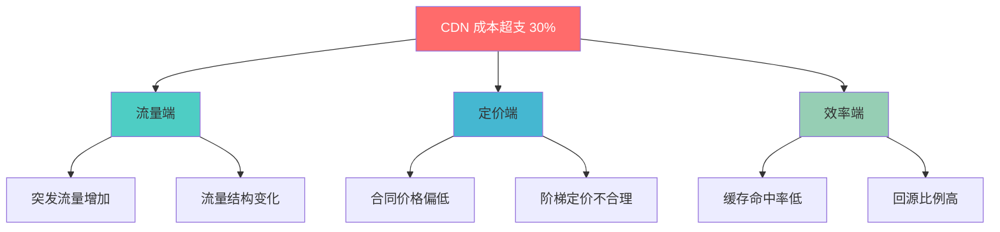
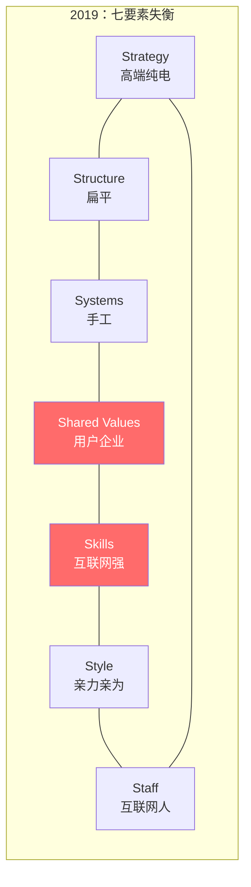
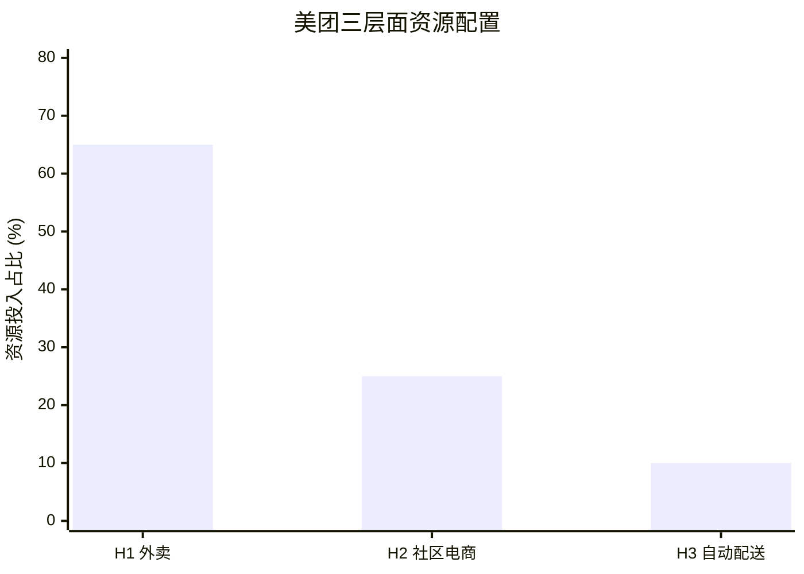
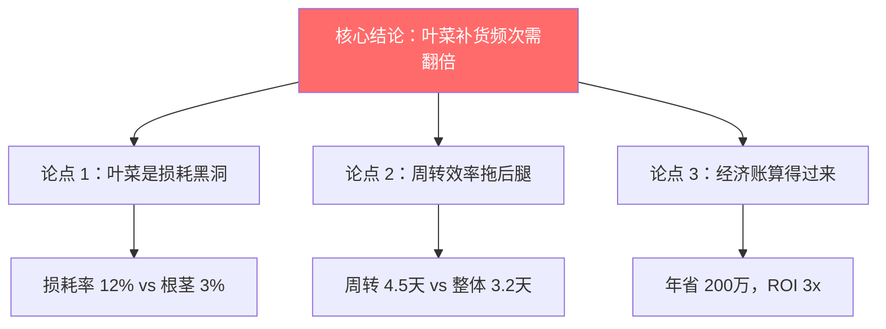
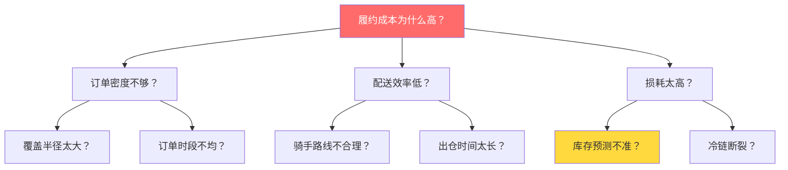
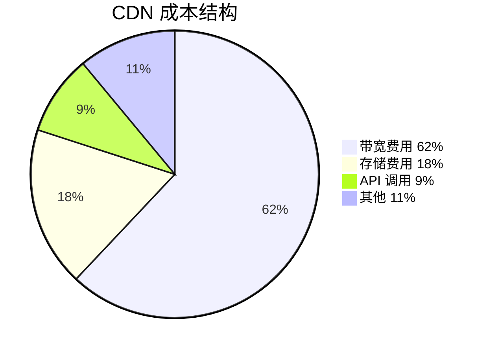

# McKinsey 麦肯锡 — 逻辑即权力

> "If you can't explain it simply, you don't understand it well enough."

---

## 🧬 公司 DNA

| 维度 | 特征 |
|------|------|
| **创立** | 1926 年，James O. McKinsey |
| **全球定位** | "The Firm" — 管理咨询的代名词 |
| **核心信条** | **事实为基础，逻辑为骨架，层级为结构** |
| **人才画像** | 顶级商学院 MBA、极度结构化思维 |
| **方法论风格** | 自上而下拆解、MECE 分解、数据驱动 |
| **产出风格** | 100 页 PPT，每页一个 insight，金字塔结构 |

### McKinsey 的"味道"

```
McKinsey 顾问的一天：

08:00  用 MECE 把问题拆成 3 个互不重叠的子问题
09:00  每个子问题用 Issue Tree 深挖到可执行的 insight
10:00  80/20 过滤：只留最关键的 20% 发现
11:00  金字塔原理组织汇报：结论先行
14:00  "So what?" — 每个发现必须回答"所以呢？"
16:00  Pre-Mortem：假设方案已失败，反推风险
18:00  客户汇报：100 页 PPT，管理层 30 分钟
```

---

## 📐 核心方法论

### 1. MECE 原则（Mutually Exclusive, Collectively Exhaustive）

> **一句话**：把问题拆成"不重叠、不遗漏"的子问题。

**生动举例**：叮咚买菜的缺货分析

```
❌ 不 MECE 的拆法（有重叠）：
├── 线上缺货
├── 前置仓缺货
└── 最后一公里缺货
（线上和前置仓有重叠）

✅ MECE 的拆法：
├── 需求端问题（预测不准、促销波动）
├── 供给端问题（供应商断供、物流延迟）
└── 系统端问题（库存数据不准、补货算法缺陷）
```

**Mermaid 图：MECE 拆解示例**



**使用场景**：任何分析的第一步 — 先确保问题分解是 MECE 的。

---

### 2. 7S 框架

> **一句话**：组织问题不是某一个环节坏了，而是七个要素不匹配。

**生动举例**：蔚来汽车的组织诊断

| 要素 | 2019 年（危机期） | 2023 年（复苏期） | 变化 |
|------|------------------|------------------|------|
| **Strategy** | 高端纯电 + 换电 | 高端纯电 + 子品牌 | 从单线到矩阵 |
| **Structure** | 扁平、创始人驱动 | 事业部制、分级授权 | 从游击队到正规军 |
| **Systems** | 飞书 + 手工流程 | 飞书 + 自研系统 | 从工具到体系 |
| **Shared Values** | 用户企业、极致服务 | 不变 | 始终是核心 DNA |
| **Skills** | 互联网基因强 | 补齐制造和供应链 | 从偏科到均衡 |
| **Style** | 李斌亲力亲为 | 逐渐放权 | 从创始人依赖到团队驱动 |
| **Staff** | 互联网人才为主 | 引入传统汽车人才 | 从单一到多元 |



**核心洞察**：7S 不是列出七项就完了，关键是找到**不匹配的要素对**。2019 年蔚来最大的矛盾是：Skills（互联网基因）与 Strategy（高端制造）不匹配。

---

### 3. 三层面增长（Three Horizons）

> **一句话**：活在当下、投资明天、赌注未来。

**生动举例**：美团的三层面布局

| 层面 | 业务 | 时间线 | 核心指标 |
|------|------|--------|---------|
| **H1** 🐄 | 外卖、到店 | 现金牛 | 利润率、用户留存 |
| **H2** 🌱 | 社区电商、买菜 | 高增长 | GMV 增速、履约成本 |
| **H3** 🎰 | 自动配送、AI | 探索期 | 技术成熟度、市场规模 |



**陷阱警示**：
- ❌ 把 H1 的利润全投到 H3（新业务烧钱、核心业务失血）
- ❌ 只做 H1 不投 H2/H3（温水煮青蛙，错过转型窗口）
- ✅ H1 造血 → H2 投资 → H3 探索，比例约 70/20/10

---

### 4. 金字塔原理

> **一句话**：先说结论，再给理由，每个理由下有数据支撑。

**汇报结构对比**：

```
❌ 没有金字塔的汇报（听众一脸懵）：

"我们调研了 5 个前置仓，发现库存周转天数是 3.2 天，
 然后对标了行业平均 2.8 天，差异主要集中在叶菜类，
 叶菜类的损耗率是 12%，而根茎类只有 3%，
 所以我们建议优化叶菜的补货频率..."

✅ 金字塔结构（30 秒抓住注意力）：

"建议将叶菜补货频率从每日 1 次提升至 2 次。
 理由：
 ① 叶菜损耗率 12%（根茎类仅 3%），是成本黑洞
 ② 叶菜周转天数 4.5 天（整体 3.2 天），拖累整体效率
 ③ 补货频次提升后，预计损耗率可降至 6%，年省 200 万
 详细数据见附录。"
```



**"So What?" 测试**：每个数据点必须回答"所以呢？"，否则就是噪音。

---

### 5. Issue Tree（问题树）

> **一句话**：把大问题拆成小问题，直到每个小问题都有答案。

**类型对比**：

| 类型 | 起点 | 方向 | 适用 |
|------|------|------|------|
| **诊断树** | 现象 | 向下追问为什么 | 找根因 |
| **假设树** | 假设 | 向下验证对不对 | 验证方案 |
| **计算树** | 目标 | 向下分解怎么算 | 量化估算 |

**生动举例**：叮咚买菜履约成本为什么高？



---

### 6. 80/20 法则

> **一句话**：找到那 20% 的关键因素，搞定它就能解决 80% 的问题。

**生动举例**：CDN 成本结构分析

| 成本项 | 占比 | 80/20 判断 |
|--------|------|-----------|
| 带宽费用 | 62% | 🔴 **关键 20%** — 优先优化 |
| 存储费用 | 18% | 🟡 次要 |
| API 调用 | 9% | 🟢 可忽略 |
| 其他 | 11% | 🟢 可忽略 |

**行动**：带宽费用中，动态内容占 80% → 优先优化动态内容的缓存策略。



---

## 🏆 McKinsey 大单案例

### 案例一：GE（通用电气）战略重组 — 10 亿美元级

| 维度 | 详情 |
|------|------|
| **客户** | GE（全球 largest conglomerate） |
| **问题** | 业务太分散，资本市场看不懂，估值折价 30% |
| **McKinsey 方案** | 用 BCG 矩阵 + 三层面增长重新划分业务组合 |
| **关键动作** | 剥离金融（GE Capital）、聚焦工业互联网（Predix） |
| **结果** | 短期股价上涨 20%，但长期因执行问题失败 |
| **教训** | ⚠️ 方案完美 ≠ 执行成功 — 组织变革才是最难的部分 |

**关键获胜点**：McKinsey 用"投资者视角"重新定义了 GE 的业务组合 — 不是按产品分，而是按"增长性 × 盈利性"分。

---

### 案例二：腾讯组织架构重组 — 2018

| 维度 | 详情 |
|------|------|
| **客户** | 腾讯 |
| **问题** | 组织僵化、创新乏力、被字节跳动追赶 |
| **McKinsey 方案** | 7S 框架诊断 + 事业部制重组 |
| **关键动作** | ① 成立云与智慧产业事业群（CSIG）② 合并社交与内容事业群（PCG）③ 技术委员会统一技术底座 |
| **结果** | 组织效率提升 40%，云业务 3 年增长 5 倍 |
| **关键获胜点** | 7S 框架精准定位了"Structure"和"Systems"的不匹配 — 事业群各自为战，没有统一的技术中台 |

**McKinsey 的"杀手锏"**：不是画 PPT，而是用 7S 框架找到了腾讯组织问题的"结构性根因" — 技术中台缺失。

---

### 案例三：某零售银行数字化转型 — 3 亿元级

| 维度 | 详情 |
|------|------|
| **客户** | 国内某 Top 10 银行 |
| **问题** | 线上业务占比仅 15%，落后招行 30 个百分点 |
| **McKinsey 方案** | 端到端数字化转型（6 个月诊断 + 18 个月实施） |
| **关键动作** | ① 7S 诊断：发现"Staff"和"Skills"是最大短板 ② 数字化成熟度从 L1.5 提升到 L3.5 ③ 建立数据中台，统一客户视图 |
| **结果** | 线上业务占比提升到 45%，获客成本降低 60% |
| **关键获胜点** | McKinsey 没有直接推荐"买什么系统"，而是先用 7S 诊断组织能力 — 找到"人"的问题先于"技术"的问题 |

---

## 🎯 McKinsey 工具箱速查

| 工具 | 一句话 | 在 nailit 中的位置 |
|------|--------|-------------------|
| MECE | 不重叠、不遗漏 | Step 1 + Step 4 |
| 7S | 组织七要素对齐 | Step 1 + Step 2 |
| 三层面增长 | H1/H2/H3 时间分层 | Step 2 |
| Issue Tree | 逻辑树拆解 | Step 3 |
| 金字塔原理 | 结论先行 | Step 5 |
| 80/20 | 关键少数 | Step 3 + Step 4 |

---

## 🔗 关联

- 方法论全景：[[咨询方法论]]
- BCG 篇：[[02_BCG波士顿咨询]]
- Bain 篇：[[03_Bain贝恩]]
- 实战应用：[[../skills/analyst/SKILL.md|analyst Skill]]
