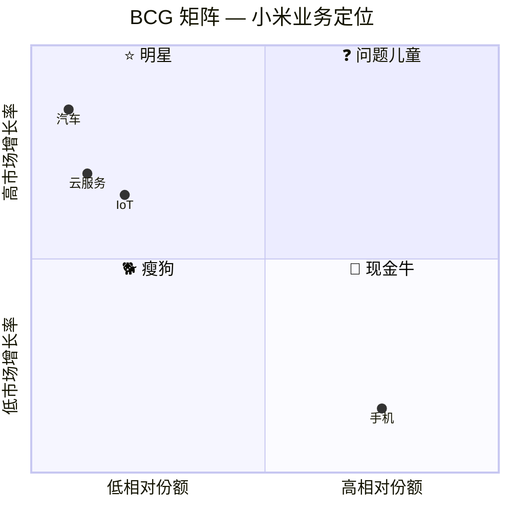
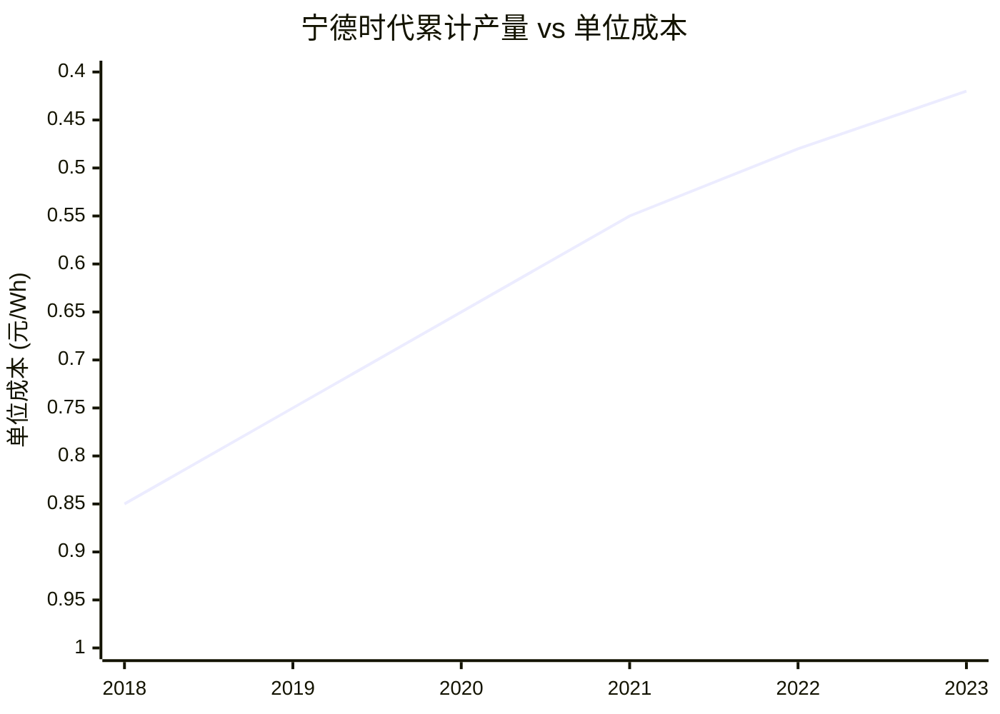
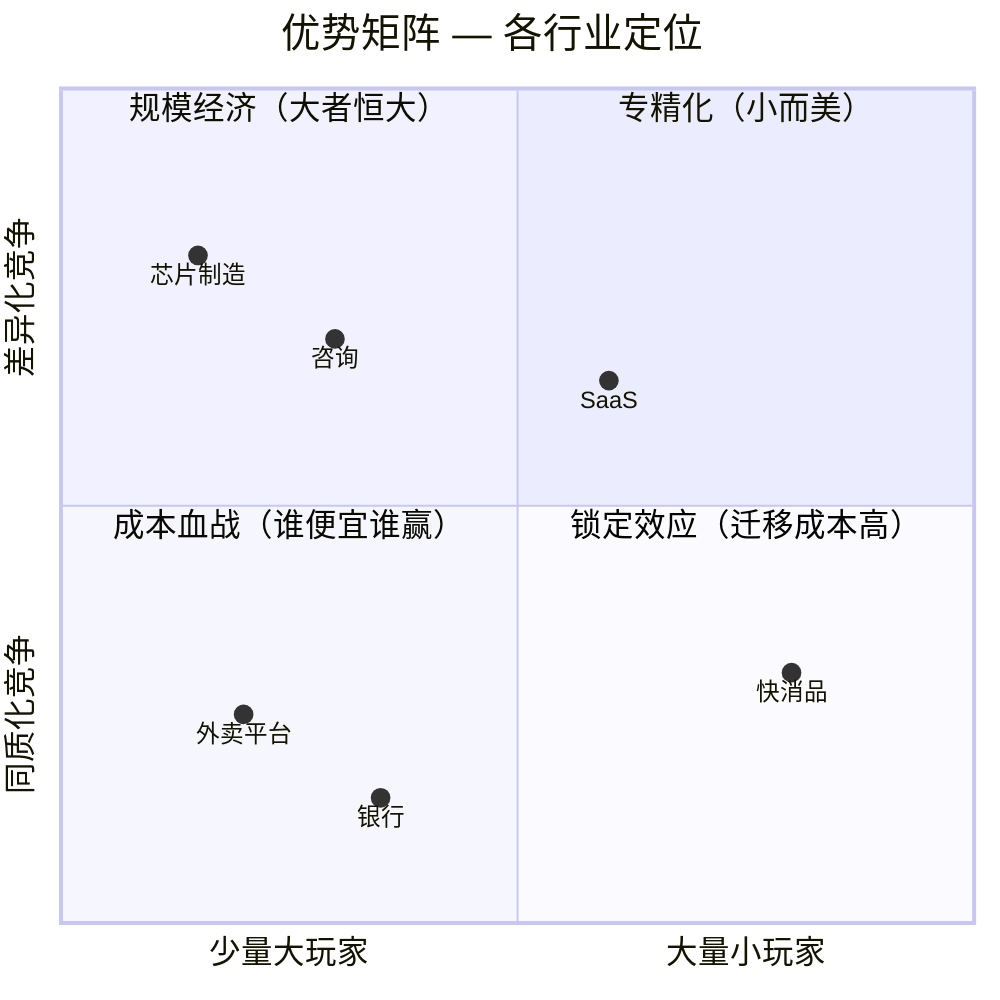

# BCG 波士顿咨询 — 用数学讲故事

> "In the long run, the only sustainable competitive advantage is your ability to learn faster than the competition."

---

## 🧬 公司 DNA

| 维度 | 特征 |
|------|------|
| **创立** | 1963 年，Bruce Henderson（从 Bain & Company 分裂） |
| **全球定位** | 战略咨询鼻祖，发明了"战略咨询"这个行业 |
| **核心信条** | **一切皆可量化，经验曲线决定胜负** |
| **人才画像** | 数学好、喜欢建模、擅长用数据讲商业故事 |
| **方法论风格** | 矩阵思维、量化分析、竞争动力学 |
| **独门绝技** | 首创"战略咨询"概念，发明 BCG 矩阵 |

### BCG 的"味道"

```
BCG 顾问的思维模式：

1. 先画一个 2x2 矩阵
2. 把所有东西放进去
3. 用数学证明为什么这样放
4. 告诉你"市场增长率 × 相对份额 = 竞争地位"
5. 然后说"所以你应该把钱投到右边"
```

---

## 📐 核心方法论

### 1. BCG 矩阵（增长-份额矩阵）

> **一句话**：用两个维度（市场增长率 + 相对市场份额）把业务分成四类，然后区别对待。

**生动举例**：小米的业务组合

| 业务 | 市场增长率 | 相对份额 | 象限 | 策略 |
|------|-----------|---------|------|------|
| 手机 | 5%（低） | 15%（高） | 🐄 现金牛 | 收割利润，反哺新业务 |
| IoT | 25%（高） | 3%（低） | ❓ 问题儿童 | 选择性投资，赌对变明星 |
| 汽车 | 40%（高） | 1%（低） | ❓ 问题儿童 | 重金押注，赌未来 |
| 云服务 | 30%（高） | 2%（低） | ❓ 问题儿童 | 跟随策略 |



**核心洞察**：小米的问题不是手机（现金牛），而是 IoT 和汽车（问题儿童）能不能变成明星。如果不能，就是在烧钱。

---

### 2. 经验曲线（Experience Curve）

> **一句话**：做得越多，成本越低 — 不是"熟能生巧"那么简单。

**核心公式**：

```
C₁ = C₀ × (Q₁/Q₀)^(-α)

其中：
C₀ = 当前单位成本
Q₀ = 当前累计产量
Q₁ = 新的累计产量
α = 学习率参数（通常 0.15-0.30）
```

**生动举例**：宁德时代的动力电池成本下降



| 年份 | 累计产量 (GWh) | 单位成本 (元/Wh) | 下降幅度 |
|------|---------------|-----------------|---------|
| 2018 | 25 | 0.85 | - |
| 2019 | 45 | 0.75 | -12% |
| 2020 | 80 | 0.65 | -13% |
| 2021 | 150 | 0.55 | -15% |
| 2022 | 280 | 0.48 | -13% |
| 2033 | 500 | 0.42 | -13% |

**战略含义**：
- 先发者（宁德时代）靠规模吃经验曲线红利
- 后来者（比亚迪、中创新航）必须找到弯道超车的方式
- **经验曲线的陷阱**：技术变革可能重置曲线（如固态电池）

---

### 3. 优势矩阵（Advantage Matrix）

> **一句话**：不同行业的"赢法"不同，先搞清楚你所在的行业靠什么赢。



| 行业 | 优势类型 | 策略 |
|------|---------|------|
| 芯片制造 | 规模经济 | 拼产能、拼良率 |
| 咨询 | 专精化 | 拼人才、拼品牌 |
| 外卖平台 | 规模经济 + 锁定 | 拼密度、拼习惯 |
| 快消品 | 无优势（成本战） | 拼渠道、拼营销 |

---

## 🏆 BCG 大单案例

### 案例一：Netflix 战略转型 — 改变娱乐行业

| 维度 | 详情 |
|------|------|
| **客户** | Netflix（当时还是 DVD 租赁公司） |
| **问题** | DVD 租赁市场见顶，流媒体技术刚萌芽 |
| **BCG 方案** | 经验曲线 + BCG 矩阵重新定义业务 |
| **关键动作** | ① 用经验曲线预判：流媒体带宽成本将每年下降 30% ② 用 BCG 矩阵识别：DVD 是"现金牛"，流媒体是"问题儿童" ③ 建议"自我颠覆" — 用 DVD 利润养流媒体 |
| **结果** | Netflix 从 DVD 租赁转型为全球流媒体巨头，市值 2000 亿美元 |
| **关键获胜点** | BCG 的经验曲线模型让 Netflix 相信：流媒体成本会快速下降，先发优势 = 成本优势 |

**BCG 的"杀手锏"**：用数学模型证明"现在投入巨资做流媒体是值得的" — 不是拍脑袋，而是用经验曲线算出来的。

---

### 案例二：Uber 全球扩张策略

| 维度 | 详情 |
|------|------|
| **客户** | Uber |
| **问题** | 全球扩张烧钱太快，每个市场都在亏损 |
| **BCG 方案** | 经验曲线 + 优势矩阵 |
| **关键动作** | ① 用经验曲线分析：每个市场的订单密度达到临界点后，成本会急剧下降 ② 用优势矩阵判断：出行是"规模经济"型行业，必须做第一 ③ 建议"先亏损抢份额，等经验曲线起效" |
| **结果** | Uber 在 50+ 国家建立领先地位，2023 年首次全年盈利 |
| **关键获胜点** | BCG 用经验曲线说服投资者"亏损是战略投资，不是烧钱" — 把亏损重新定义为"购买经验曲线位置" |

---

### 案例三：某车企新能源转型 — 5 亿元级

| 维度 | 详情 |
|------|------|
| **客户** | 国内某传统车企 |
| **问题** | 燃油车利润下滑，新能源车投入巨大，不知道怎么分配资源 |
| **BCG 方案** | BCG 矩阵 + 三层面增长 |
| **关键动作** | ① 用 BCG 矩阵分类：燃油 SUV（现金牛）、电动轿车（问题儿童）、氢能源（瘦狗） ② 用三层面分配资源：H1 燃油车养 H2 电动车 ③ 建议砍掉氢能源投入（瘦狗） |
| **结果** | 3 年内新能源车占比从 5% 提升到 35%，整体利润率维持稳定 |
| **关键获胜点** | BCG 矩阵让管理层"有勇气"砍掉不赚钱的业务 — 不是"不想做"，而是"数学告诉我们不该做" |

---

## 🎯 BCG 工具箱速查

| 工具 | 一句话 | 在 nailit 中的位置 |
|------|--------|-------------------|
| BCG 矩阵 | 业务四象限分类 | Step 4（业务组合评估） |
| 经验曲线 | 累计产量→成本下降 | Step 4（成本杠杆分析） |
| 优势矩阵 | 竞争优势类型识别 | Step 1（竞争格局评估） |

---

## 🔗 关联

- 方法论全景：[[咨询方法论]]
- McKinsey 篇：[[01_McKinsey麦肯锡]]
- Bain 篇：[[03_Bain贝恩]]
- 实战应用：[[../skills/analyst/SKILL.md|analyst Skill]]
