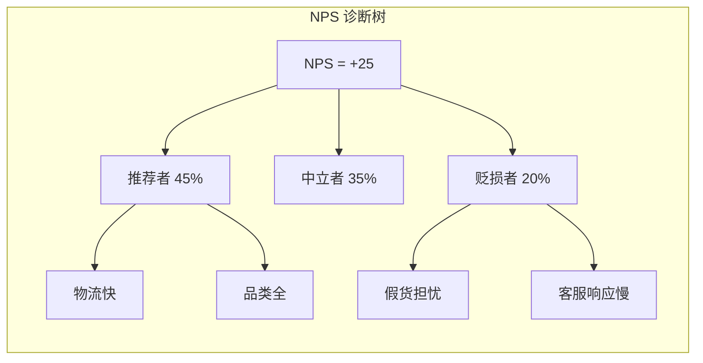
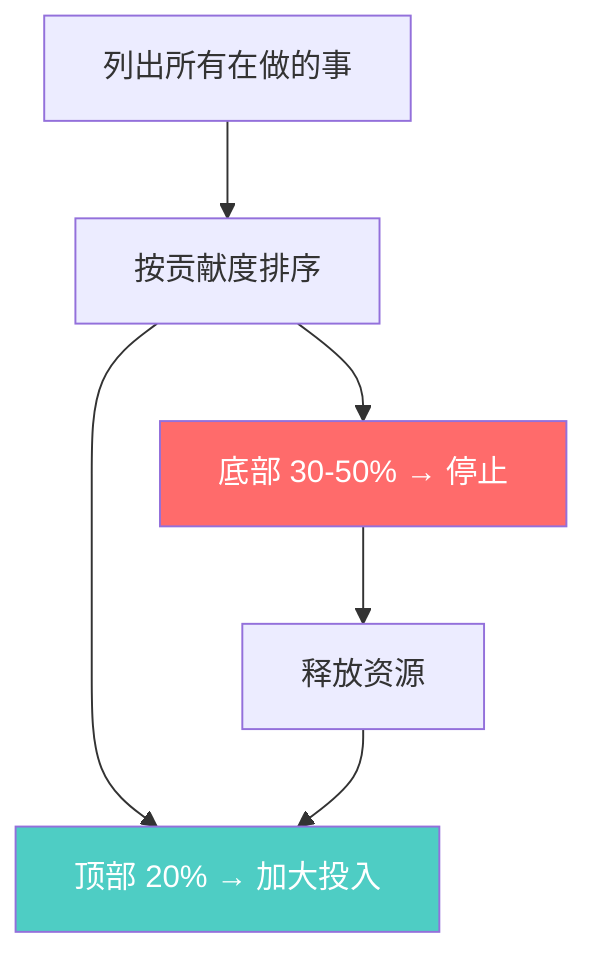

# Bain 贝恩 — 利润是一切的答案

> "The most powerful strategic insights come from understanding where the money is — and where it isn't."

---

## 🧬 公司 DNA

| 维度 | 特征 |
|------|------|
| **创立** | 1973 年，Bill Bain（从 BCG 分裂） |
| **全球定位** | "结果导向"的咨询公司 — 只关心能不能落地 |
| **核心信条** | **利润池决定一切，少做 > 多做** |
| **人才画像** | 务实派、擅长执行、喜欢问"钱从哪来" |
| **方法论风格** | 利润驱动、简化聚焦、结果可量化 |
| **独门绝技** | 发明了 NPS（净推荐值）、利润池分析 |

### Bain 的"味道"

```
Bain 顾问的思维模式：

1. 先问"这个行业钱在哪里？"（利润池）
2. 再问"我们能切到哪块蛋糕？"
3. 然后说"砍掉 30% 不赚钱的业务"
4. 最后说"只做这一件事就够了"
```

---

## 📐 核心方法论

### 1. 利润池分析（Profit Pool）

> **一句话**：行业的收入分布和利润分布是两回事 — 收入大的环节可能不赚钱。

**生动举例**：汽车行业的利润池

| 价值链环节 | 收入占比 | 利润占比 | 利润率 |
|-----------|---------|---------|--------|
| 零部件制造 | 25% | 8% | 3% |
| 整车制造 | 40% | 15% | 4% |
| 经销商/零售 | 15% | 12% | 8% |
| 汽车金融 | 5% | 25% | 50% |
| 售后服务 | 10% | 30% | 30% |
| 保险/延保 | 5% | 10% | 20% |

```mermaid
xychart-beta
    title "汽车行业：收入 vs 利润"
    x-axis ["零部件", "整车", "经销商", "汽车金融", "售后服务", "保险"]
    y-axis "占比 (%)" 0 --> 45
    bar [25, 40, 15, 5, 10, 5]
    bar [8, 15, 12, 25, 30, 10]
```



**核心洞察**：
- 整车制造收入最大（40%），但利润只有 15%
- 汽车金融收入最小（5%），但利润占 25%
- **蔚来为什么做金融？** 因为它看到了利润池的分布

**使用步骤**：
1. 绘制价值链各环节的收入规模
2. 估算每个环节的利润率
3. 找到"利润厚区"（金融、售后）
4. 选择切入利润最厚的环节

---

### 2. NPS（净推荐值）

> **一句话**：问客户一个问题就够了 — "你会推荐我们给朋友吗？"

**公式**：

```
NPS = 推荐者% (9-10分) - 贬损者% (0-6分)

范围：-100 到 +100
```

**生动举例**：电商平台 NPS 对标

| 平台 | NPS | 评价 | 关键驱动因素 |
|------|-----|------|-------------|
| 拼多多 | +45 | 🟢 优秀 | 极致性价比、社交裂变 |
| 京东 | +38 | 🟢 良好 | 物流体验、正品保障 |
| 淘宝 | +25 | 🟡 一般 | 选择多但体验参差 |
| 抖音电商 | +15 | 🟡 待提升 | 冲动消费后退货率高 |



**NPS 的陷阱**：
- ❌ 只看总分不看细分（总分 +30，但 B 端客户 -10）
- ❌ 不追踪贬损者的具体痛点
- ✅ 按客户分群追踪，找到贬损者最集中的环节

---

### 3. 简化聚焦（Simplify and Focus）

> **一句话**：战略的本质不是选择做什么，而是选择**不做什么**。

**Bain 的简化框架**：



**生动举例**：某 SaaS 公司的产品线瘦身

| 产品线 | 收入贡献 | 客户数 | 资源投入 | 决策 |
|--------|---------|--------|---------|------|
| 核心 CRM | 55% | 2000 | 40% | ✅ 加大投入 |
| 营销自动化 | 20% | 800 | 25% | ✅ 保持 |
| 客服工单 | 12% | 400 | 20% | 🟡 观察 |
| 项目管理 | 8% | 150 | 10% | ❌ 停止 |
| BI 看板 | 5% | 50 | 5% | ❌ 停止 |

**结果**：砍掉项目管理和 BI 看板后，释放的 15% 资源投入核心 CRM，收入增长 30%。

---

## 🏆 Bain 大单案例

### 案例一：苹果生态系统 — 利润池的极致运用

| 维度 | 详情 |
|------|------|
| **客户** | Apple（非官方，Bain 研究案例） |
| **洞察** | 硬件利润薄，服务利润厚 |
| **Bain 分析** | 利润池拆解：iPhone 收入占 52%，但服务收入利润率 70%（硬件仅 36%） |
| **策略推导** | 用硬件锁定用户 → 用服务持续收割利润 |
| **结果** | Apple 服务收入从 2015 年的 200 亿增长到 2024 年的 960 亿美元 |
| **关键获胜点** | Bain 的利润池分析揭示了 Apple 的"隐藏商业模式" — 卖的不是手机，是"进入生态的门票" |

**Bain 的"杀手锏"**：利润池分析让 Apple 看到"服务"才是真正的利润来源 — 这就是为什么 Apple 拼命推订阅、推 Apple One。

---

### 案例二：某电商巨头的 NPS 革命

| 维度 | 详情 |
|------|------|
| **客户** | 某国内电商（年 GMV 5000 亿） |
| **问题** | 用户增长放缓，获客成本飙升 |
| **Bain 方案** | NPS 驱动增长 |
| **关键动作** | ① 建立 NPS 追踪体系，按用户分群 ② 发现"贬损者"集中在"售后"环节（NPS -15） ③ 集中资源改善售后，NPS 从 +25 提升到 +45 ④ NPS 每提升 10 点，用户留存率提升 5% |
| **结果** | 1 年内复购率提升 12%，获客成本降低 20% |
| **关键获胜点** | Bain 用 NPS 证明了"老客户比新客户值钱" — 投资 1 块钱改善体验 = 节省 3 块钱获客成本 |

---

### 案例三：某零售集团产品线瘦身 — 2 亿元级

| 维度 | 详情 |
|------|------|
| **客户** | 某国内零售集团（旗下 15 个子品牌） |
| **问题** | 品牌太多、资源分散、整体利润下滑 |
| **Bain 方案** | 简化聚焦 + 利润池分析 |
| **关键动作** | ① 利润池分析：3 个品牌贡献 80% 利润 ② 简化聚焦：砍掉 5 个不赚钱的品牌 ③ 释放的资源投入 Top 3 品牌 |
| **结果** | 整体利润率从 3% 提升到 8%，品牌数从 15 减到 10 |
| **关键获胜点** | Bain 的"简化聚焦"让管理层有勇气说"不做" — 不是"做不好"，而是"不值得做" |

---

## 🎯 Bain 工具箱速查

| 工具 | 一句话 | 在 nailit 中的位置 |
|------|--------|-------------------|
| 利润池 | 行业利润分布地图 | Step 4（选择最优切入位置） |
| NPS | 客户忠诚度度量 | Step 2（客户维度目标） |
| 简化聚焦 | 少做 > 多做 | Step 5（明确不做什么） |

---

## 🔗 关联

- 方法论全景：[[咨询方法论]]
- McKinsey 篇：[[01_McKinsey麦肯锡]]
- BCG 篇：[[02_BCG波士顿咨询]]
- 实战应用：[[../skills/analyst/SKILL.md|analyst Skill]]
