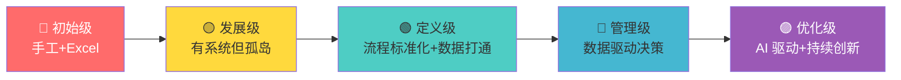
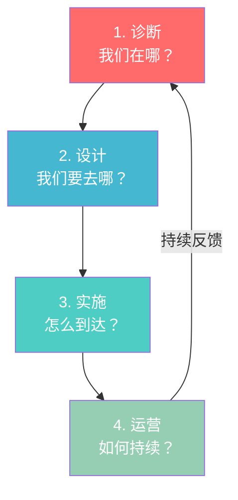
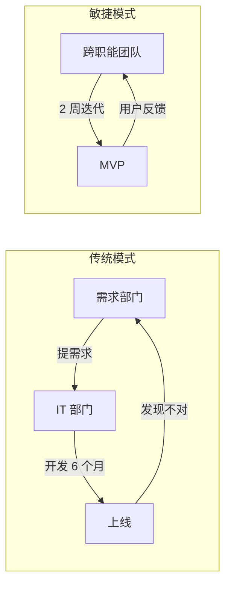

# Deloitte 德勤 — 技术驱动变革

> "The future is not about technology. It's about the people who use it."

---

## 🧬 公司 DNA

| 维度 | 特征 |
|------|------|
| **创立** | 1845 年，William Deloitte（四大之一） |
| **全球定位** | 从审计起家，转型为"技术+咨询"双引擎 |
| **核心信条** | **数字化是手段不是目的，组织能力是变革的瓶颈** |
| **人才画像** | 技术背景强、擅长落地实施、关注组织变革 |
| **方法论风格** | 诊断→设计→实施→运营，端到端交付 |
| **独门绝技** | 数字化成熟度评估、敏捷组织转型 |

### Deloitte 的"味道"

```
Deloitte 顾问的思维模式：

1. 先做数字化成熟度评估（给组织打分）
2. 然后画一张"从今天到目标"的路线图
3. 用敏捷方法分阶段实施
4. 最后确保组织能力能跟上技术升级
```

---

## 📐 核心方法论

### 1. 数字化成熟度模型（Digital Maturity Model）

> **一句话**：先搞清楚你在哪一级，才能知道下一步往哪走。

**五个成熟度等级**：



**生动举例**：某零售企业的数字化成熟度诊断

| 维度 | 当前等级 | 目标等级 | 差距 |
|------|---------|---------|------|
| **战略** | L3（有数字化战略） | L5（AI 驱动） | 2 级 |
| **客户** | L2（有 App 但体验差） | L4（全渠道） | 2 级 |
| **运营** | L1（手工为主） | L4（自动化） | 3 级 |
| **数据** | L2（有数据但没打通） | L5（数据中台） | 3 级 |
| **组织** | L1（IT 部门支持） | L3（IT 业务融合） | 2 级 |
| **文化** | L1（排斥变化） | L3（拥抱创新） | 2 级 |

**核心洞察**：运营和数据差距最大（3 级），但组织和文化是前提（不改文化，技术白搭）。

---

### 2. 端到端数字化转型框架

> **一句话**：数字化转型不是买系统，是改组织。

**Deloitte 的转型四阶段**：

| 阶段 | 核心任务 | 典型产出 | 时间 |
|------|---------|---------|------|
| **1. 诊断** | 现状评估、差距分析 | 成熟度报告、痛点地图 | 2-4 周 |
| **2. 设计** | 目标架构、转型路线图 | 数字化蓝图、投资计划 | 4-8 周 |
| **3. 实施** | 敏捷交付、快速迭代 | MVP、试点成果 | 3-6 月 |
| **4. 运营** | 持续优化、能力沉淀 | 运营体系、组织能力 | 持续 |



**生动举例**：某制造企业的数字化转型路径

| 阶段 | 行动 | 成果 |
|------|------|------|
| 诊断 | 发现 70% 决策靠经验 | 数字化成熟度 L1.5 |
| 设计 | 目标 3 年达到 L4 | 投资 2000 万，分 3 期 |
| 实施 | 先上 MES（制造执行系统） | 产能提升 15% |
| 运营 | 建立数据中台，持续优化 | 决策响应时间缩短 50% |

---

### 3. 敏捷组织转型

> **一句话**：让大公司像创业公司一样灵活。

**Deloitte 的敏捷转型模型**：

| 维度 | 传统模式 | 敏捷模式 |
|------|---------|---------|
| **组织** | 部门墙、层级多 | 跨职能团队、扁平 |
| **决策** | 自上而下、层层审批 | 授权一线、快速决策 |
| **交付** | 瀑布式、半年一次 | 迭代式、两周一次 |
| **文化** | 规避风险、怕犯错 | 快速试错、从失败中学习 |
| **考核** | KPI 导向、年底考核 | OKR 导向、持续反馈 |



---

## 🏆 Deloitte 大单案例

### 案例一：某银行数字化转型 — 5 亿元级

| 维度 | 详情 |
|------|------|
| **客户** | 国内某 Top 20 银行 |
| **问题** | 线上化率仅 20%，落后招行 40 个百分点 |
| **Deloitte 方案** | 数字化成熟度诊断 + 端到端转型 |
| **关键动作** | ① 成熟度诊断：整体 L1.8（初始级） ② 7S 分析：Skills（人才）和 Systems（系统）是最大短板 ③ 分 3 期实施：第一期建数据中台，第二期上线智能风控，第三期全渠道整合 |
| **结果** | 线上化率提升到 55%，获客成本降低 45% |
| **关键获胜点** | Deloitte 的成熟度模型让银行"量化"了自己的差距 — 不是"我们比招行差"，而是"我们差在 L2.2 级" |

---

### 案例二：某制造企业敏捷转型 — 1 亿元级

| 维度 | 详情 |
|------|------|
| **客户** | 某国内制造企业（5000 人） |
| **问题** | 新产品研发周期 18 个月，市场变化快，产品上市即过时 |
| **Deloitte 方案** | 敏捷组织转型 |
| **关键动作** | ① 7S 诊断：Structure（层级多）、Style（决策慢）是瓶颈 ② 从"部门制"转为"产品小队制"（Spotify 模式）③ 每个小队 8-10 人，端到端负责一个产品线 ④ 建立"部落-小队-分会"三层结构 |
| **结果** | 新产品研发周期从 18 个月缩短到 6 个月，上市速度提升 3 倍 |
| **关键获胜点** | Deloitte 用 7S 找到了"组织结构"是创新的瓶颈 — 不是"人不行"，而是"层级太多、决策太慢" |

---

### 案例三：某政府数字化转型 — 3 亿元级

| 维度 | 详情 |
|------|------|
| **客户** | 某省级政府 |
| **问题** | 政务服务效率低，群众办事跑 3-5 次 |
| **Deloitte 方案** | 数字化成熟度 + 端到端转型 |
| **关键动作** | ① 成熟度诊断：大部分部门 L1（手工+Excel）② 设计"一网通办"蓝图：100+ 事项线上化 ③ 建立数据共享平台：打破部门数据孤岛 ④ 敏捷实施：分批次上线 |
| **结果** | 群众办事从"跑 3-5 次"变为"最多跑 1 次"，90% 事项线上可办 |
| **关键获胜点** | Deloitte 的端到端方法论让政府"系统性"地推进数字化 — 不是"上一个系统"，而是"改一个流程" |

---

## 🎯 Deloitte 工具箱速查

| 工具 | 一句话 | 在 nailit 中的位置 |
|------|--------|-------------------|
| 数字化成熟度 | 组织能力评分卡 | Step 1（组织 As-Is 诊断） |
| 端到端转型 | 诊断→设计→实施→运营 | 贯穿全流程 |
| 敏捷组织 | 大公司变灵活 | Step 2（组织 To-Be 设计） |

---

## 🔗 关联

- 方法论全景：[[咨询方法论]]
- McKinsey 篇：[[01_McKinsey麦肯锡#7S 框架]]（组织诊断对比）
- 供应链专项：[[06_供应链专项方法论]]
- 实战应用：[[../skills/analyst/SKILL.md|analyst Skill]]
