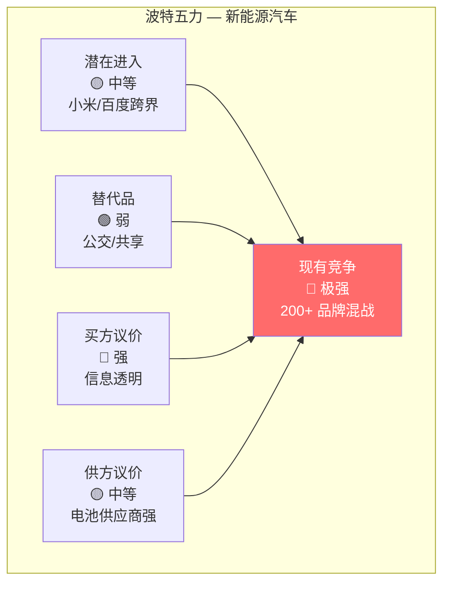
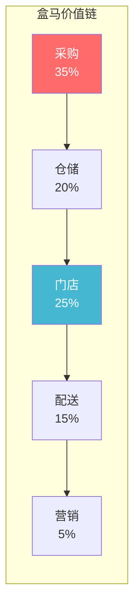
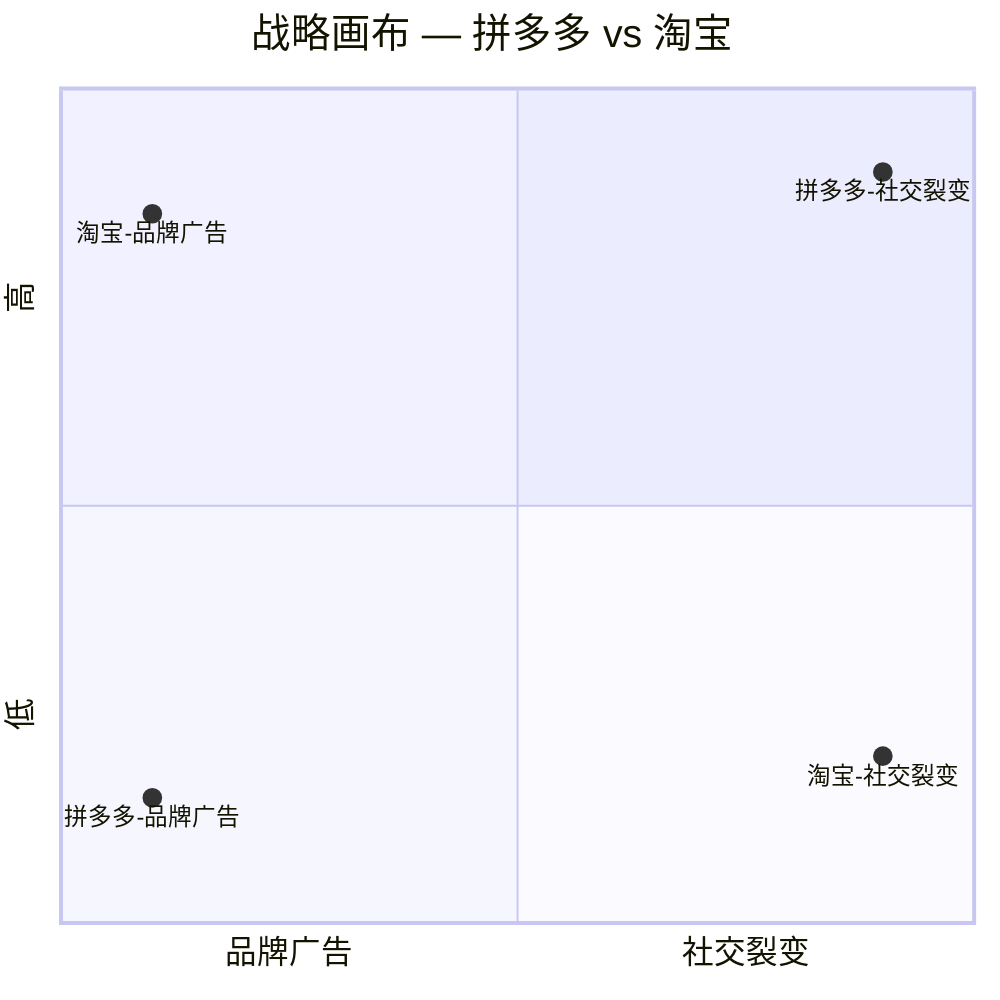
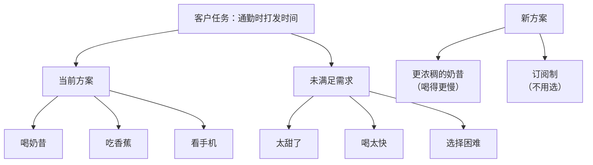
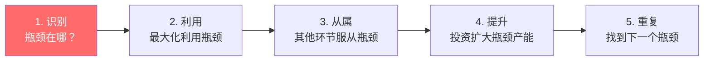
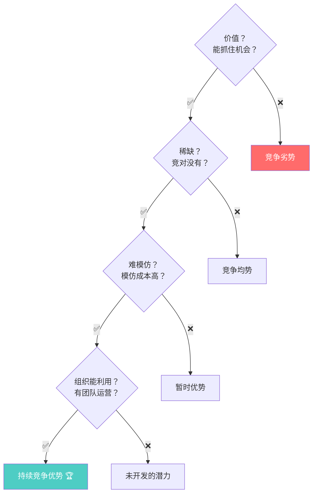
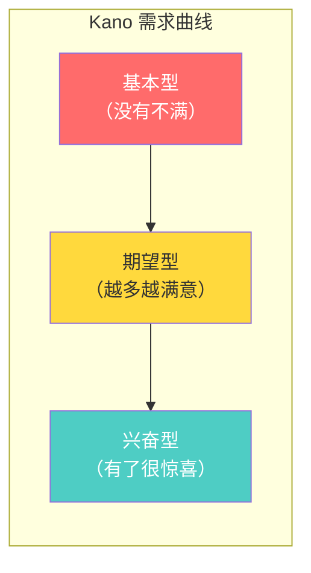

# Harvard 哈佛经典 — 经典永不过时

> "The essence of strategy is choosing what not to do." — Michael Porter

---

## 🧬 学术 DNA

| 维度 | 特征 |
|------|------|
| **来源** | 哈佛商学院 + 独立学者 |
| **核心信条** | **竞争战略决定利润，客户需求决定产品** |
| **学术风格** | 理论严谨、案例驱动、跨学科融合 |
| **方法论寿命** | 30-50 年仍被广泛使用 |
| **影响力** | 塑造了整个商学院的课程体系 |

### 经典理论的"味道"

```
哈佛理论的共同特点：

1. 用一个简洁的模型解释复杂现象
2. 用大量案例验证理论的普适性
3. 30 年后仍然被引用
4. 每个 MBA 学生第一天就要学
```

---

## 📐 核心方法论

### 1. 波特五力模型（Porter's Five Forces）

> **一句话**：行业的利润不是由产品决定的，是由竞争结构决定的。

**生动举例**：中国新能源汽车行业的五力分析

| 力量 | 强度 | 分析 |
|------|------|------|
| **现有竞争** | 🔴 极强 | 比亚迪、特斯拉、蔚小理、华为、小米… 200+ 品牌混战 |
| **潜在进入** | 🟡 中等 | 壁垒高（资金、技术、牌照），但跨界者不断（小米、百度） |
| **替代品** | 🟢 弱 | 公共交通、共享出行，短期无法替代私家车 |
| **买方议价** | 🔴 强 | 信息透明、选择多、转换成本低 |
| **供方议价** | 🟡 中等 | 电池（宁德时代）议价强，但传统零部件供应商弱 |



**核心洞察**：新能源汽车是典型的"红海" — 五力都很强，利润被挤压。这就是为什么大家都在找"蓝海"。

---

### 2. 价值链分析（Value Chain）

> **一句话**：拆解企业内部每个环节，找到高价值和高成本的点。

**生动举例**：盒马鲜生的价值链

| 环节 | 成本占比 | 价值贡献 | 优化方向 |
|------|---------|---------|---------|
| 采购/供应链 | 35% | ⭐⭐⭐ | 产地直采、自有品牌 |
| 仓储/冷链 | 20% | ⭐⭐ | 前置仓+店仓一体 |
| 门店运营 | 25% | ⭐⭐⭐ | 线下体验+餐饮 |
| 配送 | 15% | ⭐⭐ | 30 分钟达 |
| 营销/获客 | 5% | ⭐ | 会员体系 |



**核心洞察**：采购占成本 35% 但价值贡献也最高 — 这就是为什么盒马拼命做"日日鲜"和产地直采。

---

### 3. 蓝海战略（Blue Ocean Strategy）

> **一句话**：不要在红海里拼杀，去创造没人竞争的市场。

**核心工具：ERRC 四步动作框架**

| 动作 | 问题 | 案例：拼多多 |
|------|------|-------------|
| **Eliminate**（消除） | 行业习以为常的哪些因素可以消除？ | 消除"品牌溢价" — 不做品牌广告 |
| **Reduce**（减少） | 哪些因素可以低于行业标准？ | 减少"SKU 数量" — 只做爆品 |
| **Raise**（提升） | 哪些因素可以高于行业标准？ | 提升"社交裂变" — 拼团砍价 |
| **Create**（创造） | 行业从未提供的哪些因素可以创造？ | 创造"下沉市场" — 五环外用户 |



**蓝海战略的陷阱**：
- ❌ 蓝海只是暂时的 — 成功后会引来模仿者（红海化）
- ❌ 不是所有蓝海都值得追 — 有些"蓝海"其实是"死海"
- ✅ 关键是持续创新，保持领先 1-2 个身位

---

### 4. JTBD（Jobs to Be Done）

> **一句话**：客户不是在买产品，而是在"雇佣"产品完成一个任务。

**生动举例**：奶昔的 JTBD 分析

| 维度 | 传统视角 | JTBD 视角 |
|------|---------|----------|
| **产品** | 奶昔是一种饮料 | 奶昔是"通勤路上的陪伴" |
| **竞品** | 其他饮料 | 香蕉、面包棒、无聊 |
| **客户任务** | 解渴 | 打发 20 分钟通勤时间 + 不脏手 |
| **设计方向** | 更好喝、更健康 | 更浓稠（喝得更慢）、更耐饿 |

**JTBD 模板**：
> 当 [情境] 时，我想要 [动机]，以便 [期望结果]

**供应链版 JTBD**：
> 当 [库存即将耗尽] 时，我想要 [自动触发补货]，以便 [不缺货也不积压]



---

### 5. TOC 约束理论（Theory of Constraints）

> **一句话**：系统的产出由最弱的环节决定 — 找到它、解决它。

**五步聚焦法**：



**生动举例**：叮咚买菜的前置仓瓶颈

| 环节 | 产能 | 瓶颈判断 |
|------|------|---------|
| 采购 | 充足 | ❌ 不是瓶颈 |
| 入仓 | 每日 2 次 | ❌ 不是瓶颈 |
| **分拣** | **每小时 80 单** | 🔴 **瓶颈！** |
| 配送 | 每小时 120 单 | ❌ 不是瓶颈 |

**TOC 解法**：
1. **识别**：分拣是瓶颈（80 单/小时 < 配送 120 单/小时）
2. **利用**：优化分拣路径、减少行走距离
3. **从属**：配送节奏服从分拣节奏（不要催骑手）
4. **提升**：引入自动分拣设备
5. **重复**：分拣解决后，瓶颈转移到配送

---

### 6. VRIO 分析

> **一句话**：评估一个资源/能力是否值得投资，看四个维度。

**生动举例**：蔚来的换电网络

| 维度 | 评估 | 得分 |
|------|------|------|
| **Value**（价值） | 解决充电焦虑，提升用户体验 | ✅ |
| **Rareness**（稀缺） | 竞对几乎没有自建换电网络 | ✅ |
| **Imitability**（难模仿） | 投资巨大（单站 300 万）、先发优势 | ✅ |
| **Organization**（组织） | 蔚来有专门团队运营 | ✅ |

**结论**：换电网络 = **持续竞争优势**（V+R+I+O 全部满足）



---

### 7. PESTLE 分析

> **一句话**：扫描宏观环境的六个维度，别被"黑天鹅"咬到。

**生动举例**：中国 CDNs 行业的 PESTLE

| 维度 | 关键因素 | 影响 |
|------|---------|------|
| **P**olitical | 数据安全法、跨境数据传输限制 | 🔴 合规成本增加 |
| **E**conomic | 流量增长放缓、价格战 | 🟡 利润承压 |
| **S**ocial | 短视频、直播兴起 | 🟢 带宽需求增长 |
| **T**echnological | 边缘计算、Serverless | 🟢 新技术机会 |
| **L**egal | 反垄断、数据合规 | 🔴 监管风险 |
| **E**nvironmental | 绿色数据中心要求 | 🟡 能耗成本上升 |

---

### 8. Kano 模型

> **一句话**：不是所有需求都值得投入 — 区分基本型、期望型、兴奋型。

**生动举例**：外卖 App 的需求分类

| 类型 | 需求 | 投资策略 |
|------|------|---------|
| **基本型** | 能下单、能支付 | 必须满足，不值得过度投资 |
| **期望型** | 配送快、选择多 | 越多越好，对标竞品 |
| **兴奋型** | 预计到达时间、实时追踪 | 差异化来源，但要找对 |
| **无差异** | App 主题皮肤 | 不投资 |
| **反向型** | 强制看广告 | 必须避免 |



---

## 🏆 Harvard 经典大单案例

### 案例一：丰田生产方式（TPS）— TOC 的最佳实践

| 维度 | 详情 |
|------|------|
| **客户** | 丰田汽车 |
| **问题** | 1950 年代，丰田面临资金短缺、市场小、资源有限 |
| **理论基础** | TOC 约束理论（Goldratt 后来总结） |
| **关键动作** | ① 识别瓶颈：装配线是约束 ② 利用瓶颈：JIT（准时制）只在需要时生产 ③ 从属其他：供应商按丰田节奏供货 ④ 提升瓶颈：持续改善（Kaizen） |
| **结果** | 丰田成为全球最大汽车制造商，生产效率全球第一 |
| **关键获胜点** | 丰田把"约束"变成了"优势" — 资源有限反而逼出了 JIT 生产方式 |

**核心洞察**：TOC 不是"消除约束"，而是"利用约束" — 丰田用"资源有限"创造了"零库存"的生产方式。

---

### 案例二：任天堂 Switch — 蓝海战略的经典

| 维度 | 详情 |
|------|------|
| **客户** | 任天堂 |
| **问题** | Wii U 失败，市场份额被 PS4 和 Xbox 抢走 |
| **理论基础** | 蓝海战略（Kim & Mauborgne） |
| **关键动作** | 用 ERRC 四步动作重新定义游戏机：|
| | ① **Eliminate**：消除"高性能硬件"竞赛（不跟索尼比画质） |
| | ② **Reduce**：减少"独占大作"投入 |
| | ③ **Raise**：提升"便携性"和"社交性" |
| | ④ **Create**：创造"主机+掌机二合一"新品类 |
| **结果** | Switch 全球销量 1.4 亿台，超越 PS4 |
| **关键获胜点** | 任天堂没有在"画质"这个红海里竞争，而是创造了"便携+社交"的蓝海 |

---

### 案例三：拼多多的 JTBD 实战

| 维度 | 详情 |
|------|------|
| **客户** | 拼多多 |
| **理论基础** | JTBD（Jobs to Be Done） |
| **关键洞察** | 五环外用户的"任务"不是"买便宜货"，而是"社交+购物" |
| **JTBD 分析** | 当 [妈妈想给孙子买东西] 时，我想要 [社交推荐+低价]，以便 [省钱+有面子] |
| **策略推导** | ① 拼团 = 社交推荐 ② 砍价 = 社交裂变 ③ 极致低价 = 省钱 |
| **结果** | 拼多多用户超 9 亿，GMV 超 4 万亿 |
| **关键获胜点** | JTBD 让拼多多看到"购物"不是"交易"，而是"社交" — 这就是为什么拼多多像社交软件 |

---

### 案例四：某制造企业的五力分析 — 5000 万级

| 维度 | 详情 |
|------|------|
| **客户** | 某国内制造企业 |
| **问题** | 行业利润持续下滑，不知道该不该继续投入 |
| **理论基础** | 波特五力 |
| **五力分析** | ① 现有竞争：极强（200+ 同类企业）② 潜在进入：中等（资金壁垒）③ 替代品：强（新材料替代）④ 买方议价：强（大客户集中）⑤ 供方议价：弱（原材料充足）|
| **结论** | 五力中有三力很强 — 行业利润被结构性挤压 |
| **建议** | ① 转型新材料（进入替代品领域）② 或者向上游整合（降低供方议价） |
| **关键获胜点** | 五力分析让客户"理性接受"了转型的必要性 — 不是"不想做"，而是"行业结构决定必须变" |

---

## 🎯 Harvard 工具箱速查

| 工具 | 一句话 | 在 nailit 中的位置 |
|------|--------|-------------------|
| 五力模型 | 行业竞争结构 | Step 1（外部环境） |
| 价值链 | 内部活动拆解 | Step 1 + Step 4 |
| 蓝海 ERRC | 价值创新 | Step 4（创新方案） |
| JTBD | 客户任务视角 | Step 2（需求洞察） |
| TOC | 约束即系统 | Step 3（瓶颈诊断） |
| VRIO | 资源评估 | Step 1（能力评估） |
| PESTLE | 宏观环境 | Step 1（环境扫描） |
| Kano | 需求分类 | Step 2 + Step 4 |

---

## 🔗 关联

- 方法论全景：[[咨询方法论]]
- McKinsey 篇：[[01_McKinsey麦肯锡]]
- BCG 篇：[[02_BCG波士顿咨询]]
- Bain 篇：[[03_Bain贝恩]]
- 供应链专项：[[06_供应链专项方法论]]
- 实战应用：[[../skills/analyst/SKILL.md|analyst Skill]]
