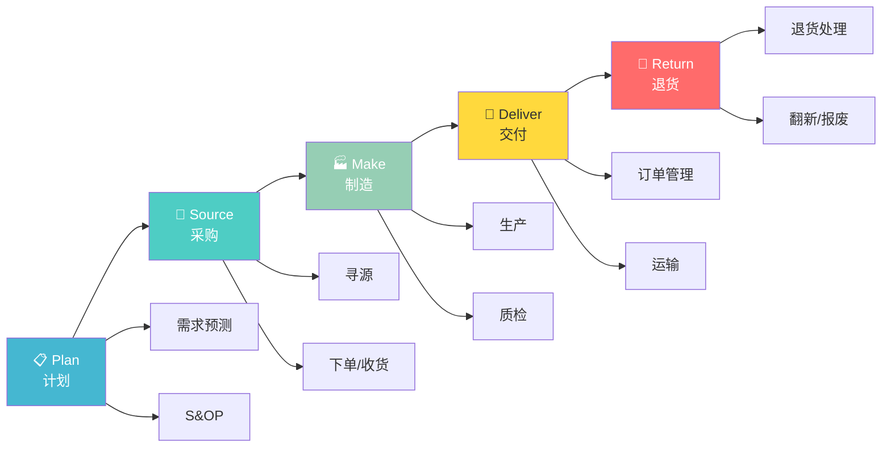
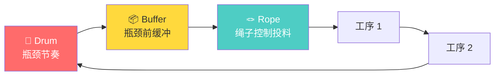
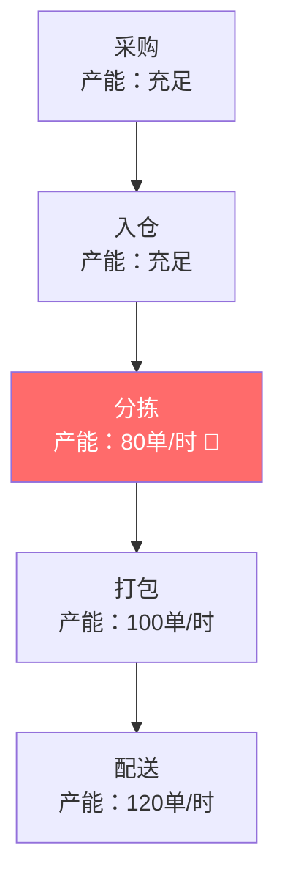
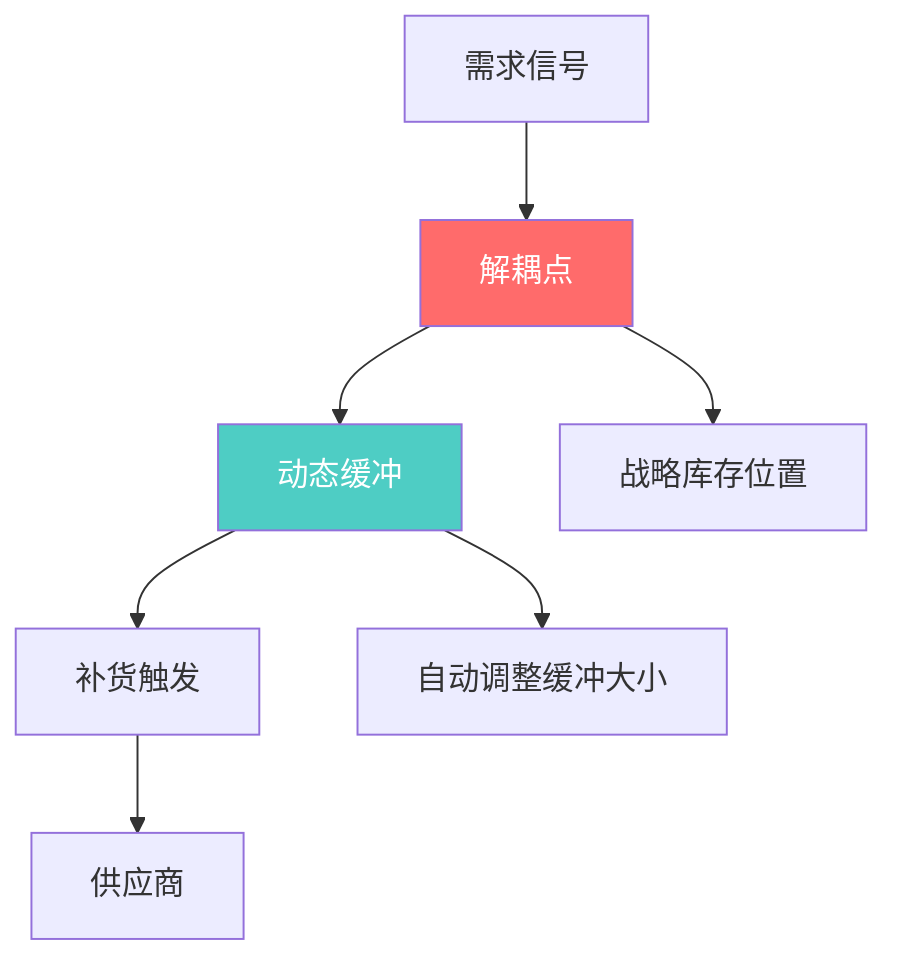
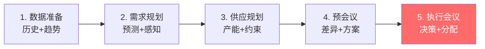

# 供应链专项方法论 — 约束即系统

> "Throughput is not about making things — it's about making money through things." — Eliyahu Goldratt

---

## 🧬 供应链方法论 DNA

| 维度 | 特征 |
|------|------|
| **来源** | APICS / ISM / 学术界 / 实践者 |
| **核心信条** | **供应链是系统，优化必须全局视角** |
| **方法论风格** | 流程导向、量化驱动、系统思维 |
| **典型用户** | 供应链计划、采购、物流、运营 |
| **独特价值** | 不是"怎么做"，而是"先做什么" |

---

## 📐 核心方法论

### 1. SCOR 模型（Supply Chain Operations Reference）

> **一句话**：用五种标准流程描述整条供应链 — Plan / Source / Make / Deliver / Return。

**SCOR 全景图**：

**五个绩效维度**：

| 维度 | 英文 | 衡量指标 | 行业基准 |
|------|------|---------|---------|
| **可靠性** | Reliability | 订单准时交付率 | 95%+ |
| **响应性** | Responsiveness | 订单履行周期 | <72h |
| **敏捷性** | Agility | 供应链响应变化的能力 | 高 |
| **成本** | Cost | 供应链总成本/收入 | <10% |
| **资产管理** | Asset | 现金周转周期 | <30天 |

**生动举例**：某快消品公司的 SCOR 诊断

| 流程 | 当前表现 | 基准 | 差距 |
|------|---------|------|------|
| Plan | 预测准确率 65% | 80% | 🔴 -15% |
| Source | 供应商准时率 88% | 95% | 🔴 -7% |
| Make | 设备 OEE 72% | 85% | 🟡 -13% |
| Deliver | 准时交付率 91% | 95% | 🟡 -4% |
| Return | 退货处理周期 14 天 | 7 天 | 🔴 +7 天 |

**核心洞察**：Plan 和 Return 是最大短板 — 预测不准导致生产计划混乱，退货慢导致客户不满。

---

### 2. TOC 约束理论（Theory of Constraints）

> **一句话**：供应链的产出由最弱的环节决定 — 不是优化最强的，而是修复最弱的。

**DBR 模型（Drum-Buffer-Rope）**：

**生动举例**：叮咚买菜前置仓的 TOC 分析

**TOC 五步解法**：

| 步骤 | 行动 | 具体措施 |
|------|------|---------|
| 1. 识别 | 分拣是瓶颈 | 80单/时 < 配送 120单/时 |
| 2. 利用 | 优化分拣路径 | 缩短行走距离 30% |
| 3. 从属 | 配送服从分拣 | 不催骑手，按分拣节奏排单 |
| 4. 提升 | 引入自动分拣 | 投资 50 万/仓 |
| 5. 重复 | 瓶颈转移到配送 | 重新分析配送环节 |

**核心洞察**：不要试图同时优化所有环节 — 90% 的改善来自对瓶颈的专注。

---

### 3. DDMRP（Demand-Driven MRP）

> **一句话**：用实际需求拉动补货，而不是用预测推动 — 打破牛鞭效应。

**核心机制**：

**三个核心组件**：

| 组件 | 功能 | 举例 |
|------|------|------|
| **解耦点** | 在关键位置设缓冲 | 成品仓、区域仓、前置仓 |
| **动态缓冲** | 根据消耗自动调整 | 高峰期自动加大缓冲 |
| **需求信号** | 由实际消耗触发补货 | 不再依赖 3 个月前的预测 |

**生动举例**：某电子元器件的 DDMRP 实施

| 指标 | 实施前（MRP） | 实施后（DDMRP） | 改善 |
|------|-------------|----------------|------|
| 库存周转 | 4 次/年 | 8 次/年 | +100% |
| 缺货率 | 8% | 2% | -75% |
| 预测准确率依赖 | 高（70%+） | 低（50%+） | 降低依赖 |
| 牛鞭效应 | 严重 | 显著缓解 | ⬇️ |

---

### 4. S&OP（Sales & Operations Planning）

> **一句话**：让销售和运营坐在同一张桌子上，用同一个数字说话。

**S&OP 五步流程**：

**生动举例**：某食品企业的月度 S&OP

| 步骤 | 活动 | 产出 |
|------|------|------|
| 数据准备 | 拉取上月销售数据、库存数据 | 基线数据包 |
| 需求规划 | 618 大促预测：+50% | 需求计划 V1 |
| 供应规划 | 产能评估：只能 +30% | 供应计划 V1 |
| 预会议 | 差距 20%：需要加班 or 外包 | 建议方案 A/B |
| 执行会议 | CEO 决策：加班 + 临时采购 | 最终计划 |

**S&OP 的关键成功因素**：
- ❌ 只有供应链参加（销售不参与）
- ❌ 预测是"拍脑袋"（没有数据支撑）
- ✅ 跨部门参与、数据驱动、高层决策

---

### 5. 七步战略采购（Kearney）

> **一句话**：采购不是"砍价"，是"系统化地选择和管理供应商"。

**七步流程**：

| 步骤 | 活动 | 关键输出 |
|------|------|---------|
| 1. 品类分析 | 供应市场、品类定位 | 品类地图 |
| 2. 策略制定 | 采购策略、供应商策略 | 策略文档 |
| 3. 供应商评估 | 能力、财务、风险 | 评估报告 |
| 4. 供应商选择 | RFQ/RFP、技术评审 | 短名单 |
| 5. 商务谈判 | 价格、条款、SLA | 合同 |
| 6. 整合接入 | 流程对接、系统集成 | 上线 |
| 7. 持续改进 | 绩效监控、成本优化 | 季度报告 |

**生动举例**：某车企的电池采购决策

| 步骤 | 关键决策 |
|------|---------|
| 品类分析 | 电池占整车成本 40%，高风险品类 |
| 策略制定 | 双源采购（宁德+比亚迪），降低依赖 |
| 供应商评估 | 宁德：技术领先；比亚迪：成本优势 |
| 供应商选择 | 70% 宁德 + 30% 比亚迪 |
| 商务谈判 | 锁价 3 年，年降 5% |
| 整合接入 | 6 个月验证期 |
| 持续改进 | 季度绩效评估，年度重谈 |

---

## 🏆 供应链大单案例

### 案例一：丰田 JIT — TOC 的教科书级应用

| 维度 | 详情 |
|------|------|
| **客户** | 丰田汽车 |
| **问题** | 1950 年代资金短缺，无法承受大量库存积压 |
| **方法论** | TOC 约束理论（当时未正式命名，但思想一致） |
| **关键动作** | ① 识别瓶颈：装配速度 ② 利用瓶颈：只在需要时生产（JIT）③ 从属：供应商按丰田节奏供货 ④ 提升：持续改善（Kaizen） |
| **结果** | 库存周转率提升 10 倍，生产成本降低 30%，成为全球最大车企 |
| **关键获胜点** | 丰田把"资金有限"这个约束变成了"零库存"的竞争优势 |

---

### 案例二：ZARA 快时尚 — SCOR 的极致

| 维度 | 详情 |
|------|------|
| **客户** | ZARA（Inditex 集团） |
| **问题** | 时尚行业变化快，传统服装企业从设计到上架需要 6 个月 |
| **方法论** | SCOR 模型 + 价值链优化 |
| **关键动作** | ① Plan：实时追踪销售数据，快速调整设计 ② Source：70% 供应商在西班牙/葡萄牙（近岸）③ Make：小批量生产，快速翻单 ④ Deliver：每周 2 次上新，空运到全球 |
| **结果** | 从设计到上架只需 2 周（行业平均 6 个月），库存周转率是竞对的 3 倍 |
| **关键获胜点** | ZARA 用 SCOR 模型重新设计了整条供应链 — 不是"更便宜"，而是"更快" |

**SCOR 分析**：

| 流程 | ZARA | 传统服装 | 差异 |
|------|------|---------|------|
| Plan | 实时数据 | 季度预测 | 响应速度 100x |
| Source | 近岸采购 | 亚洲采购 | 交期 2 周 vs 3 月 |
| Make | 小批量翻单 | 大批量生产 | 库存风险低 80% |
| Deliver | 每周上新 | 季度上新 | 新鲜感 4x |

---

### 案例三：戴尔直销 — 经验曲线 + TOC

| 维度 | 详情 |
|------|------|
| **客户** | Dell |
| **问题** | PC 行业价格战激烈，利润越来越薄 |
| **方法论** | 经验曲线（BCG）+ TOC |
| **关键动作** | ① 用经验曲线：先发者靠规模吃成本红利 ② 用 TOC：识别瓶颈是"库存" ③ 直销模式：客户下单后才生产（零库存）④ 用客户的钱采购零部件（负现金周期） |
| **结果** | Dell 库存周转天数 4 天（行业平均 30 天），现金周期 -36 天 |
| **关键获胜点** | Dell 用 TOC 找到了 PC 行业的"真正瓶颈" — 不是制造，而是库存 |

---

### 案例四：某电商的 S&OP 改革 — 1 亿元级

| 维度 | 详情 |
|------|------|
| **客户** | 某国内电商（生鲜品类） |
| **问题** | 缺货率 15%，库存积压 2000 万 |
| **方法论** | S&OP + DDMRP |
| **关键动作** | ① 建立月度 S&OP 会议：销售+供应链+采购一起看数据 ② 用 DDMRP 替代传统 MRP：在解耦点设缓冲 ③ 动态调整缓冲大小：高峰期自动加大 |
| **结果** | 缺货率从 15% 降到 3%，库存积压减少 60% |
| **关键获胜点** | S&OP 让销售和供应链"用同一个数字说话" — 以前销售拍脑袋要货，供应链拍脑袋备货 |

---

## 🎯 供应链工具箱速查

| 工具 | 一句话 | 在 nailit 中的位置 |
|------|--------|-------------------|
| SCOR | 供应链全景地图 | 贯穿 Step 1-3 |
| TOC | 瓶颈即系统 | Step 3（优先级排序） |
| DDMRP | 需求拉动补货 | Step 4（库存优化） |
| S&OP | 供需平衡 | Step 4（供需方案） |
| 七步采购 | 系统化采购决策 | Step 4（供应商选择） |

---

## 🔗 关联

- 方法论全景：[[咨询方法论]]
- McKinsey 篇：[[01_McKinsey麦肯锡]]
- Harvard 篇：[[05_Harvard哈佛经典#TOC 约束理论]]
- 实战应用：[[../skills/analyst/SKILL.md|analyst Skill]]
