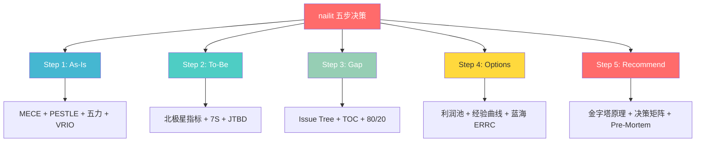
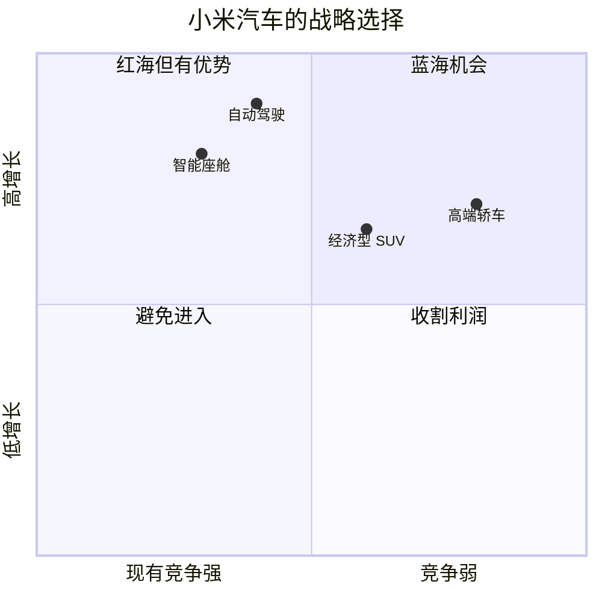
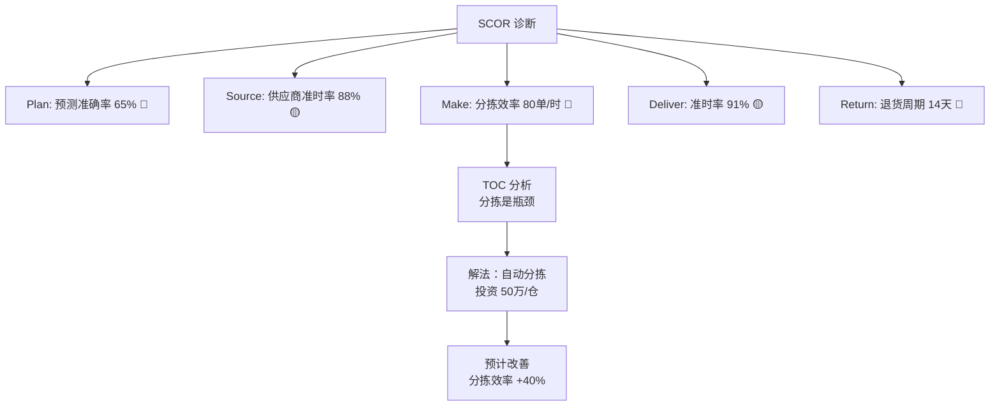
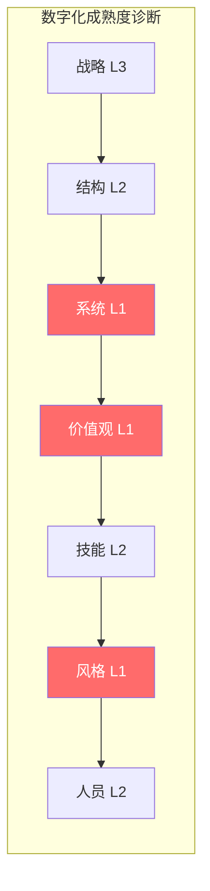
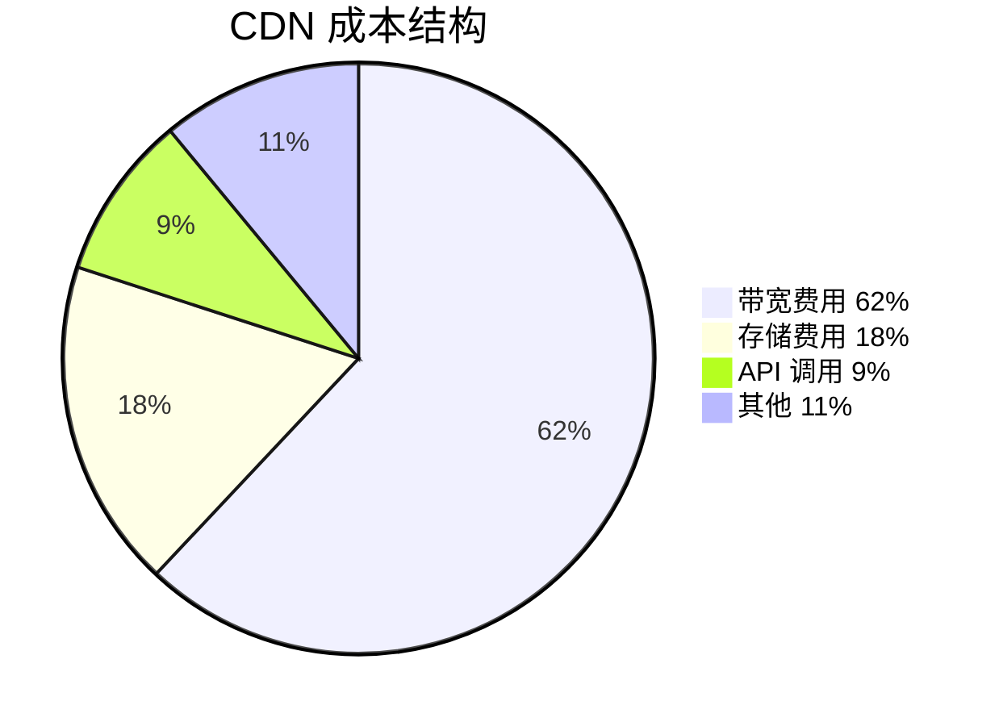
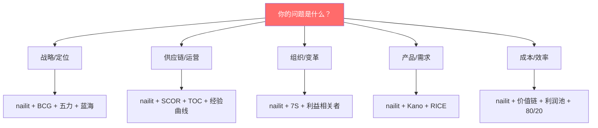

# 框架组合拳 — 1+1 > 2

> 单一框架是工具，组合框架是方法论。真正的高手不是会多少框架，而是知道什么时候用什么组合。

---

## 🎯 组合原则

**三条铁律**：
1. **nailit 是主框架** — 五步决策流程是骨架，其他框架是肌肉
2. **辅助框架嵌入对应 Step** — 不是另起炉灶，而是在 nailit 内部增强
3. **2-3 个辅助框架足够** — 太多框架 = 没有框架

---

## 🔴 场景一：战略定位

**问题类型**：我们应该进入哪个市场？如何定位？

**框架组合**：nailit + BCG 矩阵 + 五力模型 + 蓝海 ERRC

| Step | 主框架 | 辅助框架 | 具体操作 |
|------|--------|---------|---------|
| Step 1 | nailit As-Is | 五力分析 | 扫描行业竞争结构 |
| Step 2 | nailit To-Be | 蓝海 ERRC | 画出差异化曲线 |
| Step 3 | nailit Gap | 80/20 | 识别关键差距 |
| Step 4 | nailit Options | BCG 矩阵 | 评估业务组合 |
| Step 5 | nailit Recommend | 决策矩阵 | 加权评分选方案 |

**实战案例**：小米汽车的战略定位

**结论**：小米选择"智能座舱 + 自动驾驶"作为差异化切入点（蓝海区域），而非在传统车型上与比亚迪硬拼。

---

## 🔴 场景二：供应链优化

**问题类型**：供应链效率低、成本高、交付慢。

**框架组合**：nailit + SCOR + TOC + 经验曲线

| Step | 主框架 | 辅助框架 | 具体操作 |
|------|--------|---------|---------|
| Step 1 | nailit As-Is | SCOR 诊断 | 五流程绩效评估 |
| Step 2 | nailit To-Be | 经验曲线 | 设定成本目标路径 |
| Step 3 | nailit Gap | TOC | 找到系统瓶颈 |
| Step 4 | nailit Options | DDMRP | 设计库存方案 |
| Step 5 | nailit Recommend | S&OP | 供需平衡方案 |

**实战案例**：叮咚买菜的履约成本优化

**结论**：优先解决分拣瓶颈（TOC），同时优化预测准确率（Plan），预计年省 800 万。

---

## 🟡 场景三：数字化转型

**问题类型**：公司想数字化但不知道从哪开始。

**框架组合**：nailit + 7S + 数字化成熟度 + 价值链

| Step | 主框架 | 辅助框架 | 具体操作 |
|------|--------|---------|---------|
| Step 1 | nailit As-Is | 数字化成熟度 + 7S | 组织能力诊断 |
| Step 2 | nailit To-Be | 价值链目标 | 设计目标状态 |
| Step 3 | nailit Gap | 7S 不匹配 | 找到组织瓶颈 |
| Step 4 | nailit Options | 端到端转型 | 分阶段实施 |
| Step 5 | nailit Recommend | Pre-Mortem | 风险预判 |

**实战案例**：某制造企业的数字化转型

**核心洞察**：技术和系统是 L1（最差），但价值观和文化也是 L1 — 不改文化，买了系统也白搭。

---

## 🟡 场景四：成本优化

**问题类型**：成本失控，需要找到优化空间。

**框架组合**：nailit + 价值链 + 利润池 + 80/20

| Step | 主框架 | 辅助框架 | 具体操作 |
|------|--------|---------|---------|
| Step 1 | nailit As-Is | 价值链 | 拆解各环节成本 |
| Step 2 | nailit To-Be | 利润池 | 找到最优切入点 |
| Step 3 | nailit Gap | 80/20 | 识别关键成本项 |
| Step 4 | nailit Options | 经验曲线 | 设计降本路径 |
| Step 5 | nailit Recommend | 决策矩阵 | 加权选方案 |

**实战案例**：CDN 成本优化

| 成本项 | 占比 | 优化方案 | 预计节省 |
|--------|------|---------|---------|
| 带宽（动态） | 40% | 增加缓存命中率 | 25% |
| 带宽（静态） | 22% | 调整计费模式 | 10% |
| 存储 | 18% | 冷热数据分层 | 30% |
| API | 9% | 减少冗余调用 | 20% |

**结论**：优先优化动态内容缓存（80/20），预计年省 300 万。

---

## 🟢 场景五：产品优先级

**问题类型**：需求太多，资源有限，先做哪个？

**框架组合**：nailit + Kano + RICE

| Step | 主框架 | 辅助框架 | 具体操作 |
|------|--------|---------|---------|
| Step 1 | nailit As-Is | Kano 分类 | 需求分层 |
| Step 2 | nailit To-Be | 北极星指标 | 对齐目标 |
| Step 3 | nailit Gap | 80/20 | 找关键需求 |
| Step 4 | nailit Options | RICE 评分 | 量化排序 |
| Step 5 | nailit Recommend | 决策矩阵 | 最终选择 |

**实战案例**：SaaS 产品的需求优先级

| 需求 | Kano 类型 | RICE 得分 | 优先级 |
|------|---------|----------|--------|
| 核心功能 Bug 修复 | 基本型 | 95 | 🔴 P0 |
| 性能优化 | 期望型 | 80 | 🟡 P1 |
| AI 智能推荐 | 兴奋型 | 60 | 🟢 P2 |
| 暗黑模式 | 无差异 | 20 | ⬜ P3 |
| 社交分享 | 反向型 | 5 | ❌ 不做 |

---

## 🔵 场景六：组织变革

**问题类型**：组织效率低、部门墙严重、决策慢。

**框架组合**：nailit + 7S + 利益相关者分析

| Step | 主框架 | 辅助框架 | 具体操作 |
|------|--------|---------|---------|
| Step 1 | nailit As-Is | 7S 诊断 | 组织七要素评估 |
| Step 2 | nailit To-Be | 7S 目标态 | 设计目标组织 |
| Step 3 | nailit Gap | 不匹配分析 | 找到失衡要素 |
| Step 4 | nailit Options | 敏捷转型 | 分阶段实施 |
| Step 5 | nailit Recommend | 利益相关者 | 争取支持 |

---

## 🎯 选择框架的决策树

---

## 🔗 关联

- 方法论全景：[[咨询方法论]]
- McKinsey 篇：[[01_McKinsey麦肯锡]]
- BCG 篇：[[02_BCG波士顿咨询]]
- Bain 篇：[[03_Bain贝恩]]
- Deloitte 篇：[[04_Deloitte德勤]]
- Harvard 篇：[[05_Harvard哈佛经典]]
- 供应链专项：[[06_供应链专项方法论]]
- 实战应用：[[../skills/analyst/SKILL.md|analyst Skill]]
