# AI 时代的演进 — 咨询、SaaS、软件、FDE 的终局

> "Every old way of working will be questioned. The only question is whether you do the questioning — or the AI does."

---

## 🔭 演进全景图

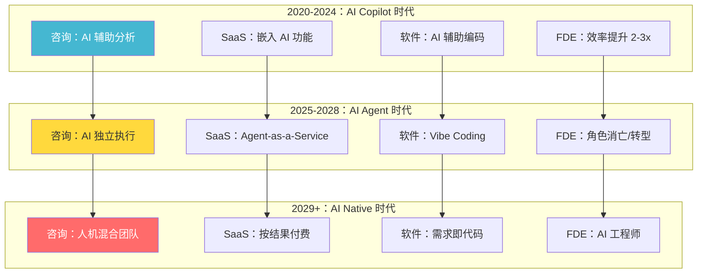

---

## 一、战略咨询的演进

### 当前状态：AI 正在"吃掉"咨询的底层工作

| 咨询工作 | AI 替代度 | 时间线 |
|---------|----------|--------|
| 数据收集与清洗 | 🔴 90% | 已发生 |
| 行业研究与对标 | 🔴 80% | 已发生 |
| 框架套用与分析 | 🟡 60% | 进行中 |
| 方案生成 | 🟡 50% | 进行中 |
| 客户沟通与说服 | 🟢 10% | 长期安全 |
| 组织变革实施 | 🟢 5% | 长期安全 |

### 三个阶段的演进

#### 阶段一：AI Copilot（2020-2024）

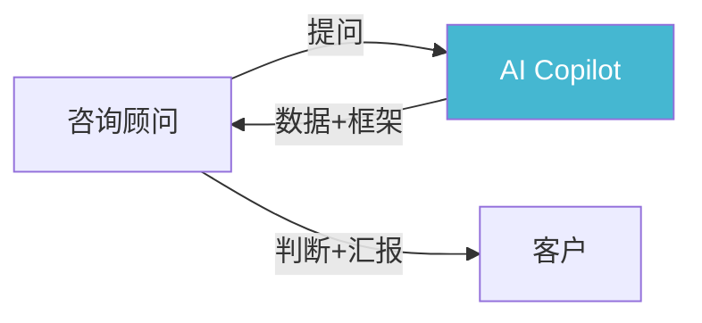

**特征**：
- 顾问仍然主导，AI 是"更快的实习生"
- McKinsey 内部工具 Lilli：自动生成行业摘要、竞争分析
- BCG 的 AI 工具：帮助顾问快速完成 PPT 初稿
- **关键变化**：初级顾问的需求减少 30-40%

**实战案例**：McKinsey 用 AI 在 2 小时内完成传统需要 2 周的行业研究报告初稿

---

#### 阶段二：AI Agent（2025-2028）

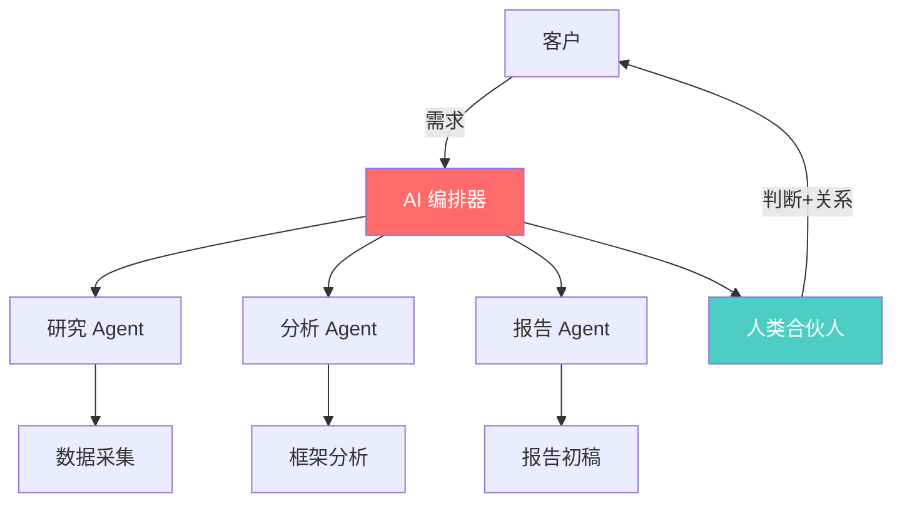

**特征**：
- AI 可以独立完成 70% 的分析工作
- 人类合伙人聚焦：判断、关系、变革实施
- **新的咨询模式**：
  - 传统：20 人团队 × 6 个月 = 500 万
  - AI 时代：3 人团队 × 2 个月 = 80 万
  - **降维打击**：中型企业的咨询需求被释放

**关键变化**：
- 初级顾问几乎被 AI Agent 替代
- 中级顾问转型为"AI 训练师"
- 高级合伙人聚焦"变革领导力"

---

#### 阶段三：AI Native（2029+）

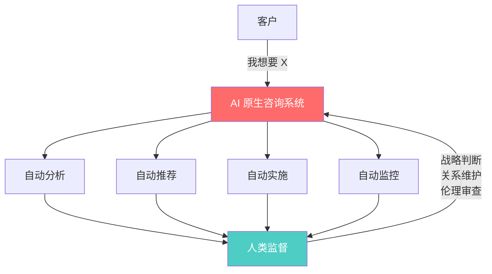

**特征**：
- 咨询从"卖人天"变为"卖结果"
- AI 系统 7×24 运行，实时监控并调整策略
- **新的定价模式**：
  - 传统：按人天计费（$5000/天）
  - AI 时代：按结果计费（节省成本的 20%）

### 咨询公司的生存法则

| 策略 | McKinsey | BCG | Bain |
|------|---------|-----|------|
| **防御** | 内部 AI 工具 Lilli | BCG X（AI 部门） | Bain 基金（投资 AI） |
| **进攻** | 收购 AI 公司 | 与 OpenAI 合作 | 专注执行落地 |
| **转型** | 从"建议"到"实施" | 从"战略"到"产品" | 从"咨询"到"运营" |

---

## 二、SaaS 的演进

### 当前状态：SaaS 正在从"工具"变为"智能体"

| SaaS 类型 | AI 替代度 | 演进方向 |
|----------|----------|---------|
| CRM | 🔴 80% | 从"记录客户"到"预测客户" |
| ERP | 🔴 70% | 从"管理流程"到"优化流程" |
| HRM | 🟡 60% | 从"管理员工"到"赋能员工" |
| BI | 🔴 85% | 从"看报表"到"问问题" |
| 项目管理 | 🟡 50% | 从"分配任务"到"自动执行" |

### 三个阶段的演进

#### 阶段一：AI 增强型 SaaS（2023-2025）

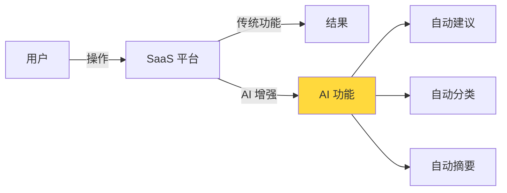

**案例：Salesforce Einstein**
- 自动预测客户成交概率
- 自动推荐下一步行动
- 自动分类客户反馈
- **效果**：销售效率提升 30%，但产品形态没有根本改变

---

#### 阶段二：AI Agent 型 SaaS（2025-2028）

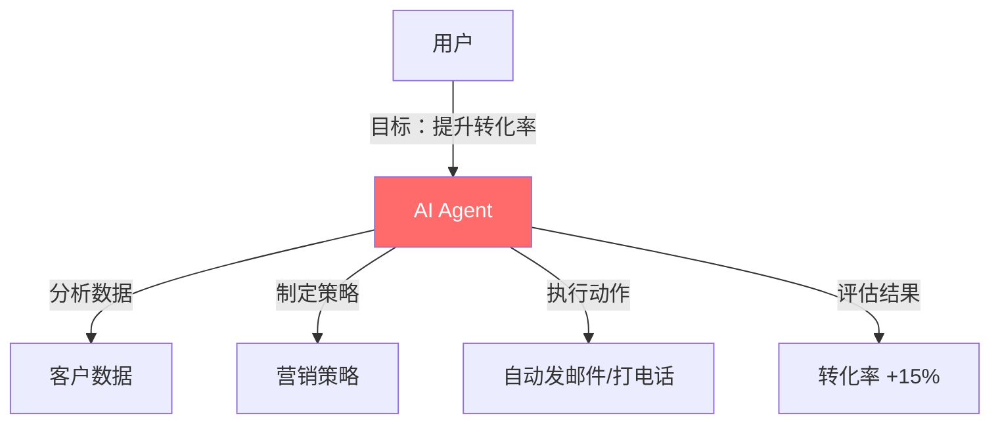

**案例：HubSpot 的 AI Agent**
- 用户说"帮我提升这个季度的线索转化率"
- AI Agent 自动：
  1. 分析历史数据，找到转化率低的环节
  2. 生成个性化邮件序列
  3. 自动发送并 A/B 测试
  4. 根据回复自动调整策略
- **关键变化**：用户不再"操作软件"，而是"告诉软件目标"

---

#### 阶段三：AI Native SaaS（2029+）

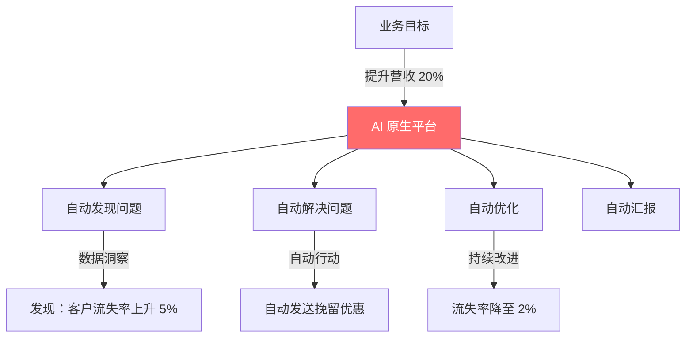

**特征**：
- SaaS 从"工具"变为"智能体"
- 用户不再需要"学习软件"，只需"表达目标"
- **新的定价模式**：按结果付费（提升的收入 × 20%）

### SaaS 的终局预测

| 维度 | 今天（2026） | 2030 年 |
|------|------------|--------|
| **交互方式** | GUI + 手动操作 | 自然语言 + 自动执行 |
| **定价模式** | 按用户数/月 | 按结果/价值 |
| **产品形态** | 功能堆叠 | 智能体 |
| **竞争壁垒** | 功能多少 | 数据飞轮 + 智能体能力 |
| **用户角色** | 操作者 | 目标设定者 |

---

## 三、软件开发的演进

### 当前状态：Vibe Coding 正在重新定义"写代码"

| 编码方式 | 效率 | 代码质量 | 适用场景 |
|---------|------|---------|---------|
| 纯手写 | 1x | 高（取决于人） | 复杂系统 |
| Copilot 辅助 | 2-3x | 中高 | 日常开发 |
| AI 生成 + 人工审查 | 5-10x | 中 | 快速原型 |
| Vibe Coding | 20-50x | 低（需审查） | 内部工具、MVP |

### 三个阶段的演进

#### 阶段一：AI 辅助编码（2023-2025）

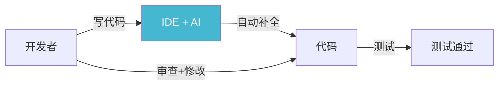

**工具**：GitHub Copilot、Cursor、Claude Code
**效果**：编码速度提升 2-3 倍，但开发者仍需理解代码

---

#### 阶段二：Vibe Coding（2025-2028）

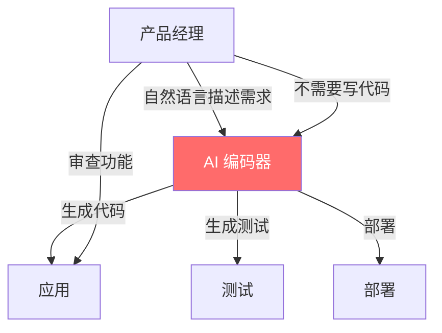

**案例：Cursor + Claude 的 Vibe Coding 工作流**
- 产品经理用自然语言描述："我要一个类似 Notion 的文档编辑器，支持协作、版本历史、AI 总结"
- AI 生成完整的前端 + 后端代码
- 产品经理审查功能，不需要看代码
- **关键变化**：产品经理可以"自己做产品"

**风险**：
- ❌ 生成的代码可能有安全漏洞
- ❌ 复杂系统仍需要专业工程师
- ✅ 适合 MVP、内部工具、原型验证

---

#### 阶段三：需求即代码（2029+）

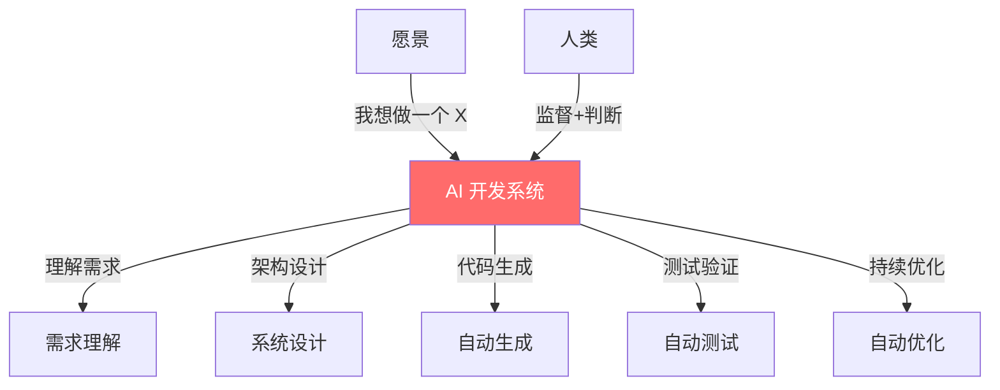

**特征**：
- 从"写代码"到"描述意图"
- AI 理解业务意图，自动生成完整系统
- **新的职业**：AI 系统架构师、AI 伦理审查员

---

## 四、FDE（Field Development Engineer）的演进

### 当前状态：FDE 正在从"驻场支持"变为"远程智能"

| FDE 工作 | AI 替代度 | 时间线 |
|---------|----------|--------|
| 环境部署 | 🔴 85% | 已发生 |
| 问题排查 | 🔴 70% | 进行中 |
| 客户培训 | 🟡 50% | 进行中 |
| 需求对接 | 🟢 20% | 长期安全 |
| 关系维护 | 🟢 10% | 长期安全 |

### 三个阶段的演进

#### 阶段一：AI 辅助 FDE（2023-2025）

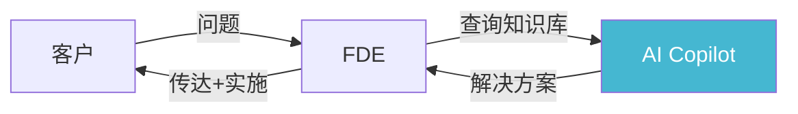

**效果**：FDE 的问题解决速度提升 3 倍，但仍需现场支持

---

#### 阶段二：AI Agent FDE（2025-2028）

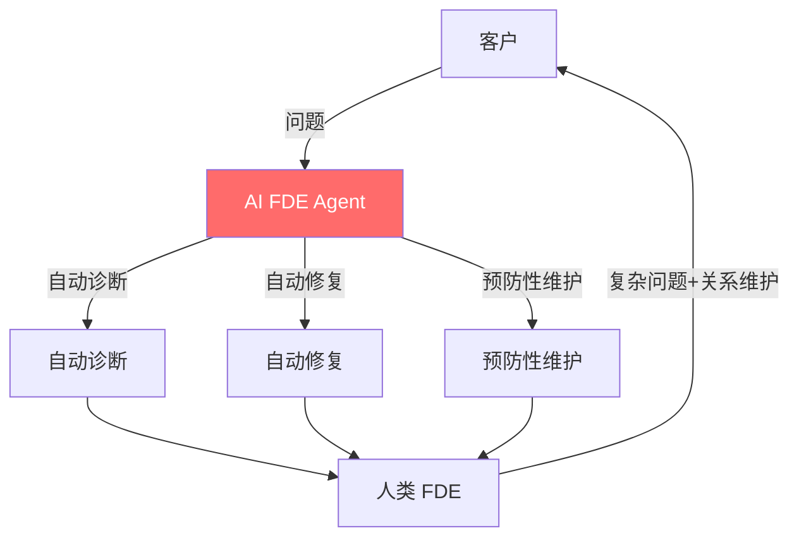

**特征**：
- 80% 的问题由 AI Agent 自动解决
- 人类 FDE 聚焦 20% 的复杂问题
- **新的 FDE 角色**：AI Agent 训练师、客户成功经理

---

#### 阶段三：零接触 FDE（2029+）

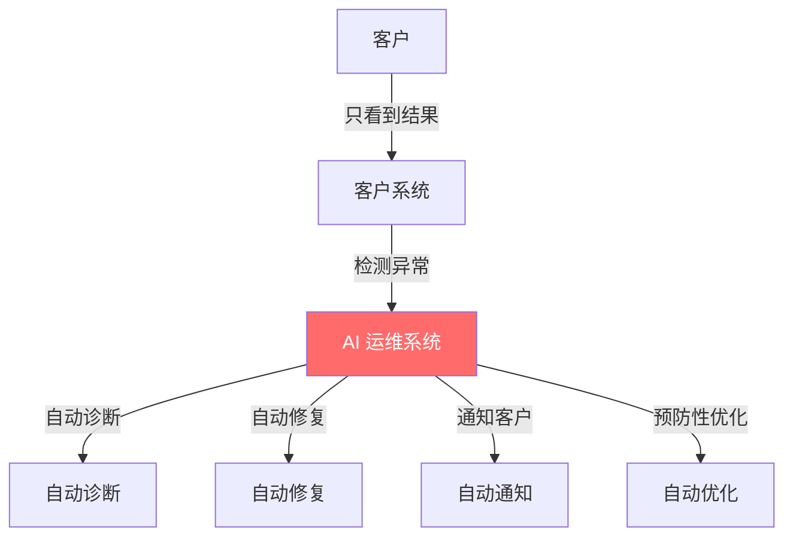

**特征**：
- 客户甚至不知道问题发生过（已被自动修复）
- FDE 从"救火队员"变为"系统架构师"
- **新的定价**：按系统可用性付费（99.99% SLA）

---

## 五、终局预测：谁会活下来？

### 咨询公司的命运

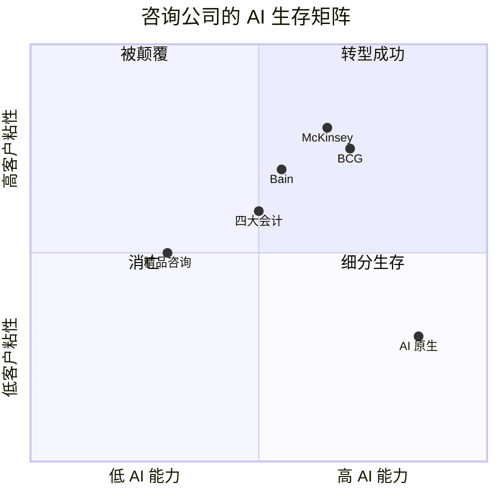

| 类型 | 命运 | 原因 |
|------|------|------|
| **顶级战略咨询** | 转型成功 | 品牌+关系+变革实施能力不可替代 |
| **中型咨询** | 被挤压 | AI 让顶级咨询"降维打击"中端市场 |
| **精品咨询** | 细分生存 | 在特定领域建立深度壁垒 |
| **AI 原生** | 新玩家 | 用 AI 重新定义咨询的交付方式 |

### SaaS 的命运

| 类型 | 命运 | 原因 |
|------|------|------|
| **数据密集型 SaaS** | 转型为 AI 平台 | 数据是 AI 的燃料 |
| **流程型 SaaS** | 被 AI Agent 替代 | Agent 可以自动执行流程 |
| **协作型 SaaS** | 增强而非替代 | 人与人的协作仍需工具 |
| **垂直型 SaaS** | 生存但需转型 | 行业知识 + AI = 护城河 |

### 软件开发的命运

| 角色 | 命运 | 转型方向 |
|------|------|---------|
| **初级开发** | 被 AI 替代 | 转型为产品经理/AI 训练师 |
| **中级开发** | 部分被替代 | 转型为系统架构师 |
| **高级开发** | 增强而非替代 | 聚焦架构、安全、复杂系统 |
| **全栈开发** | 价值提升 | 能驾驭 AI 工具的人更稀缺 |

---

## 六、应对策略

### 个人层面

| 角色 | 今天该做什么 |
|------|------------|
| **咨询顾问** | 学会用 AI Agent 做分析，聚焦"判断力"和"变革实施" |
| **SaaS 从业者** | 从"功能设计"转向"AI 体验设计" |
| **软件开发** | 从"写代码"转向"定义意图"和"系统架构" |
| **FDE** | 从"解决问题"转向"预防问题"和"客户成功" |

### 组织层面

| 维度 | 策略 |
|------|------|
| **人才** | 减少"执行层"，增加"判断层"和"创新层" |
| **流程** | 用 AI 自动化 80% 的重复工作 |
| **文化** | 从"我知道答案"到"我知道问什么问题" |
| **技术** | 建立 AI 数据飞轮，越用越智能 |

---

## 🔗 关联

- 咨询方法论全景：[[咨询方法论]]
- McKinsey 篇：[[01_McKinsey麦肯锡]]
- 框架组合拳：[[07_框架组合拳]]
- 实战应用：[[../skills/analyst/SKILL.md|analyst Skill]]
