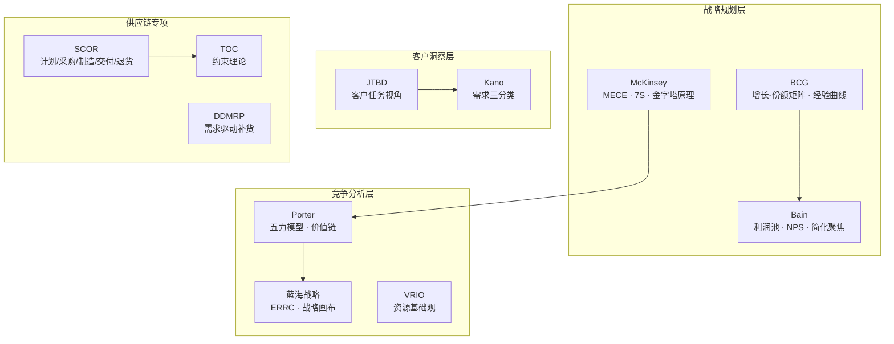

# 咨询方法论全景

> 融合 McKinsey / BCG / Bain / Deloitte / Harvard 等顶级咨询公司的高阶分析框架。

---

## 🗺️ 方法论地图

---

## 📂 各家详解

| # | 文件 | 公司 | 核心 DNA | 看家方法论 |
|---|------|------|---------|-----------|
| 01 | [[01_McKinsey麦肯锡]] | McKinsey | 逻辑即权力 | MECE、7S、金字塔原理 |
| 02 | [[02_BCG波士顿咨询]] | BCG | 用数学讲故事 | BCG 矩阵、经验曲线 |
| 03 | [[03_Bain贝恩]] | Bain | 利润是一切的答案 | 利润池、NPS、简化聚焦 |
| 04 | [[04_Deloitte德勤]] | Deloitte | 技术驱动变革 | 数字化成熟度、端到端转型 |
| 05 | [[05_Harvard哈佛经典]] | Harvard / 独立学者 | 经典永不过时 | 五力、价值链、蓝海、TOC |
| 06 | [[06_供应链专项方法论]] | 多家融合 | 约束即系统 | SCOR、DDMRP、S&OP |

---

## 🎯 按场景选框架

| 场景 | 首选框架 | 辅助框架 | 详细说明 |
|------|---------|---------|---------|
| 🏢 战略定位 | BCG 矩阵 | 五力 + 蓝海 | [[02_BCG波士顿咨询#BCG 矩阵]] |
| 💰 成本优化 | 价值链 | 利润池 + 80/20 | [[05_Harvard哈佛经典#价值链分析]] |
| 🔗 供应链瓶颈 | TOC | SCOR + 经验曲线 | [[06_供应链专项方法论#TOC 约束理论]] |
| 🏗️ 组织变革 | 7S | 利益相关者分析 | [[01_McKinsey麦肯锡#7S 框架]] |
| 🚀 市场进入 | 蓝海 ERRC | Ansoff + JTBD | [[05_Harvard哈佛经典#蓝海战略]] |
| 📊 优先级排序 | Kano | 80/20 + 决策矩阵 | [[05_Harvard哈佛经典#Kano 模型]] |
| 🤝 沟通汇报 | 金字塔原理 | 80/20 | [[01_McKinsey麦肯锡#金字塔原理]] |
| 📈 增长路径 | 三层面增长 | 经验曲线 | [[01_McKinsey麦肯锡#三层面增长]] |

---

## 🔗 关联

- 分析实战 Skill：[[../skills/analyst/SKILL.md|analyst]]
- 横纵分析：[[../skills/hv-analysis/SKILL.md|hv-analysis]]
- 产品策略框架：`/swot-analysis` `/porters-five-forces` `/business-model`
