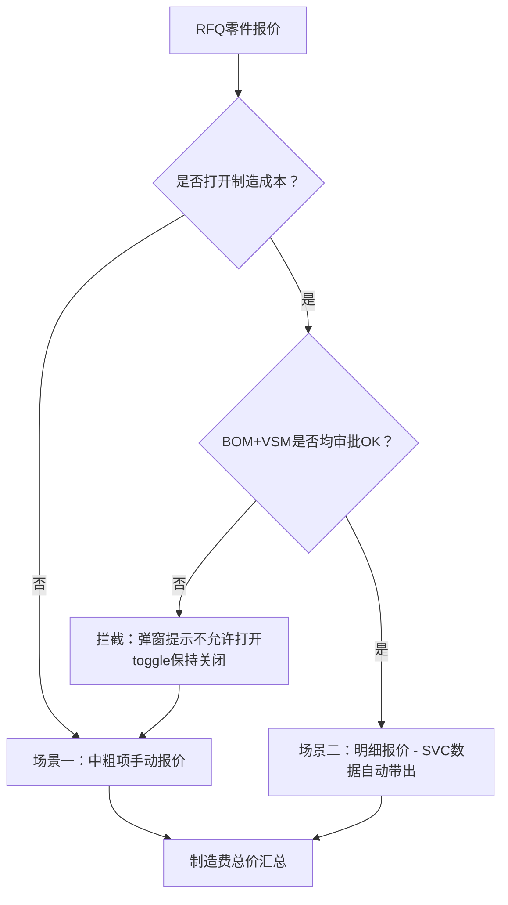
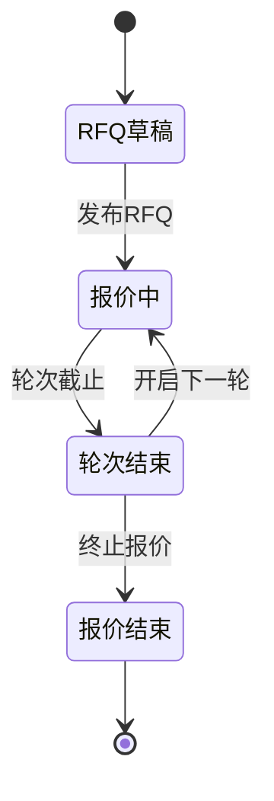

---
created: 2026-05-21
updated: 2026-07-16
tags: [Xiaomi, 采购, 系统]
status: draft
---


> [!summary] 制造费明细报价PRD（v2.1）
> - **核心**：基于 BOM+VSM 双维度校验的制造费明细报价 PRD，定义两种报价场景和中粗项自动计算+手动覆盖机制
> - **要点**：BOM+VSM 必须全部 OK 才能打开明细报价；中粗项支持 auto/overridden/conflict 三态；VSM 版本校验覆盖不支持回退
> - **关联**：[[制造费明细报价-PRD优化版v2]] · [[制造费明细报价PRD]]

# 制造费明细报价 - 产品需求文档（PRD）

| 属性 | 内容 |
|------|------|
| 文档版本 | v2.1 |
| 所属模块 | EP采购平台 - RFQ报价 |
| 需求编号 | MEP-2026-045 |
| 优先级 | P1 |
| 文档状态 | 评审中 |
| 创建日期 | 2026-05-21 |
| 最后更新 | 2026-05-21 |

---

## 1 术语表

| 术语 | 定义 |
|------|------|
| EP | 企业采购平台（Enterprise Procurement） |
| SVC | 供应商协同系统（Supplier Collaboration） |
| BOM | 物料清单（Bill of Materials） |
| VSM | 价值流图（Value Stream Mapping），本需求中指制造工艺工序结构 |
| RFQ | 报价请求（Request for Quotation） |
| 制造费 | 生产制造过程中产生的费用总和，包含设备、人工、报废、能耗、耗材 |
| 中粗项 | 制造费用的汇总级费用项（设备/人员/报废/能耗/耗材） |
| 明细项 | 基于工艺工序视角的逐行制造费用明细 |
| 自制件 | 由供应商自行生产的零部件（区别于外购件） |
| 工段/线体 | 生产工艺中的一个加工环节或生产线 |
| OEE | 设备综合效率（Overall Equipment Effectiveness） |
| LCR | 客户每日产能需求（Line Capacity Requirement） |
| CT | 生产节拍时间（Cycle Time） |

---

## 2 需求背景与目标

### 2.1 背景

制造费用需要包含半成品，原自制件维度无法完整计算制造费。一期版本中采购员在EP端手动维护制造费的方式已无法满足精度要求，需要基于BOM结构和VSM工艺工序进行明细报价。

### 2.2 变更点

- 制造费报价场景限定为：BOM结构OK **且** VSM OK时，进行明细报价
- 关闭EP端手动维护制造费入口，采购端不再手动维护
- 报价视角从"自制件维度"切换为"工艺工序维度"

### 2.3 目标

- 实现基于工艺工序视角的制造费用明细报价
- 通过BOM+VSM双维度校验确保报价数据准确性
- 支持内网（采购员）和外网（供应商）协同报价

---

## 3 功能概述

### 3.1 核心决策流程



> **关键规则变更（v2.1）：** BOM+VSM 必须**全部OK**才能打开制造费明细。部分OK或全部NOK时，系统拦截打开操作，供应商只能使用中粗项手动报价。

### 3.2 两种报价场景速览

| 场景 | 前提条件 | 报价模式 | 数据来源 |
|------|---------|---------|---------|
| 场景一 | 关闭制造成本（默认 / BOM+VSM非全部OK被拦截） | 中粗项手动填写 | 供应商手动输入 |
| 场景二 | 打开制造成本 + BOM+VSM均OK | 明细项 + 中粗项自动汇总 | SVC自动带出，用户填写/确认 |

---

## 4 详细功能需求

### 4.1 内网 - 报价列表「打开制造成本」字段

**用户故事：** 作为采购员，我希望在报价列表中能看到每个零件是否打开了制造成本，以便了解该零件的报价模式。

**功能说明：**

- 报价列表新增列：`是否打开制造成本`
- 可见阶段：RFQ草稿 / 报价中 / 轮次结束 / 报价结束（全生命周期可见）
- 默认值：**打开**（默认勾选）
- 控件类型：开关（Switch）

**验收标准：**
1. [ ] 列表页展示「是否打开制造成本」列
2. [ ] 默认状态为"打开"
3. [ ] 四个阶段（草稿/报价中/轮次结束/报价结束）均可查看
4. [ ] 采购员可切换开关状态

---

### 4.2 外网 - 供应商报价界面「打开制造成本」按钮

**用户故事：** 作为供应商，我希望能控制是否打开制造成本，以便选择适合的报价方式。

**功能说明：**

- 外网列表增加「是否打开制造成本」按钮
- **可编辑时机：** 供应商在轮次中可随时编辑
- 控制范围：报价详情中制造费模块的展示方式

**BOM+VSM前置校验（v2.1新增）：**

供应商点击「打开制造成本」时，系统需先校验该零件的BOM结构状态和VSM审批状态：

| 校验条件 | 系统行为 |
|---------|---------|
| BOM结构OK **且** VSM审批OK | 允许打开，进入明细报价模式（场景二） |
| BOM结构NOK 或 VSM审批NOK 或 均NOK | **拦截打开操作**，弹窗提示 |

**拦截弹窗内容：**
> "该零件的BOM结构或VSM工艺尚未审批通过，无法打开制造费明细。请联系采购员完成BOM和VSM审批后重试。当前报价请使用中粗项手动填写。"

**状态切换规则：**

| 切换方向 | 前置条件 | 操作后果 |
|---------|---------|---------|
| 不打开 → 打开 | BOM+VSM均OK | 已报价中粗项**清空**，从SVC自动带出明细数据 |
| 不打开 → 打开 | BOM+VSM非全部OK | **拦截**，toggle保持关闭，弹窗提示 |
| 打开 → 不打开 | 无前置条件 | 已报价明细项**清空**，切换为中粗项报价 |

**验收标准：**
1. [ ] 外网报价列表展示「打开制造成本」按钮
2. [ ] 轮次中供应商可随时切换
3. [ ] 点击打开时，系统校验BOM+VSM状态
4. [ ] BOM+VSM非全部OK时，toggle保持关闭，弹窗提示无法打开
5. [ ] BOM+VSM均OK时，打开成功，中粗项清空，切换为明细模式并从SVC自动带出数据
6. [ ] 打开→不打开时，明细项清空，切换为中粗项模式
7. [ ] 切换后界面实时刷新，展示对应报价模式

---

### 4.3 场景一：不打开制造成本 - 中粗项报价

**用户故事：** 作为供应商，当不需要打开制造成本时，我直接填写各项费用汇总值即可。

**制造费用报价汇总字段：**

| 费用项 | 录入方式 | 格式要求 | 可否为0 | 必填 |
|--------|---------|---------|--------|------|
| 设备费用 | 手动填写 | 金额，三位小数 | 是 | 是 |
| 人员费用 | 手动填写 | 金额，三位小数 | 是 | 是 |
| 报废费用 | 手动填写 | 金额，三位小数 | 是 | 是 |
| 能耗费用 | 手动填写 | 金额，三位小数 | 是 | 是 |
| 耗材费用 | 手动填写 | 金额，三位小数 | 是 | 是 |
| **制造费总价** | 自动计算 | 金额，三位小数 | 是 | 是 |

**计算公式：**

```
制造费总价 = 设备费用 + 人员费用 + 报废费用 + 能耗费用 + 耗材费用
```

> 制造费总价为自动计算字段，置灰不可编辑。

**验收标准：**
1. [ ] 展示5个可编辑费用项 + 1个自动计算总价
2. [ ] 各费用项支持三位小数，可为0，必填
3. [ ] 制造费总价实时汇总，置灰不可编辑
4. [ ] 任一必填项为空时，总价显示为 `0.000`

---

### 4.4 场景二：打开制造成本 + BOM+VSM均OK

**用户故事：** 作为供应商，当BOM和VSM都审批通过时，系统自动带出工艺工序数据，我只需确认或微调即可。

**前提条件：**
- 打开制造成本 = 是
- BOM结构OK = 是
- VSM审批OK = 是

**功能说明：**

- 根据BOM结构中的零件号+零件+供应商名称，从SVC获取数据
- 自动带出全部零件+工段信息
- 如果获取到多个供应商工厂的VSM，按零件+工段+供应商工厂作为联合主键生成多条数据
- 中粗项汇总逻辑：自动从明细行计算，同时支持手动覆盖（见下方模块一）

**数据来源说明：**

| 字段 | 数据来源 |
|------|---------|
| 零件号 | RFQ默认带出 |
| 零件名称 | RFQ默认带出 |
| 工段/线体名称 | SVC获取 |
| 工段/线体编号 | SVC获取 |
| 设备/能耗/报废/耗材/人工 | 由明细行自动汇总，支持手动覆盖 |

#### 4.4.1 模块一：中粗项汇总（自动计算 + 手动覆盖）

**设计原则：** 中粗项默认由明细行自动汇总计算，但供应商可手动修改任意费用项。手动修改后，该字段进入"覆盖"状态，与明细行解耦。

**费用项定义：**

| 费用项 | 默认行为 | 是否必填 | 手动覆盖 |
|--------|---------|---------|---------|
| 设备费用 | = sum（所有行的设备费） | 是 | 支持 |
| 能耗费用 | = sum（所有行的能耗费） | 是 | 支持 |
| 报废费用 | = sum（所有行的报废费） | 是 | 支持 |
| 耗材费用 | = sum（所有行的耗材费） | 是 | 支持 |
| 人员费用 | = sum（所有行的人员费） | 是 | 支持 |
| **制造费总价** | = 设备费用 + 能耗费用 + 报废费用 + 耗材费用 + 人员费用 | 是 | 随上方联动 |

**中粗项汇总公式：**

```
设备费用合计 = 零件1设备费(设备1+设备2+...+设备n) + 零件2设备费(...) + ...
能耗费用合计 = 零件1能耗费(能耗1+能耗2+...+能耗n) + 零件2能耗费(...) + ...
报废费用合计 = 零件1报废费 + 零件2报废费 + ...
耗材费用合计 = 零件1耗材费(耗材1+耗材2+...+耗材n) + 零件2耗材费(...) + ...
人员费用合计 = 零件1人工费 + 零件2人工费 + ...
制造费总价 = 设备费用 + 能耗费用 + 报废费用 + 耗材费用 + 人员费用
```

> 注：一个零件可能有多条产线，同一费用项需先按零件内产线求和，再跨零件求和。

#### 4.4.2 手动覆盖机制

**字段状态模型：**

每个中粗项费用字段有三种状态：

| 状态 | 含义 | 触发条件 |
|------|------|---------|
| `auto` | 自动计算值，跟随明细行联动 | 初始加载 / 用户点击"恢复自动计算" |
| `overridden` | 手动覆盖值，与明细行解耦 | 用户直接编辑了该字段的值 |
| `conflict` | 自动值已变化，但字段仍为覆盖值 | 明细行变更后，自动值 ≠ 当前显示值 |

**状态流转：**

```
                明细行变更
    auto ──────────────────→ auto（值跟随更新）
     │
     │ 用户手动编辑
     ↓
  overridden ── 明细行变更 ──→ conflict（自动值已变，覆盖值保留）
     │                              │
     │ 用户点击"恢复自动计算"        │ 用户点击"恢复自动计算"
     ↓                              ↓
    auto ←──────────────────── auto（恢复为最新自动值）
```

**前端交互规则：**

| 场景 | 系统行为 |
|------|---------|
| 初始加载 | 所有中粗项状态为 `auto`，显示自动计算值 |
| 用户编辑某费用项 | 该字段状态变为 `overridden`，显示手动输入值 |
| 明细行增删改导致自动值变化 | `auto` 字段值跟随更新；`overridden` 字段值不变，状态变为 `conflict`，显示差异提示 |
| 用户点击"恢复自动计算" | 字段恢复为 `auto` 状态，值更新为最新自动计算值 |
| 用户点击"一键恢复全部" | 所有 `overridden`/`conflict` 字段恢复为 `auto` |

**前端组件设计：**

```
┌─────────────────────────────────────────────────────┐
│  制造费用报价汇总                                      │
│                                                       │
│  ┌──────────┬──────────────┬────────┬──────────────┐ │
│  │ 费用项    │ 当前值(元/EA) │ 状态   │ 操作         │ │
│  ├──────────┼──────────────┼────────┼──────────────┤ │
│  │ 设备费用  │ [ 12.350 ]  │ 🟢自动  │              │ │
│  │ 能耗费用  │ [  8.200 ]  │ 🟢自动  │              │ │
│  │ 报废费用  │ [  0.500 ]  │ 🔴覆盖  │ [恢复自动]   │ │
│  │ 耗材费用  │ [  3.100 ]  │ 🟡冲突  │ [恢复自动]   │ │
│  │ 人员费用  │ [  5.800 ]  │ 🟢自动  │              │ │
│  ├──────────┼──────────────┼────────┼──────────────┤ │
│  │ 制造费总价│ [ 29.950 ]  │ 🟢自动  │ [一键恢复全部]│ │
│  └──────────┴──────────────┴────────┴──────────────┘ │
└─────────────────────────────────────────────────────┘
```

**视觉样式：**

| 状态 | 输入框样式 | 标签 |
|------|-----------|------|
| `auto` | 浅绿背景 `#E8F5E9`，可编辑 | 🟢 自动 |
| `overridden` | 浅橙背景 `#FFF3E0`，可编辑 | 🔴 手动覆盖 |
| `conflict` | 浅红背景 `#FFEBEE`，可编辑 | 🟡 与明细不一致 |

#### 4.4.3 数据存储结构

```json
{
  "summaryFields": {
    "设备费用": {
      "displayValue": 12.350,
      "autoValue": 12.350,
      "status": "auto"
    },
    "报废费用": {
      "displayValue": 0.800,
      "autoValue": 0.500,
      "status": "conflict"
    }
  }
}
```

| 字段 | 类型 | 说明 |
|------|------|------|
| `displayValue` | number | 当前显示/提交的值 |
| `autoValue` | number | 明细行最新自动计算值 |
| `status` | enum | `auto` / `overridden` / `conflict` |

> 提交报价时，以 `displayValue` 为准提交，不区分来源。

#### 4.4.4 模块二：自制件制造费明细

**业务规则：**
- 自制件（不区分层级）需要报制造费用明细
- 用户可自主添加和删除行项目
- 一个零件可能在多个线体上生产
- 报价过程中不区分供应商工厂（不同工厂但产线名称相同时，EP端不做区分）

**明细行字段：**

| 字段 | 来源 | 可编辑 | 说明 |
|------|------|--------|------|
| 零件号 | RFQ默认带出 | 否 | 自动带出 |
| 零件名称 | RFQ默认带出 | 否 | 自动带出 |
| 工段/线体名称 | SVC获取 | 是 | |
| 工段/线体编号 | SVC获取 | 是 | |
| CT生产节拍(s) | SVC获取/手动填写 | 是 | |
| 单个生产节拍产出数量 | SVC获取/手动填写 | 是 | |
| OEE设计值(%) | SVC获取/手动填写 | 是 | |
| 客户每日产能需求LCR | 手动填写 | 是 | |
| 达到LCR所需工时(h) | 自动计算 | 否 | =CT×产出×LCR/(3600×OEE) |
| 单个零件占地费分摊(元/EA) | 自动计算 | 否 | |
| 单个零件设备折旧费(元/EA) | 手动填写 | 是 | |
| 产线设备制造总费(元/EA) | 手动填写 | 是 | |
| 单个零件能耗费(元/EA) | 手动填写 | 是 | |
| 本工段合格率(%) | 手动填写 | 是 | |
| 报废可回收率(%) | 手动填写 | 是 | |
| 报废费(元/EA) | 手动填写 | 是 | |
| 耗材零件均摊(元/EA) | 手动填写 | 是 | |
| 直接+间接人员费(元/EA) | 手动填写 | 是 | |

**维护详情按钮：**
- 每行提供「维护详情」按钮
- 轮次报价中一直可编辑

**验收标准：**
1. [ ] 进入报价页面时，自动从SVC拉取零件+工段数据
2. [ ] 多供应商工厂场景下，按联合主键生成多条行数据
3. [ ] 自动带出的行可删除，不做强制要求
4. [ ] 支持用户手动添加额外的零件+工段行
5. [ ] 「维护详情」按钮在轮次报价期间始终可点击
6. [ ] 中粗项初始为自动计算状态，值跟随明细行联动
7. [ ] 手动编辑中粗项后，状态变为"覆盖"，不再跟随明细行联动
8. [ ] 明细行变更后，"覆盖"状态的中粗项显示"与明细不一致"提示
9. [ ] 用户可点击"恢复自动计算"将单个字段恢复为自动值
10. [ ] 用户可点击"一键恢复全部"将所有字段恢复为自动值

---

### 4.5 可视化VSM

**用户故事：** 作为供应商，我希望看到VSM工艺流程图，以便直观了解制造工艺结构。

**功能说明：**

- 根据零件号+供应商从SVC获取可视化VSM结构
- VSM结构状态OK：显示VSM图
- VSM结构状态NOK：不显示（空白）
- 多个VSM存储在多个JSON中，渲染为多个效果图

**验收标准：**
1. [ ] VSM状态OK时正确渲染流程图
2. [ ] VSM状态NOK时显示空白区域
3. [ ] 多VSM场景下分别渲染

---

### 4.6 弹窗交互说明

本节定义报价流程中涉及的所有弹窗交互，包括VSM版本校验弹窗和制造费打开拦截弹窗。

#### 4.6.1 VSM版本校验弹窗

**触发时机：** 以下三个操作均触发VSM版本校验：

1. 点击报价（进入报价详情页）
2. 手动点击「获取最新VSM」按钮
3. 提交报价

**弹窗类型：** 模态弹窗（Modal），需用户点击「确定」后关闭。

**校验逻辑与弹窗内容：**

系统根据SVC返回的VSM状态，展示以下三种弹窗之一：

**情况一：SVC不存在审批通过的VSM**

| 属性 | 内容 |
|------|------|
| 弹窗标题 | VSM版本校验 |
| 弹窗正文 | 无已审批通过的VSM，请手动维护制造费 |
| 按钮 | [确定] |
| 后续操作 | 阻断操作。供应商无法使用明细报价，当前零件自动回落至中粗项手动报价模式（场景一） |

**情况二：EP端VSM版本 = SVC最新版本（无更新）**

| 属性 | 内容 |
|------|------|
| 弹窗标题 | VSM版本校验 |
| 弹窗正文 | 当前VSM无更新，请在当前版本上进行更新 |
| 按钮 | [确定] |
| 后续操作 | 放行操作。允许继续报价，使用当前已加载的VSM数据 |

**情况三：SVC存在更高版本VSM（有更新）**

| 属性 | 内容 |
|------|------|
| 弹窗标题 | VSM版本校验 |
| 弹窗正文 | 已获取到最新版本，请在最新版本上进行更新 |
| 按钮 | [确定] |
| 后续操作 | **覆盖前强提示**。点击确定后，系统用SVC最新版本覆盖EP端已缓存的VSM数据，明细行重新从SVC拉取。此操作**不支持回退** |

> **覆盖逻辑说明：** 覆盖操作会清空供应商当前已填写的明细数据（工段信息、产能参数、设备/能耗/耗材明细），并用SVC最新数据重新填充。供应商需在新数据基础上重新报价。

#### 4.6.2 无法打开制造明细弹窗

**触发时机：** 供应商在报价界面点击「打开制造成本」开关时，系统先校验BOM+VSM状态。若不满足条件，弹出此拦截弹窗。

**弹窗类型：** 模态弹窗（Modal），需用户点击「确定」后关闭。

**校验逻辑：**

| BOM状态 | VSM状态 | 系统行为 |
|---------|---------|---------|
| OK | OK | 允许打开，不弹窗 |
| OK | NOK | **拦截**，弹出此弹窗 |
| NOK | OK | **拦截**，弹出此弹窗 |
| NOK | NOK | **拦截**，弹出此弹窗 |

**弹窗内容：**

| 属性 | 内容 |
|------|------|
| 弹窗标题 | 无法打开制造明细 |
| 弹窗正文 | SVC BOM结构或VSM结构状态NOK，无法打开制造明细 |
| 按钮 | [确定] |
| 后续操作 | toggle保持关闭状态，报价模式维持中粗项手动报价（场景一） |

> **设计意图：** 供应商无需了解BOM和VSM的具体NOK原因，只需知道当前无法使用明细报价。具体的审批推进由采购员在内网侧协调。

#### 4.6.3 弹窗交互规范

| 规范项 | 要求 |
|--------|------|
| 弹窗层级 | z-index 高于页面所有内容，居中显示 |
| 遮罩层 | 半透明黑色遮罩，点击遮罩**不关闭**弹窗（强制交互） |
| 关闭方式 | 仅通过「确定」按钮关闭 |
| 按钮样式 | 主按钮（蓝色实心），单按钮居右 |
| 文本样式 | 标题加粗 16px，正文常规 14px，行高 1.6 |
| 动画 | 淡入 + 缩放（ease-out 200ms） |

**验收标准：**
1. [ ] 三个触发时机（进入报价/获取VSM/提交报价）均执行VSM版本校验
2. [ ] 三种校验结果分别展示对应弹窗内容
3. [ ] 高版本覆盖前有强提示，确认后覆盖，不支持回退
4. [ ] 点击「打开制造成本」时校验BOM+VSM状态
5. [ ] BOM+VSM非全部OK时，toggle保持关闭，弹出拦截弹窗
6. [ ] 所有弹窗需点击「确定」才能关闭，点击遮罩不关闭
7. [ ] 弹窗展示期间，页面其他操作被阻断

---

## 5 校验规则汇总

### 5.1 制造费维护完成校验

- 每行最后的价格数据：**可以为0，不能为空**
- 任意一行存在空值 → 无法计算 → 「制造费维护完成」按钮**无法点亮**

### 5.2 提交完整性校验

**校验规则：** 必填字段非空，为空值则提交报价时报错。

**错误提示格式：** `零件X-工厂1制造费未填写完整，xx,xx,xx`（定位到字段名即可，无需提醒到具体零件-工厂行）

**场景一（中粗项手动报价）校验字段：**

| 类别 | 校验字段 |
|------|---------|
| 中粗项 | 设备费用、人员费用、报废费用、能耗费用、耗材费用 |

**场景二（明细报价-SVC自动带出）校验字段：**

| 类别 | 校验字段 |
|------|---------|
| 中粗项 | 设备费用、人员费用、报废费用、能耗费用、耗材费用 |
| 零件信息 | 零件号、零件名称 |
| 工段信息 | 工段/线体编号、工段/线体名称 |
| 产能参数 | CT生产节拍(s)、单个生产节拍产出数量、OEE设计值、客户每日产能需求LCR、达到LCR所需工时(h) |
| 成本明细 | 单个零件占地费分摊(元/EA)、单个零件设备折旧费(元/EA)、产线设备制造总费(元/EA)、单个零件能耗费(元/EA) |
| 质量指标 | 本工段合格率(%)、报废可回收率(%) |
| 费用明细 | 报废费、耗材零件均摊(元/EA)、直接+间接人员费(元/EA) |

### 5.3 VSM版本校验

详见 4.6 节。

---

## 6 异常场景与处理

### 6.1 BOM变更对制造费的影响

**大原则：** SVC零件来源为材料费的BOM零件，BOM端变化会影响SVC。BOM+VSM状态直接决定制造费报价模式。

| BOM状态 | VSM状态 | 制造费模式 | 影响说明 |
|---------|---------|-----------|---------|
| NOK | 任意 | 场景一（中粗项手动报价） | 无法打开制造费明细，供应商只能手动填写中粗项 |
| OK | NOK | 场景一（中粗项手动报价） | VSM未审批，无法打开制造费明细 |
| OK | OK | 场景二（明细报价-SVC自动带出） | 可打开制造费明细，SVC自动带出工段数据 |

> 注：采购员在内网切换「是否打开制造成本」时，同样受此规则约束。BOM+VSM非全部OK时，采购员也无法将开关切换为"打开"。

### 6.2 一个零件多产线场景

- 可能出现一个自制件对应多条产线
- 报价过程中不区分供应商工厂
- 不同工厂但产线名称相同时，EP端不做区分

---

## 7 导入导出

- 导入导出模板已更新，新增制造费明细相关字段
- 支持批量导入制造费用明细数据
- 模板格式见附件

---

## 8 非功能需求

| 类别 | 要求 |
|------|------|
| 性能 | SVC数据拉取响应时间 ≤ 3s |
| 并发 | 支持同一RFQ下多供应商同时报价 |
| 数据一致性 | 切换"打开制造成本"时，已填数据需正确清空或保留 |
| 兼容性 | 支持Chrome、Edge最新两个主版本 |
| 可访问性 | 关键操作（提交/切换）支持键盘操作 |

---

## 附录

### A. 状态流转完整视图



### B. 制造成本费用构成

制造成本费用包含以下7个维度：

1. 工段信息
2. 设备费用
3. 人工费用
4. 报废费用
5. 能耗费用
6. 产能满足
7. 制造费总价

### C. 采购端变更说明

- 关闭EP端手动维护制造费入口
- 采购员不再在EP端手动维护制造费
