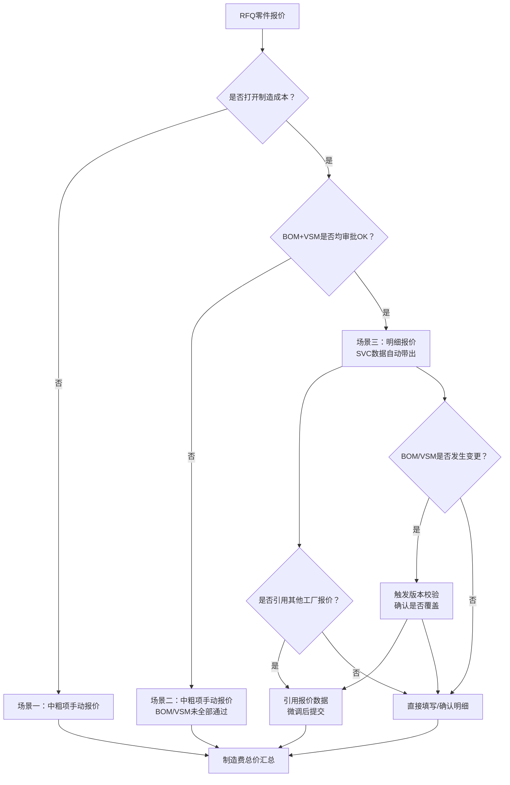
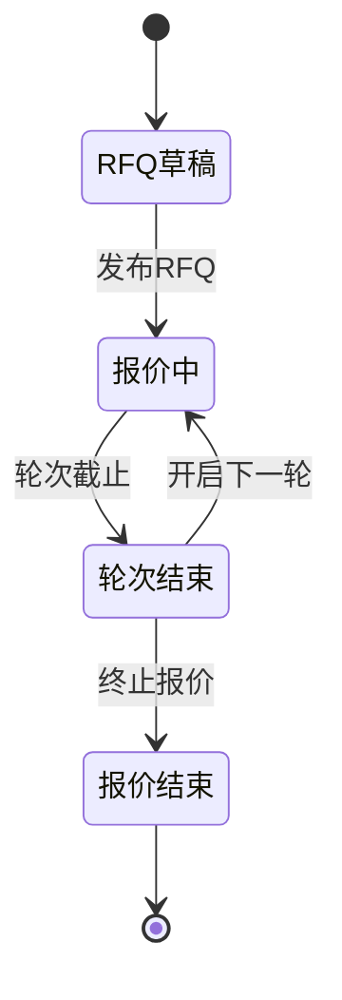

# 制造费明细报价 - 产品需求文档（PRD）

| 属性 | 内容 |
|------|------|
| 文档版本 | v2.2 |
| 所属模块 | EP采购平台 - RFQ报价 |
| 需求编号 | MEP-2026-045 |
| 优先级 | P1 |
| 文档状态 | 评审中 |
| 创建日期 | 2026-05-21 |
| 最后更新 | 2026-05-22 |

---

## 1 术语表

| 术语 | 定义 |
|------|------|
| EP | 企业采购平台（Enterprise Procurement） |
| SVC | 供应商协同系统（Supplier Collaboration） |
| BOM | 物料清单（Bill of Materials） |
| VSM | 价值流图（Value Stream Mapping），本需求中指制造工艺工序结构 |
| RFQ | 报价请求（Request for Quotation） |
| 制造费 | 生产制造过程中产生的费用总和，包含设备、人工、报废、能耗、耗材 |
| 中粗项 | 制造费用的汇总级费用项（设备/人员/报废/能耗/耗材） |
| 明细项 | 基于工艺工序视角的逐行制造费用明细 |
| 自制件 | 由供应商自行生产的零部件（区别于外购件） |
| 外购件 | 由供应商外部采购的零部件（区别于自制件） |
| 半成品 | 生产过程中需进一步加工的中间产品 |
| 工段/线体 | 生产工艺中的一个加工环节或生产线 |
| OEE | 设备综合效率（Overall Equipment Effectiveness） |
| LCR | 客户每日产能需求（Line Capacity Requirement） |
| CT | 生产节拍时间（Cycle Time） |
| 引用报价 | 供应商将其他工厂或历史轮次的报价数据复制到当前行，作为参考或基础数据 |

---

## 2 需求背景与目标

### 2.1 背景

制造费用需要包含半成品，原自制件维度无法完整计算制造费。一期版本中采购员在EP端手动维护制造费的方式已无法满足精度要求，需要基于BOM结构和VSM工艺工序进行明细报价。

### 2.2 变更点

- 制造费报价场景限定为：BOM结构OK **且** VSM OK时，进行明细报价
- 关闭EP端手动维护制造费入口，采购端不再手动维护
- 报价视角从"自制件维度"切换为"工艺工序维度"

### 2.3 目标

- 实现基于工艺工序视角的制造费用明细报价
- 通过BOM+VSM双维度校验确保报价数据准确性
- 支持内网（采购员）和外网（供应商）协同报价

---

## 3 功能概述

### 3.1 核心决策流程



### 3.2 四种报价场景速览

| 场景 | 前提条件 | 报价模式 | 输入方式 |
|------|---------|---------|---------|
| 场景一 | 关闭制造成本（默认） | 中粗项手动填写 | 供应商手动输入中粗项 |
| 场景二 | 打开制造成本 + BOM/VSM非全部OK | 中粗项手动填写 | 供应商手动输入中粗项 |
| 场景三 | 打开制造成本 + BOM+VSM均OK | 明细项 + 中粗项自动汇总 | SVC自动带出，用户填写/确认 |
| 场景四 | 场景三基础上 + 引用其他工厂报价 | 明细项 + 中粗项自动汇总 | 引用其他工厂数据，微调后提交 |

---

## 4 详细功能需求

### 4.1 内网 - 报价列表增加「打开制造成本」字段

**用户故事：** 作为采购员，我希望在报价列表中能看到每个零件是否打开了制造成本，以便了解该零件的报价模式。

**功能说明：**

- 报价列表新增列：`是否打开制造费成本`
- 可见阶段：RFQ草稿 / 报价中 / 轮次结束 / 报价结束（全生命周期可见）
- 默认值：**打开**（默认勾选）
- 变化：供应商可在报价过程中打开/关闭开关，采购员端查看报价时可见开关状态

**验收标准：**
1. [ ] 列表页展示「是否打开制造成本」列
2. [ ] 默认状态为"打开"
3. [ ] 四个阶段（草稿/报价中/轮次结束/报价结束）均可查看

---

### 4.2 外网 - 供应商报价界面「打开制造成本」按钮

**用户故事：** 作为供应商，我希望能控制是否打开制造成本，以便选择适合的报价方式。

**功能说明：**

- 外网列表增加「是否打开制造费成本」按钮
- **可编辑时机：** 供应商在轮次中可随时编辑
- 控制范围：报价详情中制造费模块的展示方式

**状态切换规则：**

| 切换方向 | 操作后果 |
|---------|---------|
| 不打开 → 打开 | 已报价中粗项**清空**，按制造明细重新计算 |
| 打开 → 不打开 | 已报价明细项**清空**，按中粗项进行报价 |

**验收标准：**
1. [ ] 外网报价弹框页展示「是否打开制造费成本」按钮
2. [ ] 轮次中供应商可随时切换
3. [ ] 不打开→打开时，中粗项清空，切换为明细模式
4. [ ] 打开→不打开时，明细项清空，切换为中粗项模式
5. [ ] 切换后界面实时刷新，展示对应报价模式

---

### 4.3 场景一：不打开制造成本 - 中粗项报价

**用户故事：** 作为供应商，当不需要打开制造成本时，我直接填写各项费用汇总值即可。

**制造费用报价汇总字段：**

| 费用项 | 录入方式 | 格式要求 | 可否为0 | 必填 |
|--------|---------|---------|--------|------|
| 是否打开制造费成本 | 手动选择 | — | — | 是 |
| 设备费用 | 手动填写 | 金额，三位小数 | 是 | 是 |
| 人员费用 | 手动填写 | 金额，三位小数 | 是 | 是 |
| 报废费用 | 手动填写 | 金额，三位小数 | 是 | 是 |
| 能耗费用 | 手动填写 | 金额，三位小数 | 是 | 是 |
| 耗材费用 | 手动填写 | 金额，三位小数 | 是 | 是 |
| **制造费总价** | 自动计算 | 金额，三位小数 | 是 | 是 |

**计算公式：**

```
制造费总价 = 设备费用 + 人员费用 + 报废费用 + 能耗费用 + 耗材费用
```

> 制造费总价为自动计算字段，置灰不可编辑。

**验收标准：**
1. [ ] 展示5个可编辑费用项 + 1个自动计算总价
2. [ ] 各费用项支持三位小数，可为0，必填
3. [ ] 制造费总价实时汇总，置灰不可编辑
4. [ ] 任一必填项为空时，总价显示为 `0.000`

---

### 4.4 场景二：打开制造成本 + BOM/VSM非全部OK

**用户故事：** 作为供应商，当BOM/VSM未全部审批通过时，我需要自主添加零件工段信息并填写制造明细。

**前提条件：**
- 打开制造成本 = 是
- BOM结构OK + VSM审批OK = 否（至少一项不满足）

> BOM+VSM 必须全部OK才能打开制造费明细。部分OK或全部NOK时，系统拦截打开操作，供应商只能使用中粗项手动报价。

**制造费用报价汇总字段：**

| 费用项 | 录入方式 | 格式要求 | 可否为0 | 必填 |
|--------|---------|---------|--------|------|
| 是否打开制造费成本 | 手动选择 | — | — | 是 |
| 设备费用 | 手动填写 | 金额，三位小数 | 是 | 是 |
| 人员费用 | 手动填写 | 金额，三位小数 | 是 | 是 |
| 报废费用 | 手动填写 | 金额，三位小数 | 是 | 是 |
| 能耗费用 | 手动填写 | 金额，三位小数 | 是 | 是 |
| 耗材费用 | 手动填写 | 金额，三位小数 | 是 | 是 |
| **制造费总价** | 自动计算 | 金额，三位小数 | 是 | 是 |

**计算公式：**

```
制造费总价 = 设备费用 + 人员费用 + 报废费用 + 能耗费用 + 耗材费用
```

> 制造费总价为自动计算字段，置灰不可编辑。

**验收标准：**
1. [ ] 展示5个可编辑费用项 + 1个自动计算总价
2. [ ] 各费用项支持三位小数，可为0，必填
3. [ ] 制造费总价实时汇总，置灰不可编辑
4. [ ] 任一必填项为空时，总价显示为 `0.000`

---

### 4.5 场景三：打开制造成本 + BOM+VSM均OK

**用户故事：** 作为供应商，当BOM和VSM都审批通过时，系统自动带出工艺工序数据，我只需确认或微调即可。

**前提条件：**
- 打开制造成本 = 是
- BOM结构OK = 是
- VSM审批OK = 是

**功能说明：**

- 根据BOM结构中的零件号+零件+供应商名称，从SVC获取数据
- 自动带出全部零件+工段信息
- 如果获取到多个供应商工厂的VSM，按零件+工段+供应商工厂作为联合主键生成多条数据
- 中粗项汇总逻辑与场景二一致（见 4.5.1）

**数据来源说明：**

| 字段 | 数据来源 |
|------|---------|
| 零件号 | RFQ默认带出 |
| 零件名称 | RFQ默认带出 |
| 工段/线体名称 | SVC获取 |
| 工段/线体编号 | SVC获取 |
| 供应商工厂编号 | SVC获取 |
| 供应商工厂名称 | SVC获取 |
| 设备/能耗/报废/耗材/人员 | 由明细行自动汇总 |

**维护详情按钮：**
- 每行提供「维护详情」按钮
- 轮次报价中一直可编辑

**验收标准：**
1. [ ] 进入报价页面时，自动从SVC拉取零件+工段数据
2. [ ] 多供应商工厂场景下，按联合主键生成多条行数据
3. [ ] 自动带出的行可删除，不做强制要求
4. [ ] 支持用户手动添加额外的耗材费用
5. [ ] 「维护详情」按钮在轮次报价期间始终可点击

---

#### 4.5.1 模块一：中粗项汇总（自动计算 + 手动覆盖）

**设计原则：** 中粗项默认由明细行自动汇总计算，但供应商可手动修改任意费用项。手动修改后，该字段进入"覆盖"状态，与明细行解耦。

**费用项定义：**

| 费用项 | 状态 | 计算公式 | 是否必填 |
|--------|------|---------|---------|
| 是否打开制造费成本 | 手动选择 | — | 是 |
| 设备费用 | 自动计算，支持手动更新 | = sum（所有行的设备费） | 是 |
| 能耗费用 | 自动计算，支持手动更新 | = sum（所有行的能耗费） | 是 |
| 报废费用 | 自动计算，支持手动更新 | = sum（所有行的报废费） | 是 |
| 耗材费用 | 自动计算，支持手动更新 | = sum（所有行的耗材费） | 是 |
| 人员费用 | 自动计算，支持手动更新 | = sum（所有行的人员费） | 是 |
| **制造费总价** | 自动计算，支持手动更新 | = 设备费用 + 能耗费用 + 报废费用 + 耗材费用 + 人员费用 | 是 |

**中粗项汇总规则：**

```
设备费用合计 = 零件1设备费(设备1+设备2+...+设备n) + 零件2设备费(...) + ...
能耗费用合计 = 零件1能耗费(能耗1+能耗2+...+能耗n) + 零件2能耗费(...) + ...
报废费用合计 = 零件1报废费 + 零件2报废费 + ...
耗材费用合计 = 零件1耗材费(耗材1+耗材2+...+耗材n) + 零件2耗材费(...) + ...
人员费用合计 = 零件1直接人工 + 零件1间接人工
制造费总价 = 设备费用 + 能耗费用 + 报废费用 + 耗材费用 + 人员费用
```

> 注：一个零件可能有多条产线，同一费用项需先按产线求和，再按零件求和。

#### 4.5.2 手动覆盖机制

**字段状态模型：**

每个中粗项费用字段有三种状态：

| 状态 | 含义 | 触发条件 |
|------|------|---------|
| `auto` | 自动计算值，跟随明细行联动 | 初始加载 / 用户点击"恢复自动计算" |
| `overridden` | 手动覆盖值，与明细行解耦 | 用户直接编辑了该字段的值 |
| `conflict` | 自动值已变化，但字段仍为覆盖值 | 明细行变更后，自动值 ≠ 当前显示值 |

**状态流转：**

```
                明细行变更
    auto ──────────────────→ auto（值跟随更新）
     │
     │ 用户手动编辑
     ↓
  overridden ── 明细行变更 ──→ conflict（自动值已变，覆盖值保留）
     │                              │
     │ 用户点击"恢复自动计算"        │ 用户点击"恢复自动计算"
     ↓                              ↓
    auto ←──────────────────── auto（恢复为最新自动值）
```

**关键交互流程：**
1. 初始加载 → 所有中粗项为 `auto`，值 = SUM(明细行)
2. 用户编辑某个费用项 → 该字段变为 `overridden`，不再跟随明细联动
3. 提交报价时 → 统一以 `displayValue` 提交，不区分来源

**视觉样式：**

| 状态 | 输入框样式 | 标签 |
|------|-----------|------|
| `auto` | 浅绿背景 `#E8F5E9`，可编辑 | 🟢 自动 |
| `overridden` | 浅橙背景 `#FFF3E0`，可编辑 | 🔴 手动覆盖 |
| `conflict` | 浅红背景 `#FFEBEE`，可编辑 | 🟡 与明细不一致 |

---

#### 4.5.3 模块二：制造费明细

**业务规则：**
- BOM零件不区分层级，需要报制造费用明细
- 用户不可自主添加和删除行项目
- 一个零件可能在多个线体上生产

##### 4.5.3.1 零件-工段信息

| EP字段名 | 备注 | 来源 | EP输入样式 | SVC带出样式 | 是否必填 | 提交校验 | 格式 | 公式 | SVC字段名 | SVC字段名称 | SVC表名 |
|---------|------|------|-----------|------------|---------|---------|------|------|----------|-----------|--------|
| 零件号 | — | EP带出 | 输入框 | 置灰 | 必填 | — | 文本，50字符 | — | 零件号 | partNo | Process_part |
| 零件名称 | — | EP带出 | 输入框 | 置灰 | 必填 | — | 文本，50字符 | — | 零件名称 | — | — |
| SVC版本 | SVC审批状态OK时从SVC获取 | — | 标签 | — | 必填 | — | 文本，50字符 | — | — | — | — |
| 工段/线体编号 | — | SVC审批状态OK时从SVC获取 | 输入框 | 置灰 | 必填 | — | 文本，50字符 | — | 工段/线体编号 | process_code | svc_process_master1 |
| 工段/线体名称 | — | SVC审批状态OK时从SVC获取 | 输入框 | 置灰 | 必填 | — | 文本，50字符 | — | 工段/线体名称 | process_name | svc_process_master1 |
| 供应商工厂编号 | — | SVC审批状态OK时从SVC获取 | 输入框 | 置灰 | 必填 | — | 文本，50字符 | — | — | — | — |
| 供应商工厂名称 | — | SVC审批状态OK时从SVC获取 | 输入框 | 置灰 | 必填 | — | 文本，50字符 | — | — | — | — |
| 设备费用 | 从行项目汇总 | 输入框 | 置灰 | 必填 | 校验 | 金额，可以为0 | — | — | — | — |
| 能耗费用 | 从行项目汇总 | 输入框 | 置灰 | 必填 | 校验 | 金额，可以为0 | — | — | — | — |
| 报废费用 | 从行项目汇总 | 输入框 | 置灰 | 必填 | 校验 | 金额，可以为0 | — | — | — | — |
| 耗材费用 | 从行项目汇总 | 输入框 | 置灰 | 必填 | 校验 | 金额，可以为0 | — | — | — | — |
| 人员费用 | 从行项目汇总 | 输入框 | 置灰 | 必填 | 校验 | 金额，可以为0 | — | — | — | — |
| 制造费总价 | 从行项目汇总 | 输入框 | 置灰 | 必填 | 校验 | 金额，可以为0 | — | — | — | — |

##### 4.5.3.2 产能信息

| EP字段名 | 备注 | 来源 | EP输入样式 | SVC带出样式 | 是否必填 | 提交校验 | 格式 | 公式 | SVC字段名 | SVC字段名称 | SVC表名 | 关系 |
|---------|------|------|-----------|------------|---------|---------|------|------|----------|-----------|--------|------|
| CT生产节拍(s) | — | SVC审批状态OK时从SVC获取 | 输入框 | 置灰 | 必填 | — | 正整数，不可以为0 | — | ct | CT生产节拍（单位：秒） | svc_process_part1 | 1:1 |
| 单个生产节拍产出数量 | — | SVC审批状态OK时从SVC获取 | 输入框 | 置灰 | 必填 | — | 正整数，不可以为0 | — | qty_per_ct | 单个生产节拍产出数量 | svc_process_part1 | — |
| OEE设计值 | 本工段/线体OEE，OEE包含不良率 | SVC审批状态OK时从SVC获取 | 输入框 | 置灰 | 必填 | — | 百分比，小数点后两位，不可以为0 | — | design_oee | OEE设计值 | svc_process_master1 | — |
| 客户每日产能需求LCR | 参考SOR的产能要求 | EP填写 | 输入框 | — | 必填 | — | 正整数，不可以为0 | — | — | — | — | — |
| 达到LCR所需工时(h) | LCR×CT/单节拍产出数量/OEE | EP计算 | 置灰计算值 | — | 必填 | — | 数字，小数点后两位，不可以为0 | LCR×CT/单节拍产出数量/OEE | — | — | — | — |
| 供应商每日总工时(h) | — | SVC审批状态OK时从SVC获取 | 输入框 | 置灰 | 非必填 | — | 数字，小数点后两位，可以为0 | — | daily_total_hours | 供应商每日总工时 | svc_process_master1 | — |
| 供应商每日承诺工时(h) | — | SVC审批状态OK时从SVC获取 | 输入框 | 置灰 | 非必填 | — | 数字，小数点后两位，可以为0 | — | promised_hours | 供应商每日承诺工时 | svc_process_master1 | — |
| 空闲工时(h) | — | SVC审批状态OK时从SVC获取 | 输入框 | 置灰 | 非必填 | — | 数字，小数点后两位，可以为0 | — | idle_hours | 空闲工时 | svc_process_master1 | — |

##### 4.5.3.3 设备费用

| EP字段名 | 备注 | 来源 | EP输入样式 | SVC带出样式 | 是否必填 | 提交校验 | 格式 | 公式 | SVC字段名 | SVC字段名称 | SVC表名 | 关系 |
|---------|------|------|-----------|------------|---------|---------|------|------|----------|-----------|--------|------|
| 产线面积(㎡) | — | SVC审批状态OK时从SVC获取 | 输入框 | 置灰 | 非必填 | — | 数字，小数点后两位，可以为0 | — | area | 线体面积(㎡) | svc_process_master1 | 1:N |
| 厂房单位成本(元/h/m2) | — | EP填写 | 输入框 | — | 非必填 | — | 金额，小数点后三位，可以为0 | — | — | — | — | — |
| 单个零件占地费分摊(元/EA) | 产线面积×厂房单位成本/24H×达到LCR所需工时/LCR | EP计算 | 置灰计算值 | — | 必填 | 校验 | 金额，小数点后三位，可以为0 | 如计算因子有值则计算；若任意因子为空则支持手动输入 | — | — | — | — |
| 通用设备模检夹名称 | — | SVC审批状态OK时从SVC获取 | 输入框 | 置灰 | 非必填 | — | 文本，50字符 | — | — | — | — | — |
| 通用设备品牌型号 | — | EP填写 | 输入框 | — | 非必填 | — | 文本，50字符 | — | — | — | — | — |
| 设备状态 | — | EP填写 | 下拉选项 | — | 非必填 | — | 下拉选项，新/旧 | — | — | — | — | — |
| 设备原值(元) | — | EP填写 | 输入框 | — | 非必填 | — | 金额，小数点后三位，可以为0 | — | — | — | — | — |
| 折旧年限(年) | — | EP填写 | 输入框 | — | 非必填 | — | 数字，小数点后两位，不可以为0 | — | — | — | — | — |
| 单个零件设备折旧费(元/EA) | 设备原值/折旧年限/365/24H×达到LCR所需工时/LCR | EP计算 | 置灰计算值 | — | 必填 | 校验 | 金额，小数点后三位，可以为0 | 如计算因子有值则计算；若任意因子为空则支持手动输入 | — | — | — | — |
| 设备维护费比例 | 参考值0%-3% | EP填写 | 输入框 | — | 非必填 | — | 百分比，小数点后两位，可以为0 | — | — | — | — | — |
| 单个零件设备维护费分摊(元/EA) | 设备原值×设备维护费比例/365/24H×达到LCR所需工时/LCR | EP计算 | 置灰计算值 | — | 必填 | 校验 | 金额，小数点后三位，可以为0 | 如计算因子有值则计算；若任意因子为空则支持手动输入 | — | — | — | — |
| 设备制造总费(元/EA) | 单个零件占地费分摊+单个零件设备折旧费+单个零件设备维护费分摊 | EP计算 | 置灰计算值 | — | 必填 | 校验 | 金额，小数点后三位，可以为0 | 如计算因子有值则计算；若任意因子为空则支持手动输入 | — | — | — | — |

##### 4.5.3.4 能耗费用

| EP字段名 | 备注 | 来源 | EP输入样式 | SVC带出样式 | 是否必填 | 提交校验 | 格式 | 公式 | 关系 |
|---------|------|------|-----------|------------|---------|---------|------|------|------|
| 能耗种类 | — | EP填写 | 下拉选项 | — | 非必填 | — | 下拉选项：电/天然气/水/煤炭/燃油 | — | 1:N |
| 能耗单位 | — | EP填写 | 下拉选项 | — | 非必填 | — | 下拉选项：度/kg/吨/其他 | — | — |
| 小时能源消耗量(单位/h) | — | EP填写 | 输入框 | — | 非必填 | — | 数字，小数点后两位，可以为0 | — | — |
| 能耗单价(元/h) | — | EP填写 | 输入框 | — | 非必填 | — | 金额，小数点后三位，可以为0 | — | — |
| 单个零件能耗费(元/EA) | 能耗单价×小时能耗量×达到LCR所需工时/LCR | EP计算 | 置灰计算值 | — | 必填 | 校验 | 金额，小数点后三位，可以为0 | 如计算因子有值则计算；若任意因子为空则支持手动输入 | — |

##### 4.5.3.5 报废费用

| EP字段名 | 备注 | 来源 | EP输入样式 | SVC带出样式 | 是否必填 | 提交校验 | 格式 | 公式 | SVC字段名 | SVC字段名称 | SVC表名 | 关系 |
|---------|------|------|-----------|------------|---------|---------|------|------|----------|-----------|--------|------|
| 报废物料成本 | — | EP填写 | 输入框 | — | 非必填 | — | 金额，小数点后三位，可以为0 | — | — | — | — | 1:1 |
| 本工段合格率(%) | — | SVC审批状态OK时从SVC获取 | 输入框 | 置灰 | 必填 | — | 百分比，小数点后两位，可以为0 | — | estimated_qualified_rate | 本工段报废率（%） | svc_process_master1 | — |
| 报废可回收率(%) | — | SVC审批状态OK时从SVC获取 | 输入框 | 置灰 | 必填 | — | 百分比，小数点后两位，可以为0 | — | reject_rate | 报废可回收率（%） | svc_process_part1 | — |
| 报废费 | 报废物料成本×（1-本工段合格率）×（1-报废可回收率） | EP计算 | 置灰计算值 | — | 必填 | 校验 | 金额，小数点后三位，可以为0 | 如计算因子有值则计算；若任意因子为空则支持手动输入 | — | — | — | — |

##### 4.5.3.6 耗材费用

| EP字段名 | 备注 | 来源 | EP输入样式 | SVC带出样式 | 是否必填 | 提交校验 | 格式 | 公式 | SVC字段名 | SVC字段名称 | SVC表名 | 关系 |
|---------|------|------|-----------|------------|---------|---------|------|------|----------|-----------|--------|------|
| 耗材名 | — | SVC审批状态OK时从SVC获取 | 下拉选项 | 置灰 | 非必填 | — | 下拉选项：冷却水/润滑油/焊丝/脱模剂/刀具/激光头/氮气 | — | consumable_name | 耗材名 | svc_process_consumable1 | 1:N |
| 耗材消耗量(h) | — | SVC审批状态OK时从SVC获取 | 输入框 | 置灰 | 非必填 | — | 数字，两位小数，可以为0 | — | consumable_qty | 耗材消耗量（h） | svc_process_consumable1 | — |
| 单位 | — | EP填写 | 输入框 | — | 非必填 | — | 文本，50字符 | — | — | — | — | — |
| 耗材单价(元/单位) | — | EP填写 | 输入框 | — | 非必填 | — | 金额，小数点后三位，可以为0 | — | — | — | — | — |
| 耗材零件均摊(元/EA) | 耗材消耗量×耗材单价/达到LCR所需工时/LCR | EP计算 | 置灰计算值 | — | 必填 | 校验 | 金额，小数点后三位，可以为0 | 如计算因子有值则计算；若任意因子为空则支持手动输入 | — | — | — | — |

##### 4.5.3.7 人员费用

| EP字段名 | 备注 | 来源 | EP输入样式 | SVC带出样式 | 是否必填 | 提交校验 | 格式 | 公式 | SVC字段名 | SVC字段名称 | SVC表名 | 关系 |
|---------|------|------|-----------|------------|---------|---------|------|------|----------|-----------|--------|------|
| 直接人员数量 | — | SVC审批状态OK时从SVC获取 | 输入框 | 置灰 | 非必填 | — | 数字，小数点后两位，可以为0 | — | direct_staff_count | 直接人员数量 | svc_process_master1 | 1:1 |
| 直接人员每天费用(元/天) | — | EP填写 | 输入框 | — | 非必填 | — | 金额，小数点后三位，可以为0 | — | — | — | — | — |
| 间接人员每天工时(h) | — | SVC审批状态OK时从SVC获取 | 输入框 | 置灰 | 非必填 | — | 数字，小数点后两位，可以为0 | — | indirect_staff_daily_hours | 间接人员每天工时（h） | svc_process_master1 | — |
| 间接人员费(元/小时) | — | EP填写 | 输入框 | — | 非必填 | — | 金额，小数点后三位，可以为0 | — | — | — | — | — |
| 直接+间接人员费(元/EA) | （达到LCR所需工时×直接人员数量×直接人员费+间接人员每天工时×间接人员费）/LCR | EP计算 | 置灰计算值 | — | 必填 | 校验 | 金额，小数点后三位，可以为0 | 如计算因子有值则计算；若任意因子为空则支持手动输入 | — | — | — | — |

---

### 4.6 可视化VSM

**用户故事：** 作为供应商，我希望看到VSM工艺流程图，以便直观了解制造工艺结构。

**功能说明：**

- 根据零件号+供应商从SVC获取可视化VSM结构
- VSM结构状态OK：显示VSM图
- VSM结构状态NOK：不显示（空白）
- 多个VSM存储在多个JSON中，渲染为多个效果图

**验收标准：**
1. [ ] VSM状态OK时正确渲染流程图
2. [ ] VSM状态NOK时显示空白区域
3. [ ] 多VSM场景下分别渲染

---

### 4.7 VSM版本校验

**触发时机：** 以下三个操作均触发VSM版本校验：

1. 点击报价（进入报价详情页）
2. 手动点击「获取最新VSM」按钮
3. 提交报价

**校验逻辑与弹窗提示：**

| 校验结果 | 弹窗内容 | 后续操作 |
|---------|---------|---------|
| SVC不存在审批通过的VSM | "无已审批通过的VSM，请手动维护制造费" | 阻断操作 |
| EP端VSM版本 = SVC最新版本 | "当前VSM无更新，请在当前版本上进行更新" | 放行操作 |
| 存在更高版本 | "已获取到最新版本，请在最新版本上进行更新" | 覆盖前强提示，确认后覆盖，不支持回退 |

> **覆盖逻辑说明：** 覆盖操作会清空供应商当前已填写的明细数据（工段信息、产能参数、设备/能耗/耗材明细），并用SVC最新数据重新填充。供应商需在新数据基础上重新报价。此操作**不支持回退**。

**验收标准：**
1. [ ] 三个触发时机均执行版本校验
2. [ ] 三种校验结果分别展示对应弹窗
3. [ ] 高版本覆盖前有强提示，确认后覆盖
4. [ ] 覆盖操作不支持回退

---

### 4.8 引用其他工厂报价

**用户故事：** 作为供应商，当同一零件在多个工厂生产时，我希望能引用其他工厂的报价数据，以提高报价效率并保持数据一致性。

**功能说明：**

- 仅在场景三（明细报价模式）下可用
- 每行提供「引用报价」按钮
- 点击后弹出引用弹窗，展示可引用的数据源

**引用数据源类型：**

| 数据源 | 说明 | 优先级 |
|-------|------|-------|
| 同零件其他工厂报价 | 同一零件在不同工厂的工段报价数据 | 最高 |
| 上一轮次本报价数据 | 同一零件在上一轮次的报价数据 | 中 |
| 同RFQ相似工段报价 | 同RFQ下其他零件但工艺相似的工段数据 | 低 |

**引用操作流程：**

1. 供应商点击目标行的「引用报价」按钮
2. 弹出引用弹窗，展示可引用的工厂/轮次列表
3. 供应商选择引用来源，系统预览引用数据
4. 供应商确认引用，系统弹出二次确认："引用将覆盖当前行明细数据，确定？"
5. 确认后，引用数据写入当前行，相关字段状态变为 `overridden`
6. 供应商在引用数据基础上进行微调

**引用数据映射规则：**

| 引用源字段 | 是否复制 | 说明 |
|-----------|---------|------|
| CT生产节拍 | 是 | 直接复制 |
| 单个生产节拍产出数量 | 是 | 直接复制 |
| OEE设计值 | 是 | 直接复制 |
| LCR | 否 | 保持目标行不变（各工厂产能需求不同） |
| 设备原值/折旧年限/维护费比例 | 是 | 直接复制 |
| 能耗种类/单价/小时消耗量 | 是 | 直接复制 |
| 报废物料成本 | 是 | 直接复制 |
| 耗材名/消耗量/单价 | 是 | 直接复制 |
| 直接人员数量/费用 | 是 | 直接复制 |
| 间接人员工时/费用 | 是 | 直接复制 |
| 所有计算字段 | 否 | 引用后自动重算 |
| 零件号/零件名称/工段编号 | 否 | 保持目标行不变 |

**引用限制：**

| 限制项 | 规则 |
|-------|------|
| 引用频率 | 同一行在同一轮次内最多引用3次 |
| 引用来源 | 仅可引用同RFQ下的报价数据，不可跨RFQ引用 |
| 引用权限 | 供应商仅可引用本供应商的报价数据，不可引用其他供应商 |
| 数据一致性 | 引用后如引用源数据发生变更，已引用数据**不同步更新** |
| 撤销引用 | 引用后不支持一键撤销，供应商需手动修改或再次引用覆盖 |

**验收标准：**
1. [ ] 明细报价模式下每行显示「引用报价」按钮
2. [ ] 引用弹窗正确展示可引用的工厂/轮次列表
3. [ ] 引用数据映射规则正确执行
4. [ ] 引用后字段状态正确标记为 `overridden`
5. [ ] 引用限制规则正确生效（频率、来源、权限）
6. [ ] 二次确认弹窗正确展示

---

## 5 校验规则汇总

### 5.1 制造费维护完成校验

- 每行最后的价格数据：**可以为0，不能为空**
- 任意一行存在空值 → 无法计算 → 「制造费维护完成」按钮**无法点亮**

### 5.2 提交完整性校验

**校验规则：** 必填字段非空，为空值则提交报价时报错。

**错误提示格式：** `零件X-工厂1制造费未填写完整，xx,xx,xx`（定位到字段名即可，无需提醒到具体零件-工厂行）

**完整性校验字段清单：**

| 类别 | 校验字段 |
|------|---------|
| 中粗项 | 设备费用、人员费用、报废费用、能耗费用、耗材费用 |
| 零件信息 | 零件号、零件名称 |
| 成本明细 | 单个零件占地费分摊(元/EA)、单个零件设备折旧费(元/EA)、产线设备制造总费(元/EA)、单个零件能耗费(元/EA)、报废费、耗材零件均摊(元/EA)、直接+间接人员费(元/EA) |

### 5.3 BOM/VSM变更校验

| 校验时机 | 校验内容 | 错误提示 |
|---------|---------|---------|
| 打开制造成本时 | BOM+VSM是否均OK | "BOM结构或VSM结构状态NOK，无法打开制造明细" |
| 提交报价时 | BOM版本一致性 | "BOM结构已变更，请获取最新BOM后重新提交" |
| 提交报价时 | VSM版本一致性 | "VSM结构已变更，请获取最新VSM后重新提交" |
| 获取最新VSM时 | VSM版本对比 | 见4.7三种校验结果 |

### 5.4 引用报价校验

| 校验项 | 规则 | 错误提示 |
|-------|------|---------|
| 引用频率 | 同一行同轮次最多引用3次 | "该行已达到引用上限（3次），请手动填写" |
| 引用来源 | 仅可引用同RFQ下本供应商数据 | "仅可引用同RFQ下的报价数据" |
| 引用目标 | 仅在明细报价模式下可用 | "当前为中粗项模式，不支持引用报价" |
| 引用数据完整性 | 引用源数据必须完整 | "引用源数据不完整，无法引用" |

---

## 6 异常场景与处理

### 6.1 BOM结构变更场景

**大原则：** SVC零件来源为材料费的BOM零件，BOM端变化会影响SVC。BOM状态是决定制造费报价模式的核心开关。

#### 6.1.1 BOM状态切换矩阵

| 场景编号 | BOM变化 | 前提条件 | 制造费处理 | 供应商影响 |
|---------|---------|---------|-----------|-----------|
| BOM-S1 | NOK → OK（首次通过） | 制造成本已打开 | 切换为明细报价模式，系统从SVC自动带出零件+工段数据 | 原中粗项数据**清空**，自动加载明细项 |
| BOM-S2 | OK → NOK（被驳回） | 当前为明细报价模式 | **阻断**明细报价，回退为中粗项手动模式 | 明细数据**保留但置灰不可编辑**，需等BOM重新审批 |
| BOM-S3 | OK → OK（版本升级） | 当前为明细报价模式 | 触发VSM版本校验，按VSM-S3处理 | 见6.2.3 |
| BOM-S4 | NOK → NOK（状态不变） | 当前为中粗项模式 | 无影响，继续中粗项报价 | 无 |

#### 6.1.2 BOM结构内容变更（BOM状态仍为OK）

| 场景编号 | 变更类型 | 制造费处理 | 数据影响 |
|---------|---------|-----------|---------|
| BOM-C1 | 新增下级自制件 | 下一轮次生效时，新增行自动带出（从SVC获取），**不影响当前轮次** | 新行初始状态为空，供应商需在下轮填写 |
| BOM-C2 | 删除下级自制件 | 对应明细行标记为"已删除"，**不影响当前轮次已填数据** | 被删除行仍显示，标记删除线，汇总时排除 |
| BOM-C3 | 零件来源变更（自制件→外购件） | 该零件从制造费明细中移除，转为材料费 | 明细行标记"已转材料费"，汇总时排除 |
| BOM-C4 | 零件来源变更（外购件→自制件） | 该零件新增到制造费明细，从SVC获取工段数据 | 新增行需供应商填写，汇总时加入 |
| BOM-C5 | 零件层级变更（半成品→成品） | 不影响制造费明细结构 | 仅BOM展示层级变化 |
| BOM-C6 | 零件号变更 | 旧零件号行保留，新零件号行新增 | 供应商需确认新零件号的报价数据 |

#### 6.1.3 BOM与制造费的联动规则

```
┌─────────────────────────────────────────────────────────────────┐
│                     BOM 状态判定逻辑                              │
├─────────────────────────────────────────────────────────────────┤
│  BOM状态 = NOK                                                  │
│    → 仅要求RFQ零件报价                                          │
│    → 子件+自制件用户自由编辑，不强制要求下级零件                    │
│    → 制造费仅支持中粗项手动报价                                    │
├─────────────────────────────────────────────────────────────────┤
│  BOM状态 = OK                                                   │
│    → 要求RFQ零件 + 下级自制件报价                                 │
│    → 材料工艺中下级零件属性为自制件的默认带出，可删除               │
│    → 若VSM也OK，切换为明细报价模式                                │
├─────────────────────────────────────────────────────────────────┤
│  BOM状态 = OK，但VSM = NOK                                       │
│    → 制造费仍为中粗项手动报价                                     │
│    → 供应商可自主添加工段信息（见6.3）                             │
└─────────────────────────────────────────────────────────────────┘
```

#### 6.1.4 BOM变更的轮次处理规则

| 变更时机 | 处理方式 |
|---------|---------|
| 同一轮次内BOM变更 | **不影响当前轮次**，变更在下一轮次生效 |
| 跨轮次BOM变更 | 新轮次开启时自动同步BOM变更，更新制造费明细行 |
| 供应商已提交报价后BOM变更 | 采购员发起新轮次时，系统提示"BOM已变更，请供应商更新报价" |

---

### 6.2 VSM结构变更场景

**大原则：** VSM版本是制造费明细报价的数据源。VSM变更直接影响明细行的工段结构和参数。

#### 6.2.1 VSM状态切换矩阵

| 场景编号 | VSM变化 | 前提条件 | 制造费处理 | 供应商影响 |
|---------|---------|---------|-----------|-----------|
| VSM-S1 | NOK → OK（首次通过） | 制造成本已打开 + BOM OK | 切换为明细报价模式，从SVC自动带出工段数据 | 原中粗项数据**清空**，自动加载明细项 |
| VSM-S2 | OK → NOK（被驳回） | 当前为明细报价模式 | **阻断**明细报价，回退为中粗项手动模式 | 明细数据**保留但置灰不可编辑**，需等VSM重新审批 |
| VSM-S3 | OK → OK（版本升级） | 当前为明细报价模式 | 触发VSM版本校验（见4.7），覆盖或保留由供应商确认 | 见4.7覆盖逻辑 |
| VSM-S4 | NOK → NOK（状态不变） | 当前为中粗项模式 | 无影响 | 无 |

#### 6.2.2 VSM结构内容变更（VSM状态仍为OK）

| 场景编号 | 变更类型 | 制造费处理 | 数据影响 |
|---------|---------|-----------|---------|
| VSM-C1 | 新增工段/线体 | 新增行从SVC自动带出，**不影响当前轮次** | 新行初始状态为空，供应商需在下轮填写 |
| VSM-C2 | 删除工段/线体 | 对应明细行标记"已删除"，**不影响当前轮次已填数据** | 被删除行保留显示，标记删除线，汇总时排除 |
| VSM-C3 | 工段参数变更（CT/OEE/LCR等） | 该工段的产能、设备、能耗等计算值**自动重算** | 相关计算字段更新，供应商需确认 |
| VSM-C4 | 工段合并/拆分 | 旧行保留，新增合并/拆分后的行 | 供应商需重新分配费用 |
| VSM-C5 | 工段顺序调整 | 不影响计算，仅调整展示顺序 | 无 |
| VSM-C6 | 供应商工厂变更 | 新增工厂行，旧工厂行保留 | 供应商需确认新工厂的报价 |

#### 6.2.3 VSM版本校验详细流程

```
┌─────────────────────────────────────────────────────────────────┐
│                  VSM版本校验决策树                                │
├─────────────────────────────────────────────────────────────────┤
│  触发时机：                                                      │
│    1. 点击报价（进入报价详情页）                                   │
│    2. 手动点击「获取最新VSM」按钮                                  │
│    3. 提交报价                                                    │
├─────────────────────────────────────────────────────────────────┤
│                                                                  │
│  SVC是否存在审批通过的VSM？                                       │
│    ├─ 否 → 弹窗："无已审批通过的VSM，请手动维护制造费"             │
│    │        → 阻断操作，保持当前状态                               │
│    └─ 是 → EP端VSM版本 = SVC最新版本？                           │
│              ├─ 是 → 弹窗："当前VSM无更新，请在当前版本上进行更新"  │
│              │        → 放行操作                                  │
│              └─ 否（存在更高版本）                                  │
│                   → 弹窗："已获取到最新版本，请在最新版本上进行更新" │
│                   → 二次确认："覆盖将清空已填写的明细数据，且不可回退"│
│                   → 确认后覆盖，用SVC最新数据重新填充              │
│                                                                  │
└─────────────────────────────────────────────────────────────────┘
```

> **覆盖操作影响范围：** 工段信息、产能参数、设备明细、能耗明细、报废参数、耗材明细、人员配置。覆盖后所有字段恢复为SVC默认值，供应商已做的手动覆盖（overridden）**全部丢失**。

#### 6.2.4 VSM变更的轮次处理规则

| 变更时机 | 处理方式 |
|---------|---------|
| 同一轮次内VSM变更 | 点击「获取最新VSM」可手动触发更新，需二次确认 |
| 跨轮次VSM变更 | 新轮次开启时自动同步VSM变更，更新制造费明细行 |
| 供应商已提交报价后VSM变更 | 采购员发起新轮次时，系统提示"VSM已变更，请供应商更新报价" |

---

### 6.3 引用其他工厂报价

**用户故事：** 作为供应商，当同一零件在多个工厂生产时，我希望能引用其他工厂的报价数据作为参考或直接复制，以提高报价效率。

#### 6.3.1 引用场景矩阵

| 场景编号 | 引用类型 | 说明 | 数据处理 |
|---------|---------|------|---------|
| REF-1 | 同零件同工厂引用 | 同一零件在同工厂的不同工段间引用 | 复制产能/设备/能耗等参数，**不复制金额** |
| REF-2 | 同零件跨工厂引用 | 同一零件在不同工厂的工段间引用 | 复制全部明细数据，供应商需确认后使用 |
| REF-3 | 跨零件引用 | 不同零件但工艺相似的工段间引用 | 仅复制工艺参数（CT/OEE等），**不复制金额** |
| REF-4 | 历史轮次引用 | 引用上一轮次的报价数据 | 复制全部数据，作为当前轮次的初始值 |

#### 6.3.2 引用操作流程

```
┌─────────────────────────────────────────────────────────────────┐
│                   引用其他工厂报价流程                             │
├─────────────────────────────────────────────────────────────────┤
│                                                                  │
│  1. 供应商点击「引用报价」按钮                                    │
│     ↓                                                            │
│  2. 弹出引用弹窗，展示可引用的工厂列表                            │
│     - 同零件的其他工厂报价                                        │
│     - 上一轮次的本报价数据                                        │
│     - 同RFQ下其他零件的相似工段                                   │
│     ↓                                                            │
│  3. 供应商选择引用来源，点击"引用"                                │
│     ↓                                                            │
│  4. 系统弹出确认弹窗：                                           │
│     "引用将覆盖当前行的明细数据，已填写的数据将被替换。确定引用？" │
│     ↓                                                            │
│  5. 确认后，系统将引用源数据复制到当前行                          │
│     - 金额字段：复制后变为 overridden 状态                       │
│     - 参数字段：复制后变为 auto 状态                              │
│     ↓                                                            │
│  6. 供应商在引用数据基础上进行微调                                │
│                                                                  │
└─────────────────────────────────────────────────────────────────┘
```

#### 6.3.3 引用数据映射规则

| 引用源字段 | 引用目标字段 | 是否复制 | 说明 |
|-----------|-----------|---------|------|
| 零件号/零件名称 | 零件号/零件名称 | 否 | 保持目标行不变 |
| 工段/线体编号 | 工段/线体编号 | 否 | 保持目标行不变 |
| 供应商工厂编号/名称 | 供应商工厂编号/名称 | 否 | 保持目标行不变 |
| CT生产节拍 | CT生产节拍 | 是 | 直接复制 |
| 单个生产节拍产出数量 | 单个生产节拍产出数量 | 是 | 直接复制 |
| OEE设计值 | OEE设计值 | 是 | 直接复制 |
| LCR | LCR | 否 | 保持目标行不变（各工厂产能需求不同） |
| 设备原值/折旧年限 | 设备原值/折旧年限 | 是 | 直接复制 |
| 设备维护费比例 | 设备维护费比例 | 是 | 直接复制 |
| 能耗种类/单价/小时消耗量 | 能耗种类/单价/小时消耗量 | 是 | 直接复制 |
| 报废物料成本 | 报废物料成本 | 是 | 直接复制 |
| 耗材名/消耗量/单价 | 耗材名/消耗量/单价 | 是 | 直接复制 |
| 直接人员数量/费用 | 直接人员数量/费用 | 是 | 直接复制 |
| 间接人员工时/费用 | 间接人员工时/费用 | 是 | 直接复制 |
| 所有计算字段 | 所有计算字段 | 否 | 引用后自动重算 |

#### 6.3.4 引用限制规则

| 限制项 | 规则 |
|-------|------|
| 引用频率 | 同一行在同一轮次内最多引用3次 |
| 引用来源 | 仅可引用同RFQ下的报价数据，不可跨RFQ引用 |
| 引用权限 | 供应商仅可引用本供应商的报价数据，不可引用其他供应商 |
| 数据一致性 | 引用后如引用源数据发生变更，已引用数据**不同步更新** |
| 撤销引用 | 引用后不支持一键撤销，供应商需手动修改或再次引用覆盖 |

---

### 6.4 一个零件多产线场景

- 可能出现一个自制件对应多条产线
- 报价过程中不区分供应商工厂
- 不同工厂但产线名称相同时，EP端不做区分
- 多产线场景下，中粗项汇总需按产线求和后再按零件求和

**多产线费用汇总规则：**

```
零件X设备费 = 产线1设备费 + 产线2设备费 + ... + 产线n设备费
零件X能耗费 = 产线1能耗费 + 产线2能耗费 + ... + 产线n能耗费
零件X报废费 = 产线1报废费 + 产线2报废费 + ... + 产线n报废费
零件X耗材费 = 产线1耗材费 + 产线2耗材费 + ... + 产线n耗材费
零件X人员费 = 产线1人员费 + 产线2人员费 + ... + 产线n人员费
```

---

### 6.5 SVC工序NOK时的用户自主维护

**用户故事：** 当SVC工序状态为NOK时，供应商需要能够自主添加工段信息并填写制造费用明细。

**功能说明：**
- 支持用户从自制件工艺工序视角自主添加工段/线体及其关键要素信息
- 支持用户手动添加和删除行项目
- 每个线体有对应的产能、设备、人工、报废、能耗、耗材关键要素

**自主维护与SVC带出的区别：**

| 对比项 | SVC带出 | 用户自主维护 |
|-------|---------|------------|
| 数据来源 | SVC系统自动获取 | 供应商手动填写 |
| 字段置灰 | 关键字段置灰不可编辑 | 关键字段可编辑 |
| 可删除 | 可删除 | 可删除 |
| 可新增 | 仅在BOM/VSM变更时新增 | 随时可新增 |
| 版本校验 | 有VSM版本校验 | 无版本校验 |
| 提交校验 | 与SVC数据一致性校验 | 仅必填项校验 |

---

## 7 导入导出

- 导入导出模板已更新，新增制造费明细相关字段
- 支持批量导入制造费用明细数据
- 模板格式见附件

---

## 8 非功能需求

| 类别 | 要求 |
|------|------|
| 性能 | SVC数据拉取响应时间 ≤ 3s |
| 并发 | 支持同一RFQ下多供应商同时报价 |
| 数据一致性 | 切换"打开制造成本"时，已填数据需正确清空或保留 |
| 兼容性 | 支持Chrome、Edge最新两个主版本 |
| 可访问性 | 关键操作（提交/切换）支持键盘操作 |

---

## 附录

### A. 状态流转完整视图



### B. 制造成本费用构成

制造成本费用包含以下7个维度：

1. 工段信息
2. 设备费用
3. 人工费用
4. 报废费用
5. 能耗费用
6. 产能满足
7. 制造费总价

### C. 采购端变更说明

- 关闭EP端手动维护制造费入口
- 采购员不再在EP端手动维护制造费

---

> 回到 → [[Xiaomi|📱 小米 EP 采购系统]]
