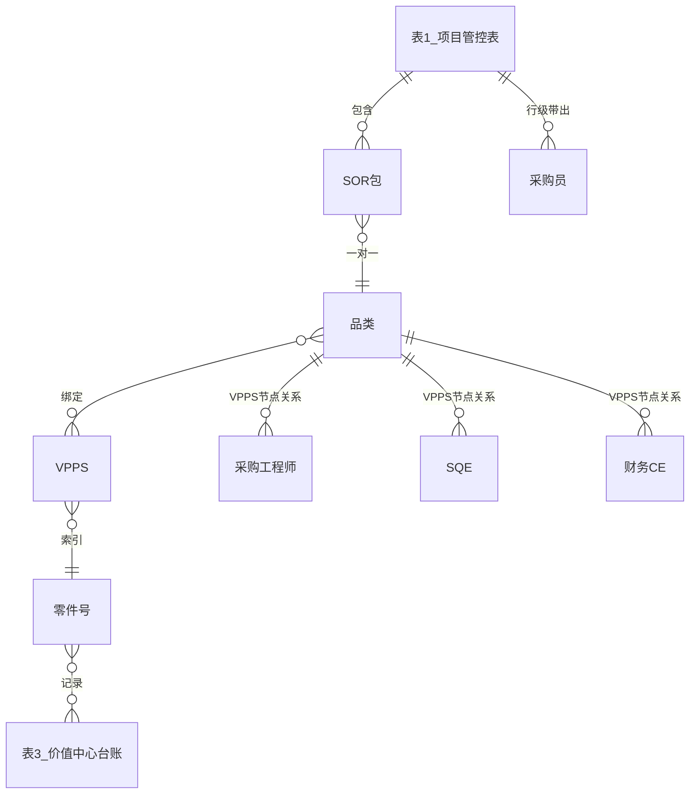

> [!summary] MVPS 品类管理与 VPPS 绑定品类 PRD（视觉版）
> - **核心**：EP 平台品类资源池建设 PRD，建立 VPPS 编码到品类到采购员的基础映射关系
> - **要点**：品类管理 + VPPS 绑定品类 + 变更记录三大模块；含权限矩阵、三表联动关系、任务智能路由、25+ 条验收标准
> - **关联**：[[MVPS品类管理与VPPS绑定品类-PRD]] · [[VPPS应用需求]] · [[MVPS资料索引]]

# EP-2026XXXX-MVPS品类管理与VPPS绑定品类-PRD（视觉版）

> **需求优先级**：P0
> **需求状态**：方案确认中，待开发评审
> **涉及模块**：品类管理、VPPS绑定品类、变更记录
> **参考原型**：VPPS绑定品类页面（见下方视觉参考）
> **说明**：本文基于BRD、现有PRD及视觉参考截图整理，补充了界面布局、字段样式与交互细节。未确认内容仍标注为“待确认”。

---

# 一、文档信息

|项目|内容|
|---|---|
|需求名称|MVPS品类管理与VPPS绑定品类|
|需求编号|EP-2026XXXX-MVPS品类管理与VPPS绑定品类-PRD|
|优先级|P0|
|需求状态|方案确认中，待开发评审|
|编写日期|2026-07-13|
|关联文档|00_VPPS应用需求.md（BRD）|
|涉及系统|EP采购平台 — 主数据管理模块|

---

# 二、需求概览

|序号|需求|优先级|上线情况|
|---|---|---|---|
|1|品类基础数据管理|P0|待上线|
|2|VPPS绑定品类|P0|待上线|
|3|变更记录|P0|待上线|

---

# 三、业务背景

随着 EP 业务规模持续扩张，系统建设目标正在从“流程工具”向“供应链管控体系”升级。2026 年下半年 EP 平台建设采用“双轨协同”思路：

- **主线一：数据资产沉淀** —— 统筹建设品类、供应商、成本三维核心数据仓库，完成全域非结构化业务信息的标准化、资产化治理；
- **主线二：AI赋能功能板块** —— 为 EP 全业务单元配置 AI 决策引擎，构建自主运转的自动化业务体系。

本需求属于“数据资产沉淀”主线中的**品类资源池建设**。当前采购业务仍大量以零件 PN 或单据维度流转，采购品类体系尚未与研发 MVPS 数据打通，导致 SOR、EWO、CWO、SWO、样件、框架等任务在下发和分工时缺少稳定的品类与人员映射基座。

通过将 MVPS 引入 EP 品类管理链路，建立“**VPPS 编码 → 品类 → 品类专家 / 采购员**”的基础映射关系，为后续品类库、成本库、任务中台以及任务自动下发能力提供数据基础。

---

# 四、业务痛点

|痛点|具体表现|业务影响|
|---|---|---|
|品类主数据缺失|采购品类体系未与研发 MVPS 打通，线上仍以零件 PN 或单据维度处理，缺少聚合品类概念|需求规划、供应商治理、数字化和跨部门协同缺少统一口径|
|缺乏资源池基座|未按品类建立供应商资源池，无法支撑战略、杠杆、瓶颈、常规等差异化采购策略|采购策略制定缺乏数据支撑，供应商选择依赖经验判断|
|人员映射依赖人工|SOR 发包、EWO 设变、框架协议等场景需要人工匹配采购员并下发任务|年度任务分配量大，流程冗长低效，存在物料错配风险|
|人员变动响应慢|采购员离职或调岗时，需要人工排查并转移其负责的所有单据|操作效率低、易遗漏，影响业务连续性|
|VPPS 与品类关系缺口|上游新增结构编码后，EP 缺少标准化待绑定、无需绑定、撤回和解绑机制|后续任务自动下发、品类统计、台账追溯无法稳定依赖 VPPS 关系|

---

# 五、业务目标

|目标|说明|
|---|---|
|建立品类资源池底座|在 EP 中统一维护品类清单、专业组、材料品类、工艺品类、品类描述、品类专家等基础信息|
|打通 MVPS 与采购品类映射|通过 VPPS 绑定品类，建立“结构编码 / 位置码 → VPPS → 品类”的基础关系|
|支撑任务自动下发|为后续 SOR、EWO、CWO、SWO、样件、框架等任务按“VPPS → 品类 → 采购员”索引下发提供数据基础|
|降低人工匹配成本|减少人工识别品类、匹配采购员、手动下发任务的操作成本和错配风险|
|支持品类生命周期管理|支持新增、编辑、转派、冻结、解绑等品类管理动作，保证历史业务可追溯|
|明确权限边界|区分品类管理员、当前品类专家、ADMIN、普通用户等角色能力|
|支持误绑定纠正|已绑定错误的 VPPS 可在品类管理页面解绑，解绑后恢复为待绑定|
|保证关键操作可追溯|转派、冻结、绑定、解绑、无需绑定、撤回等操作写入变更记录|

---

# 六、术语说明

|术语|说明|
|---|---|
|MVPS|研发物料零件系统，通过数字体系定义系统、子系统及零件在整车中的位置及分级标准|
|VPPS|上游同步的编码数据对象，具体全称待确认；本文指需要进行品类绑定判断的数据。一个VPPS编码由“结构编码 + 位置码”组合生成|
|MiBOM / 总基线|VPPS 数据来源，具体同步逻辑和字段来源待开发确认|
|品类管理员|可新增品类的角色|
|品类专家|负责具体品类维护和业务承接的角色|
|当前品类专家|当前品类的负责人，仅能维护自己负责范围内的数据|
|ADMIN|管理员角色，默认具备品类管理员新增权限，可操作全部生效品类|
|生效品类|可被维护、可被 VPPS 绑定的品类|
|已冻结品类|不可继续用于 VPPS 绑定和常规维护的品类；冻结后仅支持解绑已绑定 VPPS，其余操作不可用|
|待绑定|VPPS 尚未绑定品类，也未被标记为无需绑定|
|已绑定|VPPS 已绑定到某个生效品类|
|无需绑定|VPPS 被判断为不需要绑定品类|

---

# 七、功能说明

## 7.1 功能范围

|模块|功能范围|
|---|---|
|品类管理|品类查询、新增、编辑、转派、冻结、批量导入、导出、变更记录、已绑定 VPPS 展示与解绑|
|VPPS绑定品类|查询 VPPS、绑定品类、标记无需绑定、撤回无需绑定、导出|
|变更记录|品类字段变更、人员变更、VPPS 关系变更、绑定/解绑/无需绑定等操作追溯|

---

## 7.2 权限设计

### 品类管理权限矩阵

|功能|品类管理员|当前品类专家|ADMIN|普通采购员|
|---|---|---|---|---|
|查看品类列表|✅ 是|✅ 是，仅查询自己名下的数据|✅ 是|✅ 是，仅查询自己名下的数据|
|新增品类|✅ 是|❌ 否|✅ 是|❌ 否|
|编辑材料品类|✅ 是|✅ 是|✅ 是|❌ 否|
|编辑工艺品类|✅ 是|✅ 是|✅ 是|❌ 否|
|编辑品类描述|✅ 是|✅ 是|✅ 是|❌ 否|
|修改专业组|✅ 是|❌ 否|✅ 是|❌ 否|
|转派品类|✅ 是|✅ 是|✅ 是|❌ 否|
|冻结品类|✅ 是|✅ 是|✅ 是|❌ 否|
|解绑/绑定 VPPS|✅ 是|✅ 是|✅ 是|❌ 否|
|查看变更记录|✅ 是|✅ 是|✅ 是|❌ 否|

### VPPS绑定品类权限矩阵

> **说明：VPPS绑定品类页面不提供已绑定解绑能力。解绑需在品类管理页面操作。**

|功能|ADMIN|品类管理员|普通采购员|
|---|---|---|---|
|查看 VPPS 绑定列表|✅ 是|✅ 是|❌ 否|
|绑定到自己负责的品类|✅ 是|✅ 是|❌ 否|
|绑定到他人负责的品类|✅ 是|✅ 是|❌ 否|
|标记无需绑定|✅ 是|✅ 是|❌ 否|
|撤回无需绑定|✅ 是|✅ 是|❌ 否|
|已绑定解绑|❌ 否|❌ 否|❌ 否|

---

## 7.3 品类管理（P0）

### 页面职责

品类管理页面用于维护品类主数据，包含：

- 查询品类；
- 新增品类；
- 编辑品类属性；
- 维护品类专家、SQE、默认采购工程师；
- 维护品类与 VPPS 关系；
- 转派品类；
- 冻结品类；
- 查看品类变更记录；
- 查看并解绑当前品类下已绑定 VPPS。

### 查询条件

|页面|查询字段|控件类型|说明|
|---|---|---|---|
|品类管理|品类编码|搜索输入框|支持按品类编码查询|
||品类名称|输入框|支持按品类名称查询|
||VPPS节点|支持搜索，选择器|支持多选，支持按VPPS查询，示例：10.01.01|
||品类专家|搜索器|按姓名搜索|
||SQE主管|搜索器|按姓名搜索|
||采购工程师|搜索器|按姓名搜索|
||专业组|下拉框|支持按专业组筛选|

### 列表字段

|字段|说明|
|---|---|
|品类编码|系统生成，发布后不可修改|
|品类名称|品类名称|
|品类专家|显示名称，新建品类时选择的名字|
|品类状态|生效 / 已冻结|
|专业组|单选|
|材料品类|支持多选|
|工艺品类|支持多选|
|定点供应商|展示该品类下定点供应商，期初导入|
|品类描述/说明|展示品类适用范围或维护说明|
|操作|编辑、变更记录|

### 操作按钮

|按钮|说明|
|---|---|
|批量导入|导入品类数据，admin与品类管理员可见并操作|
|导出|导出当前列表数据，admin与品类管理员可见并操作|
|转派|对选中品类执行转派，admin与品类管理员可见并操作，转派后品类专家字段变更。被转派后的品类专家可编辑此品类|
|冻结|1. 对选中品类执行冻结，校验：需先把此品类关联的VPPS解绑之后才能冻结成功！<br>2. 功能点，admin与品类管理员可见并操作|
|新增品类|1. 打开新增品类弹窗<br>2. 功能点，admin与品类管理员可见并操作|

### 新增品类（P0）

#### 新增字段

> **业务规则**：仅品类管理员可新增品类。新增品类保存即发布，无草稿态。

|字段|必填|控件|说明|
|---|---|---|---|
|品类编码|是|只读|1. 系统自动生成，发布后不可删除<br>2. 生成规则：CAT-五位流水号|
|品类名称|是|输入框|必填，用户填写，需要校验名称是否重复，如有重复给予提示，已有重复的品类名称，请勿重复录入|
|专业组|是|下拉框|单选，必选；系统配置字典|
|品类描述/说明|否|输入框|非必填，说明品类适用范围或维护说明|
|材料品类|是|多选搜索|非必填，支持搜索多选|
|工艺品类|是|多选搜索|非必填，支持搜索多选|
|品类专家|是|支持搜索|单选，支持搜索，需要有品类专家的角色|

#### 操作按钮

|按钮|说明|
|---|---|
|取消|关闭当前弹窗|
|发布|1. 点击发布，二次弹窗，提示：新增品类保存后将立即发布为生效状态，品类编码发布后不可修改，请确认信息无误。<br>2. 发布之后，品类状态为生效<br>3. 发布之后，写入变更记录|

### 编辑品类（P0）

可编辑字段发生变化时需要写入变更记录。

|信息组|字段|规则|
|---|---|---|---
|基础信息|品类编码|只读，不可修改|
|基础信息|品类名称|必填，可修改|
|品类属性|品类状态|只读，不可修改|
|品类属性|专业组|必填，可修改|
|品类属性|材料品类|非必填，可修改，当前品类专家 / ADMIN 可编辑|
|品类属性|工艺品类|非必填，可修改，当前品类专家 / ADMIN 可编辑|
|品类属性|品类描述/说明|非必填，可修改，当前品类专家 / ADMIN 可编辑|
|人员关系|品类专家|置灰，不可修改|
|VPPS关系|VPPS节点 - 采购工程师关系|不强制关联VPPS，可修改，当前品类专家 / 品类管理员 / ADMIN 可维护，可选择的人员角色：buyer，只支持绑定一个采购工程师|
|VPPS关系|VPPS节点 - SQE工程师|SQE工程师，可选择的人员角色：sqeEng，只支持绑定一个SQE工程师|
|VPPS关系|VPPS节点 - 财务CE|不强制关联VPPS，可修改，只支持绑定一个财务CE，当前品类专家 / Admin 可维护，可选择的人员角色：financeCe|

### VPPS节点解绑与绑定

1. **功能背景**：已绑定的 VPPS 如果绑定错误，可以在品类管理页面解绑。
   - VPPS绑定品类页面不支持解绑；
   - 品类管理页面需要提供解绑入口；
   - 解绑是在品类视角下处理当前品类已绑定的 VPPS；
   - 解绑后 VPPS 状态恢复为待绑定。

2. **入口**：品类管理 > 进入某品类详情 / 编辑页 > 已绑定 VPPS 列表 > 解绑

3. **已绑定 VPPS 展示字段**

|字段|说明|
|---|---|
|VPPS编码|VPPS 编码|
|结构编码|上游同步字段，来源待开发确认|
|结构简码|上游同步字段，来源待开发确认|
|位置码|上游同步字段，来源待开发确认|
|中文描述|上游同步字段，来源待开发确认|
|英文描述|上游同步字段，来源待开发确认|
|编码状态|上游同步字段，来源待开发确认|
|编码生效日期|上游同步字段，来源待开发确认|
|编码失效日期|上游同步字段，来源待开发确认|
|绑定时间|VPPS 绑定到当前品类的时间|
|操作|解绑|

4. **解绑规则**

|规则项|规则说明|
|---|---|
|操作入口|品类管理页面|
|操作对象|当前品类下已绑定 VPPS|
|操作权限|当前品类专家 / ADMIN|
|操作后状态|VPPS 状态恢复为待绑定|
|绑定品类展示|解绑后不再展示绑定品类|
|是否需要原因|不需要|
|是否记录变更|是|
|是否影响下游业务|当前 VPPS 下游业务尚未使用，本期允许解绑；后续下游使用后需重新评估限制规则|

5. **页面提示**

点击解绑时提示：

> 解绑后该 VPPS 将恢复为待绑定状态，请确认。

解绑无需填写原因。

### 品类转派（P0）

**入口**：品类管理列表 > 选择品类 > 点击“转派”

|字段|必填|说明|
|---|---|---|
|当前品类|系统展示|展示品类编码和名称，当前品类专家 / ADMIN 可操作|
|当前品类专家|系统展示|展示当前品类专家|
|转派至|是|选择新的品类专家，必须有品类专家的角色|
|转派原因|否|如组织调整 / 人员调岗|
|是否写入变更记录|是||

### 冻结品类（P0）

**入口**：品类管理列表 > 选择品类 > 点击“冻结”

**约束**：已冻结品类不可在 VPPS绑定品类页面被选择用于新的绑定。

|规则项|规则说明|
|---|---|
|冻结|点击之后给予提示：冻结之后品类不可恢复，谨慎操作！|
|操作权限|当前品类专家 / ADMIN|
|操作对象|生效状态品类|
|操作后状态|已冻结<br>1. 已冻结品类不可在 VPPS绑定品类页面被选择用于新的绑定。<br>2. 该品类不可继续绑定 VPPS，转派或执行其他常规维护，仅支持解绑已绑定 VPPS。|
|是否可继续绑定 VPPS|否|
|是否影响历史业务|历史业务保留；冻结后仅支持解绑已绑定 VPPS，其余操作不可用|
|是否写入变更记录|是|

---

## 7.4 VPPS绑定品类（P0）

### 页面职责

VPPS绑定品类页面用于处理 MiBOM / 总基线增量同步下来的 VPPS 数据。

页面主要支持：

|支持|不支持|备注|
|---|---|---|
|1. 查询 VPPS；<br>2. 查看 VPPS 绑定状态；<br>3. 将待绑定 VPPS 绑定到生效品类；<br>4. 将待绑定 VPPS 标记为无需绑定；<br>5. 对无需绑定 VPPS 进行撤回；<br>6. 导出 VPPS 绑定数据。|1. 已绑定 VPPS 的解绑；<br>2. 已绑定 VPPS 的改绑；<br>3. 冻结品类的绑定；<br>4. 品类基础信息编辑。|如 VPPS 绑定错误，需进入品类管理页面，在对应品类下对已绑定 VPPS 执行解绑。|

### 视觉参考

> 以下为 VPPS绑定品类 页面参考效果图，布局和样式以该图为基准进行开发实现。


### 页面布局与样式说明

|区域|元素|说明|
|---|---|---|
|顶部导航|小米汽车 Logo + 主导航栏|沿用现有 EP 平台顶部导航：首页、供应商管理、采购项目管理、采购任务管理、RFQ询报价管理、采购定点与台账、主数据管理|
|面包屑|主数据管理 / VPPS绑定品类|标明当前所在模块及页面|
|子模块Tab|品类管理、VPPS绑定品类、Part Planning管理|当前选中“VPPS绑定品类”，下划线高亮样式|
|筛选区|绑定状态、VPPS编码、结构编码|横向排列，标签右对齐；绑定状态为下拉选择框，默认“全部”|
|操作按钮|查询、重置、导出|查询按钮为主色（蓝色），重置按钮为灰色线框；导出按钮位于右侧|
|提示信息|“MIBOM 每下发一个 VPPS 即生成一条待处理绑定数据”|位于筛选区下方，左侧带蓝色提示图标|
|数据表格|VPPS绑定列表|表头为浅灰色背景，行白底交替；状态列使用彩色标签（待绑定-橙色、已绑定-绿色、失效-红色）|
|分页|共 X 条 + 页码切换|位于表格右下角，当前页码高亮显示|

### 查询条件

|查询字段|控件类型|说明|默认值|
|---|---|---|---|
|绑定状态|下拉框|全部 / 待绑定 / 已绑定 / 无需绑定|全部|
|VPPS编码|输入框|支持按 VPPS 编码查询|空|
|结构编码|输入框|支持按结构编码查询|空|
|中文描述|输入框|模糊查询|空|
|状态|下拉框|单选|空|
|编码状态|下拉框|单选：生效 / 失效|空|

### 列表字段

|字段|说明|视觉样式|
|---|---|---|
|序号|列表序号|居左，纯文本|
|绑定状态|待绑定 / 已绑定 / 无需绑定|彩色标签：待绑定-橙色边框橙色文字；已绑定-绿色边框绿色文字；无需绑定-灰色边框灰色文字|
|VPPS编码|上游同步字段，如 10.11.01|蓝色文本，可点击跳转详情（待确认）|
|结构编码|上游同步字段，如 STR-MBOM-1001|纯文本|
|结构简码|上游同步字段，如 FRT-BPR|纯文本|
|位置码|上游同步字段，如 FR-L|纯文本|
|中文描述|上游同步字段，如“前保险杠左侧安装结构”|纯文本|
|英文描述|上游同步字段，如“Front bumper LH mounting structure”|纯文本|
|创建人|当前原型展示为 MiBOM|纯文本|
|编码状态|生效 / 失效|彩色标签：生效-绿色；失效-红色|
|编码生效日期|上游同步字段，如 2026-06-20|纯文本|
|编码失效日期|上游同步字段，如 2026-06-28|纯文本，未失效展示为“-”|
|绑定品类|展示已绑定品类名称|纯文本，未绑定展示为“-”|
|操作|绑定 / 标记无需绑定 / 撤回|操作按钮，已绑定状态无操作入口|

### 列表排序规则

1. 绑定状态 = 待绑定 的数据排在最上方；
2. 待绑定数据内部按编码生效日期倒序排列；
3. 已绑定数据排在待绑定之后；
4. 绑定状态 = 无需绑定 的数据排在最后；
5. 非待绑定数据内部同样按编码生效日期倒序排列；
6. 同状态且编码生效日期相同的，按 VPPS 编码升序排列。

### 操作规则

> **业务规则**：VPPS 绑定品类时，品类专家仅可选择自己负责且状态为“生效”的品类进行绑定；ADMIN 可操作全部生效品类。编码状态为“失效”的 VPPS 不允许发起新绑定；若编码状态变为失效前已完成绑定，系统不自动解绑、不自动变更绑定关系。

|当前状态|可操作|操作后状态|操作入口|
|---|---|---|---|
|待绑定|绑定品类|已绑定|VPPS绑定品类页面|
|待绑定|标记无需绑定|无需绑定|VPPS绑定品类页面|
|无需绑定|撤回|待绑定|VPPS绑定品类页面|
|已绑定|解绑|待绑定|品类管理页面|

### 绑定品类规则

|规则项|规则说明|
|---|---|
|操作入口|VPPS绑定品类页面|
|操作对象|绑定状态为待绑定的 VPPS|
|可选品类|状态为生效的品类|
|当前品类管理员|可操作|
|ADMIN|可操作全部生效品类|
|操作后状态|已绑定|
|是否写入变更记录|是|

### 标记无需绑定规则

|规则项|规则说明|
|---|---|
|操作入口|VPPS绑定品类页面|
|操作对象|绑定状态为待绑定的 VPPS|
|操作人|品类管理员 / ADMIN|
|是否需要填写原因|不需要|
|操作后状态|无需绑定|
|是否写入变更记录|是|

### 撤回无需绑定规则

|规则项|规则说明|
|---|---|
|操作入口|VPPS绑定品类页面|
|操作对象|绑定状态为无需绑定的 VPPS|
|操作人|当前品类专家 / 品类管理员 / ADMIN|
|操作后状态|待绑定|
|是否写入变更记录|是|

---

## 7.5 变更记录（P0）

变更记录用于追踪品类、人员、VPPS 关系、绑定状态等关键变化。

### 需要记录的操作类型

|操作|是否记录|
|---|---|
|新增品类|建议记录|
|编辑材料品类|是|
|编辑工艺品类|是|
|编辑品类描述|是|
|编辑品类专家|是|
|编辑 SQE主管|是|
|编辑默认采购工程师|是|
|编辑 VPPS节点 - 采购工程师-财务CE关系|是|
|转派品类|是|
|冻结品类|是|
|VPPS绑定品类|是|
|品类管理页解绑 VPPS|是|
|上游同步编码状态变化|不记录|

### 列表字段

|字段|说明|
|---|---|
|品类编码|关联品类|
|全部字段|单选：首次打开默认全部<br>可选：品类专家、SQE主管、采购工程师、VPPS节点/采购工程师/财务CE、材料品类、工艺品类、品类描述、品类状态、品类转派|
|全部时间|单选：首次打开默认全部<br>可选：近3个月、近6个月、近1年|
|VPPS编码|涉及 VPPS 时记录|
|操作对象|品类 / VPPS / 人员关系|
|操作类型|新增、编辑、转派、冻结、绑定、解绑等|
|变更字段|如SQE、材料品类、工艺品类、VPPS关系、绑定状态等|
|变更前值|变更前内容|
|变更后值|变更后内容|
|操作人|当前登录用户|
|操作时间|系统记录，年月日时分秒|
|来源|手动编辑 / 批量导入 / 上游同步|

---

# 八、三张表联动关系与字段级映射

> 本章基于 BRD《VPPS应用需求》的"业务底层三张数据库"与"三张表联动关系"，补充品类资源池（表2）与项目管控表（表1）、价值中心台账（表3）之间的字段级联动规则。这些联动是"VPPS → 品类 → 采购员"任务自动下发能力的底座，需在本期一并设计，否则下游自动下发无法稳定依赖。

## 8.1 三张核心数据库定位

|编号|数据表|定位|与品类 / VPPS 的关系|
|---|---|---|---|
|表1|项目管控表|车型 → 项目编号（车型项目 + 工厂）→ SOR 包进度|分包选品类，自动带出采购员 / SQE；是"品类 + 车型 → 采购员"的索引源|
|表2|品类资源池（底表）|品类主数据 + VPPS 绑定清单 + 品类 - 人员关系|本 PRD 核心；所有品类和 VPPS 绑定关系的唯一来源（底表）|
|表3|价值中心台账|零件号 + VPPS + 规则方案 + 零件履历|台账的"品类 / VPPS"来自定点任务的 VPPS；零件履历跨项目 / 工厂 / 供应商抓取|

## 8.2 表2 品类资源池 ↔ VPPS 绑定关系（底表约束）

- VPPS编码 = 结构编码 + 位置码（由上游 MiBOM / 总基线同步下发）；结构编码 + 位置码定位到"零件品类"，+ 使用规则定位到"配置"。
- 一个 VPPS 只能绑定一个生效品类；品类是底表，VPPS 绑定品类时只能从表2 已存在的生效品类中选择（外键约束）。
- 已绑定 / 已解绑的 VPPS 状态流转见第七章；解绑后 VPPS 回到"待绑定"，可被重新绑定。
- 上游新增结构编码 → 推送 EP 生成"待绑定"VPPS → 飞书通知品类专家（见 BRD 品类资源池"新增待绑定"节点）。

## 8.3 表1 ↔ 表2 联动：项目分包选品类自动带出人员

|联动点|规则|
|---|---|
|分包选品类|项目分包（表1）选择品类时，采购员默认带出表2该品类对应的采购专家；若分包时手动填写采购员，则以手动填写为准（优先级：手动填写 > 表2默认带出）|
|SOR审批到项目经理|项目经理不再填写采购员 & SQE & 定点时间，改为"选择品类"，系统自动带出采购员 & SQE（来自表2）|
|品类外键|项目分包所选品类必须在表2品类清单中；不在清单中的品类不允许选择|
|一个SOR一对一品类|业务规则：一个 SOR 对应一个品类；一个品类可关联多个 SOR 包（一对多）|
|采购员冲突|一个 SOR 可跨多个项目，若多个项目同一品类对应不同采购员，以"项目进度表（表1）行级采购员"为准（见 8.5 下发链路）|

## 8.4 表3 ↔ VPPS / 品类 联动：台账字段补全

|联动点|规则|
|---|---|
|零件号新增字段|零件号基本信息新增 VPPS（结构简码 + 位置码）、规则方案|
|零件履历页|零件详情新增"零件履历"，按 项目 + 位置码 + 规则方案 + 工厂 + 供应商 抓取 关联零件号、关联 EWO、价格、拉动数量|
|台账品类 / VPPS来源|台账的"品类""VPPS编码"来自定点任务的 VPPS 编码（经表2索引品类）|
|静态不更新规则|变更 VPPS 的 EWO 采购未处理时，零件台账 VPPS 保持"上一版本定点"的 VPPS 编码不更新；历史定点的 EWO 任务 VPPS 不更新（静态过去式数据，不回写）|

## 8.5 下发任务链路：零件号 → VPPS → 品类 → 采购员

> 核心链路：任务零件 → 索引 VPPS → VPPS 索引品类（表2）→ 品类 + 任务车型 索引采购（表1）→ 任务直接下发。

|任务类型|是否自动下发|说明|
|---|---|---|
|EWO / SWO / CWO|是|用零件号背后的 VPPS，索引表2找品类，结合项目编码索引表1找采购员|
|框架任务|是（受限）|无车型字段，需补充项目编码或用其它索引方式，否则人工|
|样件任务|是（受限）|无车型字段，同上|
|紧固件、胶水|否|未进 EBOM，索引不到 VPPS，保留 PM / 样件专员 / 路梦瑶 手工下发|
|面料|否|不进 BOM，索引不到 VPPS，手工下发|
|无 VPPS 的零件|否|人工下发任务|

## 8.6 EWO 改前参考件号智能关联

- 触发：EWO 任务下发后，根据"改后零件"的 VPPS + 项目编码 去台账（表3）中找到已定点的零件号，回写为"改前参考件号"。
- 要求：支持批量关联能力（一次 EWO 可关联多个参考件号）。
- 关系式：改后零件（VPPS + 项目）→ 台账（已定点零件号）→ 参考件号回填 EWO。

## 8.7 字段级映射矩阵（BRD 三张表联动关系）

|影响菜单 & 功能|增加字段|备注|
|---|---|---|
|SOR1管理（量产 & 售后）、SOR定点任务（量产 & 售后）、BDL预选|"品类"|一个 SOR 一对一品类|
|设计价格变更、颜色件变更、SWO任务、样件任务、框架任务|"VPPS编码"（= 结构简码 + 位置码）|EP 优先取 EBOM 索引，次选零件信息库查|
|台账|"品类""VPPS编码"|来自定点任务的 VPPS 编码；变更 VPPS 的 EWO 采购未处理，零件台账 VPPS 保持上一版本定点的 VPPS 编码不更新；历史定点的 EWO 任务 VPPS 不更新（静态过去式）|
|EWO参考件号|改前参考件号|根据改后零件 VPPS + 项目编码查台账已定点零件号回填|
|下发任务|任务零件索引 VPPS → 品类 → 采购|特殊场景：紧固件 / 胶水未进 EBOM、面料索引不到 VPPS，仍人工下发；样件 / 框架无车型字段|
|转派|—|应以"项目 + VPPS"维度管理分工；人员变更 / 离职需同时操作表2与表1转派|

## 8.8 联动关系图（参考）

> 下图示意三表与 VPPS 的关系，可视化原型见 `prototypes/vpps-binding-prototype.html` 的"联动关系"模块。



## 8.9 转派双表联动（重要）

- 现有"一键转派"应被替代：以 **项目 + VPPS** 维度管理所有任务分工（而非散落多人名下）。
- 人员变更 / 离职时，必须**同时**操作：
  1. 品类资源池（表2）：转派品类专家 / 采购工程师；
  2. 项目进度表（表1）：转派项目行级采购员；
- 两者合并后，才能正确索引到"车型项目层面下 VPPS 的采购工程师"。仅操作其一会导致下发错配。

---

# 九、数据模型概要

## 8.1 品类基础数据

|字段|类型|必填|说明|
|---|---|---|---|
|品类编码|VARCHAR|是|系统生成，发布后不可修改|
|品类名称|VARCHAR|是|用户填写；当前品类专家 / ADMIN 可编辑|
|品类状态|VARCHAR|是|生效 / 已冻结|
|专业组|VARCHAR|是|单选，不允许修改|
|材料品类|VARCHAR / JSON|是|支持多选|
|工艺品类|VARCHAR / JSON|是|支持多选|
|品类描述|VARCHAR|否|品类适用范围或维护说明|
|品类专家|VARCHAR|是|默认取新增人|
|SQE主管|VARCHAR|否|字段来源待确认|
|默认采购工程师|VARCHAR|否|用于新增 VPPS 关系时默认带出|
|创建人|VARCHAR|是|系统记录|
|创建时间|DATETIME|是|系统记录|
|更新人|VARCHAR|否|系统记录|
|更新时间|DATETIME|否|系统记录|

## 8.2 绑定数据

|字段|类型|必填|说明|
|---|---|---|---|
|VPPS编码|VARCHAR|是|上游同步|
|结构编码|VARCHAR|否|上游同步，来源待确认|
|结构简码|VARCHAR|否|上游同步，来源待确认|
|位置码|VARCHAR|否|上游同步，来源待确认|
|中文描述|VARCHAR|否|上游同步，来源待确认|
|英文描述|VARCHAR|否|上游同步，来源待确认|
|创建人|VARCHAR|是|当前原型展示为 MiBOM|
|编码状态|VARCHAR|是|生效 / 失效；失效编码不可新绑定，已绑定数据系统不做自动处理|
|编码生效日期|DATE|否|来源待确认|
|编码失效日期|DATE|否|来源待确认|
|绑定状态|VARCHAR|是|待绑定 / 已绑定 / 无需绑定|
|绑定品类编码|VARCHAR|否|已绑定时有值|
|绑定时间|DATETIME|否|绑定时记录|
|绑定人|VARCHAR|否|绑定时记录|

## 8.3 品类 - VPPS - 采购工程师关系

|字段|类型|必填|说明|
|---|---|---|---|
|品类编码|VARCHAR|是|关联品类|
|VPPS节点|VARCHAR|是|VPPS 节点|
|采购工程师|VARCHAR|是|该 VPPS 节点对应采购工程师|
|创建人|VARCHAR|是|系统记录|
|创建时间|DATETIME|是|系统记录|
|更新人|VARCHAR|否|系统记录|
|更新时间|DATETIME|否|系统记录|

## 8.4 变更记录

|字段|类型|必填|说明|
|---|---|---|---|
|记录ID|VARCHAR|是|系统生成|
|品类编码|VARCHAR|否|涉及品类时记录|
|VPPS编码|VARCHAR|否|涉及 VPPS 时记录|
|操作类型|VARCHAR|是|新增、编辑、转派、冻结、绑定、解绑等|
|变更字段|VARCHAR|否|如材料品类、绑定状态等|
|变更前值|TEXT|否|变更前内容|
|变更后值|TEXT|否|变更后内容|
|操作人|VARCHAR|是|当前登录用户|
|操作时间|DATETIME|是|系统记录|
|变更原因|VARCHAR|否|转派、解绑等场景可记录|
|来源|VARCHAR|是|手动编辑 / 批量导入 / 上游同步|

---

# 十、风险与约束

|风险 / 约束|说明|处理建议|
|---|---|---|
|冻结后仅支持解绑 VPPS|已确认冻结后历史业务保留，除解绑已绑定 VPPS 外，其余操作不可用|前后端均需拦截非解绑类操作|
|转派在途业务自动转移不纳入本期|已确认本期不自动转移，放入后续迭代|本期仅保留责任移交确认与变更记录|
|解绑无需填写原因|已确认品类管理页解绑 VPPS 不需要填写原因|解绑弹窗仅做二次确认|
|VPPS 下游业务尚未使用|当前 VPPS 下游业务并未使用，本期允许解绑|后续下游启用后需重新评估限制规则|
|生效/失效日期字段来源未确认|需确认来自哪个上游字段|与开发和上游接口确认|
|存量数据初始化|已确认为初始化导入数据|开发需提供导入模板和校验规则|
|ADMIN 默认具备品类管理员新增权限|已确认 ADMIN 可新增品类|权限矩阵按“是”处理|
|上游同步导致编码状态变化不写入变更记录|已确认不需要记录上游同步编码状态变化|变更记录仅记录用户操作类关键变更|

---

# 十一、剩余待开发确认

|序号|待开发确认项|说明|
|---|---|---|
|1|MiBOM / 总基线同步字段来源与同步频率|PRD 不写具体定时任务时间，需开发确认接口字段和触发机制|
|2|初始化导入模板与校验规则|需明确品类、VPPS、绑定关系三类初始化数据的模板字段、唯一键和失败处理|
|3|冻结品类“仅支持解绑 VPPS”的前后端拦截方式|需确认按钮隐藏、接口校验和错误提示|
|4|编码状态失效后的展示样式|失效 VPPS 不允许新绑定，需确认列表标签、按钮置灰和提示文案|
|5|VPPS编码详情页是否存在|参考截图中VPPS编码为蓝色文本，是否可点击跳转详情需确认|
|6|表格列宽与固定列规则|参考截图中操作列是否固定、横向滚动是否支持需确认|

---

# 十二、验收标准

### AC-1：品类管理员新增品类

Given 当前用户为品类管理员
When 用户在品类管理页面点击“新增品类”并填写必填信息后保存
Then 系统创建品类
And 品类编码由系统自动生成
And 品类状态为生效
And 品类专家默认取新增人
And 不产生草稿数据

### AC-2：非品类管理员不可新增品类

Given 当前用户不是品类管理员
When 用户进入品类管理页面
Then 系统不展示新增品类入口，或点击后提示无权限

### AC-3：当前品类专家编辑自己负责的品类

Given 当前用户为当前品类专家
When 用户编辑材料品类、工艺品类、品类描述或人员关系并保存
Then 系统保存变更
And 系统写入变更记录

### AC-4：其他品类专家不可编辑他人负责的品类

Given 当前用户不是当前品类专家
And 当前用户不是 ADMIN
When 用户尝试编辑该品类
Then 系统不允许保存
And 系统提示无权限

### AC-5：变更需要责任移交确认

Given 用户修改品类专家
When 用户点击保存
Then 系统弹出责任移交确认弹窗
And 用户必须勾选两个确认项
And 两项均勾选后才可提交
And 提交后系统写入变更记录

### AC-6：冻结后不可用于 VPPS 绑定

Given 某品类状态为已冻结
When 用户在 VPPS绑定品类页面选择绑定品类
Then 系统不展示该冻结品类，或不可选择该冻结品类

### AC-7：当前品类专家绑定自己负责的生效品类

Given 当前用户为某生效品类的品类专家
And VPPS 状态为待绑定
When 用户选择该品类并确认绑定
Then VPPS 状态变为已绑定
And 系统展示绑定品类
And 系统写入变更记录

### AC-8：当前品类专家不可绑定他人负责品类

Given 当前用户不是目标品类的当前品类专家
And 当前用户不是 ADMIN
When 用户尝试绑定该品类
Then 系统不允许绑定

### AC-9：ADMIN 可绑定全部生效品类

Given 当前用户为 ADMIN
And VPPS 状态为待绑定
When 用户选择任意生效品类并确认绑定
Then 系统绑定成功
And VPPS 状态变为已绑定

### AC-10：标记无需绑定

Given 当前用户为品类管理员或 ADMIN
And VPPS 状态为待绑定
When 用户点击“无需绑定”
Then 系统无需用户填写原因
And VPPS 状态变为无需绑定
And 系统写入变更记录

### AC-11：撤回无需绑定

Given 当前用户为当前品类专家、品类管理员或 ADMIN
And VPPS 状态为无需绑定
When 用户点击“撤回”
Then VPPS 状态恢复为待绑定
And 系统写入变更记录

### AC-12：品类管理页解绑 VPPS

Given 当前用户为当前品类专家、品类管理员或 ADMIN
And 当前品类下存在已绑定 VPPS
When 用户在品类管理页点击解绑并确认
Then VPPS 状态恢复为待绑定
And VPPS 不再展示绑定品类
And 系统写入变更记录

### AC-13：VPPS绑定品类页面不支持解绑

Given VPPS 状态为已绑定
When 用户进入 VPPS绑定品类页面
Then 系统不展示解绑入口
And 用户不能在该页面执行解绑操作

### AC-14：分包选品类自动带出采购员

Given 项目分包（表1）选择表2中某生效品类
When 系统加载该品类
Then 采购员默认带出表2该品类对应的采购专家
And 若用户手动填写采购员，则以手动填写为准

### AC-15：SOR审批到项目经理时选品类自动带出

Given SOR审批流转至项目经理节点
When 项目经理选择品类（而非填写采购员 / SQE / 定点时间）
Then 系统自动带出采购员与 SQE（来自表2）
And 不允许手动填写采购员 / SQE / 定点时间

### AC-16：VPPS绑定品类受底表约束

Given VPPS绑定品类页面发起绑定
When 用户选择目标品类
Then 仅能选择表2中已存在的生效品类
And 已冻结品类不在可选列表

### AC-17：下发任务按 VPPS → 品类 → 采购员 索引

Given 某 EWO 任务零件号背后有 VPPS 且已绑定品类
When 系统下发任务
Then 经 VPPS 索引表2品类，结合项目编码索引表1采购员，任务直接下发

### AC-18：特殊场景人工下发

Given 零件为紧固件 / 胶水 / 面料 或 无 VPPS
When 系统尝试自动下发
Then 系统不自动下发，保留人工下发入口（PM / 样件专员 / 路梦瑶）

### AC-19：台账 VPPS 静态不更新

Given 某零件台账已记录定点 VPPS
When 后续变更 VPPS 的 EWO 采购未处理
Then 零件台账 VPPS 保持上一版本定点的 VPPS 编码不更新

### AC-20：EWO 改前参考件号回填

Given EWO 任务下发，改后零件有 VPPS + 项目编码
When 系统查台账已定点零件号
Then 回填"改前参考件号"，并支持批量关联

### AC-21：转派双表联动

Given 某采购员离职 / 调岗
When 执行转派
Then 系统提示需同时转派表2（品类资源池）与表1（项目进度表）
And 仅完成其一不允许关闭转派流程

### AC-22：GCM / SQE / 采购工程师三级人员树可配置

Given 主数据管理员进入人员树配置页面
When 维护 GCM、SQE、采购工程师三级关系并保存
Then 系统校验同一 VPPS 节点下采购工程师唯一
And 数据结构与 SRM 人员主数据直连，支持按工号同步姓名 / 部门 / 状态
And 变更写入变更记录

### AC-23：采购品类 → MVPS → 合格供应商三级映射可在线配置

Given 主数据管理员进入三级映射配置页面
When 选择品类、绑定 MVPS / VPPS 节点、关联合格供应商后保存
Then 系统生成一条映射记录，支持版本追溯
And 同一品类 + 同一 VPPS 节点 + 同一供应商不可重复
And 支持 Excel 批量导入，导入失败返回具体行错误

### AC-24：三级映射版本可追溯

Given 某条品类-MVPS-供应商映射发生变更
When 用户查看映射历史
Then 系统展示变更时间、变更人、变更前 / 后值
And 历史版本仅可查看，不可编辑

### AC-25：车型 + SOR 在线维护品类归属与负责人

Given 项目经理进入车型 + SOR 项目管控页面
When 为 SOR 包选择品类并保存
Then 系统自动带出表2的采购员 / SQE
And 一个 SOR 只能关联一个品类
And 系统校验所选品类在表2品类清单中

### AC-26：项目进度可视化管控

Given 项目管控表已维护多车型 / 多 SOR 包数据
When 用户进入项目进度可视化页面
Then 系统展示车型 - SOR 包 - 品类 - 负责人 - 定点状态的看板 / 甘特视图
And 支持按车型、工厂、品类专家、定点状态筛选

### AC-27：SOR 任务按品类自动分派

Given 某 SOR 包已关联品类且项目进度表已维护采购员
When SOR 任务进入采购任务管理列表
Then 系统自动将任务分派给对应采购员
And 任务列表显示责任人、计划完成时间、任务状态

### AC-28：BDL / EWO / CWO / SWO / 框架协议任务按品类自动分派

Given 某任务零件号可索引到 VPPS，且 VPPS 已绑定品类，且项目进度表已维护采购员
When BDL / EWO / CWO / SWO / 框架协议任务触发下发
Then 系统按“零件号 → VPPS → 品类 → 项目 + 车型 → 采购员”链路自动分派
And 任务列表显示关联单号、RFQ / EWO 编号、采购工程师、状态

### AC-29：特殊任务场景保留人工下发入口

Given 任务为紧固件 / 胶水 / 面料 / 无 VPPS 零件，或样件 / 框架任务无车型字段
When 系统尝试自动分派
Then 系统不自动分派，保留 PM / 样件专员 / 路梦瑶人工下发入口

### AC-30：一键批量转移任务

Given 用户在任务路由页面选择多条同项目 / 同品类 / 同 VPPS 任务
When 点击“批量转移”并选择目标采购员
Then 系统校验目标采购员有对应品类权限
And 同时更新表1行级采购员与表2 VPPS 节点采购员（或提示需同时完成双表转派）
And 写入变更记录

---

# 十三、采购品类与项目主数据维护

> 本章承接 BRD 与架构全景中“建立采购品类与项目管控主数据体系”的目标，将“分类 → MVPS → 人员”三级自动路由所需的底层主数据维护能力补全到 PRD。包含：人员树配置、采购品类 → MVPS → 合格供应商三级映射、批量导入与版本追溯。

## 13.1 人员树配置（GCM / SQE / 采购工程师）

### 业务目标

通过主数据维护，建立“品类 → VPPS 节点 → 人员”的映射基座，实现任务按品类自动路由到 GCM（采购工程师）、SQE、采购工程师三级角色。数据结构与 SRM 系统人员主数据直连，保证人员信息同源、同态。

### 数据来源与触发

|触发源|说明|频率|
|---|---|---|
|MiBOM / 总基线|新增结构编码时，同步生成待绑定 VPPS 节点|事件触发|
|SRM 系统人员主数据|GCM、SQE、采购工程师工号、姓名、部门、状态、汇报线|定时同步 / 事件触发|
|手工维护|主数据管理员在人员树配置页增删改|实时生效|

### 配置字段

|字段|必填|控件|说明|
|---|---|---|---|
|品类|是|下拉选择|仅允许选择表2中生效品类|
|VPPS 节点|是|下拉选择 / 多选|来自已绑定品类的 VPPS 编码；一个 VPPS 节点可配置三级人员|
|GCM|否|人员搜索器|采购工程师（General Commodity Manager），角色：buyer；一个 VPPS 节点仅支持绑定一个 GCM|
|SQE|否|人员搜索器|质量工程师，角色：sqeEng；一个 VPPS 节点仅支持绑定一个 SQE|
|采购工程师|否|人员搜索器|具体执行采购工程师，角色：buyer；一个 VPPS 节点仅支持绑定一个采购工程师|
|生效日期|是|日期选择|该人员关系生效日期|
|失效日期|否|日期选择|人员关系失效日期；失效后该节点任务不再自动路由到此人|
|数据来源|否|只读|SRM 同步 / 手工维护|

### 业务规则

1. **唯一性**：同一品类 + 同一 VPPS 节点 + 同一角色，同一时间段内只能存在一条生效记录。
2. **SRM 直连**：人员搜索器调用 SRM 人员主数据接口；GCM / SQE / 采购工程师字段存储工号，展示姓名。
3. **变更记录**：人员树的新增、编辑、失效操作写入变更记录。
4. **联动**：人员树配置变更后，项目分包（表1）选品类自动带出的人员随之更新；历史已下发任务不受影响。

### 页面操作

|按钮|说明|权限|
|---|---|---|
|新增人员关系|打开新增弹窗，选择品类、VPPS 节点、角色人员|主数据管理员 / ADMIN|
|批量导入|下载模板，按品类 + VPPS 节点 + 角色人员批量导入|主数据管理员 / ADMIN|
|导出|导出当前人员树全量|主数据管理员 / ADMIN|
|失效|对选中人员关系置失效日期；失效后不可再用于新任务自动路由|主数据管理员 / ADMIN|
|变更记录|查看人员树历史变更|主数据管理员 / ADMIN / 品类管理员|

## 13.2 采购品类 → MVPS → 合格供应商三级映射

### 业务目标

建立“采购品类 → MVPS（VPPS 节点）→ 合格供应商”的在线映射，支撑后续 RFQ 定点、资源池策略、供应商推荐等场景；支持批量导入、版本追溯。

### 映射字段

|字段|必填|控件|说明|
|---|---|---|---|
|品类编码|是|下拉选择|表2生效品类|
|品类名称|否|只读|根据品类编码自动带出|
|MVPS / VPPS 节点|是|下拉选择|该品类下已绑定的 VPPS 编码；可多选或单选|
|合格供应商编码|是|供应商搜索器|来自 SRM 合格供应商主数据|
|合格供应商名称|否|只读|自动带出|
|供应商状态|否|只读|合格 / 潜在 / 冻结|
|生效版本|是|只读|系统自动生成版本号，如 V1、V2|
|生效日期|是|日期选择|该版本生效日期|
|失效日期|否|日期选择|版本失效日期；失效后新任务不再推荐该供应商|
|维护人|否|只读|系统记录|

### 业务规则

1. **唯一性**：同一品类 + 同一 VPPS 节点 + 同一供应商编码，同一时间段内只能存在一条生效版本。
2. **版本追溯**：每次编辑（修改供应商、生效 / 失效日期）生成新版本，旧版本置为历史；历史版本可查看不可编辑。
3. **批量导入**：支持 Excel 批量导入；导入模板字段：品类编码、VPPS 节点、供应商编码、生效日期、失效日期；导入失败返回失败行及原因。
4. **SRM 直连**：供应商编码从 SRM 合格供应商主数据选择；状态与 SRM 同步。
5. **联动**：三级映射生效后，品类详情页的“定点供应商”列表可自动展示；RFQ 定点时可按品类 + VPPS 推荐合格供应商。

### 页面操作

|按钮|说明|权限|
|---|---|---|
|新增映射|新增品类 → MVPS → 供应商映射|主数据管理员 / ADMIN|
|批量导入|按模板批量导入映射关系|主数据管理员 / ADMIN|
|导出|导出当前生效映射|主数据管理员 / ADMIN|
|编辑版本|修改映射，生成新版本|主数据管理员 / ADMIN|
|查看历史|查看该映射的所有历史版本|主数据管理员 / ADMIN / 品类管理员|
|失效|对当前版本置失效日期|主数据管理员 / ADMIN|

---

# 十四、车型项目管控在线化

> 本章将“车型 + SOR 在线维护品类归属与负责人，项目进度可视化管控，替代线下 Excel 人工拉单”的能力补全到 PRD。对应架构全景中的“车型项目管控表”和“项目维度应用”。

## 14.1 车型 + SOR 项目管控表

### 业务目标

将现有项目列表提升为“车型 → 项目编号 → SOR 包”三级结构，支持在线维护每个 SOR 包的品类归属、采购员、SQE、计划定点时间，替代线下 Excel 拉单。

### 列表字段

|字段|说明|来源|
|---|---|---|
|车型项目|车型 + 项目编号（车型项目 + 工厂）|BOM 同源 / 项目主数据|
|涉及工厂|工厂名称|项目主数据|
|项目 M0 时间|项目里程碑时间|项目主数据|
|采购项目经理|项目负责人|项目主数据|
|SOR 包数量|已发包 / 预计包数|系统自动统计|
|定点状态|已定点 / 已发包|系统自动统计|
|基础车型数量|该车型下基础车型数|项目主数据|
|详情|进入项目详情页|操作入口|
|转派采购项目经理|将项目整体转派给新项目经理|操作入口|

### 项目详情页 - 进度管理（重点）

|字段|必填|说明|来源|
|---|---|---|---|
|SOR 编号|系统自动带出|SOR 单据号|SOR 系统|
|SOR 名称|系统自动带出|SOR 名称|SOR 系统|
|品类|是|PM 导入或选择；必须在表2品类清单中|表2品类资源池|
|采购员|是|默认带出表2该品类对应的采购工程师；可手动覆盖|表2 / 手工|
|采购组|否|采购组织分组|手工 / 系统默认|
|DRE|系统自动带出|设计负责人|研发系统|
|SQE|是|默认带出表2该品类对应 SQE；可手动覆盖|表2 / 手工|
|开发策略|可选|战略 / 杠杆 / 瓶颈 / 常规|手工|
|计划定点时间|是|PM 导入或选择|手工 / SOR 系统|
|定点状态|系统自动带出|已定点 / 未定点|定点流程|
|实际定点时间|系统自动带出|定点流程完成后回写|定点流程|
|定点文档归档|系统自动带出|定点申请单上传后返回数据|定点流程|
|关联 BDL|系统自动带出|BDL 单据号|BDL 流程|
|BDL 评审进度|系统自动带出|BDL 状态|BDL 流程|
|关联 RFQ|系统自动带出|RFQ 单据号|RFQ 流程|
|核价完成进度|系统自动带出|RFQ 状态|RFQ 流程|
|合同签署进度|系统自动带出|合同状态|合同流程|
|操作|转派人员 / 冻结|操作入口|手工|

### 业务规则

1. **一个 SOR 一对一品类**：业务规则要求一个 SOR 只能关联一个品类；一个品类可关联多个 SOR 包（一对多）。
2. **自动带出人员**：SOR 审批到项目经理节点时，项目经理不再填写采购员 / SQE / 定点时间，只需选择品类，系统自动带出表2人员。
3. **手动覆盖**：PM 导入时若手动填写采购员 / SQE，则以手动填写为准（优先级：手动 > 表2默认）。
4. **品类外键约束**：所选品类必须在表2品类清单中；不在清单中不允许保存。
5. **多项目冲突**：一个 SOR 可跨多个项目，若同一品类在不同项目对应不同采购员，以项目进度表行级采购员为准。

## 14.2 项目进度可视化管控

### 可视化维度

|维度|说明|适用场景|
|---|---|---|
|车型看板|按车型聚合展示所有 SOR 包、定点状态、负责人|管理层监控|
|SOR 包进度|甘特 / 列表展示 SOR 包的计划定点时间、实际定点时间、合同签署进度|项目经理跟踪|
|品类维度|按品类聚合展示所有 SOR 包、采购员负载、RFQ 进度|品类专家管理|
|工厂维度|按工厂聚合展示项目分布、多工厂进度|工厂协同|

### 可视化元素

- **状态颜色**：未启动（灰）、进行中（蓝）、已定点（绿）、超期（红）、冻结（橙）。
- **下钻能力**：点击车型 → 项目 → SOR 包 → 品类详情；点击负责人 → 该采购员当前所有任务列表。
- **筛选条件**：车型、工厂、品类、采购员、SQE、定点状态、时间范围。
- **导出**：支持导出当前视图到 Excel / PDF。

### 替代线下 Excel 拉单

- 项目进度表在线化后，原有线下 Excel 项目管控表不再作为正式数据源；系统提供“项目导出”功能供线下汇报使用。
- 线上数据与 BOM、SOR、BDL、RFQ、合同系统打通，自动回写定点状态、实际定点时间、合同签署进度。

---

# 十五、任务智能路由与转移

> 本章将“SOR / BDL / EWO / CWO / SWO / 框架协议任务按品类自动分派，支持一键批量转移”的能力补全到 PRD。对应架构全景中的“任务路由和通知”模块。

## 15.1 自动路由规则

### 核心链路

```
任务零件 → 索引 VPPS（结构编码 + 位置码） → VPPS 索引品类（表2） → 品类 + 项目编码 + 车型 索引采购员（表1） → 任务直接下发
```

### 任务类型路由策略

|任务类型|自动分派|路由说明|
|---|---|---|
|SOR 任务|是|SOR 包已关联品类，按表1行级采购员直接分派；无品类则无法自动分派|
|BDL 任务|是|BDL 关联 SOR 或零件号，按零件号 VPPS → 品类 → 采购员分派|
|EWO 任务|是|改后零件 VPPS 索引品类；若需改前参考件号，先查台账回填|
|CWO 任务|是|同 EWO，按零件号 VPPS → 品类 → 采购员分派|
|SWO 任务|是|同 EWO / CWO，按零件号 VPPS → 品类 → 采购员分派|
|框架协议任务|是（受限）|框架任务通常无车型字段，需补充项目编码或按 SOR 包关联品类；无法索引则人工|
|样件任务|是（受限）|样件任务通常无车型字段，需补充项目编码或按 SOR 包关联品类；无法索引则人工|
|紧固件 / 胶水|否|未进 EBOM，索引不到 VPPS，保留 PM / 样件专员 / 路梦瑶 手工下发|
|面料|否|不进 BOM，索引不到 VPPS，保留人工下发|
|无 VPPS 零件|否|保留人工下发|

### 路由失败处理

1. **无法索引 VPPS**：任务进入“待人工分派”池，通知 PM / 样件专员 / 路梦瑶。
2. **VPPS 未绑定品类**：任务进入“待绑定品类”提醒，通知品类管理员。
3. **表1无对应采购员**：任务进入“待补充负责人”提醒，通知项目经理。
4. **重复任务**：同一 VPPS + 同一项目 + 同一任务类型，系统提示重复并合并或人工确认。

## 15.2 SOR / BDL / EWO / CWO / SWO / 框架协议任务自动分派

### 任务列表字段

|字段|说明|适用任务类型|
|---|---|---|
|序号|列表序号|全部|
|任务类型|SOR / BDL / EWO / CWO / SWO / 框架协议|全部|
|关联单号|SOR 编号 / BDL 编号 / EWO 编号 / RFQ 编号|全部|
|零件号 / 改后零件|零件号；EWO 展示改后零件|EWO / CWO / SWO / BDL|
|VPPS 编码|结构编码 + 位置码|全部|
|中文描述|零件 / VPPS 中文描述|全部|
|车型 / 项目|车型 + 项目编号|全部|
|影响车型 / 工厂|EWO 影响范围|EWO / CWO / SWO|
|品类|自动索引的品类|全部|
|采购工程师|自动分派的目标采购员|全部|
|SQE|自动分派的目标 SQE|全部|
|计划完成时间|任务计划完成时间|全部|
|状态|待处理 / 处理中 / 已完成 / 已驳回|全部|
|操作|下发 / 接收 / 转派 / 更多|全部|

### 任务状态流转

- **待处理**：任务已生成，等待采购员处理。
- **已下发**：系统已按规则自动分派到采购员，或人工点击“下发”。
- **处理中**：采购员已接收并开始处理。
- **已完成**：任务闭环。
- **已驳回**：任务被驳回，回到待处理或人工池。

## 15.3 一键批量转移

### 业务目标

当采购员离职、调岗或负载不均时，支持按“项目 + 品类 + VPPS”维度一键批量转移任务，并同时更新表1（项目进度表）和表2（品类资源池）的人员映射，避免任务散落多人名下。

### 批量转移入口

1. **任务路由页面**：选择多条任务后点击“批量转移”。
2. **人员树配置页面**：选择某采购员，点击“转移全部任务”。
3. **项目进度表**：选择某 SOR 包行，点击“转派人员”。

### 批量转移规则

|规则项|说明|
|---|---|
|选择维度|支持按项目、品类、VPPS 节点、任务类型筛选后全选 / 多选|
|目标人员|必须是有对应品类权限的采购工程师 / SQE；目标人员来自 SRM 人员主数据|
|双表联动|转移时系统提示：需同时更新表1（项目进度表行级采购员）和表2（品类资源池 VPPS 节点采购员）|
|校验|仅完成表1或表2其一，不允许关闭转移流程；系统给出明确提示|
|影响范围|已生成的待处理 / 处理中任务随人员转移；历史已完成任务不转移|
|变更记录|批量转移写入变更记录，记录转移人、转移时间、原人员、目标人员、任务数量|
|通知|转移完成后，通知原人员、目标人员、品类管理员、项目经理|

### 批量转移界面字段

|字段|说明|
|---|---|
|原人员|被转移的采购员 / SQE|
|目标人员|新采购员 / SQE（人员搜索器）|
|转移范围|项目 + 品类 + VPPS 节点 + 任务类型多选|
|任务数量|根据筛选条件实时计算可转移任务数|
|转移原因|可选，用于变更记录|
|是否同步表2|默认勾选；取消时系统提示需后续手动维护品类资源池|
|是否同步表1|默认勾选；取消时系统提示需后续手动维护项目进度表|

---

*（注：本PRD综合了BRD业务背景、原PRD功能逻辑、三张表联动关系、参考截图视觉布局及品类主数据搭建 Skill & Agent 架构全景，用于指导开发实现。）*
