---
created: '2026-07-24'
tags: [Xiaomi, AI, 系统]
---

---created: 2026-07-16
updated: 2026-07-16
tags: [Xiaomi, 系统, 采购]
status: draft
---

> [!summary] EP 系统本体知识图谱
> - **核心**：基于 EP 操作手册生成的领域本体模型，覆盖供应商管理、询报价、采购定点、订单框架、合同签署五大域
> - **要点**：7 大实体域 + 完整关系图谱 + 3 条核心流程（SOR报价/信息变更/通用审批）+ 8 条关键业务规则
> - **关联**：[[09_Xiaomi/07_项目与汇报/02_Q3立项/06_立项报告_体系运营部_生产采购系统_26YQ3]] · [[09_Xiaomi/07_项目与汇报/02_Q3立项/05_采购数字化方案]]

# 生产采购系统(EP) — 本体知识图谱

> 基于《生产采购系统(EP)操作手册（供应商端）》生成的领域本体模型

---

## 一、核心实体（Classes）

### 1.1 组织与参与者

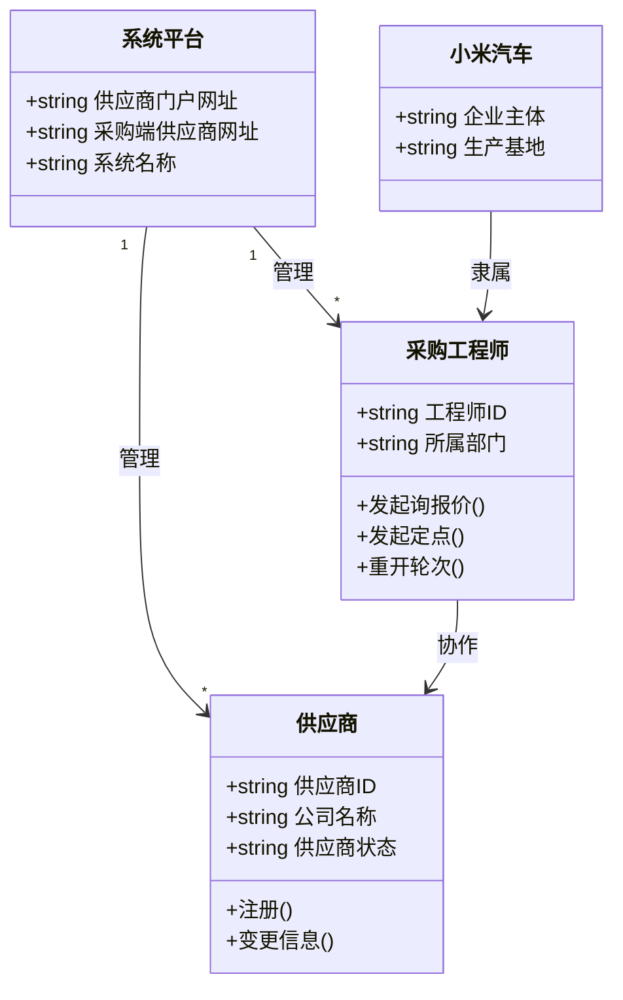

### 1.2 供应商信息域

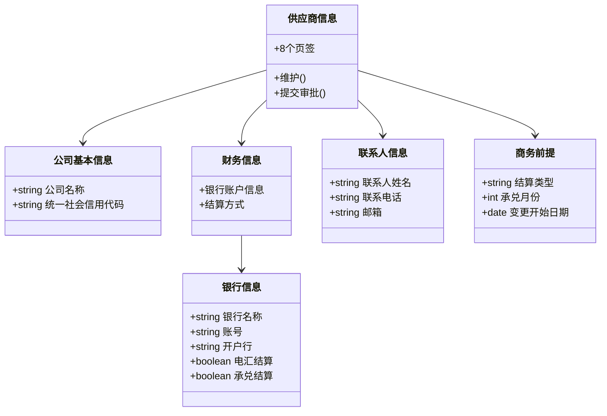

### 1.3 询报价域

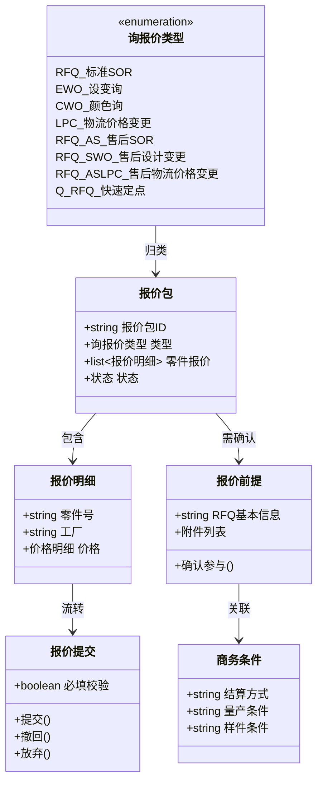

### 1.4 价格构成域

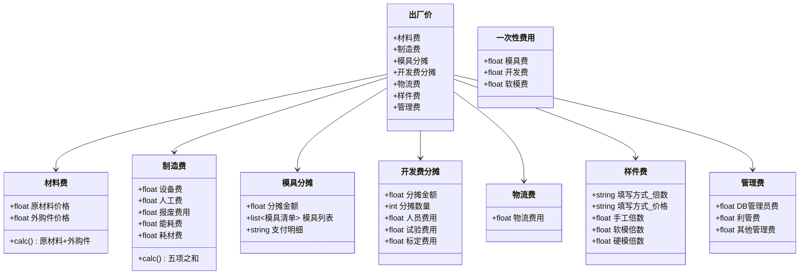

### 1.5 采购定点域

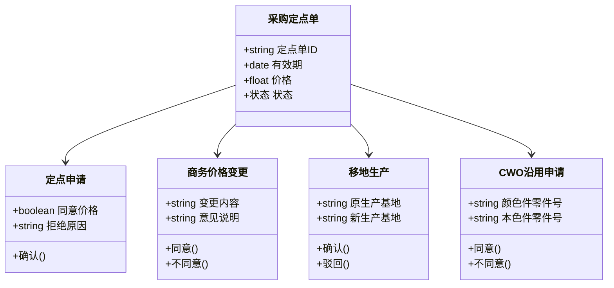

### 1.6 订单与框架管理域

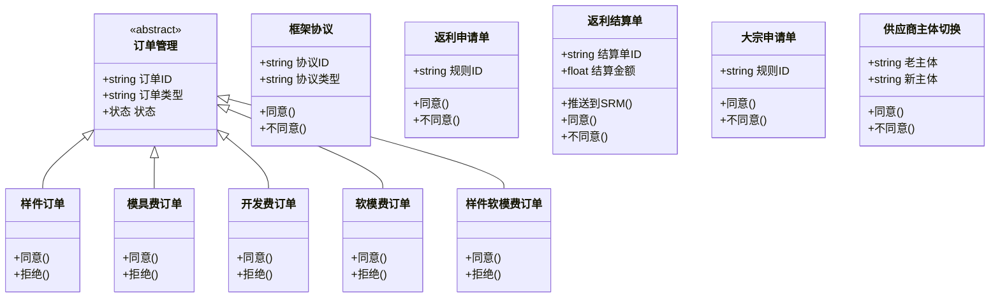

### 1.7 合同签署域

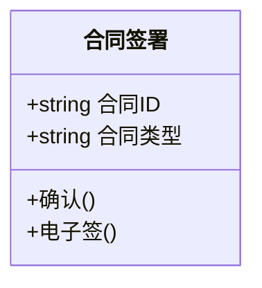

---

## 二、关系图谱（Relationships）

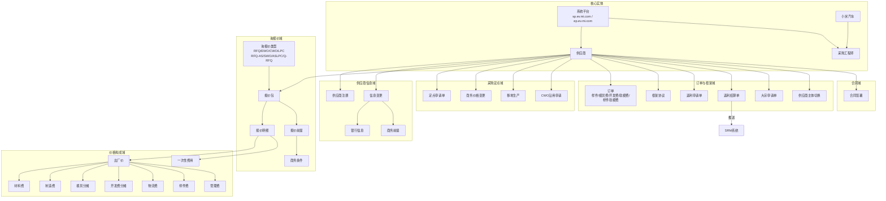

---

## 三、流程本体（Process Ontology）

### 3.1 SOR报价完整流程

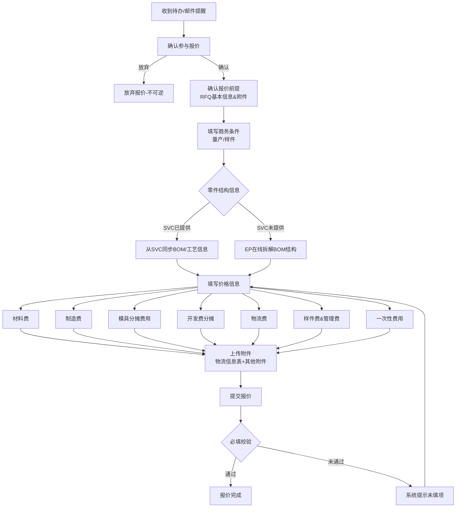

### 3.2 信息变更流程

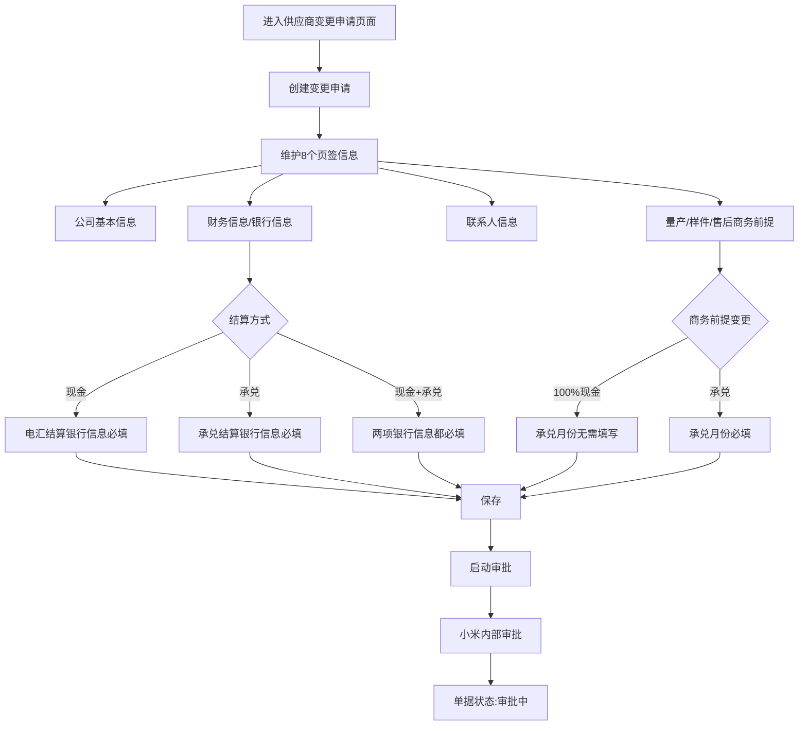

### 3.3 通用审批模式

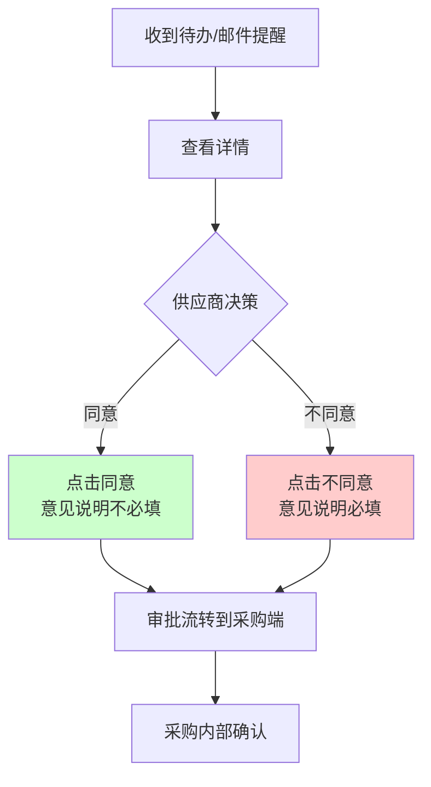

---

## 四、本体层次总结

| 层次 | 内容 | 实体数 |
|------|------|--------|
| **顶层域** | 供应商管理 / 询报价 / 采购定点 / 订单框架 / 合同 | 5 |
| **核心实体** | 供应商、采购工程师、系统平台、小米汽车 | 4 |
| **业务对象** | 报价包、定点申请单、框架协议、订单、合同等 | 12+ |
| **价格构成** | 出厂价、材料费、制造费、模具/开发分摊、物流、样件、管理费 | 8 |
| **流程动作** | 确认/提交/审批/同意/拒绝/撤回/终止 | 10+ |
| **外部系统** | SVC系统（BOM/工艺）、SRM系统（对账） | 2 |

---

## 五、关键业务规则（Constraints）

1. **商务条件唯一性**：一家供应商零件量产/样件结算只能有一种商务条件
2. **银行信息必填规则**：首次定点时银行信息必填，按结算方式（现金/承兑/混合）决定哪些银行信息必填
3. **承兑月份联动**：商务前提为现金时承兑月份无需填写；为承兑时承兑月份必填
4. **放弃报价不可逆**：放弃报价后不可逆转，需联系采购工程师重开轮次
5. **样件费计算**：样件价格 =（出厂价 + 物流费）× 倍数
6. **价格汇总逻辑**：零件层级>1时汇总下级第一层零件的细项费用
7. **同意按钮限制**：返利申请单、返利结算单、大宗申请单的同意按钮只能从首页待办进入
8. **主体切换双重确认**：新主体同意后，老主体也需进入系统点击同意
