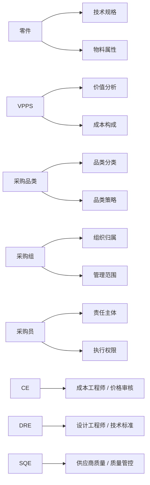
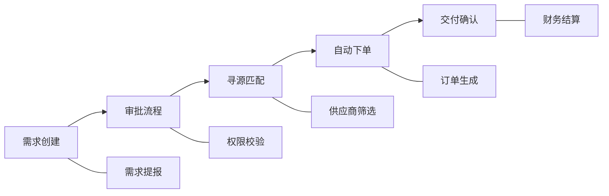
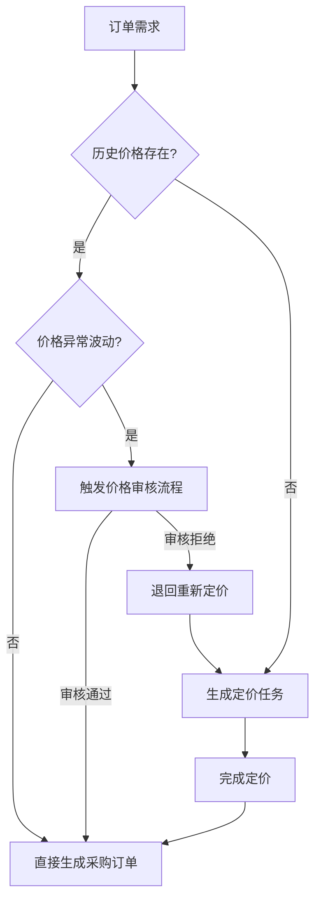
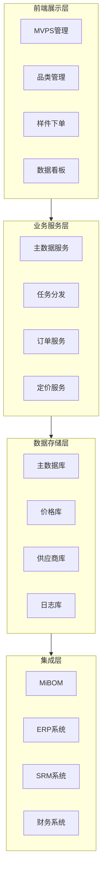

---created: 2026-07-16
updated: 2026-07-16
tags: [Xiaomi, 采购, 系统]
status: draft
---

> [!summary] 采购数字化方案
> - **核心**：构建汽车零部件采购数字化平台，核心模块为 MVPS 品类与主数据管理 + 样件自动下单，实现端到端自动化闭环
> - **要点**：品类-MVPS-人员自动映射 / 样件订单智能定价与批量下单 / 四期里程碑规划（M1-M12）/ 下单效率提升 83%
> - **关联**：[[采购数字化B点目标_业务分析与建设路径]] · [[立项报告_体系运营部_生产采购系统_26YQ3]]

# 采购数字化方案

## 一、项目简介

构建汽车零部件采购数字化平台，实现从需求创建到订单履约的端到端自动化闭环。核心模块：

1. **MVPS品类与主数据管理** — 打通研发物料与采购分类的协同链路
2. **样件自动下单** — 支撑权责清晰的采购执行，形成全链路责任追溯

---

## 二、业务期望

### 2.1 核心目标

- **MVPS与采购品类打通**：建立 MVPS → 品类 → 供应商资源的自动化映射
- **构建采购主数据体系**：零件-VPPS-品类-采购组-采购员-CE/DRE/SQE 职责矩阵，打破数据孤岛
- **品类资源池和采购策略基础**：按品类建立供应商资源池，设定准入、评估与退出机制

### 2.2 预期收益

| 维度 | 描述 |
|------|------|
| **效率提升** | 自动化流程减少手工操作，采购执行效率提升 80%+ |
| **成本优化** | 品类聚合提升议价权重，降低采购成本 |
| **风险管控** | 供应商全生命周期管理，强化供应链风控 |
| **数据驱动** | 全链路数据追溯与分析能力 |

---

## 三、数字化方案

### 3.1 MVPS品类与主数据管理

#### 3.1.1 基础能力建设

| 建设内容 | 功能描述 | 业务价值 |
|---------|---------|---------|
| 人员树搭建 | 组织架构与人员关系配置，支持任务自动下发与一键转移 | 任务精准分配，减少人工干预 |
| 车型项目MVPS数据库 | 按车型维护MVPS数据，多维度查询与分析 | 车型-物料关联，支撑项目采购决策 |
| 品类数据库基础建设 | 品类分类体系构建，维护品类属性与规则 | 奠定品类管理基础 |

#### 3.1.2 核心功能模块

**模块一：品类-MVPS主数据维护**

> 触发机制：MiBOM系统触发 → 品类管理员维护品类

| 功能点 | 说明 |
|-------|------|
| 人员树配置 | 支持 GCM/SQE/采购工程师等角色配置 |
| 生效/失效操作 | 数据状态管理，确保准确性 |
| 数据校验 | 内置完整性与一致性校验规则 |

**模块二：Part Planning应用**

| 功能点 | 说明 |
|-------|------|
| 车型+SOR包维护 | 按车型与SOR包维护对应品类及人员 |
| 关联关系管理 | 建立 车型-物料-品类-人员 关联 |
| 数据可视化 | 多维度数据看板 |

**模块三：任务分发模块**

| 子模块 | 功能描述 |
|-------|---------|
| SOR发布模块 | 标准采购需求发布与管理 |
| 售后SOR发布模块 | 售后专用采购需求发布与管理 |
| BDL预选模块 | 供应商预选与评估管理 |
| EWO/CWO/SWO任务下发模块 | 工程/合同/特殊工单任务下发与跟踪 |
| 框架协议任务模块 | 长期框架协议管理与执行跟踪 |

#### 3.1.3 主数据矩阵

---

### 3.2 样件自动下单

#### 3.2.1 核心能力

| 能力项 | 功能描述 | 业务价值 |
|-------|---------|---------|
| 批量自动下单 | 多需求批量处理，自动生成采购订单 | 提升下单效率，减少人工操作 |
| 订单自动更新 | 订单状态实时同步，变更自动通知 | 保证数据一致性 |
| 订单进度可视化 | 全链路进度追踪，关键节点预警 | 及时发现问题 |

#### 3.2.2 端到端自动化流程

#### 3.2.3 需求聚合与订单聚类

**自动识别维度：**

| 维度 | 聚合规则 | 预期效果 |
|-----|---------|---------|
| 项目维度 | 同项目相似需求合并 | 减少项目内重复订单 |
| 物料维度 | 同物料不同需求合并 | 提升物料采购批量 |
| 时间维度 | 相近交付时间需求合并 | 优化物流配送效率 |
| 供应商维度 | 同供应商需求合并 | 提升议价权重 |

**聚类流程：**

1. 遍历所有需求，按四维度匹配现有聚类
2. 匹配成功则加入对应聚类，否则创建新聚类
3. 对聚类结果进行优化调整，平衡批量与交付时效

#### 3.2.4 智能定价机制

---

## 四、技术架构

### 4.1 系统架构

### 4.2 数据流转

| 数据流 | 源系统 | 目标系统 | 数据内容 |
|-------|-------|---------|---------|
| MVPS数据同步 | MiBOM | MVPS管理系统 | 零件信息、技术规格 |
| 品类数据下发 | MVPS管理系统 | 品类管理系统 | 品类分类、映射关系 |
| 订单数据推送 | 样件下单系统 | ERP/SRM | 采购订单、交付信息 |
| 价格数据回传 | 定价系统 | 样件下单系统 | 价格信息、有效期 |

---

## 五、实施计划

### 5.1 里程碑规划

| 阶段 | 周期 | 交付物 | 关键成果 |
|-----|------|-------|---------|
| 一期 | M1-M3 | 基础数据建设 | 人员树、品类数据库上线 |
| 二期 | M4-M6 | 核心功能 | MVPS管理、任务分发上线 |
| 三期 | M7-M9 | 自动化能力 | 样件自动下单、定价模块上线 |
| 四期 | M10-M12 | 优化完善 | 全链路贯通、数据看板上线 |

### 5.2 资源需求

| 资源类型 | 数量 | 主要职责 |
|---------|------|---------|
| 产品经理 | 2人 | 需求分析、产品设计 |
| 开发工程师 | 6人 | 系统开发、接口对接 |
| 测试工程师 | 2人 | 功能测试、性能测试 |
| 业务专家 | 2人 | 业务梳理、数据治理 |

---

## 六、风险与应对

| 风险类型 | 描述 | 应对措施 |
|---------|------|---------|
| 数据质量 | 历史数据不完整、不准确 | 制定数据治理规范，分批清洗迁移 |
| 业务变更 | 流程调整导致需求变更 | 敏捷开发，快速响应变更 |
| 系统集成 | 与外部系统对接复杂 | 提前规划接口，预留扩展能力 |
| 用户接受度 | 习惯改变阻力 | 加强培训，提供过渡期支持 |

---

## 七、预期成效

### 7.1 定量指标

| 指标项 | 当前值 | 目标值 | 提升幅度 |
|-------|-------|-------|---------|
| 下单效率 | 30分钟/单 | 5分钟/单 | 83%↑ |
| 订单处理周期 | 5天 | 1天 | 80%↑ |
| 数据准确率 | 85% | 99% | 16%↑ |
| 供应商响应时间 | 3天 | 1天 | 67%↑ |

### 7.2 定性指标

- 建立标准化的采购执行流程
- 实现全链路数据可追溯、可审计
- 打破职能间数据孤岛，形成协同效应
- 为后续采购数字化深化奠定基础

---

## 八、附录

### 8.1 术语表

| 术语 | 全称 | 说明 |
|-----|------|------|
| MVPS | Material Verification & Planning System | 物料验证与计划系统 |
| VPPS | Value Planning & Procurement System | 价值规划与采购系统 |
| SOR | Statement of Requirements | 需求说明书 |
| BDL | Bid List | 投标清单 |
| EWO | Engineering Work Order | 工程工单 |
| CWO | Contract Work Order | 合同工单 |
| SWO | Special Work Order | 特殊工单 |
| GCM | Global Category Management | 全球品类管理 |
| SQE | Supplier Quality Engineer | 供应商质量工程师 |
| CE | Cost Engineer | 成本工程师 |
| DRE | Design Requirement Engineer | 设计需求工程师 |

### 8.2 参考文档

- 采购管理制度
- 供应商管理规范
- 数据治理标准
- 系统集成规范

---

**文档版本**：V1.1  
**更新日期**：2026年6月11日  
**编制部门**：采购数字化项目组
